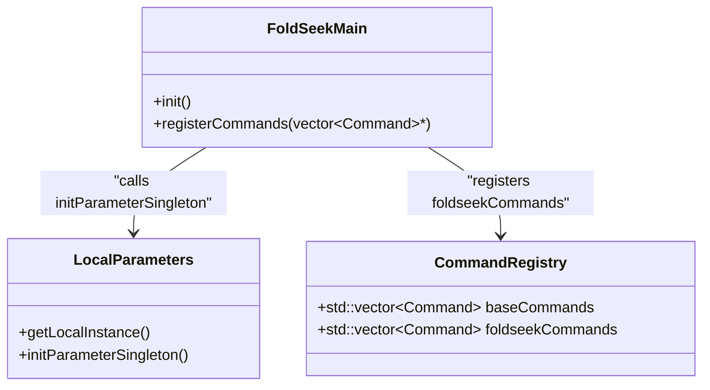
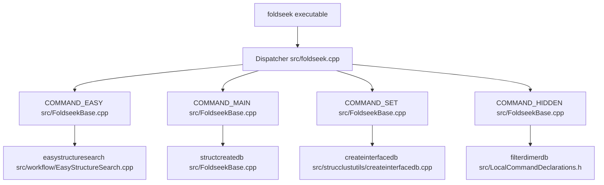
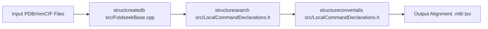
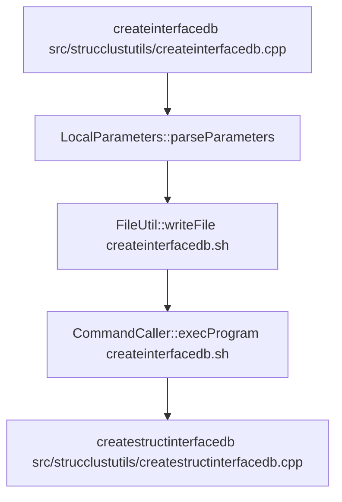

# Command Structure

Relevant source files

The following files were used as context for generating this wiki page:

- [data/createinterfacedb.sh](data/createinterfacedb.sh)
- [data/structdatabases.sh](data/structdatabases.sh)
- [src/FoldseekBase.cpp](src/FoldseekBase.cpp)
- [src/LocalCommandDeclarations.h](src/LocalCommandDeclarations.h)
- [src/commons/LocalParameters.cpp](src/commons/LocalParameters.cpp)
- [src/commons/LocalParameters.h](src/commons/LocalParameters.h)
- [src/foldseek.cpp](src/foldseek.cpp)
- [src/strucclustutils/createinterfacedb.cpp](src/strucclustutils/createinterfacedb.cpp)
- [src/strucclustutils/createstructinterfacedb.cpp](src/strucclustutils/createstructinterfacedb.cpp)

## Purpose and Scope
This page details the organization of commands, workflows, and execution pathways in FoldSeek. FoldSeek employs a modular, command-driven architecture that bridges the MMseqs2 core framework with structure-specific bioinformatics routines. The system classifies operations into user-facing easy commands (`COMMAND_EASY`), core modular blocks (`COMMAND_MAIN`, `COMMAND_SET`), and hidden or utility sub-commands (`COMMAND_HIDDEN`), governed by a centralized parameter singleton and dispatched via unified registration vectors.

Sources: [src/foldseek.cpp:1-22](), [src/FoldseekBase.cpp:1-21](), [src/LocalParameters.h:18-26]()

---

## Overview of Command Organization & Registry

FoldSeek utilizes a layered command registry. The main entry point in `src/foldseek.cpp` initializes command handling by registering two command vectors: `baseCommands` (inherited from MMseqs2) and `foldseekCommands` (FoldSeek-specific).

Title: Command Registration Architecture
Sources: [src/foldseek.cpp:15-22](), [src/FoldseekBase.cpp:17-21]()

---

## Command Categories and Mappings

FoldSeek commands are categorized by flags in the `Command` struct that govern their visibility, grouping, and execution behavior. These are declared in `src/FoldseekBase.cpp` and mapped to implementations listed in `src/LocalCommandDeclarations.h`.

| Category Flag    | Description                                      | Example Commands               |
|------------------|--------------------------------------------------|--------------------------------|
| `COMMAND_EASY`   | High-level workflow wrappers for routine tasks   | `easy-search`, `easy-cluster`  |
| `COMMAND_MAIN`   | Primary core building blocks                     | `createdb`, `structuresearch`  |
| `COMMAND_SET`    | Set and index manipulation operations            | `createsubdb`, `createinterfacedb` |
| `COMMAND_HIDDEN` | Internal or specialized utility operations       | `structureto3didescriptor`, `filterdimerdb` |

Title: Command Dispatch and Code Mapping
Sources: [src/FoldseekBase.cpp:17-96](), [src/LocalCommandDeclarations.h:6-44]()

---

## Easy-* Commands: Simplified Workflows

FoldSeek's `easy-*` commands (`COMMAND_EASY`) wrap multi-step pipelines into single user-facing commands. They automatically handle database conversion, searching, prefiltering, alignment, and formatting.

### Data Flow within `easy-search`
The `easy-search` interface invokes `easystructuresearch`, which orchestrates structure database creation (`structcreatedb`), structure searching (`structuresearch`), and alignment conversion (`structureconvertalis`).

Title: easy-search Execution Pipeline
Sources: [src/FoldseekBase.cpp:92-95](), [src/LocalCommandDeclarations.h:6-20]()

---

## Core Commands and Utility Sub-commands

Core commands (`COMMAND_MAIN`, `COMMAND_SET`) expose modular building blocks for advanced workflow construction:
- **`createdb` (`structcreatedb`)**: Converts raw structure inputs (PDB, mmCIF, tar archives, TSV lists) into binary FoldSeek databases containing sequence (`_ss`), coordinate (`_ca`), and header (`_h`) files [src/FoldseekBase.cpp:18-41]().
- **`createsubdb` (`createstructsubdb`)**: Extracts subsets of databases using ID lists [src/FoldseekBase.cpp:49-60]().
- **`createinterfacedb` (`createinterfacedb`)**: Orchestrates complex dimer interface database construction by executing embedded shell scripts (`createinterfacedb.sh`) alongside `createstructinterfacedb` [src/strucclustutils/createinterfacedb.cpp:9-25](), [src/strucclustutils/createstructinterfacedb.cpp:35-42]().

Title: Interface Database Creation Control Flow
Sources: [src/strucclustutils/createinterfacedb.cpp:9-25](), [src/strucclustutils/createstructinterfacedb.cpp:35-45]()

---

## Parameter System Integration

All commands share a global configuration state managed through the singleton `LocalParameters` class, initialized at startup by `initParameterSingleton()` [src/foldseek.cpp:22](). Commands retrieve parameter definitions and option values via `LocalParameters::getLocalInstance()` [src/commons/LocalParameters.h:21-26]().

- Parameter definitions cover alignment types (`alignmentType`), TM-score thresholds (`tmScoreThr`), and coordinate storage modes (`coordStoreMode`) [src/commons/LocalParameters.cpp:11-26]().
- Database validators (`DbValidator`) ensure valid type matching across extended database flags such as `DBTYPE_CA_ALPHA` and `DBTYPE_TMSCORE` [src/commons/LocalParameters.h:10-16](), [src/FoldseekBase.cpp:9-14]().

Sources: [src/foldseek.cpp:22](), [src/commons/LocalParameters.h:18-35](), [src/commons/LocalParameters.cpp:6-26](), [src/FoldseekBase.cpp:8-15]()

---