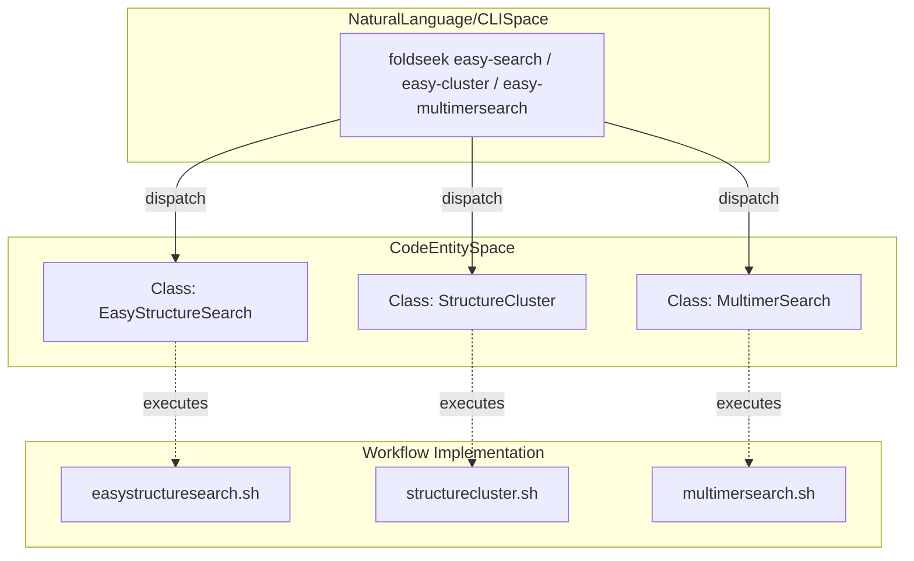
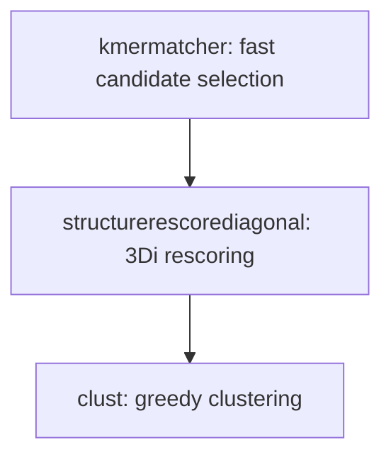
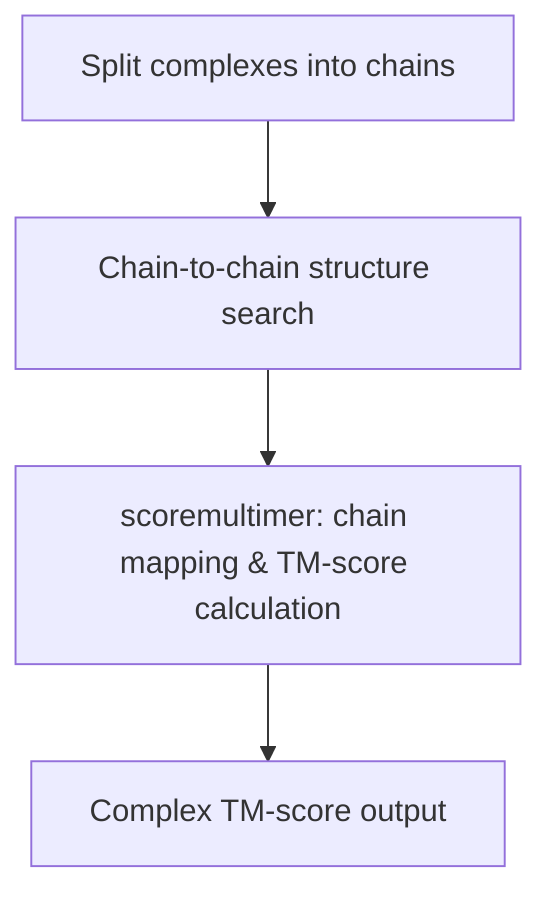

# Basic Usage Examples

<details>
<summary>Relevant source files</summary>

The following files were used as context for generating this wiki page:

- [.github/results.png](.github/results.png)
- [README.md](README.md)
- [data/structdatabases.sh](data/structdatabases.sh)
- [example/1tim.pdb.gz](example/1tim.pdb.gz)
- [example/8tim.pdb.gz](example/8tim.pdb.gz)
- [src/foldseek.cpp](src/foldseek.cpp)
- [src/strucclustutils/LoLAlign.cpp](src/strucclustutils/LoLAlign.cpp)
- [src/strucclustutils/LoLAlign.h](src/strucclustutils/LoLAlign.h)
- [src/strucclustutils/LoLAlignProbability.h](src/strucclustutils/LoLAlignProbability.h)
- [src/strucclustutils/LoLAlignProbabilityWeights.h](src/strucclustutils/LoLAlignProbabilityWeights.h)

</details>


This page provides practical usage examples of commonly employed Foldseek commands to search, cluster, and handle protein structure data. It illustrates typical patterns using easy commands (`easy-search`, `easy-cluster`, `easy-multimersearch`), database download utilities, and example input files in the `example/` directory.

---

## Command Workflow Structure

Foldseek offers two main categories of commands:

- **Easy commands:** High-level wrappers (`easy-search`, `easy-cluster`, `easy-multimersearch`) that bundle multiple steps into single user-facing commands.
- **Core commands:** Modular building blocks (`createdb`, `search`, `cluster`), allowing customizable and flexible workflows.

The natural language CLI commands map directly to workflow controller classes, which further invoke shell-script pipelines to implement the workflows.

### Diagram: CLI Commands to Workflow Controllers to Shell Pipelines



Sources: [README.md:59-64](), [src/workflow/EasyStructureSearch.cpp:28-30](), [src/workflow/StructureCluster.cpp:28-30](), [src/workflow/MultimerSearch.cpp:28-30]()

---

## Structure Search Examples

### Basic Structure Search Using easy-search

This example performs a structural comparison of a query against a database directory of structures, using files in the `example/` directory:

```bash
foldseek easy-search example/d1asha_ example/ aln tmpFolder
```

- `example/d1asha_`: query structure(s)
- `example/`: target structure database directory
- `aln`: output basename prefix
- `tmpFolder`: temporary directory for intermediate files

### Data Flow in easy-search


Sources: [README.md:30-40](), [src/foldseek.cpp:1-22]()

### GPU Acceleration for Faster Searches

Foldseek supports GPU acceleration (NVIDIA Ampere or newer) for large-scale or faster queries:

```bash
foldseek easy-search example/d1asha_ example/ aln tmp --gpu 1 --prefilter-mode 1
```

Note the use of `--gpu 1` to enable GPU search, and `--prefilter-mode 1` for ungapped alignment prefiltering optimized for single queries.

> **Important:** For GPU-accelerated search, the structural database needs to be padded appropriately for best performance (see database commands below).

Sources: [README.md:64-68](), [README.md:91-93]()

### Output Format Modes

Foldseek supports different output formats controlled by the `--format-mode` option:

| Format Mode | Description                      | Example Command                                 |
|:------------|:--------------------------------|:------------------------------------------------|
| 0 (default) | Tab-separated alignment results | `foldseek easy-search … aln.m8 tmp`             |
| 3           | Interactive HTML report           | `foldseek easy-search … result.html tmp --format-mode 3` |
| 5           | Superpositioned Cα PDB files     | `foldseek easy-search … result_dir tmp --format-mode 5` |

Sources: [README.md:34-40]()

---

## Structure Clustering Examples

### Basic Clustering Using easy-cluster

Cluster all protein structures within a directory based on similarity with a selected coverage threshold:

```bash
foldseek easy-cluster example/ res tmp -c 0.9
```

- `example/`: input directory containing structure files to cluster
- `res`: output prefix for cluster results
- `tmp`: temporary folder
- `-c 0.9`: clustering coverage threshold (90% coverage required)

### Clustering Pipeline Components



Sources: [README.md:45-50](), [src/workflow/StructureCluster.cpp:1-50]()

### Clustering Output Files

- `res_clu.tsv`: Cluster assignments listing cluster representative and member sequences.
- `res_repseq.fasta`: Fasta file containing representative sequences of detected clusters.
- `res_allseq.fasta`: Fasta of all cluster members grouped by cluster.

Sources: [README.md:46-50]()

---

## Multimer Processing Examples

Foldseek supports alignment and clustering of protein complexes (multimers) with the multimer search and cluster commands.

### Multimer Search Using easy-multimersearch

Search a multimeric complex against another complex or database:

```bash
foldseek easy-multimersearch example/1tim.pdb.gz example/8tim.pdb.gz result tmp
```

- `example/1tim.pdb.gz`: query complex structure file
- `example/8tim.pdb.gz`: target complex or database file
- `result`: output basename prefix
- `tmp`: temporary working directory

### Multimer Search Workflow

The multimer pipeline splits complexes into chains, conducts chain-vs-chain comparisons, and computes complex TM-scores by optimal chain mapping.



Sources: [README.md:51-56](), [README.md:11-12]()

---

## Database Download and Preparation

Foldseek provides a builtin command to download and prepare commonly used standard structural databases such as PDB, AlphaFoldDB, and CATH.

### Downloading e.g. PDB or AlphaFoldDB

```bash
foldseek databases PDB pdb tmp
foldseek databases Alphafold/Proteome afdb tmp
```

- `PDB`, `Alphafold/Proteome`: predefined selection keys for datasets
- `pdb`, `afdb`: output destination directory prefix
- `tmp`: temporary folder for downloads and extraction

This script internally downloads tarballs, extracts structure databases, and prepares them for Foldseek use.

Sources: [data/structdatabases.sh:81-179]()

### Creating Your Own Database from Local Files

Convert a directory of structure files into a Foldseek database:

```bash
foldseek createdb example/ myTargetDB
foldseek createindex myTargetDB tmp
```

- `createdb` processes input structure files into indexed database format.
- `createindex` creates necessary auxiliary indexing files for quick searching.

Sources: [README.md:42-44]()

### Using ProstT5 for FASTA to 3Di Conversion

Foldseek can convert protein sequences (FASTA) directly to 3Di structural descriptors using ProstT5 language model integration:

```bash
foldseek createdb input.fasta myDB --prostt5-model path/to/weights --gpu 1
```

This bypasses the need for experimentally or computationally determined structures to perform structure-like searches.

Sources: [README.md:3-3], [data/structdatabases.sh:171-178]()

---

## Example Files in `example/`

The `example/` directory contains sample PDB files (`example/1tim.pdb.gz`, `example/8tim.pdb.gz`) and pre-indexed example databases (`d1asha_`, `d1ashb_`, and others) useful for testing and tutorial purposes.

Example usage references these files to demonstrate core Foldseek functionality with minimal setup.

Sources: [example/1tim.pdb.gz:1-1](), [example/8tim.pdb.gz:1-1]()

---

# Summary Table of Common Commands

| Command                   | Purpose                                      | Input                           | Output                 |
|---------------------------|----------------------------------------------|---------------------------------|-----------------------|
| `foldseek easy-search`    | Search structures against database           | Structure files & DB dir        | Alignment results      |
| `foldseek easy-cluster`   | Cluster structures within a directory        | Directory with structures       | Cluster assignments    |
| `foldseek easy-multimersearch` | Multimer complex search                     | Complex structure files         | Complex alignment      |
| `foldseek databases`       | Download and prepare standard databases      | Datasetkey & output directory   | Foldseek-format DB     |
| `foldseek createdb`        | Create database from PDB/mmCIF/FASTA files   | Structure or sequence file(s)   | Indexed database       |
| `foldseek createindex`     | Build auxiliary index files for database     | Foldseek-format DB              | Index files            |

Sources:  
- [README.md:3-40]()  
- [data/structdatabases.sh:1-179]()  
- [src/foldseek.cpp:1-22]()  
- [src/workflow/EasyStructureSearch.cpp:20-100]()  
- [src/workflow/StructureCluster.cpp:20-120]()  
- [src/workflow/MultimerSearch.cpp:20-60]()

---