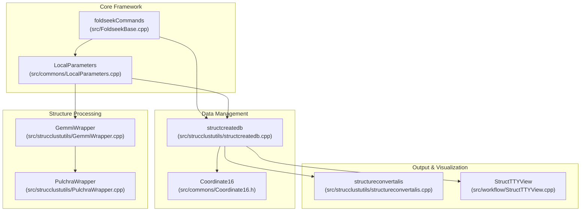
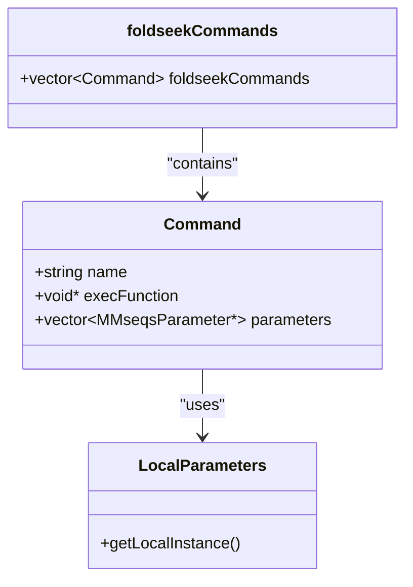
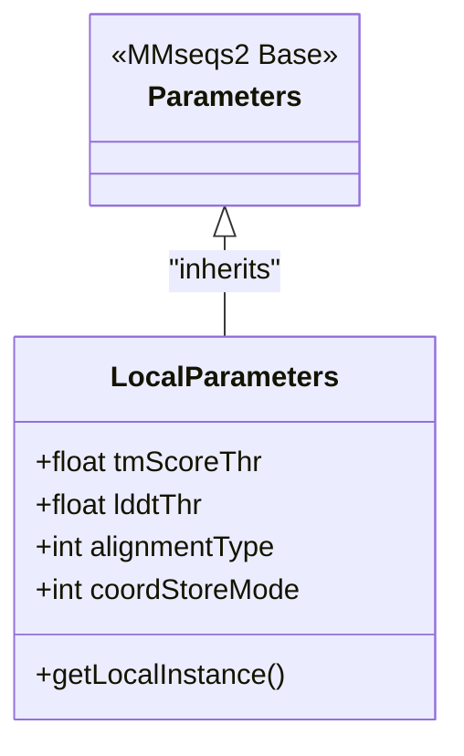
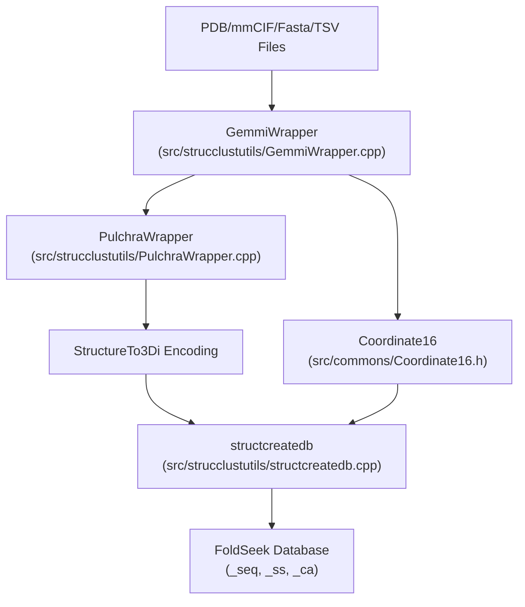
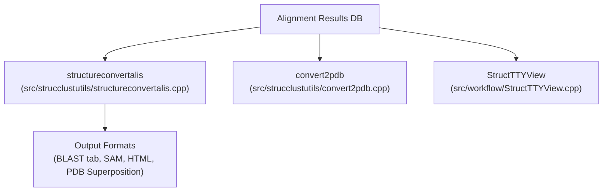

# Core Components

Relevant source files

The following files were used as context for generating this wiki page:

- [data/CMakeLists.txt](data/CMakeLists.txt)
- [src/FoldseekBase.cpp](src/FoldseekBase.cpp)
- [src/commons/LocalParameters.cpp](src/commons/LocalParameters.cpp)
- [src/commons/LocalParameters.h](src/commons/LocalParameters.h)
- [src/strucclustutils/CMakeLists.txt](src/strucclustutils/CMakeLists.txt)
- [src/workflow/CMakeLists.txt](src/workflow/CMakeLists.txt)

This page documents the foundational architectural elements of FoldSeek that enable its core functionality for protein structure search and analysis. These components provide the infrastructure upon which FoldSeek's workflows and algorithms operate.

## Architecture Overview

The core components of FoldSeek form an integrated system that enables efficient protein structure manipulation, search, and analysis by combining command dispatching, parameter management, specialized database handling, and output conversion.

### Diagram: Architecture Overview

Sources: [src/FoldseekBase.cpp:1-17](), [src/commons/LocalParameters.cpp:1-45](), [src/commons/LocalParameters.h:1-110](), [src/strucclustutils/structcreatedb.cpp:4-40]()

---

## Command System

The **Command System** provides the command-line interface infrastructure enabling interaction with FoldSeek’s functionality. It manages command registration, parameter validation, dispatch, and execution.

Commands are centrally registered in the `foldseekCommands` vector defined in `src/FoldseekBase.cpp`. Each command specifies its name, associated execution function (e.g., `structcreatedb`), parameter set (`LocalParameters`), help text, and input/output type declarations [src/FoldseekBase.cpp:17-41]().

Commands are organized into categories such as `COMMAND_MAIN`, `COMMAND_EASY`, `COMMAND_SET`, and `COMMAND_HIDDEN` [src/FoldseekBase.cpp:18-95]().

### Diagram: Command Registration and Dispatch

For details, see [Command System](#2.1).

Sources: [src/FoldseekBase.cpp:17-100](), [src/commons/LocalParameters.h:18-30]()

---

## Parameter System

The **Parameter System** centralizes configuration management in FoldSeek via the `LocalParameters` class defined in `src/commons/LocalParameters.cpp` and `src/commons/LocalParameters.h`. This class extends the MMseqs2 `Parameters` base class to include FoldSeek-specific settings like `tmScoreThr`, `lddtThr`, `alignmentType`, and `coordStoreMode` [src/commons/LocalParameters.cpp:9-40]().

The parameter system uses a singleton pattern accessed via `LocalParameters::getLocalInstance()` and associates parameter groups with specific workflows and utilities [src/commons/LocalParameters.h:18-26]().

### Diagram: Parameter Inheritance

For details, see [Parameter System](#2.2).

Sources: [src/commons/LocalParameters.cpp:1-45](), [src/commons/LocalParameters.h:18-166]()

---

## Database System and Structure Processing

The **Database System** manages the creation, storage, indexing, and querying of protein structural data using an extension of the MMseqs2 database format. Input structures (PDB, mmCIF, tar archives, FASTA, TSV) are parsed via `GemmiWrapper` [src/strucclustutils/GemmiWrapper.cpp](), processed using `PulchraWrapper` for missing atom reconstruction [src/strucclustutils/PulchraWrapper.cpp](), and stored across multi-file databases (`_seq` for amino acid sequences, `_ss` for 3Di structural sequences, and `_ca` for C-alpha coordinates) [src/strucclustutils/structcreatedb.cpp]() [src/commons/LocalParameters.h:28-35]().

Coordinates are stored compactly using `Coordinate16` [src/commons/Coordinate16.h]() supporting float or differential integer storage modes (`coordStoreMode`) [src/commons/LocalParameters.cpp:25]() [src/commons/LocalParameters.h:105-107]().

### Diagram: Database Creation Pipeline

For details, see [Database System](#2.3).

Sources: [src/strucclustutils/structcreatedb.cpp:4-50](), [src/commons/Coordinate16.h:7-79](), [src/FoldseekBase.cpp:18-40]()

---

## Output Conversion and Visualization

FoldSeek provides utilities to convert internal alignment results into user-facing formats and interactive visualizations. This includes `structureconvertalis` for BLAST tab, SAM, HTML, and superposed PDB outputs, `convert2pdb` for structure extraction, complex multimer reporting, an embedded JS report viewer, and `StructTTYView` (`structty`) for terminal-based structure visualization [src/workflow/StructTTYView.cpp]() [src/strucclustutils/CMakeLists.txt:7-14]().

### Diagram: Output Conversion Pipeline

For details, see [Output Conversion and Visualization](#2.4).

Sources: [src/workflow/StructTTYView.cpp:1-21](), [src/strucclustutils/CMakeLists.txt:1-29]()

---

For further details on these core components, please see the respective child pages:

- [Command System](#2.1)
- [Parameter System](#2.2)
- [Database System](#2.3)
- [Output Conversion and Visualization](#2.4)

---