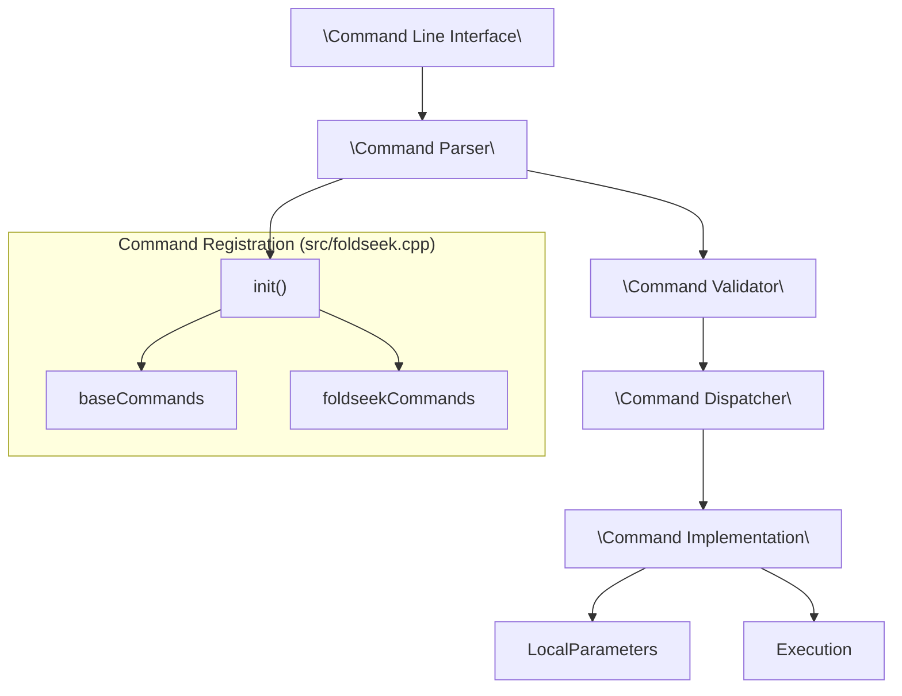
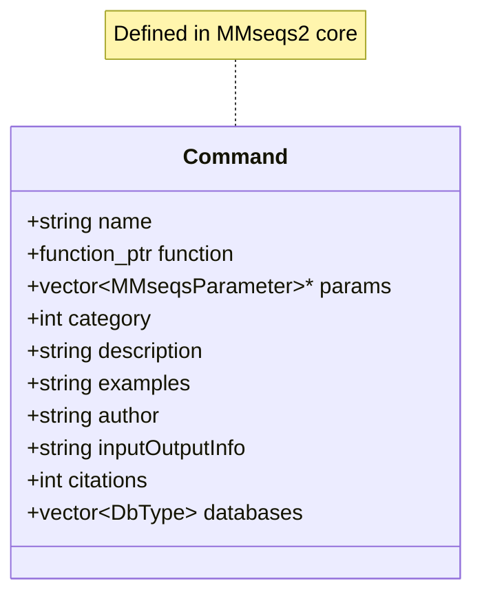
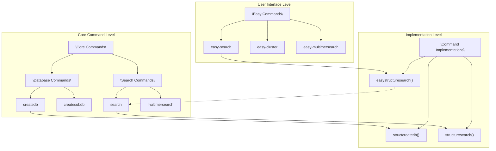
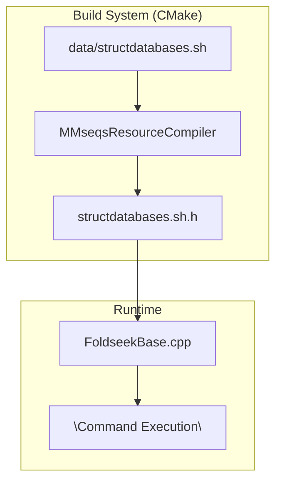

# Command System

<details>
<summary>Relevant source files</summary>

The following files were used as context for generating this wiki page:

- [data/createinterfacedb.sh](data/createinterfacedb.sh)
- [data/structdatabases.sh](data/structdatabases.sh)
- [src/FoldseekBase.cpp](src/FoldseekBase.cpp)
- [src/LocalCommandDeclarations.h](src/LocalCommandDeclarations.h)
- [src/commons/LocalParameters.cpp](src/commons/LocalParameters.cpp)
- [src/commons/LocalParameters.h](src/commons/LocalParameters.h)
- [src/foldseek.cpp](src/foldseek.cpp)
- [src/strucclustutils/createinterfacedb.cpp](src/strucclustutils/createinterfacedb.cpp)
- [src/strucclustutils/createstructinterfacedb.cpp](src/strucclustutils/createstructinterfacedb.cpp)

</details>


This page documents the command system in FoldSeek, which handles the registration, dispatching, and execution of all commands within the application. The command system is the primary interface through which users interact with FoldSeek's functionality. For detailed information on parameters used by commands, see [Parameter System](#2.2).

## Overview

FoldSeek employs a command-based architecture where distinct commands represent core functionalities—such as database creation, structure searching, and clustering—invoked via its command-line interface (CLI). This modular organization enables flexible extension and integration of structural bioinformatics operations alongside MMseqs2 base commands.

At startup, FoldSeek initializes two main command registries defined in `src/foldseek.cpp` and `src/FoldseekBase.cpp`:

- **baseCommands**: The core MMseqs2 commands for generic sequence operations [src/foldseek.cpp:15-18]().
- **foldseekCommands**: FoldSeek-specific commands focused on structural tasks [src/foldseek.cpp:16-19]().

These registries are populated during program initialization and allow centralized dispatching of user instructions.



Sources: [src/foldseek.cpp:15-21](), [src/FoldseekBase.cpp:1-16]()

## Command Structure

FoldSeek commands are encapsulated as `Command` objects defined in the MMseqs2 core. Each command includes:

- A **name** string (e.g., `"createdb"`, `"easy-search"`).
- A pointer to the **command execution function** declared in [src/LocalCommandDeclarations.h:1-44]().
- A pointer to **local parameters** specific to the command (e.g., `&localPar.structurecreatedb`) defined in [src/commons/LocalParameters.h:1-166]().
- A **category** (e.g., `COMMAND_MAIN`, `COMMAND_EASY`).
- Description strings for help output.
- Citation keys for academic attribution (e.g., `CITATION_FOLDSEEK`, `CITATION_PROSTT5`).
- Database type validation info for input/output files using `DbValidator`.



Sources: [src/FoldseekBase.cpp:17-41]()

### Command Declaration Example

A representative example of a `Command` registration is the `createdb` command in [src/FoldseekBase.cpp:18-41](). It maps the command string `"createdb"` to the implementing function `structcreatedb` with associated parameters and usage documentation:

```cpp
{"createdb", structcreatedb, &localPar.structurecreatedb, COMMAND_MAIN,
  "Convert PDB/mmCIF/tar[.gz]/DB files or directory/TSV to a structure DB",
  "# Process multiple files\nfoldseek createdb examples/1tim.pdb.gz examples/8tim.pdb.gz DB\n...",
  "Martin Steinegger <martin.steinegger@snu.ac.kr>",
  "<i:directory|.tsv>|<i:PDB|mmCIF[.gz]|tar[.gz]|DB> ... <i:PDB|mmCIF[.gz]|tar|DB> <o:sequenceDB>",
  CITATION_FOLDSEEK | CITATION_PROSTT5, 
  {{"PDB|mmCIF[.gz]|stdin|tar[.gz]|DB", DbType::ACCESS_MODE_INPUT, DbType::NEED_DATA | DbType::VARIADIC, &DbValidator::flatfileStdinAndGeneric}, 
   {"sequenceDB", DbType::ACCESS_MODE_OUTPUT, DbType::NEED_DATA, &DbValidator::flatfile}}}
```

Sources: [src/FoldseekBase.cpp:18-41]()

## Command Categories

Commands in FoldSeek are categorized using integer constants (e.g., `COMMAND_MAIN`, `COMMAND_EASY`) to control help system organization and visibility. Within [src/foldseek.cpp:12-13](), the flags `hide_base_commands = true` and `hide_base_downloads = true` suppress MMseqs2 base commands and downloads from the foldseek CLI help output for a cleaner user interface focused on structural tools.

| Category         | Description                                  |
|------------------|----------------------------------------------|
| `COMMAND_MAIN`   | Main FoldSeek tools (e.g., `createdb`, `search`)            |
| `COMMAND_EASY`   | Simplified “easy” workflows (e.g., `easy-search`, `easy-cluster`) |
| `COMMAND_SET`    | Database management/subsetting (e.g., `createsubdb`)       |
| `COMMAND_HIDDEN` | Internal or experimental utilities (e.g., `structureto3didescriptor`) |

Sources: [src/foldseek.cpp:12-13](), [src/FoldseekBase.cpp:17-100]()

## Command Hierarchy and Workflow Integration

FoldSeek structures commands both by abstraction level and function:

- **Easy Commands**: High-level simplified workflows such as `easy-search` and `easy-cluster` that wrap complex pipelines into user-friendly interfaces.
- **Core Commands**: Fundamental commands for database construction, indexing, searching, and clustering.
- **Implementation Functions**: The actual C++ functions performing the command logic, declared in [src/LocalCommandDeclarations.h:1-44]().

Commands often internally invoke lower-level commands or workflows, enabling a layered architecture.



Sources: [src/FoldseekBase.cpp:17-100](), [src/LocalCommandDeclarations.h:1-44]()

## Command Registration and Initialization

The main program entry, [src/foldseek.cpp:5-22](), handles command registration and initialization:

- `init()` is the central function called on startup to register commands, invoking `registerCommands` twice: once for the MMseqs2 `baseCommands` and once for FoldSeek-specific `foldseekCommands` [src/foldseek.cpp:17-20]().
- A global parameter singleton holding command parameters (`LocalParameters`) is instantiated via `initParameterSingleton()` [src/foldseek.cpp:22]().
- FoldSeek extends the database validator (`DbValidator`) in [src/FoldseekBase.cpp:9-15]() to support additional structural database types such as `DBTYPE_CA_ALPHA` and `DBTYPE_TMSCORE`, ensuring correct validation of structural databases.

```cpp
void init() {
    registerCommands(&baseCommands);
    registerCommands(&foldseekCommands);
}
void (*initCommands)(void) = init;

void initParameterSingleton() { 
    new LocalParameters; 
}
```

Flags are set to hide base MMseqs2 commands by default in [src/foldseek.cpp:12-13]():

```cpp
bool hide_base_commands = true;
bool hide_base_downloads = true;
```

Sources: [src/foldseek.cpp:5-22](), [src/FoldseekBase.cpp:8-15]()

## Shell Script Integration and Build Process

High-level workflows, such as those behind easy commands and database downloads, are implemented as shell scripts (e.g., [data/structdatabases.sh:1-178](), [data/createinterfacedb.sh:1-45]()). These scripts reside in the `data/` directory and are compiled into C++ header files via the MMseqsResourceCompiler during the build process. This enables runtime embedding and execution within the FoldSeek binary.



During runtime, these embedded scripts orchestrate workflows such as database downloads, preprocessing, and cluster setups that are convenient to manage outside strict C++ code, as seen in `createinterfacedb` ([src/strucclustutils/createinterfacedb.cpp:9-25]()).

Sources: [data/structdatabases.sh:1-178](), [src/FoldseekBase.cpp:1-6](), [src/strucclustutils/createinterfacedb.cpp:9-25]()

## Available Commands Overview

FoldSeek exposes a broad suite of commands organized by their primary function:

| Category       | Command Examples                        | Source Reference             |
|----------------|---------------------------------------|-----------------------------|
| **Database**   | `createdb`, `databases`, `createsubdb`| [src/FoldseekBase.cpp:17-60]() |
| **Search**     | `search`, `easy-search`, `multimersearch` | [src/FoldseekBase.cpp:61-100]() |
| **Clustering** | `cluster`, `easy-cluster`, `multimercluster` | [src/LocalCommandDeclarations.h:1-44]() |
| **Utilities**  | `tmalign`, `convert2pdb`, `compressca` | [src/LocalCommandDeclarations.h:12-23]() |

Each command consists of a function declared in [src/LocalCommandDeclarations.h:1-44]() and defined in the source tree, and is registered with an associated parameter bundle in `foldseekCommands`.

Sources: [src/FoldseekBase.cpp:17-692](), [src/LocalCommandDeclarations.h:1-44]()

---

This command system framework provides a scalable and extensible foundation for FoldSeek, enabling rapid development and integration of novel structural bioinformatics workflows while leveraging the robust MMseqs2 base infrastructure.

---