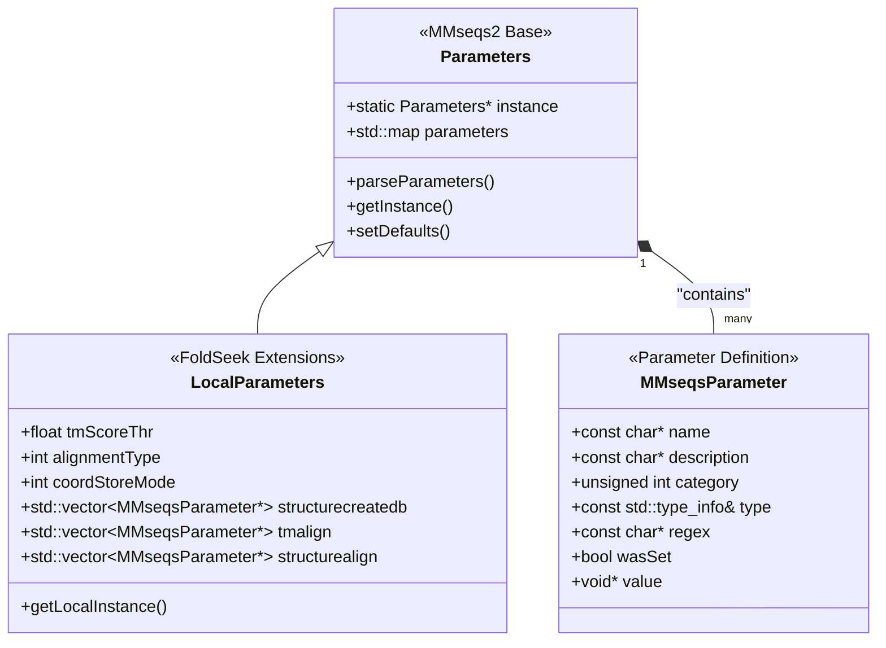
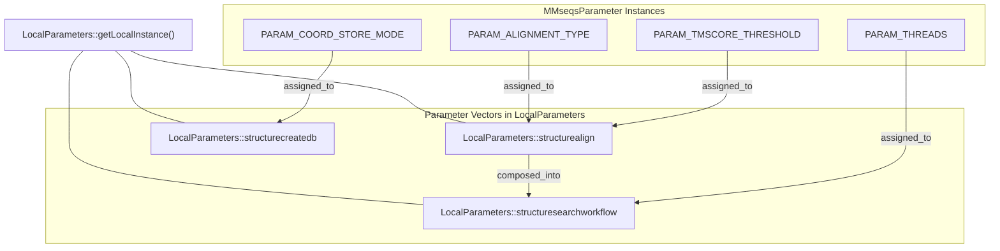
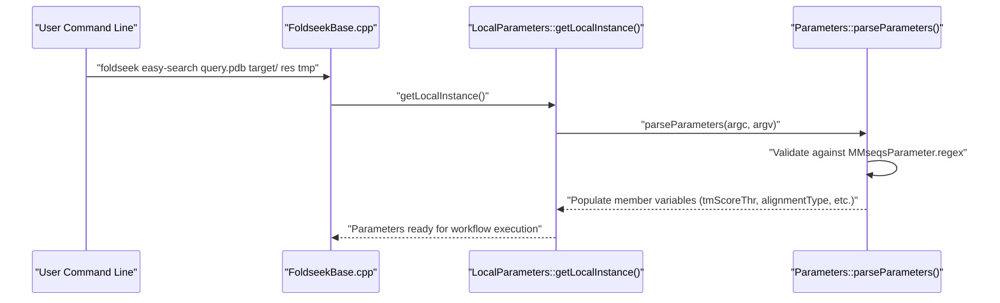

# Parameter System

<details>
<summary>Relevant source files</summary>

The following files were used as context for generating this wiki page:

- [lib/mmseqs/data/VTML200.out](lib/mmseqs/data/VTML200.out)
- [lib/mmseqs/src/alignment/Fwbw.cpp](lib/mmseqs/src/alignment/Fwbw.cpp)
- [lib/mmseqs/src/alignment/Fwbw.h](lib/mmseqs/src/alignment/Fwbw.h)
- [lib/mmseqs/src/commons/Parameters.cpp](lib/mmseqs/src/commons/Parameters.cpp)
- [lib/mmseqs/src/commons/Parameters.h](lib/mmseqs/src/commons/Parameters.h)
- [lib/mmseqs/src/prefiltering/PrefilteringIndexReader.cpp](lib/mmseqs/src/prefiltering/PrefilteringIndexReader.cpp)
- [lib/mmseqs/util/build_osx.sh](lib/mmseqs/util/build_osx.sh)
- [src/FoldseekBase.cpp](src/FoldseekBase.cpp)
- [src/commons/LocalParameters.cpp](src/commons/LocalParameters.cpp)
- [src/commons/LocalParameters.h](src/commons/LocalParameters.h)

</details>


The parameter system in Foldseek provides a comprehensive framework that defines, parses, validates, and provides access to command-line parameters and configuration options across the entire codebase. It is essential for managing user input, configuring workflows, and controlling output behaviors in structure search, alignment, clustering, multimer handling, and database management.

Sources:  
[src/commons/LocalParameters.h:18-26]()  
[src/commons/LocalParameters.cpp:9-44]()  
[lib/mmseqs/src/commons/Parameters.h:21-61]()  
[lib/mmseqs/src/commons/Parameters.cpp:30-70]()

---

## Architectural Overview: Parameter Class Hierarchy

Foldseek’s parameter system extends the MMseqs2 parameter framework (`Parameters`) to include structure-specific options needed for protein structure analysis and comparison. It centralizes parameter definitions and groups, enforces validation regexes, and supports modular composition of workflow parameters.



- `Parameters` manages low-level parameter parsing and lifecycle [lib/mmseqs/src/commons/Parameters.h:66-67]().
- `LocalParameters` specializes and extends options specifically for Foldseek [src/commons/LocalParameters.h:18-26]().
- Each parameter is instantiated as an `MMseqsParameter` containing metadata and a pointer to the storage variable [lib/mmseqs/src/commons/Parameters.h:21-31]().

Sources:  
[src/commons/LocalParameters.h:18-26]()  
[lib/mmseqs/src/commons/Parameters.h:21-61]()  
[lib/mmseqs/src/commons/Parameters.cpp:30-70]()

---

## Parameter Definition and Storage

Parameters are defined in `LocalParameters::LocalParameters()` [src/commons/LocalParameters.cpp:9-40]() using `MMseqsParameter` descriptors. Each entry binds a command-line flag name, help text, data type (`typeid`), target member variable, validation regex, and category flags.

For example, the TM-score threshold parameter is defined as:

```cpp
PARAM_TMSCORE_THRESHOLD(
    PARAM_TMSCORE_THRESHOLD_ID,
    "--tmscore-threshold",
    "TMscore threshold",
    "accept alignments with a tmsore > thr [0.0,1.0]",
    typeid(float),
    (void*)&tmScoreThr,
    "^0(\\.[0-9]+)?|1(\\.0+)?$"
)
```

The underlying member variables (e.g., `tmScoreThr`, `alignmentType`, `coordStoreMode`) reside directly inside `LocalParameters` [src/commons/LocalParameters.cpp:9-40]() and are populated during command-line parsing.

Sources:  
[src/commons/LocalParameters.cpp:9-40]()  
[lib/mmseqs/src/commons/Parameters.h:18-61]()

---

## Parameter Groups and Workflow Composition

Foldseek organizes parameters into logical groups represented by `std::vector<MMseqsParameter*>` [src/commons/LocalParameters.h:131-166](). These vectors aggregate parameters pertinent to specific sub-commands or multi-stage workflows.

### Diagram: Parameter Composition and Group Membership



Workflows combine lower-level parameter vectors (such as `structurealign` and prefilter parameters) into composite vectors like `structuresearchworkflow` [src/commons/LocalParameters.h:133-135]().

Sources:  
[src/commons/LocalParameters.h:131-166]()  
[src/commons/LocalParameters.cpp:9-40]()

---

## Parameter Flow and Lifecycle

The parameter lifecycle spans three main phases: singleton initialization, command-line parsing with regex validation, and runtime access.



### Runtime Parameter Access Example
Throughout backend execution, code accesses parameters via the singleton instance:

```cpp
LocalParameters &par = LocalParameters::getLocalInstance();
if (par.alignmentType == LocalParameters::ALIGNMENT_TYPE_TMALIGN) {
    // Execute TM-align logic
}
```

Sources:  
[src/commons/LocalParameters.h:21-26]()  
[lib/mmseqs/src/commons/Parameters.h:44-48]()  
[lib/mmseqs/src/commons/Parameters.cpp:38-62]()

---

## Output Format Configuration

Foldseek configures output structures and metric columns via specialized output format constants and flags defined in `LocalParameters` [src/commons/LocalParameters.h:72-104]().

### Output Format Constants Summary

| Constant | Value | Description |
| :--- | :--- | :--- |
| `OUTFMT_QCA` | 40 | Query C-alpha coordinates |
| `OUTFMT_TCA` | 41 | Target C-alpha coordinates |
| `OUTFMT_ALNTMSCORE` | 44 | Alignment TM-score |
| `OUTFMT_LDDT` | 45 | Local Distance Difference Test (LDDT) score |
| `OUTFMT_PROBTP` | 48 | Probability of true positive alignment |
| `OUTFMT_QTMSCORE` | 49 | Query TM-score |
| `OUTFMT_TTMSCORE` | 50 | Target TM-score |
| `OUTFMT_QUERY_COMPLEX` | 51 | Query complex identifier |
| `OUTFMT_TARGET_COMPLEX` | 52 | Target complex identifier |
| `OUTFMT_INTERFACE_LDDT` | 66 | Interface LDDT score |

Sources:  
[src/commons/LocalParameters.h:72-104]()  
[src/commons/LocalParameters.cpp:6-7]()

---

## Parameter Categories and Visibility

Each `MMseqsParameter` instance contains a category bitmask governing help generation and visibility [lib/mmseqs/src/commons/Parameters.h:29-41]().

| Category Flag | Description |
| :--- | :--- |
| `COMMAND_COMMON` | Visible to standard users in regular help outputs. |
| `COMMAND_EXPERT` | Advanced options hidden by default; revealed with expert flags [lib/mmseqs/src/commons/Parameters.h:39](). |
| `COMMAND_HIDDEN` | Internal or deprecated backward-compatibility flags (e.g., `PARAM_MULTIMER_REPORT_MODE_BC_COMPAT`) [src/commons/LocalParameters.cpp:34](). |

Sources:  
[lib/mmseqs/src/commons/Parameters.h:32-41]()  
[src/commons/LocalParameters.cpp:15-40]()

---