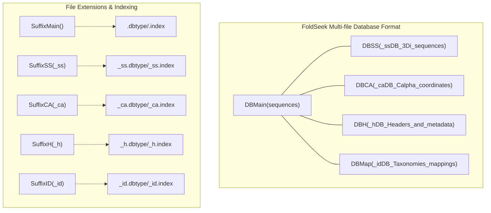
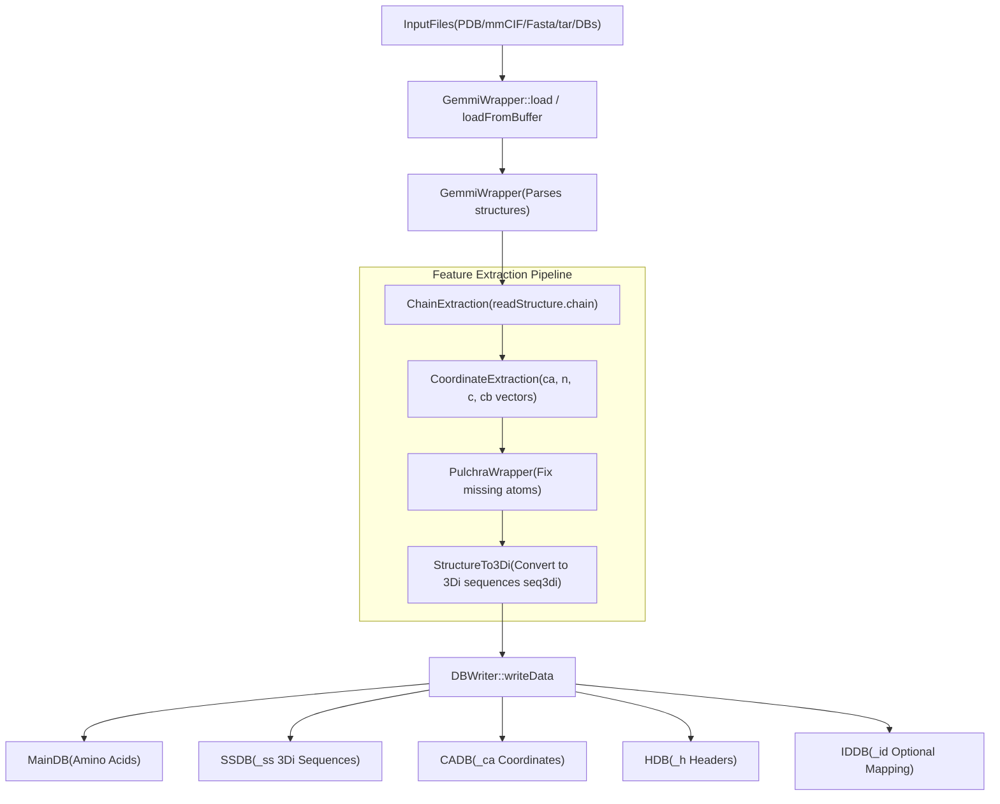
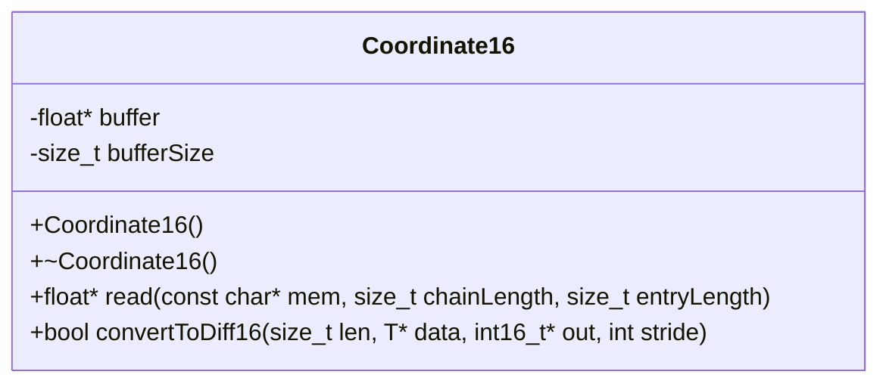
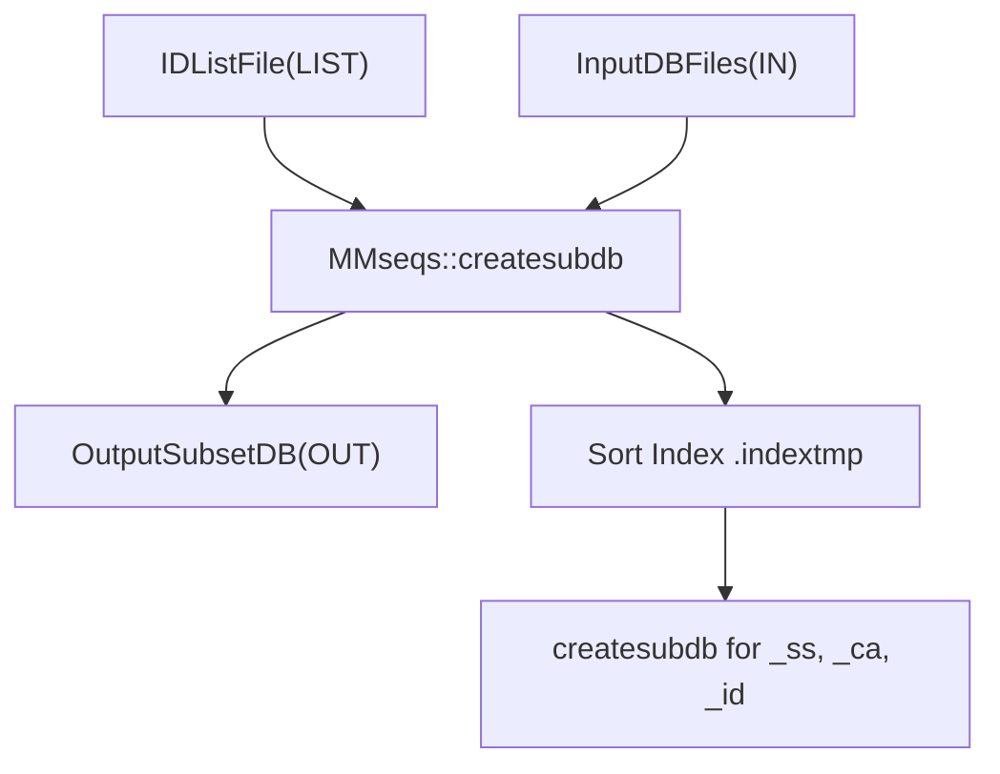
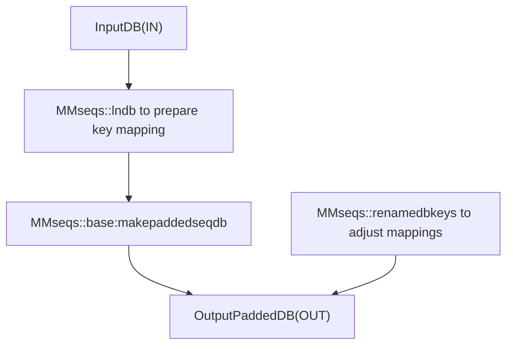
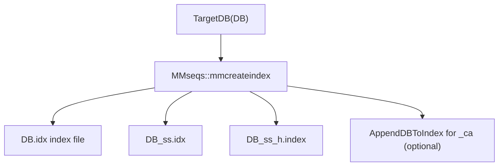

# Database System

Relevant source files

The following files were used as context for generating this wiki page:

- [data/createstructsubdb.sh](data/createstructsubdb.sh)
- [data/makepaddeddb.sh](data/makepaddeddb.sh)
- [data/result2structprofile.sh](data/result2structprofile.sh)
- [data/structureindex.sh](data/structureindex.sh)
- [data/structurerbh.sh](data/structurerbh.sh)
- [src/commons/Coordinate16.h](src/commons/Coordinate16.h)
- [src/strucclustutils/GemmiWrapper.cpp](src/strucclustutils/GemmiWrapper.cpp)
- [src/strucclustutils/GemmiWrapper.h](src/strucclustutils/GemmiWrapper.h)
- [src/strucclustutils/compressca.cpp](src/strucclustutils/compressca.cpp)
- [src/strucclustutils/createstructsubdb.cpp](src/strucclustutils/createstructsubdb.cpp)
- [src/strucclustutils/makepaddeddb.cpp](src/strucclustutils/makepaddeddb.cpp)
- [src/strucclustutils/result2structprofile.cpp](src/strucclustutils/result2structprofile.cpp)
- [src/strucclustutils/structcreatedb.cpp](src/strucclustutils/structcreatedb.cpp)
- [src/workflow/StructureIndex.cpp](src/workflow/StructureIndex.cpp)
- [src/workflow/StructureRbh.cpp](src/workflow/StructureRbh.cpp)

The FoldSeek Database System forms the core foundation for storing, indexing, and managing protein structure data in formats optimized for fast similarity searching, clustering, and further structural analysis. This page thoroughly documents the internal design, data flow, and key components involved in database creation and management within FoldSeek. It is intended for technical readers requiring in-depth knowledge of the database subsystem implementation.

For usage examples related to databases, see the [Basic Usage Examples (#1.3)]() page, and for how databases integrate into search workflows, consult the [Structure Search (#3.1)]() page.

---

## 1. Overview of Database Organization

FoldSeek databases are organized as a set of interrelated files, each specialized to store certain features or metadata. This modular multicomponent format enables efficient access and selective loading of data needed for different search or clustering steps.

### Database Components

| File                     | Code Representation / Class | Role                                             |
|--------------------------|---------------------------|--------------------------------------------------|
| `<basename>`             | `DBReader`/`DBWriter`     | Amino acid sequences and main sequence database   |
| `<basename>_ss`          | `DBReader`/`DBWriter`     | 3Di structural alphabet sequences (`_ss`)         |
| `<basename>_ca`          | `Coordinate16`/`DBWriter` | Cα atomic coordinates (`_ca`, float/int16)        |
| `<basename>_h`           | `DBReader`                | Headers, metadata, descriptions (`_h`)            |
| `<basename>_id` (optional)| `DBReader`               | Taxonomy IDs and custom mappings (`_id`)          |

Each file has accompanying `.dbtype` and `.index` files that define its database type and support fast keyed access via `DBReader` and `DBWriter`.

Sources: [src/strucclustutils/structcreatedb.cpp:442-494](), [src/strucclustutils/createstructsubdb.cpp:1-31]()

---

## 2. Database Creation Process (`structcreatedb`)

Database creation in FoldSeek primarily happens through the `createdb` command, implemented in the function `structcreatedb` (defined in `src/strucclustutils/structcreatedb.cpp`). This pipeline ingests raw structure or sequence files and outputs the multi-file database described above.

### Data Flow for `structcreatedb`

### Input Formats Supported

- **Protein Structures:** PDB format, mmCIF format, mmJSON format, Foldcomp compressed format (`GemmiWrapper::Format`)
- **Sequence Files:** FASTA files used with the ProstT5 model for predicted 3Di sequences

FoldSeek can consume directories, tar archives (optionally gzipped via `structure_mtar_gzopen` or zstd via `mtar_zstdopen`), or even database files as input sources.

### Key Classes and Functions

- **`GemmiWrapper`**: Responsible for reading, parsing, and extracting structural information from input files. Supports multiple structure formats, including compressed files (`src/strucclustutils/GemmiWrapper.h:14-89]`, `src/strucclustutils/GemmiWrapper.cpp:30-188`).
- **`PulchraWrapper`**: Repairs missing atoms in structure data, particularly important for converting backbone-only structures into full Cα traces (`src/strucclustutils/structcreatedb.cpp:228-280`).
- **`StructureTo3Di`**: Converts atomic coordinates into discrete 3Di alphabet sequences for downstream structural comparison.

### Database Writers

FoldSeek uses the generic templated `DBWriter` class to write each type of data component:
- Amino acid sequences are stored in the main database (`src/strucclustutils/structcreatedb.cpp:442-455`).
- The 3Di sequences are stored in the `_ss` suffix database (`src/strucclustutils/structcreatedb.cpp:456-470`).
- Cα coordinates are stored in the `_ca` suffix database, optionally compressed (`src/strucclustutils/structcreatedb.cpp:471-490`).
- Headers and chain metadata in the `_h` suffix database (`src/strucclustutils/structcreatedb.cpp:491-510`).

Sources: [src/strucclustutils/structcreatedb.cpp:44-560](), [src/strucclustutils/GemmiWrapper.cpp:30-188](), [src/strucclustutils/GemmiWrapper.h:14-89]()

---

## 3. Coordinate Storage and Compression

FoldSeek supports different modes for storing Cα coordinates based on precision and compression trade-offs, controlled by the parameter `coordStoreMode`:

| Mode                        | Description                                         | Reference Classes/Code                          |
|-----------------------------|-----------------------------------------------------|-----------------------------------------------|
| `COORD_STORE_MODE_CA_FLOAT` (1) | Store coordinates as raw floats (x,y,z)           | `DBWriter` writing float arrays [src/strucclustutils/structcreatedb.cpp:490-530]() |
| `COORD_STORE_MODE_CA_DIFF` (2)  | Store coordinates as difference-encoded `int16_t` arrays | `Coordinate16::convertToDiff16` [src/commons/Coordinate16.h:7-80]() |
| `COORD_STORE_MODE_CA_PLAIN_TEXT` (3) | Store coordinates as plain text floating point numbers | [src/strucclustutils/compressca.cpp:13-122]() |

### `Coordinate16` Utility

The `Coordinate16` class is a utility used to convert full precision floating point coordinates into more compact difference-encoded 16-bit integers, reducing storage size and I/O bandwidth.

The encoding stores the first coordinate in full 32-bit integer form (`int32_t`) scaled by 1000 and then all subsequent values as signed 16-bit offsets (`int16_t`) from the prior coordinate, enabling substantial compression if atomic positions vary smoothly.

Sources: [src/strucclustutils/structcreatedb.cpp:510-530](), [src/commons/Coordinate16.h:7-80](), [src/strucclustutils/compressca.cpp:13-122]()

---

## 4. Auxiliary Database Management and Utilities

### Creating Subdatabases (`createstructsubdb`)

FoldSeek supports creating subsets of existing databases for focused analysis through `createstructsubdb` (defined in `src/strucclustutils/createstructsubdb.cpp` and orchestrated via `data/createstructsubdb.sh`):

All major database components (`_ss`, `_ca`, `_h`, `_id`) are subset by mapping the list of keys to extract corresponding data efficiently, preserving internal index integrity.

Sources: [src/strucclustutils/createstructsubdb.cpp:1-31](), [data/createstructsubdb.sh:1-39]()

### Making Padded Databases for GPU (`makepaddedseqdb`)

To optimize sequence and structure databases for GPU-based searches, a padded sequence processing step is executed via `makepaddeddb` and `data/makepaddeddb.sh`:

This workflow normalizes sequence lengths with padding, generates lookup tables (`.gpu_mapping1`, `.gpu_mapping2`), and remaps database keys for accelerated GPU-based execution.

Sources: [src/strucclustutils/makepaddeddb.cpp:1-35](), [data/makepaddeddb.sh:1-174]()

### Index Creation (`structureindex`)

To accelerate database searches, FoldSeek creates indexing files that map keys and facilitate lookups via `structureindex` (`src/workflow/StructureIndex.cpp`) and `data/structureindex.sh`:

Sources: [src/workflow/StructureIndex.cpp:1-73](), [data/structureindex.sh:1-56]()

---

# References

- `src/strucclustutils/structcreatedb.cpp`: Core database creation and writing (`structcreatedb`)
- `src/strucclustutils/GemmiWrapper.h` / `.cpp`: Parsing and managing structure input (`GemmiWrapper`, `GemmiWriter`)
- `src/commons/Coordinate16.h`: Coordinate compression utility class (`Coordinate16`)
- `src/strucclustutils/compressca.cpp`: Coordinate compression workflow (`compressca`)
- `src/strucclustutils/createstructsubdb.cpp` & `data/createstructsubdb.sh`: Subdatabase creation utility
- `src/strucclustutils/makepaddeddb.cpp` & `data/makepaddeddb.sh`: Padded DB generation for GPU (`makepaddeddb`)
- `src/workflow/StructureIndex.cpp` & `data/structureindex.sh`: Database indexing workflow (`structureindex`)

---