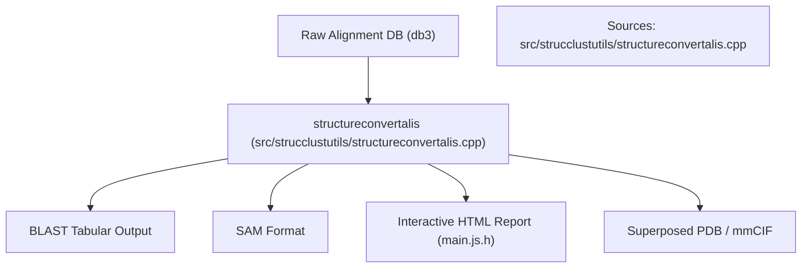
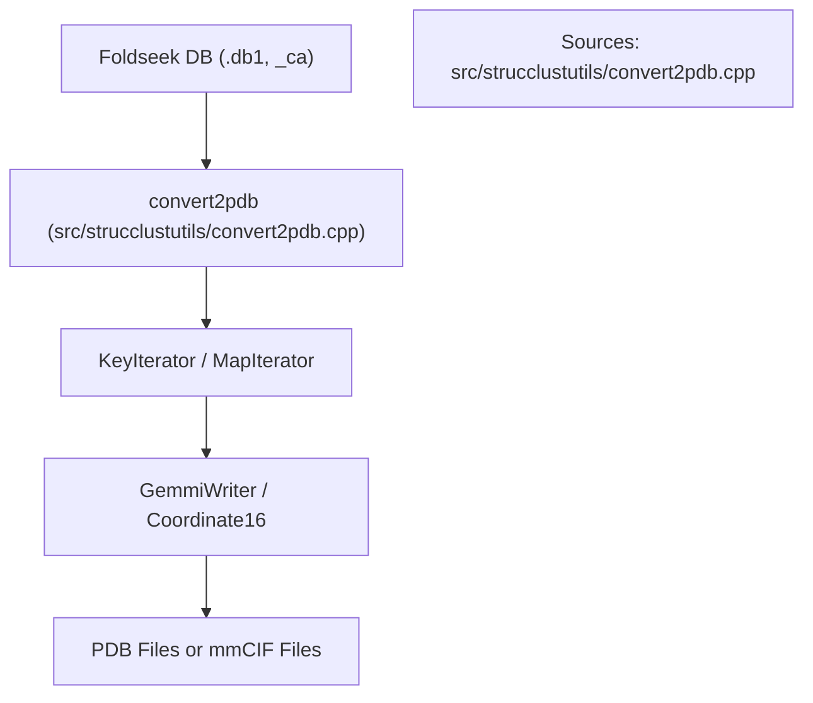
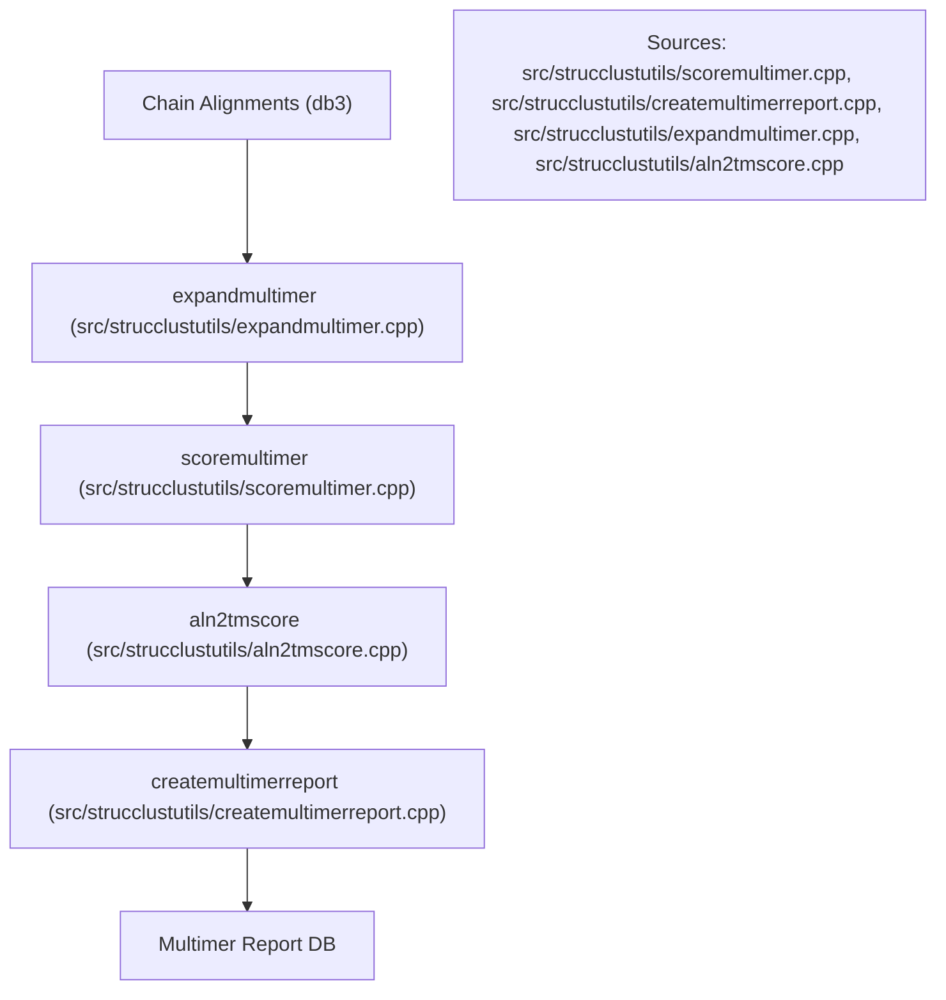
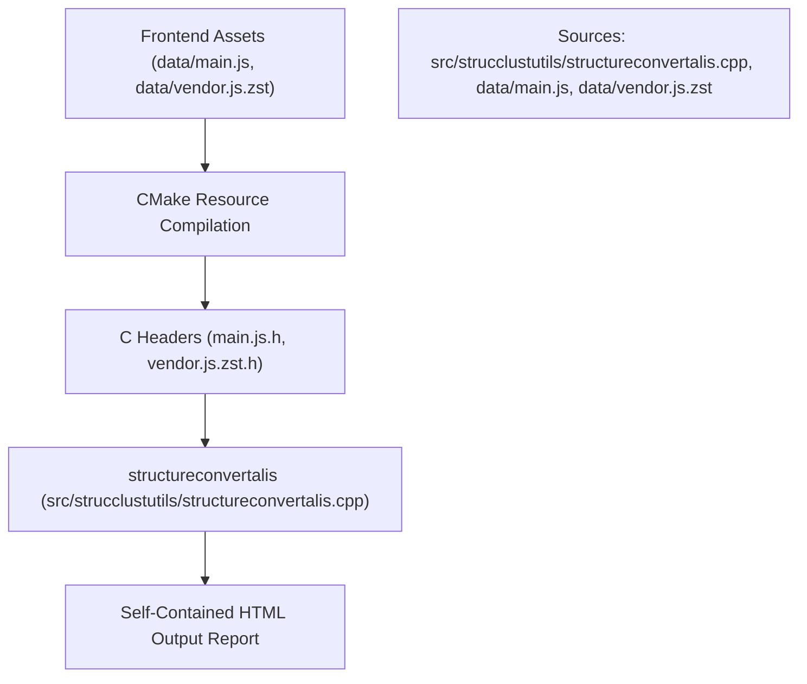
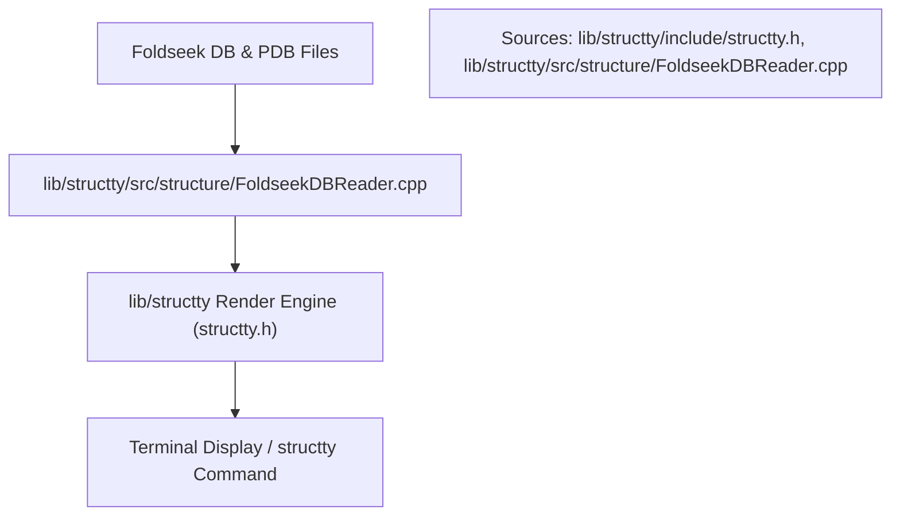

# Output Conversion and Visualization

Relevant source files

The following files were used as context for generating this wiki page:

- [data/main.js](data/main.js)
- [data/vendor.js.zst](data/vendor.js.zst)
- [lib/structty/CMakeLists.txt](lib/structty/CMakeLists.txt)
- [lib/structty/LICENSE](lib/structty/LICENSE)
- [lib/structty/THIRD_PARTY_NOTICES.md](lib/structty/THIRD_PARTY_NOTICES.md)
- [lib/structty/cmake/structty_renderConfig.cmake](lib/structty/cmake/structty_renderConfig.cmake)
- [lib/structty/include/structty.h](lib/structty/include/structty.h)
- [lib/structty/include/structty_render.h](lib/structty/include/structty_render.h)
- [lib/structty/lib/CMakeLists.txt](lib/structty/lib/CMakeLists.txt)
- [lib/structty/src/structure/FoldseekDBReader.cpp](lib/structty/src/structure/FoldseekDBReader.cpp)
- [src/strucclustutils/MultimerUtil.h](src/strucclustutils/MultimerUtil.h)
- [src/strucclustutils/aln2tmscore.cpp](src/strucclustutils/aln2tmscore.cpp)
- [src/strucclustutils/convert2pdb.cpp](src/strucclustutils/convert2pdb.cpp)
- [src/strucclustutils/createmultimerreport.cpp](src/strucclustutils/createmultimerreport.cpp)
- [src/strucclustutils/expandmultimer.cpp](src/strucclustutils/expandmultimer.cpp)
- [src/strucclustutils/scoremultimer.cpp](src/strucclustutils/scoremultimer.cpp)
- [src/strucclustutils/structurealign.cpp](src/strucclustutils/structurealign.cpp)
- [src/strucclustutils/structureconvertalis.cpp](src/strucclustutils/structureconvertalis.cpp)
- [src/strucclustutils/structurerescorediagonal.cpp](src/strucclustutils/structurerescorediagonal.cpp)

## Purpose and Scope
This page details how Foldseek converts raw structural alignment results (stored in internal binary database formats containing alignments, backtraces, and 16-bit coordinate blocks) into user-facing output formats and visualization interfaces. Specifically, we examine the implementation of `structureconvertalis` output modes, `convert2pdb`, multimer report generators (`createmultimerreport`, `expandmultimer`), the embedded JavaScript web report viewer, and the `structty` terminal structure visualization subsystem backed by `lib/structty`.

---

## 1. Alignment Result Conversion via `structureconvertalis`
The core conversion utility in Foldseek is `structureconvertalis` [src/strucclustutils/structureconvertalis.cpp:1](), which reads alignment result databases and translates them into various human-readable or downstream-compatible file formats based on parameter flags.

### Supported Output Modes
`structureconvertalis` supports multiple output formats:
- **BLAST-tab / Custom Tabular (`--format-output`)**: Detailed column-based text output containing query and target identifiers, E-values, bit scores, sequence identity, coverage fractions, and full-length alignment summaries [src/strucclustutils/structureconvertalis.cpp:171-205]().
- **SAM Format**: Converts structural alignment backtraces into standard Sequence Alignment/Map (SAM) format records for compatibility with genomics pipelines.
- **HTML Report (`--format-mode 3`)**: Generates an interactive self-contained HTML page embedding the alignment viewer and 3Di/amino acid sequence alignments [src/strucclustutils/structureconvertalis.cpp:20]() (utilizing `main.js.h` and `vendor.js.zst.h`).
- **Superposed PDB (`--format-mode 2` or similar)**: Applies the rotation matrix $U$ and translation vector $t$ computed during TM-align or superposition steps to transform target coordinates onto the query frame, outputting superposed PDB/mmCIF structures.

*Sources: [src/strucclustutils/structureconvertalis.cpp:1]()*

---

## 2. Structure Coordinate Conversion via `convert2pdb`
The `convert2pdb` tool [src/strucclustutils/convert2pdb.cpp:77]() transforms Foldseek's compressed binary structure databases (`_ca`, `_ca.index`, `.lookup`) back into standard PDB or mmCIF coordinate files.

### Key Implementation Details
- **Output Modes**: Controlled via `par.pdbOutputMode` [src/strucclustutils/convert2pdb.cpp:81](), supporting single-chain outputs, complex groupings [src/strucclustutils/convert2pdb.cpp:112](), and multi-model files (`PDB_OUTPUT_MODE_MULTIMODEL`) [src/strucclustutils/convert2pdb.cpp:120]().
- **Format Selection**: Supports both traditional PDB format and mmCIF format (`pdbOutputFormat`) via Gemmi wrappers (`GemmiWriter`) [src/strucclustutils/convert2pdb.cpp:82-85, 118]().
- **Coordinate Decoding**: Reads 16-bit coordinate blocks using `Coordinate16` [src/strucclustutils/convert2pdb.cpp:162]() and reconstructs full atom records, applying standard three-letter amino acid code lookups [src/strucclustutils/convert2pdb.cpp:145]().

*Sources: [src/strucclustutils/convert2pdb.cpp:1-176]()*

---

## 3. Multimer Reports and Complex Scoring
For multi-chain protein complexes and multimers, Foldseek coordinates specialized reporting and expansion workflows to aggregate chain-to-chain alignments into complex-level metrics.

### Key Components
- **`scoremultimer`**: Computes complex TM-scores and interface metrics by combining individual chain superpositions and evaluating residue-residue distance matrices across complex interfaces (`INTERFACE_THRESHOLD = 8`) [src/strucclustutils/scoremultimer.cpp:1-20, 125]().
- **`createmultimerreport`**: Parses complex alignment databases and formats comprehensive summary tables mapping query complex identifiers to target complex identifiers, chain mappings, and TM-score vectors [src/strucclustutils/createmultimerreport.cpp:25-65]().
- **`expandmultimer`**: Expands chain-level search results into complex-level result databases by cross-referencing `.lookup` files for query and target databases [src/strucclustutils/expandmultimer.cpp:27-70]().
- **`aln2tmscore`**: Re-scores structural alignments by recalculating exact TM-scores from $C_\alpha$ coordinates and transformation matrices [src/strucclustutils/aln2tmscore.cpp:17-106]().

*Sources: [src/strucclustutils/scoremultimer.cpp:1](), [src/strucclustutils/createmultimerreport.cpp:1](), [src/strucclustutils/expandmultimer.cpp:27](), [src/strucclustutils/aln2tmscore.cpp:17]()*

---

## 4. Embedded JavaScript Web Report Viewer
When HTML output mode is selected, Foldseek embeds a fully interactive client-side web application directly into the binary via CMake resource compilation.

### Implementation Architecture
- **Source Assets**: The frontend code is written in JavaScript (`data/main.js` [data/main.js:1]()) and bundled with dependencies compressed via Zstd (`data/vendor.js.zst` [data/vendor.js.zst:1]()).
- **Header Embedding**: During the build system resource compilation phase, these files are converted into C headers (`main.js.h`, `vendor.js.zst.h`) and included directly in `structureconvertalis.cpp` [src/strucclustutils/structureconvertalis.cpp:20-21]().
- **Client Features**: The embedded app provides interactive sequence alignment visualization, structure rendering bindings, metadata cards, and direct citation links [data/main.js:8-18]().

*Sources: [src/strucclustutils/structureconvertalis.cpp:20-21](), [data/main.js:1](), [data/vendor.js.zst:1]()*

---

## 5. StrucTTY Terminal Structure Viewer
Foldseek includes a terminal-based structure visualization utility (`structty`) powered by the vendored library `lib/structty`.

### Key Components & Data Flow
- **Command Entrypoint**: The `structty` command exposes terminal-based structure inspection directly in the CLI.
- **Database Integration**: Utilizes `FoldseekDBReader.cpp` [lib/structty/src/structure/FoldseekDBReader.cpp:1]() from `lib/structty` to read Foldseek databases (`_ca`, headers) directly without requiring external conversion tools.
- **Rendering Engine**: Leverages `lib/structty/include/structty.h` and `structty_render.h` to render ASCII/ANSI terminal graphics representing 3D protein backbone structures and chains.
- **Third-Party Dependencies**: Relies on Gemmi for coordinate parsing and stb image write utilities [lib/structty/THIRD_PARTY_NOTICES.md:5-18]().

*Sources: [lib/structty/include/structty.h](), [lib/structty/src/structure/FoldseekDBReader.cpp:1](), [lib/structty/THIRD_PARTY_NOTICES.md:1-18]()*

---