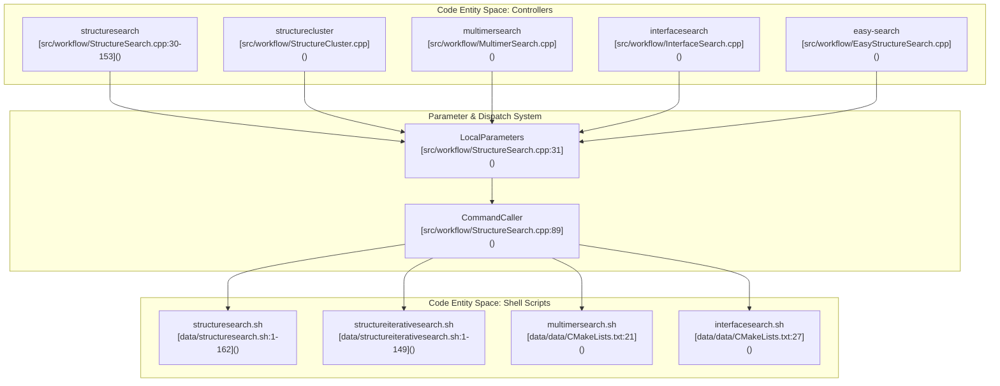
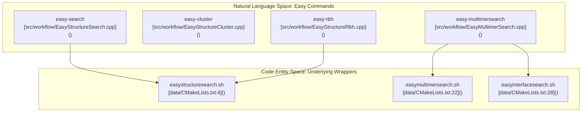

# Workflows

Relevant source files

The following files were used as context for generating this wiki page:

- [data/CMakeLists.txt](data/CMakeLists.txt)
- [data/structureiterativesearch.sh](data/structureiterativesearch.sh)
- [data/structureprofile.sh](data/structureprofile.sh)
- [data/structuresearch.sh](data/structuresearch.sh)
- [src/strucclustutils/CMakeLists.txt](src/strucclustutils/CMakeLists.txt)
- [src/workflow/CMakeLists.txt](src/workflow/CMakeLists.txt)
- [src/workflow/StructureSearch.cpp](src/workflow/StructureSearch.cpp)

This page provides a high-level overview of the principal workflows implemented in FoldSeek. These workflows form the backbone of FoldSeek’s capabilities, enabling structural search, clustering, multimer processing, protein-protein interface analysis, and easy-to-use command interfaces. Each workflow combines various algorithmic components and auxiliary tools into multi-step pipelines managed by C++ controllers and shell script orchestrations.

For detailed step-by-step descriptions, parameter explanations, and command usage, please refer to the respective child pages linked below.

---

## Workflow Architecture and Execution Model

FoldSeek's workflow system integrates core C++ controllers, shell script templates compiled into binary headers, and a centralized parameter management system. Workflows are invoked via dedicated controllers (such as `structuresearch` in `[src/workflow/StructureSearch.cpp]()-30`) which parse user arguments using `LocalParameters` (`[src/workflow/StructureSearch.cpp]()-31`), set up temporary working directories, and configure script variables using `CommandCaller` (`[src/workflow/StructureSearch.cpp]()-89-98`).

**Sources:**  
[src/workflow/StructureSearch.cpp:30-153]()  
[data/structuresearch.sh:1-162]()  
[data/structureiterativesearch.sh:1-149]()  
[data/CMakeLists.txt:1-31]()

---

## 3.1. Structure Search

The structure search workflow is FoldSeek's primary mechanism for identifying structural homologs against target databases. Orchestrated by `StructureSearch.cpp` (`[src/workflow/StructureSearch.cpp]()-30`), the workflow validates database inputs (including C-alpha coordinate databases `_ca`), sets up hash-based temporary directories (`[src/workflow/StructureSearch.cpp]()-81-86`), and invokes shell scripts like `structuresearch.sh` (`[data/structuresearch.sh]()-1`) or `structureiterativesearch.sh` (`[data/structureiterativesearch.sh]()-1`).

The pipeline proceeds from database prefiltering (using k-mer exact matching or ungapped alignment modes via `[src/workflow/StructureSearch.cpp]()-114-124`) to precise structural alignment algorithms (such as `structurealign`, `tmalign`, or `lolalign` via `[src/workflow/StructureSearch.cpp]()-128-153`), and finally formats output alignments.

For details, see [Structure Search](#3.1).

**Sources:**  
[src/workflow/StructureSearch.cpp:14-153]()  
[data/structuresearch.sh:1-162]()  
[data/structureiterativesearch.sh:1-149]()

---

## 3.2. Structure Clustering

FoldSeek supports high-throughput clustering of protein structures to reduce redundancy and organize structural space into representative sets. Managed through `StructureCluster.cpp` and orchestrated via shell scripts like `structurecluster.sh` (`[data/CMakeLists.txt]()-5`), the clustering pipeline utilizes cascaded strategies. It starts with fast k-mer matching (`kmermatcher`), diagonal rescoring (`structurerescorediagonal`), and iterative clustering rounds to group highly similar chains.

Cluster database updates can be performed incrementally using `structureclusterupdate.sh` (`[data/CMakeLists.txt]()-6`), allowing new structures to be integrated into existing clustered databases without recomputing the entire dataset.

For details, see [Structure Clustering](#3.2).

**Sources:**  
[src/workflow/CMakeLists.txt:1-21]()  
[data/CMakeLists.txt:1-31]()

---

## 3.3. Multimer Processing

Protein complexes and multimers are processed in FoldSeek using specialized workflows implemented in `MultimerSearch.cpp` and `MultimerCluster.cpp` (`[src/workflow/CMakeLists.txt]()-10-13`). These workflows coordinate chain-level searches across multimer constituent chains, expand hits to full complexes using `expandmultimer` (`[src/strucclustutils/CMakeLists.txt]()-19`), and score complex alignments using complex TM-score computations via `scoremultimer` (`[src/strucclustutils/CMakeLists.txt]()-16`). Complex clustering leverages DBSCAN to group functional assemblies.

For details, see [Multimer Processing](#3.3).

**Sources:**  
[src/workflow/CMakeLists.txt:10-13]()  
[src/strucclustutils/CMakeLists.txt:16-20]()

---

## 3.4. Interface and Dimer Workflows

To analyze protein-protein interactions and binding sites, FoldSeek provides interface-specific workflows (`interfacesearch.sh`, `interfacecluster.sh` under `[data/CMakeLists.txt]()-27-30`). These workflows involve specialized database construction steps: `createinterfacedb` and `createstructinterfacedb` (`[src/strucclustutils/CMakeLists.txt]()-22-24`) to extract interface residues, as well as `createdimerdb` and `filterdimerdb` (`[src/strucclustutils/CMakeLists.txt]()-25`) for constructing and filtering dimer configurations. Results are filtered using interface LDDT metrics.

For details, see [Interface and Dimer Workflows](#3.4).

**Sources:**  
[src/workflow/CMakeLists.txt:14-18]()  
[src/strucclustutils/CMakeLists.txt:22-25]()  
[data/CMakeLists.txt:25-30]()

---

## 3.5. Easy Commands

To minimize operational complexity, FoldSeek provides simplified `easy-*` command wrappers (such as `easy-search`, `easy-cluster`, `easy-multimersearch`, `easy-multimercluster`, and `easy-rbh` in `[src/workflow/CMakeLists.txt]()-7-18`). These commands accept standard input files (like PDB or mmCIF files directly) rather than pre-formatted FoldSeek databases, automatically handling temporary database creation, searching, alignment, and formatting.

For details, see [Easy Commands](#3.5).

**Sources:**  
[src/workflow/CMakeLists.txt:7-18]()  
[data/CMakeLists.txt:1-31]()

---

## Child Pages for Details

- [Structure Search](#3.1) — Detailed description of the structure search workflow, prefilter modes, iterative/profile search, and reciprocal best hits.  
- [Structure Clustering](#3.2) — Explanation of cascaded structure clustering and cluster database updates (`structureclusterupdate`).  
- [Multimer Processing](#3.3) — Comprehensive view of multimer search, scoring, expansion, DBSCAN clustering, and complex TM-score calculation.  
- [Interface and Dimer Workflows](#3.4) — Details on protein-protein interface searches, interface database creation, dimer construction, and LDDT filtering.  
- [Easy Commands](#3.5) — Usage of simplified `easy-*` commands wrapping complex pipelines into single user-facing commands.

# End of Workflows Page

---