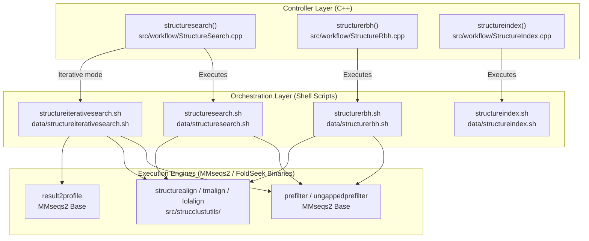
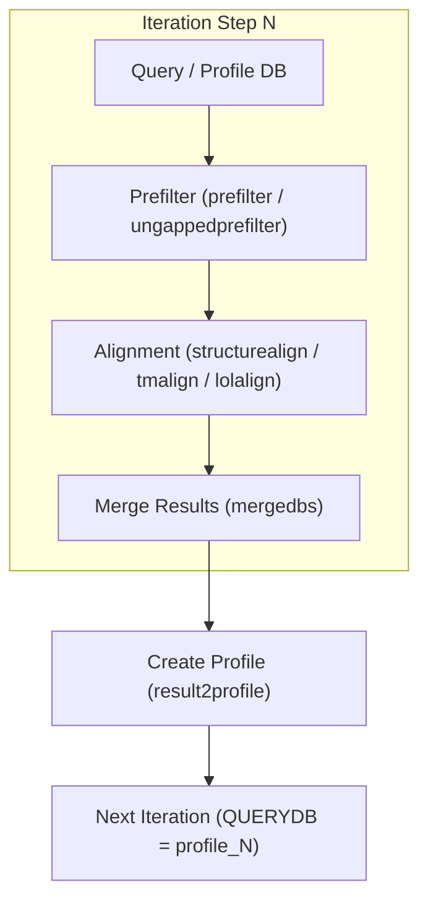

# Structure Search

Relevant source files

The following files were used as context for generating this wiki page:

- [data/createstructsubdb.sh](data/createstructsubdb.sh)
- [data/result2structprofile.sh](data/result2structprofile.sh)
- [data/structureindex.sh](data/structureindex.sh)
- [data/structureiterativesearch.sh](data/structureiterativesearch.sh)
- [data/structureprofile.sh](data/structureprofile.sh)
- [data/structurerbh.sh](data/structurerbh.sh)
- [data/structuresearch.sh](data/structuresearch.sh)
- [src/strucclustutils/createstructsubdb.cpp](src/strucclustutils/createstructsubdb.cpp)
- [src/strucclustutils/result2structprofile.cpp](src/strucclustutils/result2structprofile.cpp)
- [src/workflow/StructureIndex.cpp](src/workflow/StructureIndex.cpp)
- [src/workflow/StructureRbh.cpp](src/workflow/StructureRbh.cpp)
- [src/workflow/StructureSearch.cpp](src/workflow/StructureSearch.cpp)

This document details the Structure Search workflow in FoldSeek, which identifies structurally similar proteins in large databases. The workflow orchestrates prefiltering, detailed structural alignment, scoring, iterative profile construction, and reciprocal best hits (RBH). It is implemented via C++ workflow controllers such as `StructureSearch.cpp`, `StructureRbh.cpp`, and `StructureIndex.cpp`, which orchestrate shell script pipelines (`structuresearch.sh`, `structureiterativesearch.sh`, `structurerbh.sh`).

---

## Overview and Architecture

The structure search workflow transforms query structural data and target databases into scored structural alignments. It operates through distinct phases:
1. **Database Indexing & Preparation:** Optional creation of search indices via `structureindex()` in `src/workflow/StructureIndex.cpp` [src/workflow/StructureIndex.cpp:11-73]() and `data/structureindex.sh` [data/structureindex.sh:1-56]().
2. **Prefiltering:** Rapidly narrows down candidate target sequences using `prefilter`, `ungappedprefilter`, or exhaustive heuristics.
3. **Structural Alignment:** Executes high-resolution alignments on candidate pairs via `structurealign`, `tmalign`, or `lolalign`.
4. **Iterative / Profile Search:** Builds structural profiles across multiple iterations via `structureiterativesearch.sh` [data/structureiterativesearch.sh:1-149]() and `structureprofile.sh` [data/structureprofile.sh:1-98]().
5. **Reciprocal Best Hits (RBH):** Computes bidirectional best hits using `structurerbh` in `src/workflow/StructureRbh.cpp` [src/workflow/StructureRbh.cpp:23-85]() and `data/structurerbh.sh` [data/structurerbh.sh:1-116]().

Below is a diagram bridging the high-level search architecture to specific C++ code entities and shell scripts:

### Diagram: System-to-Code Architecture for Structure Search

Sources: [src/workflow/StructureSearch.cpp:30-180](), [src/workflow/StructureRbh.cpp:23-85](), [src/workflow/StructureIndex.cpp:11-73](), [data/structuresearch.sh:1-162](), [data/structureiterativesearch.sh:1-149](), [data/structurerbh.sh:1-116]()

---

## Core Search Workflow (`StructureSearch.cpp`)

The main entry point for standard structure search is `structuresearch()` defined in `src/workflow/StructureSearch.cpp` [src/workflow/StructureSearch.cpp:30-180](). 

### Parameter Defaults and Validation
`setStructureSearchWorkflowDefaults()` initializes parameters such as `kmerSize = 0`, `sensitivity = 9.5`, `maxResListLen = 1000`, and `alignmentMode = Parameters::ALIGNMENT_MODE_SCORE_COV_SEQID` [src/workflow/StructureSearch.cpp:14-20](). It also verifies whether query and target databases contain required C-alpha coordinates (`_ca.dbtype`) if specific output formats demand them [src/workflow/StructureSearch.cpp:61-77]().

### Temporary Directory and Variable Injection
The controller computes a parameter hash via `par.hashParameter()`, creates a unique temporary directory, and injects shell variables into a `CommandCaller` object:
- `TMP_PATH`: Temporary working directory [src/workflow/StructureSearch.cpp:90]()
- `RESULTS`: Path to final output database [src/workflow/StructureSearch.cpp:91]()
- `TARGET_PREFILTER` / `QUERY_PREFILTER`: Target and query `_ss` database paths [src/workflow/StructureSearch.cpp:94-97]()
- `INDEXEXT`: Extension (`.idx` or empty) depending on whether target index exists [src/workflow/StructureSearch.cpp:99-100]()
- `PREFILTER_PAR` / `UNGAPPEDPREFILTER_PAR`: Serialized parameter strings for prefiltering [src/workflow/StructureSearch.cpp:102-105]()

Sources: [src/workflow/StructureSearch.cpp:14-108]()

---

## Prefiltering Modes and GPU Acceleration

FoldSeek supports three prefilter modes managed by `par.prefMode` [src/workflow/StructureSearch.cpp:114-124]() and executed within `data/structuresearch.sh` [data/structuresearch.sh:40-53]():

| Prefilter Mode | Code Enum / Flag | Implementation Details |
|----------------|------------------|------------------------|
| **KMER** (default) | `LocalParameters::PREF_MODE_KMER` | Uses exact 3Di $k$-mer matching via MMseqs2 `prefilter` module [src/workflow/StructureSearch.cpp:115-117](), [data/structuresearch.sh:50-51](). |
| **UNGAPPED** | `LocalParameters::PREF_MODE_UNGAPPED` | Runs ungapped alignment matching via `ungappedprefilter` [src/workflow/StructureSearch.cpp:118-120](), [data/structuresearch.sh:45-47](). Automatically forced when GPU acceleration is active (`par.gpu == 1`) [src/workflow/StructureSearch.cpp:110-112](). |
| **EXHAUSTIVE** | `LocalParameters::PREF_MODE_EXHAUSTIVE` | Bypasses heuristic prefiltering by generating a full query-target index mapping via `fake_pref` [src/workflow/StructureSearch.cpp:121-127](), [data/structuresearch.sh:27-38](). |

Sources: [src/workflow/StructureSearch.cpp:109-127](), [data/structuresearch.sh:27-53]()

---

## Alignment Algorithms and Orchestration

Once candidate pairs are identified by the prefilter, `structuresearch.sh` delegates alignment to one of three primary backends determined by `par.alignmentType` [src/workflow/StructureSearch.cpp:128-153](), [data/structuresearch.sh:56-143]():

1. **3Di + AA Smith-Waterman (`structurealign`):** Alignments are computed using `StructureSmithWaterman` combining 3Di structural sequences and amino acid profiles [src/workflow/StructureSearch.cpp:148-153](), [data/structuresearch.sh:118-143]().
2. **TM-align (`tmalign`):** Performs a coarse alignment using `structurealign`, followed by coordinate-based structural superposition and refinement using the vendored `tmalign` module [src/workflow/StructureSearch.cpp:128-138](), [data/structuresearch.sh:56-84]().
3. **LoLAlign (`lolalign`):** Executes probabilistic log-odds local alignment following initial `structurealign` candidate generation [src/workflow/StructureSearch.cpp:139-147](), [data/structuresearch.sh:86-114]().

Sources: [src/workflow/StructureSearch.cpp:128-153](), [data/structuresearch.sh:56-143]()

---

## Iterative and Profile Search

When `par.numIterations > 1` or set to zero, FoldSeek invokes iterative workflows via `data/structureiterativesearch.sh` [data/structureiterativesearch.sh:1-149]() or `data/structureprofile.sh` [data/structureprofile.sh:1-98](). 

### Iterative Workflow Steps
1. **Prefilter & Align:** Executes prefiltering and alignment against the target database using the current query profile [data/structureiterativesearch.sh:21-69]().
2. **Result Merging & Subtraction:** Merges alignments across iterations and subtracts previously aligned targets using `subtractdbs` and `mergedbs` [data/structureiterativesearch.sh:46-100]().
3. **Profile Creation:** Converts alignment results into a profile database using MMseqs2 `result2profile` (`_ss` and standard profiles) [data/structureiterativesearch.sh:112-117]().
4. **Recycling:** Sets the output profile as the `QUERYDB` for the next iteration step [data/structureiterativesearch.sh:118]().

### Diagram: Iterative Profile Search Data Flow

Sources: [data/structureiterativesearch.sh:19-120](), [data/structureprofile.sh:16-72]()

---

## Reciprocal Best Hits (RBH) Workflow

Reciprocal best hits between two structural databases $A$ and $B$ are computed by `structurerbh()` in `src/workflow/StructureRbh.cpp` [src/workflow/StructureRbh.cpp:23-85]() and orchestrated by `data/structurerbh.sh` [data/structurerbh.sh:1-116]().

### RBH Pipeline Execution Steps
1. **Bidirectional Search:** Executes searches $A \rightarrow B$ and $B \rightarrow A$ using the structure search workflow [data/structurerbh.sh:26-36]().
2. **Filtering & Extraction:** Sorts results by bitscore and extracts the top best hits for both directions using `filterdb` (`--extract-lines 1`) [data/structurerbh.sh:39-57]().
3. **Swapping & Merging:** Swaps the result columns of $B \rightarrow A$ using `swapresults` and merges best hits [data/structurerbh.sh:60-71]().
4. **RBH Identification:** Aligns merged candidates and runs `result2rbh` to output the final reciprocal best hit pairs [data/structurerbh.sh:80-92]().

Sources: [src/workflow/StructureRbh.cpp:23-85](), [data/structurerbh.sh:1-116]()

---

## Structure Indexing

To optimize searches against large target databases, `structureindex()` in `src/workflow/StructureIndex.cpp` [src/workflow/StructureIndex.cpp:11-73]() and `data/structureindex.sh` [data/structureindex.sh:1-56]() generate prefiltered index files (`.idx`), index subsets, and linked databases (`_ss_h`, `_ss_clu`, `_ss_aln`).

Sources: [src/workflow/StructureIndex.cpp:11-73](), [data/structureindex.sh:1-56]()

---