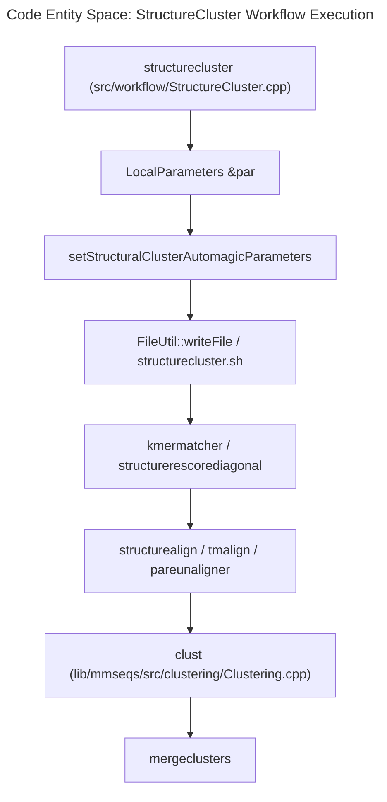
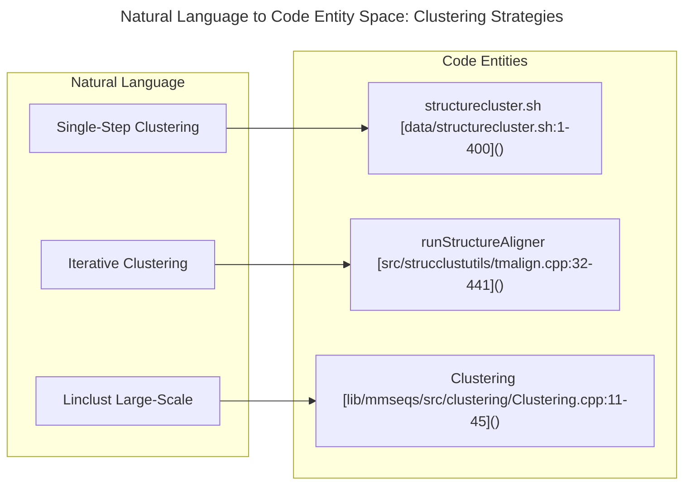
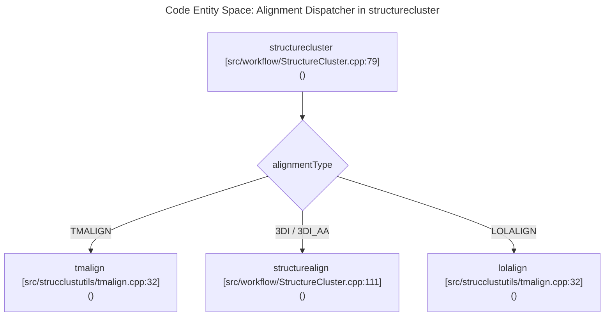
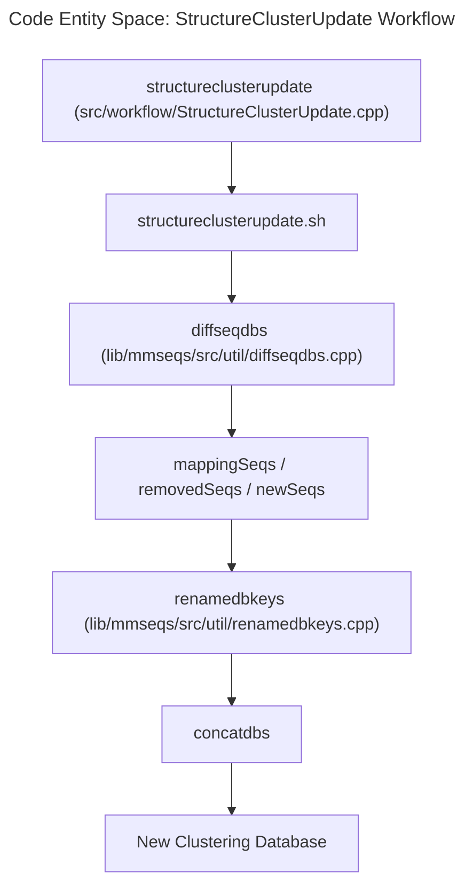

# Structure Clustering

<details>
<summary>Relevant source files</summary>

The following files were used as context for generating this wiki page:

- [data/structurecluster.sh](data/structurecluster.sh)
- [data/structureclusterupdate.sh](data/structureclusterupdate.sh)
- [lib/mmseqs/lib/simd/simd.h](lib/mmseqs/lib/simd/simd.h)
- [lib/mmseqs/src/clustering/Clustering.cpp](lib/mmseqs/src/clustering/Clustering.cpp)
- [lib/mmseqs/src/clustering/Clustering.h](lib/mmseqs/src/clustering/Clustering.h)
- [lib/mmseqs/src/util/diffseqdbs.cpp](lib/mmseqs/src/util/diffseqdbs.cpp)
- [lib/mmseqs/src/util/renamedbkeys.cpp](lib/mmseqs/src/util/renamedbkeys.cpp)
- [src/strucclustutils/pareunaligner.cpp](src/strucclustutils/pareunaligner.cpp)
- [src/strucclustutils/tmalign.cpp](src/strucclustutils/tmalign.cpp)
- [src/workflow/StructureCluster.cpp](src/workflow/StructureCluster.cpp)
- [src/workflow/StructureClusterUpdate.cpp](src/workflow/StructureClusterUpdate.cpp)

</details>


## Purpose and Scope

Structure clustering in FoldSeek groups protein structures by structural similarity to organize large datasets, identify structural families, and reduce redundancy. This LEAF page covers the implementation of structure clustering workflows (`StructureCluster`, `structurecluster.sh`), cascaded clustering pipelines, alignment utilities (`tmalign`, `pareunaligner`), and incremental database updates (`structureclusterupdate`).

Sources: [src/workflow/StructureCluster.cpp:79-209](), [data/structurecluster.sh:46-124]()

---

## Workflow Architecture and Implementation

The structure clustering pipeline orchestrates multiple MMseqs2 and FoldSeek modules through C++ workflow wrappers and shell scripts. The entry point is `structurecluster` in `src/workflow/StructureCluster.cpp`, which sets up parameter defaults and executes `structurecluster.sh`.


Sources: [src/workflow/StructureCluster.cpp:79-209](), [data/structurecluster.sh:46-124]()

### Clustering Strategies

FoldSeek supports three main clustering modes:
- **Single-Step Clustering**: Fast execution via single-pass alignment and clustering [src/workflow/StructureCluster.cpp:68-71]().
- **Iterative Clustering**: Multi-step refinement governed by `clusterSteps` (default: 3 iterations) [src/workflow/StructureCluster.cpp:72-76]().
- **Linclust-based Clustering**: Employs exact $k$-mer matching (`kmermatcher`) followed by diagonal rescoring (`structurerescorediagonal`) to achieve near-linear complexity [data/structurecluster.sh:56-124]().


Sources: [src/workflow/StructureCluster.cpp:68-76](), [data/structurecluster.sh:56-124](), [src/strucclustutils/tmalign.cpp:32-441](), [lib/mmseqs/src/clustering/Clustering.cpp:11-45]()

---

## Parameter Automagic and Defaults

The function `setStructuralClusterAutomagicParameters` dynamically adjusts clustering thresholds based on input parameters like `seqIdThr`:

- Sensitivity (`-s`) is computed via `setAutomaticStructureClusterThreshold` [src/workflow/StructureCluster.cpp:23-33]().
- Clustering mode defaults to `SET_COVER` for symmetric coverage and `GREEDY_MEM` for asymmetric modes [src/workflow/StructureCluster.cpp:53-62]().
- Component bias correction is disabled when sequence identity threshold exceeds 0.7 [src/workflow/StructureCluster.cpp:36-40]().

```cpp
void setStructureClusterWorkflowDefaults(LocalParameters *p) {
    p->spacedKmer = true;
    p->covThr = 0.8;
    p->evalThr = 0.01;
    p->sortByStructureBits = 0;
    p->maxResListLen = 1000;
    p->kmersPerSequence = 300;
    p->alignmentMode = Parameters::ALIGNMENT_MODE_SCORE_COV_SEQID;
    p->compBiasCorrection = 0;
}
```
Sources: [src/workflow/StructureCluster.cpp:11-77]()

---

## Alignment and Scoring Modules

Structural alignment during clustering can utilize multiple algorithms depending on `alignmentType`:
- `structurealign`: Local 3Di or combined 3Di+AA alignment [src/workflow/StructureCluster.cpp:110-112]().
- `tmalign`: Global TM-score structural alignment (`runStructureAligner` in `src/strucclustutils/tmalign.cpp`) [src/strucclustutils/tmalign.cpp:32-441]().
- `pareunaligner`: Parallel unaligned coordinate alignment utilities (`pareunaligner` in `src/strucclustutils/pareunaligner.cpp`) [src/strucclustutils/pareunaligner.cpp:18-221]().


Sources: [src/workflow/StructureCluster.cpp:107-119](), [src/strucclustutils/tmalign.cpp:32-441](), [src/strucclustutils/pareunaligner.cpp:18-221]()

---

## Cluster Database Updates (`structureclusterupdate`)

Incremental clustering updates allow adding new sequences or structures to an existing clustering database without recomputing the entire dataset from scratch.

The update workflow is orchestrated by `structureclusterupdate` (`src/workflow/StructureClusterUpdate.cpp`) and `data/structureclusterupdate.sh` [src/workflow/StructureClusterUpdate.cpp:23-116](), [data/structureclusterupdate.sh:1-446]().

### Key Utility Modules in Database Updates

- **`diffseqdbs`**: Compares old and new sequence header databases to isolate removed, kept, and new sequences [lib/mmseqs/src/util/diffseqdbs.cpp:44-196]().
- **`renamedbkeys`**: Reassigns database keys according to mapping files to preserve identifier consistency [lib/mmseqs/src/util/renamedbkeys.cpp:40-191]().


Sources: [src/workflow/StructureClusterUpdate.cpp:23-116](), [data/structureclusterupdate.sh:1-446](), [lib/mmseqs/src/util/diffseqdbs.cpp:44-196](), [lib/mmseqs/src/util/renamedbkeys.cpp:40-191]()

---