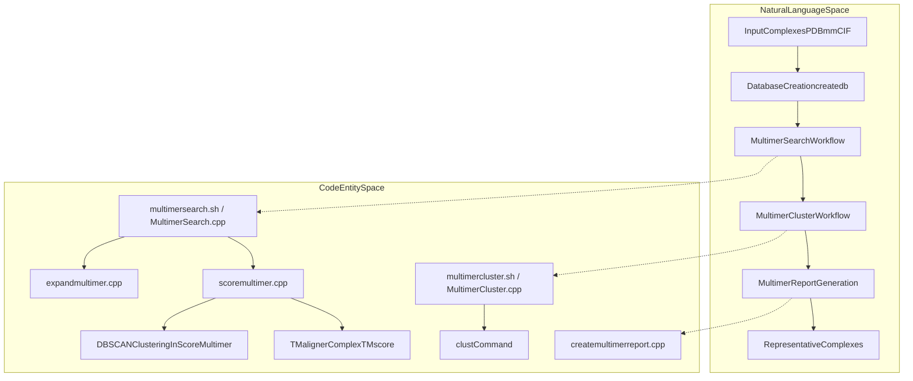
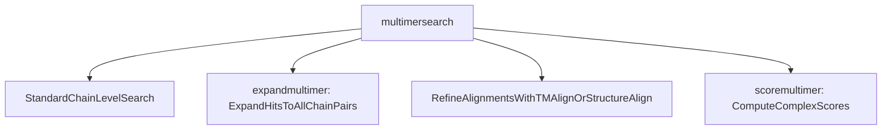
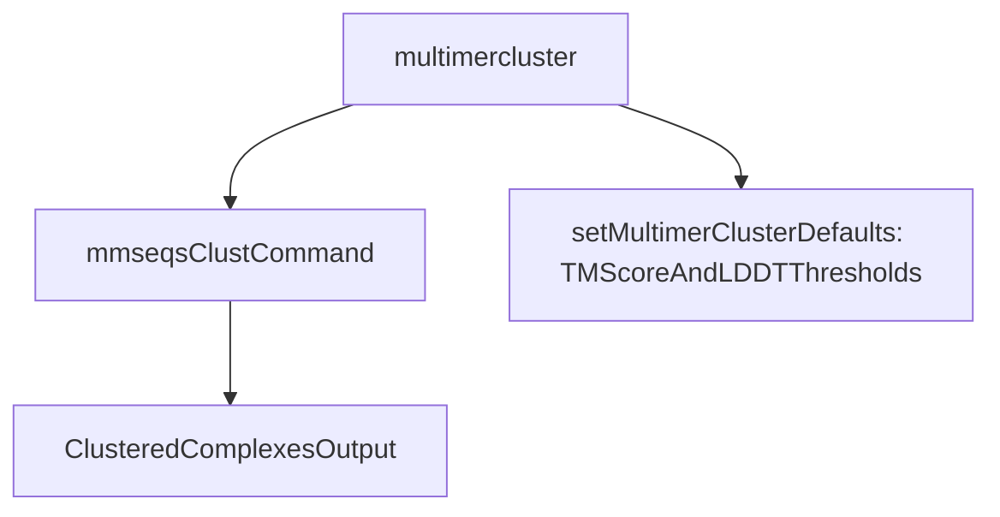
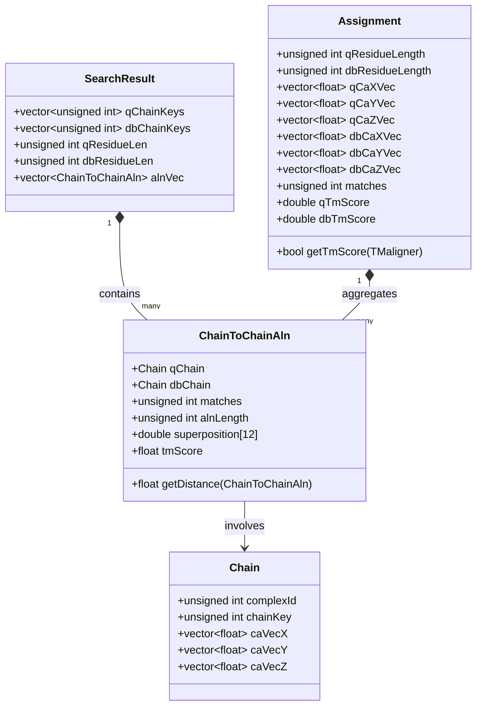
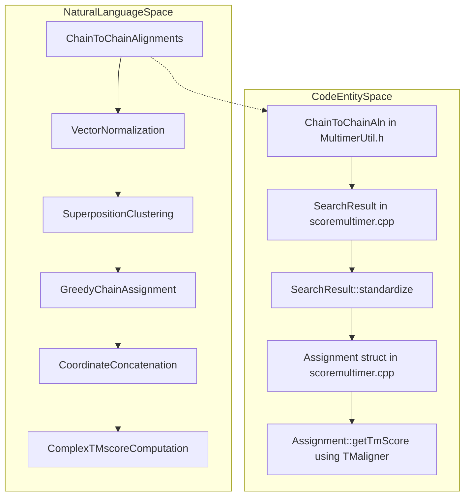
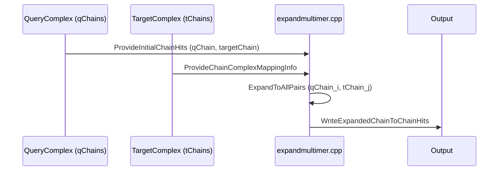

# Multimer Processing

Relevant source files

The following files were used as context for generating this wiki page:

- [data/easymultimercluster.sh](data/easymultimercluster.sh)
- [data/easymultimersearch.sh](data/easymultimersearch.sh)
- [data/multimercluster.sh](data/multimercluster.sh)
- [data/multimersearch.sh](data/multimersearch.sh)
- [src/strucclustutils/MultimerUtil.h](src/strucclustutils/MultimerUtil.h)
- [src/strucclustutils/convert2pdb.cpp](src/strucclustutils/convert2pdb.cpp)
- [src/strucclustutils/createmultimerreport.cpp](src/strucclustutils/createmultimerreport.cpp)
- [src/strucclustutils/expandmultimer.cpp](src/strucclustutils/expandmultimer.cpp)
- [src/strucclustutils/scoremultimer.cpp](src/strucclustutils/scoremultimer.cpp)
- [src/workflow/MultimerCluster.cpp](src/workflow/MultimerCluster.cpp)
- [src/workflow/MultimerSearch.cpp](src/workflow/MultimerSearch.cpp)

This page documents how FoldSeek handles protein complexes (multimers), i.e., structures containing multiple protein chains. The multimer processing functionality enables comprehensive pairwise and clustering analyses of protein complexes by combining chain-level alignments into complex-level scores, leveraging spatial superpositions, clustering, and scoring metrics such as complex TM-score and interface LDDT.

---

## Overview

Protein complexes require specialized handling beyond single-chain proteins because multiple chains and their interfaces must be considered simultaneously. FoldSeek implements this via a workflow consisting of:

- Expanding chain-to-chain hits into complex-to-complex hits  
- Scoring complexes holistically using aggregate TM-scores  
- Clustering complexes based on structural similarity  

The overall multimer processing pipeline bridges high-level user workflows to underlying C++ modules and scripts:

### Diagram: Multimer Processing Workflow and Code Mapping

Sources: [data/multimersearch.sh:1-63](), [src/workflow/MultimerSearch.cpp:11-119](), [src/strucclustutils/expandmultimer.cpp:27-154](), [src/strucclustutils/scoremultimer.cpp:19-160](), [data/multimercluster.sh:1-47](), [src/workflow/MultimerCluster.cpp:11-76](), [src/strucclustutils/createmultimerreport.cpp:87-192]()

- The `multimersearch` workflow runs initial chain-to-chain structure searches [data/multimersearch.sh:11-15](), [src/workflow/MultimerSearch.cpp:11-119]().  
- `expandmultimer` collects all chain pairs between the complexes involved in hits [src/strucclustutils/expandmultimer.cpp:27-154]().  
- `scoremultimer` aggregates chain alignments into consistent complex alignments, calculates TM-scores, and applies DBSCAN clustering on superpositions to remove inconsistent chain-pairings [src/strucclustutils/scoremultimer.cpp:19-160]().  
- The `multimercluster` workflow clusters complexes using the multimer scores [src/workflow/MultimerCluster.cpp:11-76](), [data/multimercluster.sh:1-47]().  
- Finally, `createmultimerreport` produces comprehensive reports mapping results back to chain and complex names [src/strucclustutils/createmultimerreport.cpp:87-192]().

Sources: [data/multimersearch.sh:1-63](), [src/workflow/MultimerSearch.cpp:11-119](), [src/strucclustutils/expandmultimer.cpp:27-154](), [src/strucclustutils/scoremultimer.cpp:19-324](), [data/multimercluster.sh:1-47](), [src/workflow/MultimerCluster.cpp:11-76](), [src/strucclustutils/createmultimerreport.cpp:18-192]()

---

## Core Workflows

### Multimer Search (`multimersearch`)

This command orchestrates the multimer structural search from query to target:

1. **Initial Chain-to-Chain Search**  
   Using the `search` command internally within `data/multimersearch.sh`, it performs a structural search between chains from query and target complexes [data/multimersearch.sh:11-15]().  
2. **Expansion with `expandmultimer`**  
   After initial hits, `expandmultimer` collects all chain pairs between query and target complexes that these hits belong to, enabling full complex-level pairing [src/strucclustutils/expandmultimer.cpp:27-154]().  
3. **Alignment Refinement and Scoring (`scoremultimer`)**  
   Optionally, refined structural alignments are computed (e.g., TM-align), and all chain-to-chain hits are aggregated to score the full complex alignments [data/multimersearch.sh:24-51]().

### Diagram: Multimer Search Execution Flow

Sources: [src/workflow/MultimerSearch.cpp:11-119](), [data/multimersearch.sh:1-63](), [src/strucclustutils/expandmultimer.cpp:27-154]()

Parameter tuning such as alignment algorithm, thresholds, and output format are configurable through parameters parsed and managed in `LocalParameters` [src/workflow/MultimerSearch.cpp:12-119]().

Sources: [src/workflow/MultimerSearch.cpp:11-119](), [data/multimersearch.sh:1-63]()

---

### Multimer Clustering (`multimercluster`)

After obtaining complex-level pairwise scores, `multimercluster` clusters complexes to identify groups of structurally similar multimers.

- Runs the `clust` command applying clustering based on multimer similarity scores [data/multimercluster.sh:35-39]().
- Uses thresholds such as TM-score and LDDT to filter significant alignments [src/workflow/MultimerCluster.cpp:11-29]().
- Responsible for grouping complexes sharing biologically relevant similarity.

### Diagram: Multimer Clustering Flow

Sources: [src/workflow/MultimerCluster.cpp:11-76](), [data/multimercluster.sh:1-47]()

Default filtering parameters (e.g., complex TM-score threshold 0.7) are set in `setMultimerClusterDefaults` within `MultimerCluster.cpp` [src/workflow/MultimerCluster.cpp:11-15]().

Sources: [src/workflow/MultimerCluster.cpp:11-76](), [data/multimercluster.sh:1-47]()

---

## Key Implementation Details

### Data Structures for Complex Representations

- **`Chain`:** Contains chain identifiers and C-alpha coordinate vectors (`caVecX`, `caVecY`, `caVecZ`) for that chain [src/strucclustutils/MultimerUtil.h:31-39]().  
- **`ChainToChainAln`:** Represents an alignment between a query chain and a target chain, including TM-score, alignment length, matches, and a 12-element transformation vector (`superposition`) that encodes rotation and translation [src/strucclustutils/MultimerUtil.h:41-117]().  
- **`SearchResult`:** Accumulates chain alignment results per query-target complex pair, holding involved chain keys and residue lengths [src/strucclustutils/scoremultimer.cpp:22-70]().  
- **`Assignment`:** Aggregates multiple chain alignments into a single complex-level alignment, storing concatenated coordinates and producing the complex TM-score via `TMaligner` [src/strucclustutils/scoremultimer.cpp:74-160]().

### Diagram: Complex Data Structure Relationships

Sources: [src/strucclustutils/MultimerUtil.h:31-117](), [src/strucclustutils/scoremultimer.cpp:22-160]()

---

### Complex TM-Score Calculation (`scoremultimer`)

The central module `scoremultimer` performs:

- **Feature Standardization:** Normalizes the superposition vectors encoding rotations and translations to emphasize consistent alignments and filter out noise [src/strucclustutils/scoremultimer.cpp:37-63]().  
- **DBSCAN Clustering on Superpositions:** Groups chain alignments by spatial similarity of transformations. Clusters represent sets of chain-to-chain alignments sharing a consistent 3D superposition of the complex.  
- **Greedy Assignment Per Cluster:** Within each cluster, assignments are made greedily to avoid duplicate usage of query or target chains, maximizing assignment scores.  
- **Complex TM-score Computation:**  
  - All paired C-alpha coordinates of assigned chains are concatenated into two coordinate lists (query and target) [src/strucclustutils/scoremultimer.cpp:98-105]().  
  - `TMaligner` is initialized with the query coordinates and computes the TM-score for the complex with the target coordinates [src/strucclustutils/scoremultimer.cpp:125-136]().  
  - The final complex TM-Score is normalized by the complex residue lengths and returned [src/strucclustutils/scoremultimer.cpp:134-135]().

### Diagram: Data Flow and Code Mapping in scoremultimer

Sources: [src/strucclustutils/scoremultimer.cpp:19-160](), [src/strucclustutils/MultimerUtil.h:41-117]()

---

### Expansion of Chain-to-Chain Hits to Full Complex Alignments (`expandmultimer`)

The `expandmultimer` command transforms sparse chain-to-chain hits into a more complete set by:

- Mapping each chain to its complex ID via `.lookup` files and mapping utilities [src/strucclustutils/expandmultimer.cpp:67-70]().  
- For a hit pair (query chain, target chain), all chains belonging to the respective complexes are enumerated [src/strucclustutils/expandmultimer.cpp:86-126]().  
- Produces output aligning each query chain in the query complex to every target chain in the target complex that is present in the database [src/strucclustutils/expandmultimer.cpp:115-125]().

### Diagram: Chain Expansion Sequence Flow

Sources: [src/strucclustutils/expandmultimer.cpp:27-154]()

---

### Reporting with `createmultimerreport`

The reporting tool aggregates the final results:

- Maps internal numeric chain keys to human-readable names using chain-key-to-complex mappings [src/strucclustutils/createmultimerreport.cpp:18-63]().  
- Produces tab-separated files containing complex-level TM-scores, complex coverage, individual chain TM-scores, and interface LDDT scores [src/strucclustutils/createmultimerreport.cpp:62]().  
- Incorporates alignment transformation matrices for visualization or downstream analysis [src/strucclustutils/createmultimerreport.cpp:62]().

Example output line fields (tab-separated):  
`qComplexName, tComplexName, qChains, tChains, qTMScore, tTMScore, transformationU, transformationT, qComplexCov, tComplexCov, qChainTM, tChainTM, interfaceLddtScore, assignmentId`

Sources: [src/strucclustutils/createmultimerreport.cpp:18-192]()

---

### Converting Complexes Back to PDB (`convert2pdb`)

`convert2pdb` supports exporting multimers to PDB or mmCIF with options to:

- Output single-chain PDB files  
- Output one file per complex (all chains merged)  
- Generate multi-model PDB files containing multiple complexes stacked [src/strucclustutils/convert2pdb.cpp:77-120]().  

It utilizes iterators over chain keys or complex IDs (`DbKeyIterator`, `MapIterator`) to extract chains from the FoldSeek database and writes atomic coordinates with appropriate headers [src/strucclustutils/convert2pdb.cpp:18-63](), [src/strucclustutils/convert2pdb.cpp:164-180]().

Sources: [src/strucclustutils/convert2pdb.cpp:18-180]()

---

## DBSCAN Clustering on Chain Alignments for Consistency

The `scoremultimer` module includes a specialized version of the DBSCAN algorithm to cluster chain-to-chain alignments by their spatial superposition vectors:

- Each chain alignment encodes a 12-dimensional vector (rotation matrix + translation) [src/strucclustutils/MultimerUtil.h:75-86]().  
- Pairwise distances are Euclidean distances between these vectors [src/strucclustutils/MultimerUtil.h:100-106]().  
- Clustering groups alignments with consistent superpositions, capturing structural symmetries or repeats in complexes.  
- This clustering helps to filter conflicting chain assignments and detect consistent complex-level alignments.

Sources: [src/strucclustutils/scoremultimer.cpp:180-324]()

---

## Parameters and Filtering Thresholds

Multimer processing supports several filtering parameters, primarily used in the clustering and scoring stages:

| Parameter             | Description                         | Default Value |
|-----------------------|-------------------------------------|--------------|
| `filtMultTmThr`       | Minimum TM-score for a complex alignment to be considered significant | 0.7          |
| `filtChainTmThr`      | Minimum TM-score for individual chain-to-chain alignments to be considered | 0.7          |
| `filtInterfaceLddtThr`| Minimum Interface LDDT score threshold | 0.3          |

Defaults are set in the `setMultimerClusterDefaults` function within `MultimerCluster.cpp` [src/workflow/MultimerCluster.cpp:11-16]().

Sources: [src/workflow/MultimerCluster.cpp:11-29]()

---

# References

- Multimer search and workflow script: [data/multimersearch.sh:1-63](), [src/workflow/MultimerSearch.cpp:11-119]()  
- Multimer clustering workflow: [data/multimercluster.sh:1-47](), [src/workflow/MultimerCluster.cpp:11-76]()  
- Chain expansion: [src/strucclustutils/expandmultimer.cpp:27-154]()  
- Complex scoring and TM-score calculation: [src/strucclustutils/scoremultimer.cpp:1-324](), [src/strucclustutils/MultimerUtil.h:20-117]()  
- Reporting: [src/strucclustutils/createmultimerreport.cpp:18-192]()  
- PDB exporting: [src/strucclustutils/convert2pdb.cpp:18-180]()

---