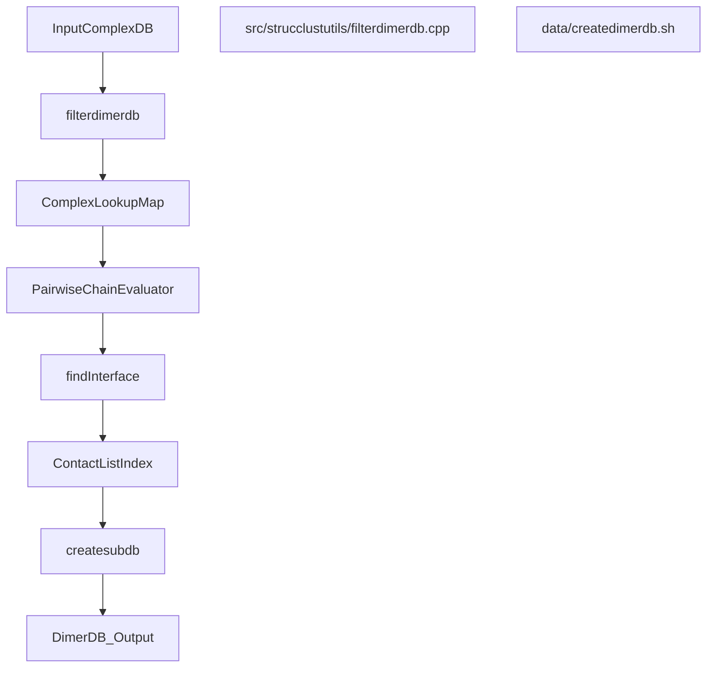
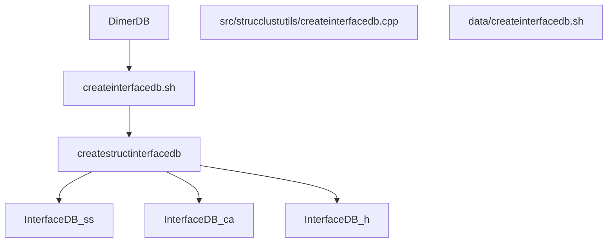
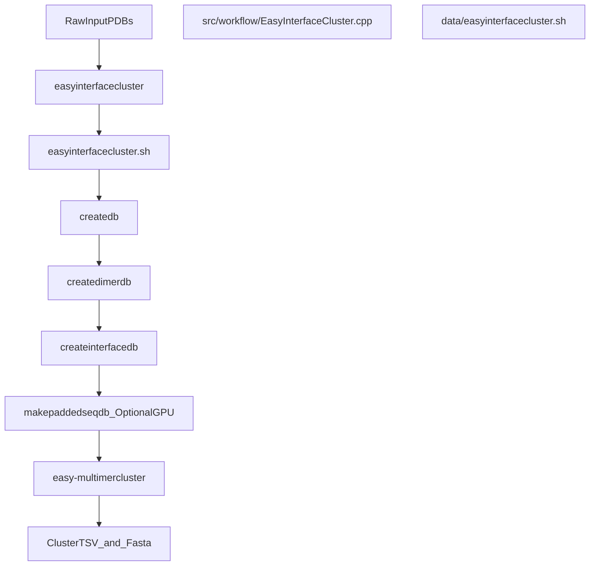

# Interface and Dimer Workflows

Relevant source files

The following files were used as context for generating this wiki page:

- [data/createdimerdb.sh](data/createdimerdb.sh)
- [data/createinterfacedb.sh](data/createinterfacedb.sh)
- [data/easyinterfacecluster.sh](data/easyinterfacecluster.sh)
- [data/easyinterfacesearch.sh](data/easyinterfacesearch.sh)
- [data/interfacecluster.sh](data/interfacecluster.sh)
- [data/interfacesearch.sh](data/interfacesearch.sh)
- [src/LocalCommandDeclarations.h](src/LocalCommandDeclarations.h)
- [src/strucclustutils/createinterfacedb.cpp](src/strucclustutils/createinterfacedb.cpp)
- [src/strucclustutils/createstructinterfacedb.cpp](src/strucclustutils/createstructinterfacedb.cpp)
- [src/strucclustutils/filterdimerdb.cpp](src/strucclustutils/filterdimerdb.cpp)
- [src/workflow/CreateDimerDb.cpp](src/workflow/CreateDimerDb.cpp)
- [src/workflow/EasyInterfaceCluster.cpp](src/workflow/EasyInterfaceCluster.cpp)
- [src/workflow/EasyInterfaceSearch.cpp](src/workflow/EasyInterfaceSearch.cpp)
- [src/workflow/InterfaceCluster.cpp](src/workflow/InterfaceCluster.cpp)
- [src/workflow/InterfaceSearch.cpp](src/workflow/InterfaceSearch.cpp)

## Purpose and Scope
This section details the architecture, workflows, and algorithms used in Foldseek for analyzing protein-protein interactions. Foldseek extends its structural alignment capabilities to protein complexes by constructing dimer databases (`createdimerdb`), extracting contacting residue pairs (`filterdimerdb`), generating specialized interface databases (`createinterfacedb`, `createstructinterfacedb`), and executing interface-centric search (`interfacesearch`, `easyinterfacesearch`) and clustering (`interfacecluster`, `easyinterfacecluster`) pipelines.

---

## 1. Dimer Database Construction (`createdimerdb` and `filterdimerdb`)
Proteins must first be decomposed or formatted into pairwise interacting chains (dimers) to analyze protein-protein interfaces. The workflow is orchestrated by `createdimerdb` (`[src/workflow/CreateDimerDb.cpp:16-47]()`) executing its companion shell script (`[data/createdimerdb.sh:1-102]()`).

The core heavy lifting for contact detection occurs in `filterdimerdb` (`[src/strucclustutils/filterdimerdb.cpp:17-91]()`). It reads a sequence database and its CA coordinate database (`_ca`), maps complex hierarchies via `.lookup` files, and evaluates inter-chain distances:

1. **Complex Hierarchy Parsing**: `getKeyToIdMapIdToKeysMapIdVec` parses the lookup files to group chains belonging to the same biological assembly or multimer complex (`[src/strucclustutils/filterdimerdb.cpp:27-31]()`).
2. **Pairwise Distance Screening**: For every pair of chains within a complex, CA coordinates are loaded via `Coordinate16::read()` (`[src/strucclustutils/filterdimerdb.cpp:65-75]()`).
3. **Interface Identification**: `findInterface()` evaluates atomic proximity using the configured `distanceThreshold` and `squareThreshold` (`[src/strucclustutils/filterdimerdb.cpp:77-78]()`). Chains meeting the minimum residue contact count (`minResidueNum`) are written out as valid dimer contact pairs (`[src/strucclustutils/filterdimerdb.cpp:78-81]()`).
4. **Subdatabase Generation**: `data/createdimerdb.sh` uses MMseqs2 subdatabase utilities (`createsubdb`, `tsv2db`) to construct sliced `_ss`, `_ca`, and `_h` databases containing only the contacting dimer entities (`[data/createdimerdb.sh:20-50]()`).

*Sources: `[src/workflow/CreateDimerDb.cpp:16-47]()`, `[data/createdimerdb.sh:1-102](), `[src/strucclustutils/filterdimerdb.cpp:17-91]()`*

---

## 2. Interface Database Creation (`createinterfacedb` and `createstructinterfacedb`)
Once dimer databases are established, Foldseek isolates the specific interface residues (those forming direct inter-chain contacts) into an interface database using `createinterfacedb` (`[src/strucclustutils/createinterfacedb.cpp:9-25]()`, `[data/createinterfacedb.sh:1-45]()`).

The underlying C++ binary `createstructinterfacedb` (`[src/LocalCommandDeclarations.h:38]()`) processes the dimer coordinates, filters out non-interface positions, and generates an interface-restricted structural representation. The resulting database retains structural profiles (`_ss`, `_ca`) and header annotations (`_h`) strictly for the localized binding regions, drastically speeding up subsequent structural comparisons by ignoring non-interacting backbone surfaces.

*Sources: `[src/LocalCommandDeclarations.h:6-43]()`, `[src/strucclustutils/createinterfacedb.cpp:9-25](), `[data/createinterfacedb.sh:1-45]()`*

---

## 3. Interface Search and Clustering Workflows
Foldseek provides core workflow executables and user-friendly `easy-*` wrappers for searching and clustering protein interfaces.

### Core Workflows: `interfacesearch` and `interfacecluster`
* **`interfacesearch`**: Orchestrated by `[src/workflow/InterfaceSearch.cpp:31-86]()` and `data/interfacesearch.sh`, this workflow takes a query interface/dimer database and a target database, checks whether they are preformatted interface databases (or builds them on the fly via `createdimerdb` and `createinterfacedb`), handles GPU padding (`makepaddedseqdb`), and delegates alignment to multimer search routines (`multimersearch`).
* **`interfacecluster`**: Managed by `[src/workflow/InterfaceCluster.cpp:38-84]()` and `[data/interfacecluster.sh:1-82]()`, this workflow clusters interface databases using `multimercluster` after ensuring correct database formatting and optional padding.

### Easy Workflows: `easyinterfacesearch` and `easyinterfacecluster`
The simplified entry points accept raw PDB/mmCIF files or fasta/sequence inputs directly:
* **`easyinterfacesearch`**: Defined in `[src/workflow/EasyInterfaceSearch.cpp:31-87]()` and `[data/easyinterfacesearch.sh]()`. Automatically creates databases from input files, builds dimers, extracts interfaces, pads for GPU acceleration if requested, and executes the search pipeline.
* **`easyinterfacecluster`**: Defined in `[src/workflow/EasyInterfaceCluster.cpp:39-87]()` and `[data/easyinterfacecluster.sh:1-134]()`. Automatically constructs query/target dimer and interface databases, executes `easy-multimercluster`, and outputs representative sequences (`_rep_seq.fasta`) and cluster mappings (`_cluster.tsv`) (`[data/easyinterfacecluster.sh:61-64]()`).

*Sources: `[src/workflow/InterfaceSearch.cpp:31-86](), `[src/workflow/InterfaceCluster.cpp:38-84]()`, `[src/workflow/EasyInterfaceSearch.cpp:31-87]()`, `[src/workflow/EasyInterfaceCluster.cpp:39-87]()`, `[data/easyinterfacecluster.sh:1-134]()`, `[data/interfacecluster.sh:1-82]()`*

---

## 4. Interface LDDT and Scoring Filters
Interface matching relies on specific threshold parameters configured during workflow initialization (e.g., `setInterfaceSearchDefaults`, `setEasyInterfaceClusterDefaults`) (`[src/workflow/EasyInterfaceCluster.cpp:12-21]()`, `[src/workflow/InterfaceSearch.cpp:11-20]()`):

* `filtInterfaceLddtThr`: Minimum interface Local Distance Difference Test (LDDT) threshold to filter low-quality interface matches.
* `filtMultTmThr`: Multimer TM-score threshold (default `0.4`) (`[src/workflow/EasyInterfaceCluster.cpp:15]()`).
* `filtChainTmThr`: Individual chain TM-score threshold.
* `lddtThr`: General structural LDDT threshold (default `0.2`) (`[src/workflow/EasyInterfaceCluster.cpp:20]()`).
* `exhaustiveSearch`: Configures search depth (default `1`) (`[src/workflow/EasyInterfaceCluster.cpp:18]()`).

These thresholds ensure that reported interface alignments share significant local contact topology rather than random backbone overlaps.

*Sources: `[src/workflow/EasyInterfaceCluster.cpp:12-37]()`, `[src/workflow/InterfaceSearch.cpp:11-30]()`*

---