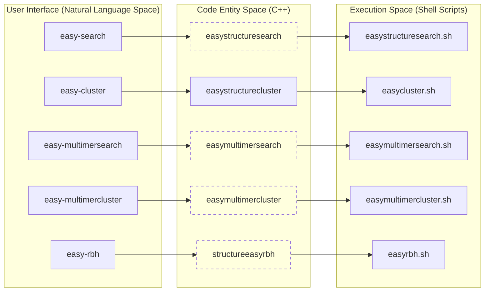
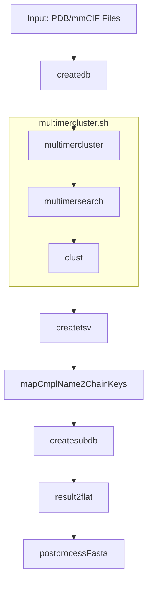

# Easy Commands

Relevant source files

The following files were used as context for generating this wiki page:

- [data/easymultimercluster.sh](data/easymultimercluster.sh)
- [data/easymultimersearch.sh](data/easymultimersearch.sh)
- [data/easystructuresearch.sh](data/easystructuresearch.sh)
- [data/multimercluster.sh](data/multimercluster.sh)
- [src/workflow/EasyMultimerCluster.cpp](src/workflow/EasyMultimerCluster.cpp)
- [src/workflow/EasyMultimerSearch.cpp](src/workflow/EasyMultimerSearch.cpp)
- [src/workflow/EasyStructureCluster.cpp](src/workflow/EasyStructureCluster.cpp)
- [src/workflow/EasyStructureRbh.cpp](src/workflow/EasyStructureRbh.cpp)
- [src/workflow/EasyStructureSearch.cpp](src/workflow/EasyStructureSearch.cpp)

Easy Commands in FoldSeek provide simplified interfaces for the most common protein structure analysis workflows. These commands abstract away the complexity of configuring multiple individual steps by combining them into single, user-facing commands with sensible defaults. This page documents the architecture, implementation, and usage of the Easy Commands system, including structure search, clustering, multimer processing, and reciprocal best hits (`easy-rbh`).

For information about the core commands that Easy Commands wrap, see [Command System](#2.1).

## Purpose and Scope

Easy Commands are designed to make FoldSeek accessible to users by handling the orchestration of internal tools. They automate:

- **Database creation**: Automatically running `createdb` on PDB/mmCIF files if a database is not provided [data/easystructuresearch.sh:15-32]().
- **Parameter configuration**: Setting optimized defaults for structural search and clustering [src/workflow/EasyStructureSearch.cpp:17-25]().
- **Environment management**: Creating temporary directories and managing intermediate files [src/workflow/EasyStructureSearch.cpp:96-102]().
- **GPU acceleration**: Handling database padding required for GPU-based search via `makepaddedseqdb` [data/easystructuresearch.sh:34-55]().

Sources: [data/easystructuresearch.sh:15-55](), [src/workflow/EasyStructureSearch.cpp:17-102]()

## Command Architecture

Easy Commands follow a consistent implementation pattern where a C++ handler sets up parameters and generates a shell script that executes the actual pipeline.

### Natural Language to Code Entity Mapping

The following diagram bridges the user-facing command names to the internal C++ handlers and the shell scripts they execute.

Sources: [src/workflow/EasyStructureSearch.cpp:33](), [src/workflow/EasyMultimerSearch.cpp:10](), [src/workflow/EasyMultimerCluster.cpp:11](), [src/workflow/EasyStructureCluster.cpp:20](), [src/workflow/EasyStructureRbh.cpp:14]()

## Workflow Implementation

### Easy Structure Search (`easy-search`)
The `easy-search` workflow performs pairwise structural comparisons between query structures and a target database. It is implemented in `easystructuresearch` [src/workflow/EasyStructureSearch.cpp:33]() and orchestrated by `easystructuresearch.sh` [data/easystructuresearch.sh:1]().

**Data Flow for Structure Search:**
1. **Query Database Creation**: Checks if the query is a database; otherwise, creates one using `createdb` [data/easystructuresearch.sh:15-24]().
2. **Target Preparation**: Prepares the target database, handling GPU padding via `makepaddedseqdb` if requested [data/easystructuresearch.sh:26-56]().
3. **Search Execution**: Runs the `search` workflow on the query and target databases [data/easystructuresearch.sh:58-63]().
4. **Greedy Best Hits**: Optionally summarizes results using `summarizeresult` if `--greedy-best-hits` is active [data/easystructuresearch.sh:65-72]().
5. **Alignment Conversion**: Formats output files using `convertalis` [data/easystructuresearch.sh:74-78]().

Sources: [src/workflow/EasyStructureSearch.cpp:33-156](), [data/easystructuresearch.sh:1-145]()

### Easy Structure Cluster (`easy-cluster`)
The `easy-cluster` command groups protein structures by structural similarity. It wraps database creation, clustering, and representative sequence extraction.

Sources: [src/workflow/EasyStructureCluster.cpp:20-72]()

### Easy Multimer Search (`easy-multimersearch`)
The `easy-multimersearch` command wraps the complex multimer scoring and expansion logic. It handles the transition from individual chain searches to complex-level alignments.

**Data Flow for Multimer Search:**
1. **Database Creation**: If the input is not a database, it runs `createdb` [src/workflow/EasyMultimerSearch.cpp:127]().
2. **GPU Padding**: If `--gpu` is enabled, it prepares a padded sequence database using `makepaddedseqdb` [src/workflow/EasyMultimerSearch.cpp:125]().
3. **Multimer Search**: Invokes the `multimersearch` core command [src/workflow/EasyMultimerSearch.cpp:128]().
4. **Alignment Conversion**: Converts the binary results into user-readable formats using `convertalis` [src/workflow/EasyMultimerSearch.cpp:129]().
5. **Report Generation**: Optionally creates a multimer report using `createmultimerreport` [src/workflow/EasyMultimerSearch.cpp:130]().

Sources: [src/workflow/EasyMultimerSearch.cpp:10-143](), [data/easymultimersearch.sh:1-95]()

### Easy Multimer Cluster (`easy-multimercluster`)
The `easy-multimercluster` workflow clusters protein complexes. It is unique because it must map representative chains back to their parent complexes to provide a coherent result.

Sources: [data/easymultimercluster.sh:106-131](), [data/multimercluster.sh:29-39](), [data/easymultimercluster.sh:29-60]()

### Easy Reciprocal Best Hits (`easy-rbh`)
The `easy-rbh` command computes reciprocal best hits between two sets of structures, ensuring bidirectional optimal matches. It is initialized by `structureeasyrbh` [src/workflow/EasyStructureRbh.cpp:14]() and executed via `easyrbh.sh`.

Sources: [src/workflow/EasyStructureRbh.cpp:1-119]()

## Implementation Details

### Parameter Handling and Defaults
Easy commands set specific defaults in C++ before parsing user arguments. For example, `easy-search` defaults to a k-mer size of 6 and a sensitivity of 9.5 [src/workflow/EasyStructureSearch.cpp:17-25](). `easy-rbh` configures alignment modes and soft sequence splitting:
- `removeTmpFiles`: `true` [src/workflow/EasyStructureRbh.cpp:39]()
- `alignmentMode`: `Parameters::ALIGNMENT_MODE_SCORE_COV_SEQID` [src/workflow/EasyStructureRbh.cpp:40]()
- `createdbMode`: `Parameters::SEQUENCE_SPLIT_MODE_SOFT` [src/workflow/EasyStructureRbh.cpp:42]()

Sources: [src/workflow/EasyStructureSearch.cpp:17-25](), [src/workflow/EasyStructureRbh.cpp:39-42]()

### Script Generation and Execution
The C++ handlers do not execute logic directly. Instead, they:
1. Use `LocalParameters` to build parameter strings for sub-commands like `SEARCH_PAR` or `CLUSTER_PAR` [src/workflow/EasyStructureSearch.cpp:129-143]().
2. Use `CommandCaller` to define environment variables (e.g., `TMP_PATH`, `RESULT`) [src/workflow/EasyMultimerCluster.cpp:39-55]().
3. Write an embedded shell script to the temporary directory using `FileUtil::writeFile` [src/workflow/EasyMultimerCluster.cpp:58]().
4. Execute the script via `cmd.execProgram()` [src/workflow/EasyMultimerCluster.cpp:60]().

Sources: [src/workflow/EasyStructureSearch.cpp:129-155](), [src/workflow/EasyMultimerCluster.cpp:39-60]()

### Temporary File Management
Temporary directories are created using a hash of the input parameters to allow for potential result reuse via the `--reuse-latest` flag [src/workflow/EasyStructureSearch.cpp:97-101](). If `removeTmpFiles` is true (default), the generated shell scripts invoke `rmdb` to clean up intermediate FoldSeek databases [data/easystructuresearch.sh:95-145](), [data/easymultimercluster.sh:148-175]().

Sources: [src/workflow/EasyStructureSearch.cpp:97-101](), [data/easystructuresearch.sh:95-145](), [data/easymultimercluster.sh:148-175]()

## Available Easy Commands Reference

| Command | C++ Entry Point | Script | Key Wrapped Commands |
|---------|-----------------|--------|----------------------|
| `easy-search` | `easystructuresearch` [src/workflow/EasyStructureSearch.cpp:33]() | `easystructuresearch.sh` | `createdb`, `search`, `convertalis` |
| `easy-cluster` | `easystructurecluster` [src/workflow/EasyStructureCluster.cpp:20]() | `easycluster.sh` | `createdb`, `cluster`, `createtsv` |
| `easy-multimersearch` | `easymultimersearch` [src/workflow/EasyMultimerSearch.cpp:10]() | `easymultimersearch.sh` | `multimersearch`, `convertalis`, `createmultimerreport` |
| `easy-multimercluster` | `easymultimercluster` [src/workflow/EasyMultimerCluster.cpp:11]() | `easymultimercluster.sh` | `multimercluster`, `createtsv`, `createsubdb` |
| `easy-rbh` | `structureeasyrbh` [src/workflow/EasyStructureRbh.cpp:14]() | `easyrbh.sh` | `createdb`, `search`, `convertalis` |

Sources: [src/workflow/EasyStructureSearch.cpp:33](), [src/workflow/EasyStructureCluster.cpp:20](), [src/workflow/EasyMultimerSearch.cpp:10](), [src/workflow/EasyMultimerCluster.cpp:11](), [src/workflow/EasyStructureRbh.cpp:14]()

---