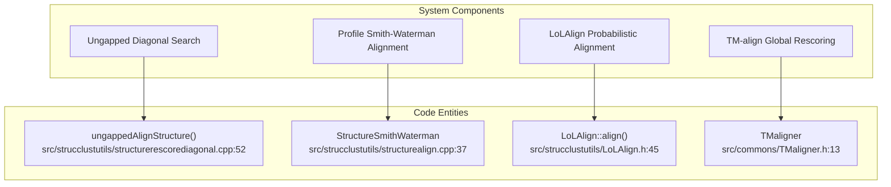
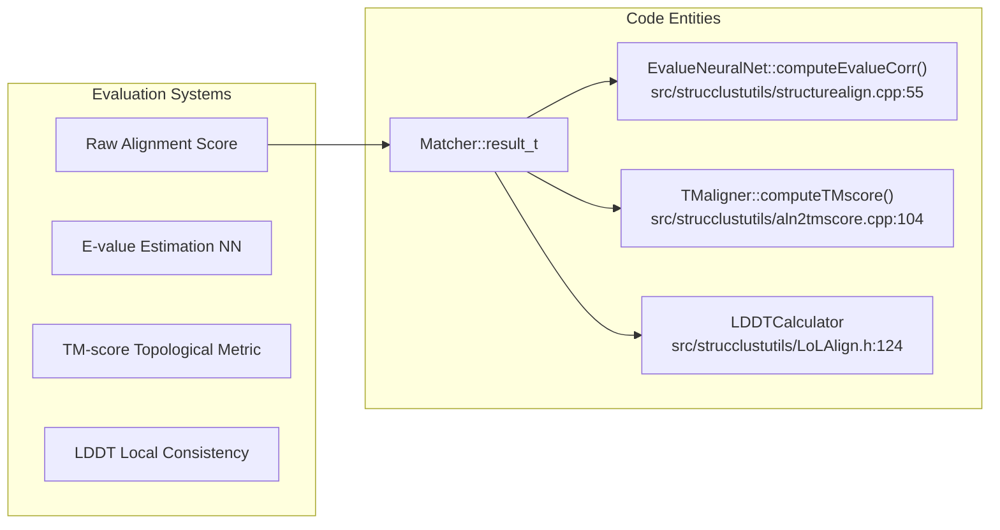
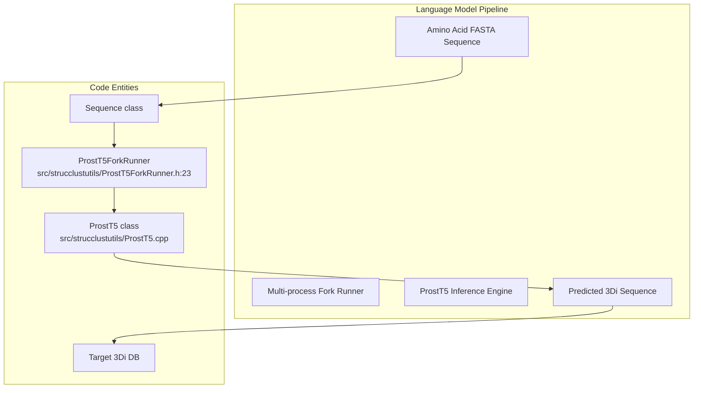

# Algorithms

Relevant source files

The following files were used as context for generating this wiki page:

- [.github/results.png](.github/results.png)
- [README.md](README.md)
- [src/strucclustutils/LoLAlign.cpp](src/strucclustutils/LoLAlign.cpp)
- [src/strucclustutils/LoLAlign.h](src/strucclustutils/LoLAlign.h)
- [src/strucclustutils/LoLAlignProbability.h](src/strucclustutils/LoLAlignProbability.h)
- [src/strucclustutils/LoLAlignProbabilityWeights.h](src/strucclustutils/LoLAlignProbabilityWeights.h)
- [src/strucclustutils/aln2tmscore.cpp](src/strucclustutils/aln2tmscore.cpp)
- [src/strucclustutils/structurealign.cpp](src/strucclustutils/structurealign.cpp)
- [src/strucclustutils/structureconvertalis.cpp](src/strucclustutils/structureconvertalis.cpp)
- [src/strucclustutils/structurerescorediagonal.cpp](src/strucclustutils/structurerescorediagonal.cpp)

This page provides an overview of the key algorithms implemented in Foldseek for protein structure alignment, statistical scoring, 3Di structural alphabet representation, and protein language model integration. 

As a parent page, this section outlines the high-level architecture and relationships between algorithms. For deep technical details, implementation specifics, and parameter tunings, refer to the respective child pages linked below.

---

## 4.1 Structure Alignment

Foldseek performs rapid and sensitive protein structure alignment by combining amino acid and 3Di structural sequences. The primary alignment engine uses `StructureSmithWaterman` [src/strucclustutils/structurealign.cpp:37-112]() for profiled gapped alignments, preceded by ungapped diagonal prefilters (`ungappedAlignStructure` in [src/strucclustutils/structurerescorediagonal.cpp:52-104]()) to prune search spaces. Additionally, Foldseek integrates **LoLAlign** (`LoLAlign` in [src/strucclustutils/LoLAlign.h:20-23]()), a probabilistic log-odds local alignment algorithm that anchors seed regions using forward-backward alignment (`FwBwAligner`) and scores homology probability via a specialized multi-layer perceptron (`LoLAlignProbability` in [src/strucclustutils/LoLAlignProbability.h:19-27]()).

Title: "Structure Alignment and Search Pipeline"

Sources: [src/strucclustutils/structurealign.cpp:37-112](), [src/strucclustutils/structurerescorediagonal.cpp:52-104](), [src/strucclustutils/LoLAlign.h:20-46]()

For details, see [Structure Alignment](#4.1).

---

## 4.2 Scoring and Evaluation

Alignments are evaluated using a combination of statistical models and structural metrics. E-values are computed using neural network estimators (`EvalueNeuralNet` via `computeEvalueCorr` [src/strucclustutils/structurealign.cpp:55-55](), [src/strucclustutils/structurerescorediagonal.cpp:106-106]()) based on score distributions and database parameters. Global structural similarity is assessed via TM-score using the `TMaligner` class [src/commons/TMaligner.h:13-13]() and `aln2tmscore` utility [src/strucclustutils/aln2tmscore.cpp:17-17](), while local structural consistency is quantified using LDDT calculations (`LDDTCalculator` in [src/strucclustutils/LoLAlign.h:124-124]()).

Title: "Scoring and Statistical Evaluation Pipeline"

Sources: [src/strucclustutils/structurealign.cpp:55-55](), [src/strucclustutils/aln2tmscore.cpp:17-136](), [src/strucclustutils/LoLAlign.h:124-124]()

For details, see [Scoring and Evaluation](#4.2).

---

## 4.3 3Di Representation

Foldseek transforms 3D protein backbones into 1D structural alphabets called **3Di**. This is achieved by computing virtual center interactions and local geometric descriptors (`structureto3didescriptor`), which are then classified into a 20-state structural alphabet (`Alphabet3Di` in [lib/3di/structureto3di.h:112-115]()) using neural network inference (`KerasModel`).

For details, see [3Di Representation](#4.3).

Sources: [lib/3di/structureto3di.h:8-39]()

---

## 4.4 Protein Language Models

To bypass the requirement of explicit 3D structures, Foldseek integrates with **ProstT5**. Protein language model inference is executed via the `ProstT5` class and orchestrated at scale using `ProstT5ForkRunner` (`prostt5Forking`) across CPU/GPU execution backends [src/strucclustutils/ProstT5ForkRunner.h:23-62](). This predicts 3Di structural sequences directly from amino acid sequences.

Title: "PLM Integration and Prediction Pipeline"

Sources: [src/strucclustutils/ProstT5ForkRunner.h:23-62]()

For details, see [Protein Language Models](#4.4).

---

## Summary of Core Algorithm Classes

| System Component | Primary Class / Function | Code Reference |
| :--- | :--- | :--- |
| **Profile Alignment** | `StructureSmithWaterman` | [src/strucclustutils/structurealign.cpp:37]() |
| **Probabilistic Alignment** | `LoLAlign` | [src/strucclustutils/LoLAlign.h:20]() |
| **Ungapped Prefilter** | `ungappedAlignStructure` | [src/strucclustutils/structurerescorediagonal.cpp:52]() |
| **Statistical E-value** | `EvalueNeuralNet` | [src/strucclustutils/structurealign.cpp:55]() |
| **Global TM-score** | `TMaligner` | [src/commons/TMaligner.h:13]() |
| **Homology Probability** | `LoLAlignProbability` | [src/strucclustutils/LoLAlignProbability.h:19]() |
| **Language Model Runner**| `ProstT5ForkRunner` | [src/strucclustutils/ProstT5ForkRunner.h:23]() |

Sources: [src/strucclustutils/structurealign.cpp:37-55](), [src/strucclustutils/LoLAlign.h:20](), [src/strucclustutils/structurerescorediagonal.cpp:52](), [src/commons/TMaligner.h:13](), [src/strucclustutils/LoLAlignProbability.h:19](), [src/strucclustutils/ProstT5ForkRunner.h:23]()

---