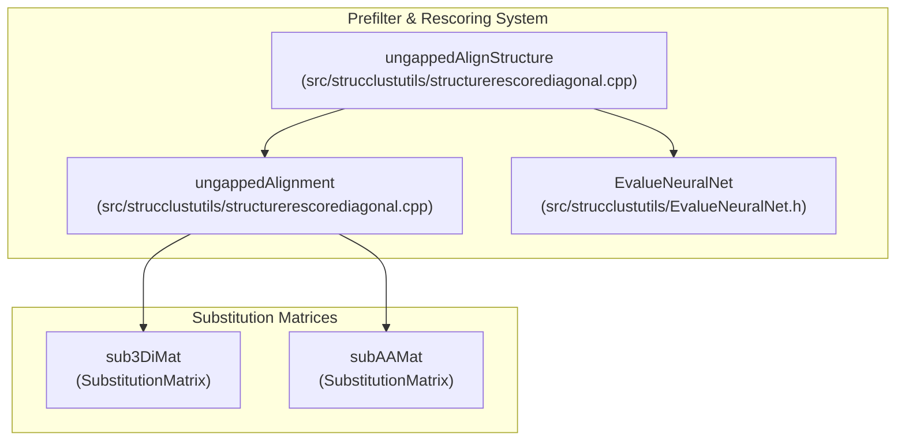
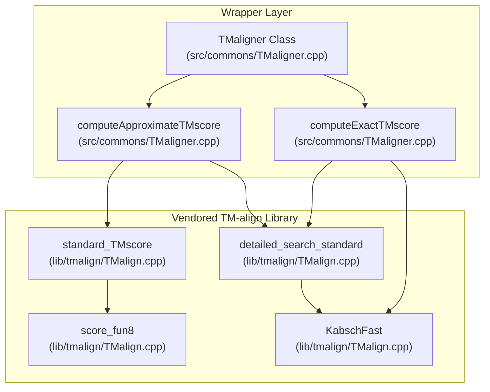

# Structure Alignment

Relevant source files

The following files were used as context for generating this wiki page:

- [data/evalue_nn.kerasify](data/evalue_nn.kerasify)
- [lib/tmalign/CMakeLists.txt](lib/tmalign/CMakeLists.txt)
- [lib/tmalign/Kabsch.h](lib/tmalign/Kabsch.h)
- [lib/tmalign/TMalign.cpp](lib/tmalign/TMalign.cpp)
- [lib/tmalign/TMalign.h](lib/tmalign/TMalign.h)
- [lib/tmalign/affineneedlemanwunsch.cpp](lib/tmalign/affineneedlemanwunsch.cpp)
- [lib/tmalign/affineneedlemanwunsch.h](lib/tmalign/affineneedlemanwunsch.h)
- [lib/tmalign/basic_fun.h](lib/tmalign/basic_fun.h)
- [src/commons/StructureSmithWaterman.cpp](src/commons/StructureSmithWaterman.cpp)
- [src/commons/StructureSmithWaterman.h](src/commons/StructureSmithWaterman.h)
- [src/commons/TMaligner.cpp](src/commons/TMaligner.cpp)
- [src/commons/TMaligner.h](src/commons/TMaligner.h)
- [src/strucclustutils/EvalueNeuralNet.cpp](src/strucclustutils/EvalueNeuralNet.cpp)
- [src/strucclustutils/EvalueNeuralNet.h](src/strucclustutils/EvalueNeuralNet.h)
- [src/strucclustutils/aln2tmscore.cpp](src/strucclustutils/aln2tmscore.cpp)
- [src/strucclustutils/samplemulambda.cpp](src/strucclustutils/samplemulambda.cpp)
- [src/strucclustutils/structurealign.cpp](src/strucclustutils/structurealign.cpp)
- [src/strucclustutils/structureconvertalis.cpp](src/strucclustutils/structureconvertalis.cpp)
- [src/strucclustutils/structurerescorediagonal.cpp](src/strucclustutils/structurerescorediagonal.cpp)

The Structure Alignment system in FoldSeek enables precise comparison and alignment of protein 3D structures. It implements a multi-stage pipeline ranging from fast ungapped diagonal scanning to sensitive 3Di+AA local alignment via `StructureSmithWaterman`, refined structural superposition via `TMaligner` (backed by the vendored `lib/tmalign` library), and probabilistic local alignment via `LoLAlign`.

For deep details on probabilistic alignment, seed anchoring, and homology classification, see [LoLAlign Probabilistic Alignment](#4.1.1). For scoring and E-value evaluation, see [Scoring and Evaluation](#4.2). For the 3Di structural alphabet, see [3Di Representation](#4.3).

## Ungapped Prefilter and Rescoring Pipeline

During initial alignment stages and prefiltering, FoldSeek executes fast ungapped diagonal scanning and rescoring to evaluate diagonal matches before engaging full dynamic programming or structural superposition `[src/strucclustutils/structurerescorediagonal.cpp:52-104]`. This pipeline combines 3Di structural alphabet substitution matrices and amino acid substitution matrices to score diagonals efficiently.

**Ungapped Prefilter Logic Flow**

Sources:
- `[src/strucclustutils/structurerescorediagonal.cpp:23-50]()`
- `[src/strucclustutils/structurerescorediagonal.cpp:52-104]()`

## StructureSmithWaterman (3Di+AA)

The `StructureSmithWaterman` class implements a striped Smith-Waterman algorithm adapted for simultaneous scoring of amino acid and 3Di structural alphabet sequences `[src/commons/StructureSmithWaterman.cpp:37-112]`, `[src/commons/StructureSmithWaterman.h:55-60]()`.

**Key Implementation Features:**
- **Profile Construction**: Builds SIMD scoring profiles for both AA and 3Di sequences (`profile_aa_byte`, `profile_3di_byte`) `[src/commons/StructureSmithWaterman.cpp:53-64]()`.
- **SIMD Parallelism**: Uses SIMD vector registers (`simd_int`) to execute parallel dynamic programming updates across database sequence segments `[src/commons/StructureSmithWaterman.cpp:48-51]()`.
- **Composition Bias Correction**: Adjusts scoring using `aaBiasCorrection` and `aaBiasCorrectionScale` to account for local sequence composition biases `[src/commons/StructureSmithWaterman.cpp:44-45]()`.

Sources:
- `[src/commons/StructureSmithWaterman.cpp:37-112]()`
- `[src/commons/StructureSmithWaterman.h:112-141]()`

## TMaligner and Vendored TM-align Library

For accurate structural superposition and TM-score calculation, FoldSeek integrates a C++ port of the TM-align algorithm housed in `lib/tmalign/` and wrapped by `TMaligner` `[src/commons/TMaligner.cpp:13-31]`, `[lib/tmalign/TMalign.cpp:1-201]()`.

**System Mapping: TM-align Components to Code Entities**

Sources:
- `[src/commons/TMaligner.cpp:13-202]()`
- `[lib/tmalign/TMalign.cpp:76-213]()`

## LoLAlign Probabilistic Alignment Overview

`LoLAlign` is a log-odds local alignment algorithm used for sensitive structural comparisons. It computes posterior probabilities via a forward-backward aligner, performs anchor-based seed refinement, and classifies homologies using a neural network classifier (`LoLAlignProbability`).

For complete details on the algorithm, seed anchoring, multi-domain mode, and probability weights, see [LoLAlign Probabilistic Alignment](#4.1.1).

Sources:
- `[src/strucclustutils/structurealign.cpp:32-144]()`

---