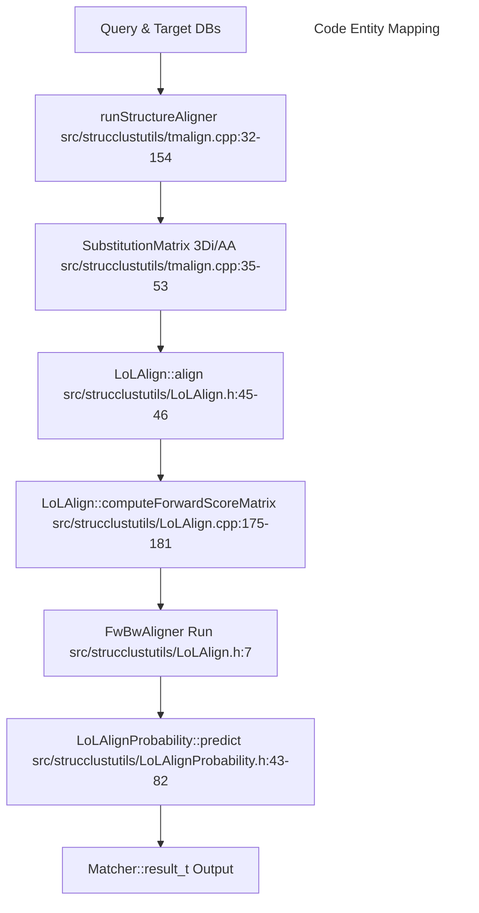
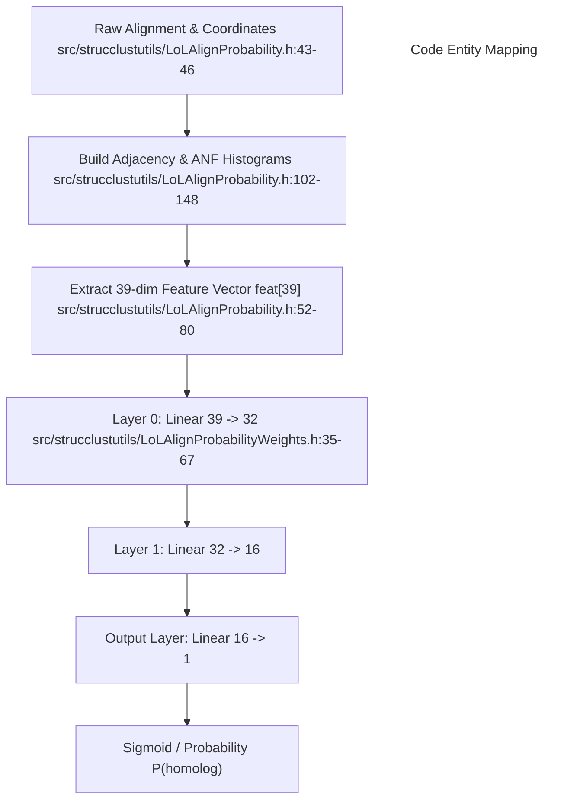

# LoLAlign Probabilistic Alignment

Relevant source files

The following files were used as context for generating this wiki page:

- [.github/results.png](.github/results.png)
- [README.md](README.md)
- [data/structurecluster.sh](data/structurecluster.sh)
- [lib/mmseqs/lib/simd/simd.h](lib/mmseqs/lib/simd/simd.h)
- [src/strucclustutils/LoLAlign.cpp](src/strucclustutils/LoLAlign.cpp)
- [src/strucclustutils/LoLAlign.h](src/strucclustutils/LoLAlign.h)
- [src/strucclustutils/LoLAlignProbability.h](src/strucclustutils/LoLAlignProbability.h)
- [src/strucclustutils/LoLAlignProbabilityWeights.h](src/strucclustutils/LoLAlignProbabilityWeights.h)
- [src/strucclustutils/pareunaligner.cpp](src/strucclustutils/pareunaligner.cpp)
- [src/strucclustutils/tmalign.cpp](src/strucclustutils/tmalign.cpp)
- [src/workflow/StructureCluster.cpp](src/workflow/StructureCluster.cpp)

## Purpose and Scope

LoLAlign is a sensitive and fast probabilistic protein structure alignment algorithm implemented in Foldseek [README.md:15](). It computes local alignments by combining structural alphabet (`3Di`) and amino acid log-odds scoring matrices with a forward-backward probabilistic alignment framework [src/strucclustutils/LoLAlign.h:25](). 

This page provides a deep technical dive into the LoLAlign architecture, covering its log-odds scoring matrices, seed anchoring via the forward-backward aligner (`FwBwAligner`), multi-domain alignment handling, and the v20 Multilayer Perceptron (MLP) homology probability classifier (`LoLAlignProbability`, `LoLAlignProbabilityWeights`).

---

## Log-Odds Local Alignment Core (`LoLAlign`)

The core of the LoLAlign algorithm is encapsulated in the `LoLAlign` class [src/strucclustutils/LoLAlign.h:20](). It takes precalculated query coordinates and target structural sequences, constructs forward score matrices using combination profiles of structural states (`3Di`) and amino acid sequences (`AA`), and performs probabilistic local alignment.

The alignment process is initiated via `tmalign.cpp` (`runStructureAligner`), which allocates per-thread `LoLAlign` and `FwBwAligner` instances when the alignment type is set to LoLAlign [src/strucclustutils/tmalign.cpp:118]().

*Diagram 1: Natural Language Space to Code Entity Space mapping the high-level LoLAlign execution pipeline from `runStructureAligner` to probability classification.*

Sources: `src/strucclustutils/LoLAlign.h:20-50`, `src/strucclustutils/tmalign.cpp:32-154`

---

## Seed Anchoring with the Forward-Backward Aligner

To handle large conformational changes and speed up local alignment, LoLAlign employs a two-stage seed anchoring and refinement scheme:

1. **Candidate Seed Selection**: Initial high-scoring diagonal matches or local window matches are identified as candidate start anchors (`candidateSeeds`, `refineSeeds`) [src/strucclustutils/LoLAlign.cpp:29-36]().
2. **Forward-Backward SIMD Kernel**: The `FwBwAligner` executes a forward-backward pass using score matrices and gap penalties (`startAnchorGo`, `startAnchorGe`, `startAnchorT`) to compute posterior probabilities over alignment paths [src/strucclustutils/LoLAlign.cpp:211-213]().
3. **Block Rescaling**: The target sequence length is padded to a multiple of SIMD vector lengths (`VECSIZE_FLOAT`), and blocks are dynamically scaled to prevent numerical underflow during the forward-backward pass [src/strucclustutils/tmalign.cpp:136-143]().

Sources: `src/strucclustutils/LoLAlign.cpp:29-66`, `src/strucclustutils/tmalign.cpp:136-152`

---

## Multi-Domain Mode

Proteins containing multiple structural domains often challenge standard global or semi-global aligners. LoLAlign supports a specialized `multiDomain` flag passed to `initQuery()` and `align()` [src/strucclustutils/LoLAlign.h:43-46](). 

When `multiDomain` is active:
- The alignment algorithm permits multiple independent local alignment paths (domains) between the query and target pair.
- Gap extension and opening penalties across domain boundaries are modulated to allow domain insertions or circular permutations without severe score penalties.

Sources: `src/strucclustutils/LoLAlign.h:43-46`, `src/strucclustutils/LoLAlign.cpp:164-168`

---

## v20 MLP Homology Probability Classifier (`LoLAlignProbability`)

The v20 classifier (`LoLAlignProbability`) evaluates alignment hits using a 39-feature Multilayer Perceptron (MLP) to output a calibrated homology probability $P(\text{homolog})$ [src/strucclustutils/LoLAlignProbability.h:1-12](). Weights and biases are statically compiled from `homology_classifier_cv0_v20.pt` via `LoLAlignProbabilityWeights.h` [src/strucclustutils/LoLAlignProbabilityWeights.h:1-6]().

### Feature Extraction Architecture
The classifier extracts 39 numerical features per alignment pair [src/strucclustutils/LoLAlignProbability.h:52-80]():
- **Base Scalars (Features 0–7)**: E-value, log E-value, bit score, transformed bit score, average LDDT score (`LDDTCalculator`), log alignment length, gap fraction, and real gap fraction.
- **Atomic Neighborhood Frequency (ANF) Histograms (Features 8–21)**: 7-bin histograms of aligned neighbors within a $20\text{ \AA}$ radius for both query and target.
- **Sequence Separation Features (Features 22–38)**: `tamax`, `qsep`, and `qfrac` features capturing spatial and sequential distribution of contacts across sequence separation bins.

*Diagram 2: Natural Language Space to Code Entity Space mapping the feature extraction and feed-forward operations of `LoLAlignProbability::predict` using weights defined in `lolprobw`.*

Sources: `src/strucclustutils/LoLAlignProbability.h:19-83`, `src/strucclustutils/LoLAlignProbabilityWeights.h:10-67`

---