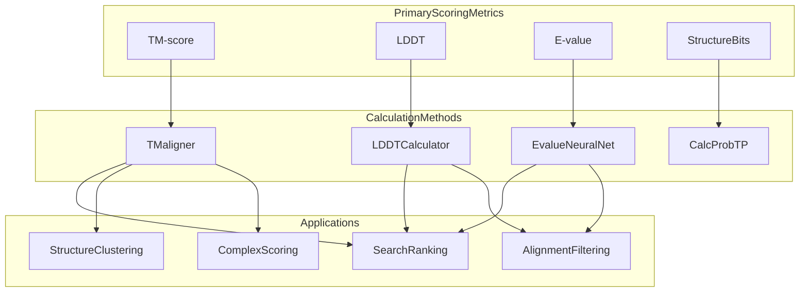
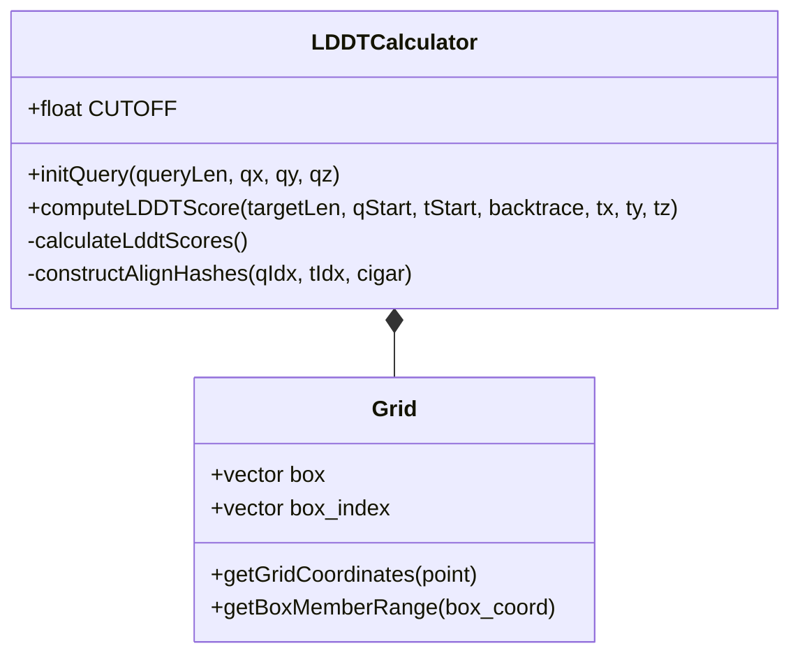
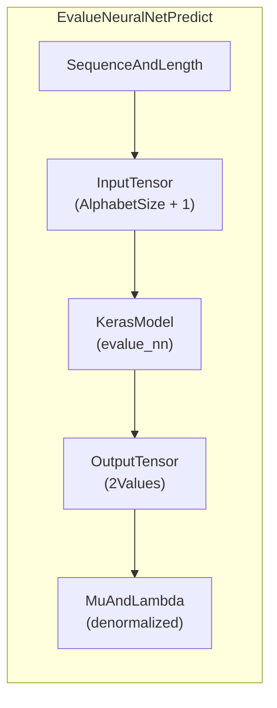

# Scoring and Evaluation

<details>
<summary>Relevant source files</summary>

The following files were used as context for generating this wiki page:

- [data/evalue_nn.kerasify](data/evalue_nn.kerasify)
- [src/commons/CalcProbTP.h](src/commons/CalcProbTP.h)
- [src/commons/LDDT.cpp](src/commons/LDDT.cpp)
- [src/commons/LDDT.h](src/commons/LDDT.h)
- [src/commons/StructureSmithWaterman.cpp](src/commons/StructureSmithWaterman.cpp)
- [src/commons/StructureSmithWaterman.h](src/commons/StructureSmithWaterman.h)
- [src/commons/TMaligner.cpp](src/commons/TMaligner.cpp)
- [src/commons/TMaligner.h](src/commons/TMaligner.h)
- [src/strucclustutils/EvalueNeuralNet.cpp](src/strucclustutils/EvalueNeuralNet.cpp)
- [src/strucclustutils/EvalueNeuralNet.h](src/strucclustutils/EvalueNeuralNet.h)
- [src/strucclustutils/samplemulambda.cpp](src/strucclustutils/samplemulambda.cpp)

</details>


This document explains the scoring metrics and evaluation methods used in FoldSeek to quantify the quality of structural alignments. The scoring system is essential for ranking search results, measuring structural similarity, and assessing the quality of identified matches. For information about the actual structural alignment algorithms, see [Structure Alignment](4.1).

## Overview of Scoring Metrics

FoldSeek employs multiple complementary scoring metrics to evaluate structural alignments:


Sources: `[src/commons/LDDT.h:13-168]()`, `[src/strucclustutils/EvalueNeuralNet.h:11-46]()`, `[src/commons/CalcProbTP.h:6-31]()`

## TM-score (Template Modeling Score)

TM-score is a length-normalized metric that measures the similarity of two protein structures. It ranges from 0 to 1, where 1 indicates a perfect match.

### Calculation and Properties

TM-score is calculated based on the optimal structural superposition. In FoldSeek, the `TMaligner` class handles the execution of the TM-align algorithm and supports both approximate and exact scoring modes (`computeAppoximateTMscore`, `computeExactTMscore`) `[src/commons/TMaligner.h:13-76]`, `[src/commons/TMaligner.cpp:13-186]()`. 

The normalization length can be adjusted using standard parameter sets for search `[src/commons/TMaligner.cpp:89-90]()`.

Sources: `[src/commons/TMaligner.h:13-76]`, `[src/commons/TMaligner.cpp:13-186]()`

## LDDT (Local Distance Difference Test)

LDDT evaluates local structural accuracy by comparing distances between residue pairs, measuring the preservation of local distance patterns rather than global superposition.

### Calculation and Implementation

The `LDDTCalculator` class implements the algorithm using spatial indexing to maintain performance `[src/commons/LDDT.h:13-168]`.


Sources: `[src/commons/LDDT.h:13-168]`, `[src/commons/LDDT.cpp:14-133]()`

Key implementation details:
1. **Cutoff**: Uses a `15.0` Ångstrom cutoff (`CUTOFF`) for residue pair evaluation `[src/commons/LDDT.h:15]()`.
2. **Spatial Indexing**: The `Grid` struct partitions the search space into cells of size `CUTOFF` to avoid $O(N^2)$ distance checks `[src/commons/LDDT.h:21-56]()`.
3. **Scoring**: Scores are calculated by checking distance differences against thresholds within `calculateLddtScores()` `[src/commons/LDDT.cpp:157-215]()`.
4. **Normalization**: Normalization weights are precomputed per query residue `[src/commons/LDDT.cpp:100-116]()`.

Sources: `[src/commons/LDDT.h:13-168]`, `[src/commons/LDDT.cpp:14-215]()`

## E-value Estimation via Neural Network

FoldSeek uses a neural network (`EvalueNeuralNet`) to predict the Gumbel distribution parameters ($\mu$ and $\lambda$) required for E-value estimation, accounting for sequence and structure composition.

### EvalueNeuralNet Implementation

The `EvalueNeuralNet` class loads a pre-trained Keras model (`evalue_nn_kerasify`) via `kerasify` to perform inference `[src/strucclustutils/EvalueNeuralNet.h:11-46]`, `[src/strucclustutils/EvalueNeuralNet.cpp:9-16]()`.


Sources: `[src/strucclustutils/EvalueNeuralNet.h:11-46]`, `[src/strucclustutils/EvalueNeuralNet.cpp:18-34]()`

1. **Input**: The network takes the residue composition counts and total sequence length `[src/strucclustutils/EvalueNeuralNet.cpp:18-25]()`.
2. **Prediction**: `predictMuLambda()` returns $\mu$ and $\lambda$ after applying linear scaling parameters `[src/strucclustutils/EvalueNeuralNet.cpp:28-34]()`.
3. **E-value Formula**:
   - `computePvalue()`: Calculates log P-value using the Gumbel distribution `[src/strucclustutils/EvalueNeuralNet.h:24-33]()`.
   - `computeEvalue()` / `computeEvalueCorr()`: Combines P-value with the database residue count (`logDbResidueCount`) to yield E-values and corrected E-values `[src/strucclustutils/EvalueNeuralNet.h:35-45]()`.
4. **Parameter Sampling**: The `samplemulambda` utility (`[src/strucclustutils/samplemulambda.cpp:1-823]()`) provides histogram accumulation and EVD fitting capabilities adapted from HMMER3 for empirical score distribution calibration.

Sources: `[src/strucclustutils/EvalueNeuralNet.h:11-46]`, `[src/strucclustutils/EvalueNeuralNet.cpp:9-34]`, `[src/strucclustutils/samplemulambda.cpp:1-100]()`

## StructureBits and Probabilistic Scoring

FoldSeek utilizes probabilistic scoring to estimate the likelihood that an alignment is a True Positive (TP).

### Calculation Logic (`CalcProbTP`)

The `CalcProbTP` class computes the probability of a true positive given a raw alignment score using fitted Gamma distributions for TPs and FPs `[src/commons/CalcProbTP.h:6-31]()`:

```cpp
  static float calculate(const float score){
    if (score <= 10){
      return 0;
    }
    if (score >= 100){
      return 1.0;
    }
    float p_tp = (0.8279 * gamma_pdf(1.8123, 1/46.0042, score) + 0.1721 * gamma_pdf(1.0057, 1/563.5014, score)) * 0.1023;
    float p_fp = (0.34 * gamma_pdf(4.9259, 1/4.745, score) + 0.66 * gamma_pdf(9.4834, 1/1.3136, score)) * 0.8977;
    return 1 / (1 + (p_fp / p_tp));
  }
```
Sources: `[src/commons/CalcProbTP.h:6-31]()`

---