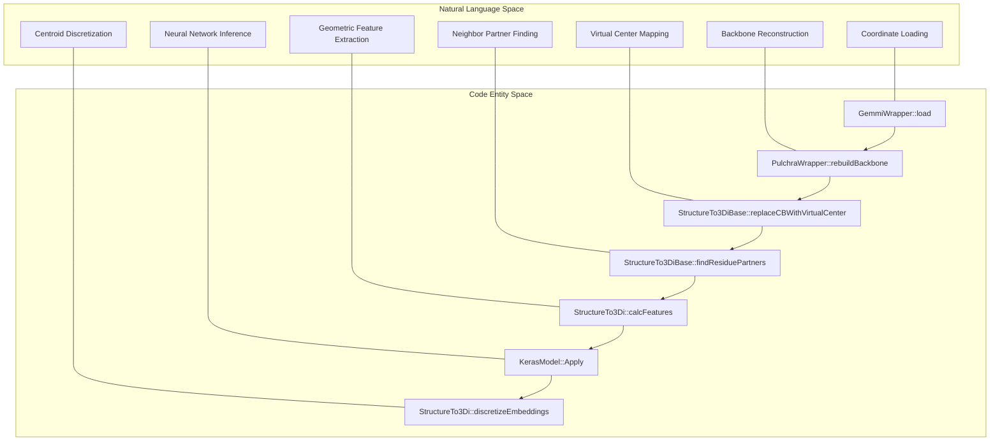
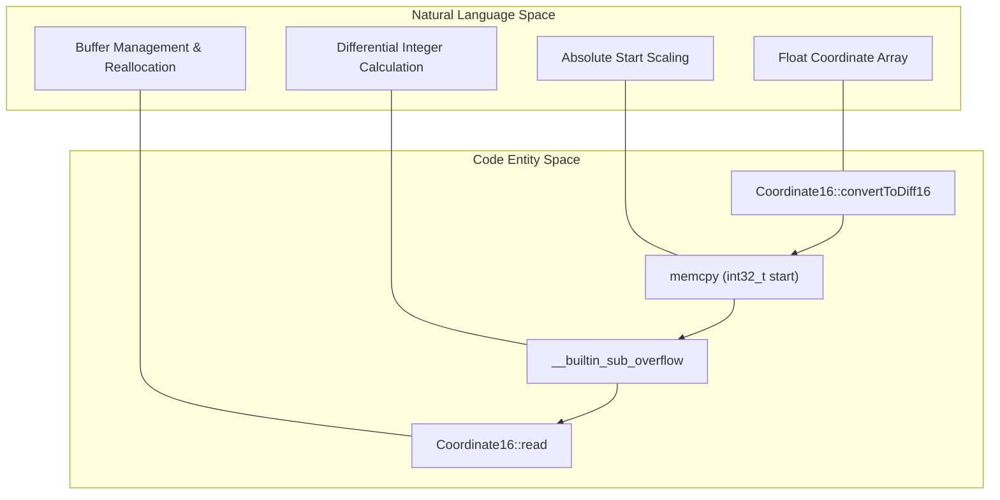
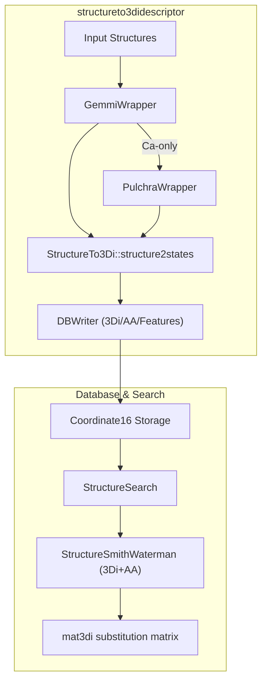

# 3Di Representation

Relevant source files

The following files were used as context for generating this wiki page:

- [data/encoder_weights_3di.kerasify](data/encoder_weights_3di.kerasify)
- [data/mat3di.out](data/mat3di.out)
- [data/mat3diSeqDist.out](data/mat3diSeqDist.out)
- [lib/3di/CMakeLists.txt](lib/3di/CMakeLists.txt)
- [lib/3di/structureto3di.cpp](lib/3di/structureto3di.cpp)
- [lib/3di/structureto3di.h](lib/3di/structureto3di.h)
- [lib/3di/structureto3diseqdist.cpp](lib/3di/structureto3diseqdist.cpp)
- [lib/3di/structureto3diseqdist.h](lib/3di/structureto3diseqdist.h)
- [lib/kerasify/CMakeLists.txt](lib/kerasify/CMakeLists.txt)
- [lib/kerasify/keras_model.cpp](lib/kerasify/keras_model.cpp)
- [lib/kerasify/keras_model.h](lib/kerasify/keras_model.h)
- [lib/pulchra/CMakeLists.txt](lib/pulchra/CMakeLists.txt)
- [lib/pulchra/LICENSE](lib/pulchra/LICENSE)
- [lib/pulchra/nco_data.h](lib/pulchra/nco_data.h)
- [lib/pulchra/pulchra.cpp](lib/pulchra/pulchra.cpp)
- [lib/pulchra/pulchra.h](lib/pulchra/pulchra.h)
- [lib/pulchra/pulchra_common.h](lib/pulchra/pulchra_common.h)
- [src/commons/Coordinate16.h](src/commons/Coordinate16.h)
- [src/strucclustutils/PulchraWrapper.cpp](src/strucclustutils/PulchraWrapper.cpp)
- [src/strucclustutils/PulchraWrapper.h](src/strucclustutils/PulchraWrapper.h)
- [src/strucclustutils/structureto3didescriptor.cpp](src/strucclustutils/structureto3didescriptor.cpp)

## Purpose and Overview

The 3Di representation is a core component of FoldSeek that converts complex 3D protein structures into 1D sequences of categorical states encoding local structural environments. This maps structural comparison onto efficient sequence alignment algorithms. This page details the encoder neural network in `lib/3di`, the `mat3di` substitution matrix, `kerasify` inference mechanics, descriptor generation via `structureto3didescriptor`, backbone reconstruction using Pulchra, and spatial coordinate compression via `Coordinate16`.

Sources: [lib/3di/structureto3di.h:1-136](), [src/strucclustutils/structureto3didescriptor.cpp:22-163](), [src/commons/Coordinate16.h:7-79]()

## Core Concepts

The 3Di structural alphabet maps the local 3D neighborhood of each amino acid into a single letter from a 20-letter alphabet through geometric feature extraction, neural network projection, and discretization.

### Code-to-Logic Mapping: 3Di Generation

Sources: [lib/3di/structureto3di.h:78-136](), [lib/3di/structureto3di.cpp:161-285](), [src/strucclustutils/structureto3didescriptor.cpp:73-136](), [lib/pulchra/pulchra.cpp:71-246]()

## 3Di Computation Algorithm

The conversion pipeline executed by `StructureTo3Di` involves several distinct processing stages:

### 1. Backbone Reconstruction

When input files lack full backbone coordinates (e.g., C-alpha only models), `PulchraWrapper::rebuildBackbone` reconstructs missing $N$ and $C$ atom positions based on C-alpha chains [src/strucclustutils/structureto3didescriptor.cpp:105-118]().

Sources: [src/strucclustutils/structureto3didescriptor.cpp:105-118](), [lib/pulchra/pulchra.cpp:71-246]()

### 2. Virtual Center Creation

Beta-carbon ($C_\beta$) positions (or virtual centers replacing them) are computed to standardize spatial orientation using `approxCBetaPosition` [lib/3di/structureto3di.cpp:49-67]() and `calcVirtualCenter` [lib/3di/structureto3di.cpp:73-99]().

Sources: [lib/3di/structureto3di.cpp:108-122](), [lib/3di/structureto3di.cpp:49-67](), [lib/3di/structureto3di.cpp:73-99]()

### 3. Residue Partner Identification

The algorithm searches for the spatially closest neighboring virtual center for each residue via `findResiduePartners` [lib/3di/structureto3di.cpp:136-157]().

Sources: [lib/3di/structureto3di.cpp:136-157]()

### 4. Feature Calculation

For each valid residue pair, a 10-dimensional feature vector (`Alphabet3Di::FEATURE_CNT`) is computed in `calcFeatures` [lib/3di/structureto3di.cpp:168-187]() capturing unit vector dot products and sequence separation metrics [lib/3di/structureto3di.cpp:184-185]().

Sources: [lib/3di/structureto3di.cpp:168-187](), [lib/3di/structureto3di.h:12]()

### 5. Neural Network Inference via Kerasify

The 10D feature vector is evaluated by a feed-forward neural network loaded via the lightweight `KerasModel` container [lib/3di/structureto3di.cpp:161-165](). Weights are compiled from `encoder_weights_3di.kerasify` [data/keras_weights_3di.kerasify]() into a 2D embedding space (`Alphabet3Di::EMBEDDING_DIM`) [lib/3di/structureto3di.h:13]().

Sources: [lib/3di/structureto3di.cpp:217-231](), [lib/3di/structureto3di.h:13]()

### 6. Discretization

The 2D embedding coordinates are mapped to the nearest of 20 predefined cluster centroids (`Alphabet3Di::centroids`) [lib/3di/structureto3di.h:18-39](), assigning a discrete 3Di state character.

Sources: [lib/3di/structureto3di.cpp:233-255](), [lib/3di/structureto3di.h:18-39]()

Sources: [lib/3di/structureto3di.h:78-136](), [lib/3di/structureto3di.cpp:1-285]()

## 3Di Substitution Matrix

Scoring between 3Di sequences relies on the `mat3di` substitution matrix loaded from `mat3di.out` [data/mat3di.out:1-25]().

| Property | Value / Detail |
|----------|----------------|
| Dimensions | $21 \times 21$ (20 states + 'X') |
| Score Range | -17 to +10 [data/mat3di.out:5-24]() |
| Scale Lambda | 0.351568 [data/mat3di.out:3]() |

Sources: [data/mat3di.out:1-25](), [src/strucclustutils/structureto3didescriptor.cpp:58]()

## Coordinate Compression (`Coordinate16`)

To minimize storage overhead for coordinate-heavy databases, FoldSeek compresses 3D float coordinates into 16-bit integer differential formats using `Coordinate16` [src/commons/Coordinate16.h:7-79]().

### Code-to-Logic Mapping: Coordinate Compression

`Coordinate16::convertToDiff16` scales floating-point coordinates by $1000.0$, stores the absolute start as an `int32_t`, and encodes subsequent steps as 16-bit differences (`int16_t`) with overflow detection [src/commons/Coordinate16.h:60-74](). `Coordinate16::read` decodes this representation back into floating-point buffers dynamically [src/commons/Coordinate16.h:15-57]().

Sources: [src/commons/Coordinate16.h:7-79]()

## Pipeline Integration

Sources: [src/strucclustutils/structureto3didescriptor.cpp:55-156](), [lib/3di/structureto3di.h:83-85](), [data/mat3di.out:1-25](), [src/commons/Coordinate16.h:7-79]()

### Key Classes and Files

| Component | Description | File |
|-----------|-------------|------|
| `StructureTo3Di` | Neural encoder & 3Di state assignment | [lib/3di/structureto3di.h](), [lib/3di/structureto3di.cpp]() |
| `PulchraWrapper` | Backbone reconstruction wrapper | [src/strucclustutils/PulchraWrapper.h](), [lib/pulchra/pulchra.cpp]() |
| `Coordinate16` | 16-bit differential coordinate compression | [src/commons/Coordinate16.h]() |
| `KerasModel` | Lightweight Keras inference engine | [lib/kerasify/keras_model.h]() |
| `mat3di.out` | 3Di substitution matrix definition | [data/mat3di.out]() |

Sources: [lib/3di/structureto3di.h:78-135](), [src/commons/Coordinate16.h:7-79](), [src/strucclustutils/structureto3didescriptor.cpp:73-75]()

---