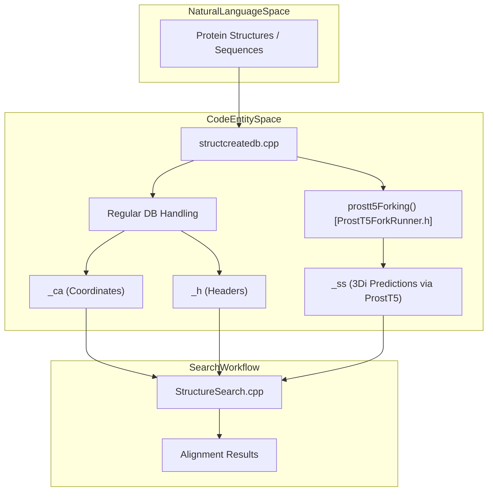
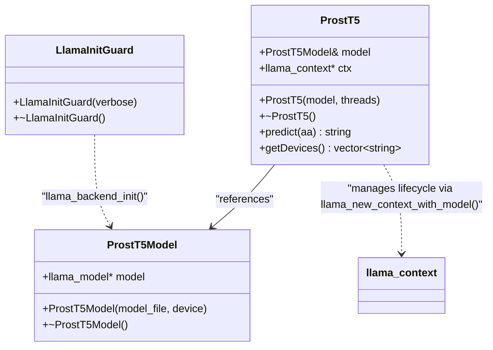

# Protein Language Models

Relevant source files

The following files were used as context for generating this wiki page:

- [src/strucclustutils/GemmiWrapper.cpp](src/strucclustutils/GemmiWrapper.cpp)
- [src/strucclustutils/GemmiWrapper.h](src/strucclustutils/GemmiWrapper.h)
- [src/strucclustutils/ProstT5.cpp](src/strucclustutils/ProstT5.cpp)
- [src/strucclustutils/ProstT5.h](src/strucclustutils/ProstT5.h)
- [src/strucclustutils/ProstT5ForkRunner.h](src/strucclustutils/ProstT5ForkRunner.h)
- [src/strucclustutils/structcreatedb.cpp](src/strucclustutils/structcreatedb.cpp)
- [util/update_prostt5.sh](util/update_prostt5.sh)

This page describes how protein language models are integrated into FoldSeek, with a focus on the `ProstT5` model implementation located in `src/strucclustutils/ProstT5.cpp` and `src/strucclustutils/ProstT5ForkRunner.h`. Protein language models enhance FoldSeek's structural search capabilities by predicting structural features (3Di sequences) directly from amino acid sequences. For information on the complementary 3Di structural representation, see [3Di Representation](4.3).

Sources: [src/strucclustutils/ProstT5.cpp:1-231](), [src/strucclustutils/ProstT5ForkRunner.h:1-160]()

## Overview of Protein Language Models in FoldSeek

Protein Language Models (PLMs) are machine learning models trained on large sequence databases to capture sequence patterns. FoldSeek integrates the **ProstT5** model via a customized `llama.cpp` backend (`lib/prostt5`) to translate amino acid sequences into 3Di structural alphabet sequences during database creation.

*Figure 1: Bridging natural language database creation concepts to C++ code entities in `structcreatedb.cpp` and `ProstT5ForkRunner.h`.*

Sources: [src/strucclustutils/structcreatedb.cpp:20-29](), [src/strucclustutils/ProstT5ForkRunner.h:23-32]()

## ProstT5 Architecture

ProstT5 is implemented as a C++ wrapper around the `llama.cpp` inference engine. The integration relies on three primary C++ classes defined in `src/strucclustutils/ProstT5.h` and implemented in `src/strucclustutils/ProstT5.cpp`.

*Figure 2: Class hierarchy for ProstT5 inference within the code entity space.*

### Key Components

1.  **`LlamaInitGuard`**: Manages the global state of the underlying LLAMA backend. Its constructor calls `llama_backend_init()` and `llama_numa_init(GGML_NUMA_STRATEGY_DISABLED)`, while its destructor invokes `llama_backend_free()` [src/strucclustutils/ProstT5.cpp:116-126]().
2.  **`ProstT5Model`**: Loads model weights from disk via `llama_load_model_from_file()` using configuration parameters parsed through `parse_device_list()` [src/strucclustutils/ProstT5.cpp:81-148]().
3.  **`ProstT5`**: Allocates and manages the `llama_context` with non-causal attention (`GGML_BACKEND_DEVICE_TYPE_GPU` or CPU threads) and provides the `predict(const std::string& aa)` method [src/strucclustutils/ProstT5.cpp:167-191]().

Sources: [src/strucclustutils/ProstT5.h:10-39](), [src/strucclustutils/ProstT5.cpp:81-191]()

## Prediction Workflow

The prediction pipeline transforms raw amino acid sequences into structural 3Di sequences using the following procedure inside `ProstT5::predict`:

1.  **Tokenization**: Iterates through the input amino acid string, prepends a special symbol `▁` to each character (e.g., `▁A`, `▁C`), and maps unknown residues to the fallback token `▁X` via `llama_token_get_token()` [src/strucclustutils/ProstT5.cpp:198-208]().
2.  **Prompting**: Prepends the special task token `<AA2fold>` to the tokenized sequence [src/strucclustutils/ProstT5.cpp:197]().
3.  **Inference**: Invokes `llama_encode()` using batches constructed via `llama_batch_get_one()` [src/strucclustutils/ProstT5.cpp:34-40]().
4.  **Decoding**: Extracts sequence embeddings via `llama_get_embeddings()`, performs an `argmax` operation over the first 20 dimensions (representing structural states), and maps indices to characters via `number_to_char()` [src/strucclustutils/ProstT5.cpp:8-64]().

Sources: [src/strucclustutils/ProstT5.cpp:8-65](), [src/strucclustutils/ProstT5.cpp:193-212]()

## Performance Optimizations

### Sequence Splitting for Long Proteins
ProstT5 operates under a fixed attention window constraint (default maximum context length of 2048 tokens). In `src/strucclustutils/ProstT5ForkRunner.h`, sequences exceeding `split_length` are partitioned into overlapping chunks. The overlapping bounds are dynamically adjusted using `minSplitLength`, and the individual chunk predictions are concatenated to form the complete 3Di sequence [src/strucclustutils/ProstT5ForkRunner.h:84-106]().

### CPU Inference via `prostt5Forking`
To maximize multi-core CPU throughput and prevent deadlocks or threading conflicts between OpenMP and `llama.cpp`, FoldSeek implements a multi-process fork runner (`prostt5Forking`):

*   **Process Management**: Sets `omp_set_num_threads(1)` to disable nested OpenMP threads, creates a System V message queue (`msgget`), and forks worker subprocesses [src/strucclustutils/ProstT5ForkRunner.h:33-52]().
*   **Work Distribution**: The parent process dispatches task indices (`TaskMsg`) via `msgsnd()`, while workers consume tasks via `msgrcv()` [src/strucclustutils/ProstT5ForkRunner.h:69-74, 128-134]().
*   **Isolation**: Each worker initializes its own `ProstT5Model` and `ProstT5` inference context, processes sequences, writes results to a thread-local temporary database using `DBWriter`, and exits via `_Exit(0)` [src/strucclustutils/ProstT5ForkRunner.h:59-119]().
*   **Result Merging**: The parent process waits for all worker processes to finish using `waitpid()` and merges temporary databases via `DBWriter::mergeResults()` [src/strucclustutils/ProstT5ForkRunner.h:141-159]().

Sources: [src/strucclustutils/ProstT5ForkRunner.h:18-160]()

### GPU Acceleration
Device configuration is managed by `parse_device_list()`, which interprets comma-separated device identifiers against `ggml_backend_dev_by_name()` [src/strucclustutils/ProstT5.cpp:81-101](). When valid GPU devices are detected, `ProstT5Model` sets `mparams.n_gpu_layers = 24` to offload model weights to the accelerator [src/strucclustutils/ProstT5.cpp:130-146]().

Sources: [src/strucclustutils/ProstT5.cpp:81-101](), [src/strucclustutils/ProstT5.cpp:130-146]()

## Integration with Database Creation

The `structcreatedb` command orchestrates structure parsing, coordinate compression, and language model inference:

| Step | Implementation Function / Class | File Reference |
| :--- | :--- | :--- |
| **Structure Parsing** | `GemmiWrapper::load()` / `loadFromBuffer()` | [src/strucclustutils/GemmiWrapper.h:39-53]() |
| **Coordinate Compression** | `Coordinate16` delta encoding | [src/strucclustutils/structcreatedb.cpp:16]() |
| **PLM Execution** | `prostt5Forking()` (when `HAVE_PROSTT5` is defined) | [src/strucclustutils/structcreatedb.cpp:20-29]() |
| **Result Storage** | `DBWriter` writing predictions to the `_ss` database | [src/strucclustutils/ProstT5ForkRunner.h:67-112]() |

Sources: [src/strucclustutils/structcreatedb.cpp:10-29](), [src/strucclustutils/GemmiWrapper.h:39-53](), [src/strucclustutils/ProstT5ForkRunner.h:67-112]()

---