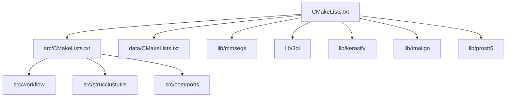
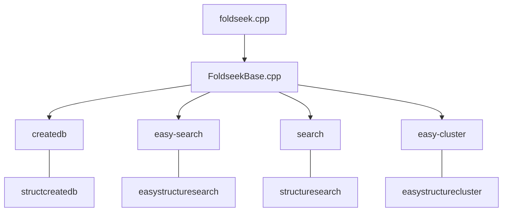

# Developer Guide

Relevant source files

The following files were used as context for generating this wiki page:

- [.github/workflows/Dockerfile.GPU-buster-cross-sbsa](.github/workflows/Dockerfile.GPU-buster-cross-sbsa)
- [.github/workflows/Dockerfile.GPU-manylinux2014](.github/workflows/Dockerfile.GPU-manylinux2014)
- [CMakeLists.txt](CMakeLists.txt)
- [azure-pipelines.yml](azure-pipelines.yml)
- [lib/mmseqs/Dockerfile](lib/mmseqs/Dockerfile)
- [src/CMakeLists.txt](src/CMakeLists.txt)
- [util/build_osx.sh](util/build_osx.sh)

This page provides high-level information for developers who want to extend or modify FoldSeek. It covers the build system, Docker/CI environment, testing framework, adding new commands, and vendored libraries.

For information on using FoldSeek, see [Overview](#1) and [Basic Usage Examples](#1.3). For architectural details of core components, see [Core Components](#2).

## Build System

FoldSeek uses a CMake-based build system that integrates multiple internal modules and third-party libraries [CMakeLists.txt:1-8](). The top-level `CMakeLists.txt` manages global configuration flags (such as SIMD levels, CUDA support, and static linking options), submodule initialization, and target compilation [CMakeLists.txt:1-118]().

**System Component Map**

Sources: [CMakeLists.txt:34-118](), [src/CMakeLists.txt:3-6](), [data/CMakeLists.txt:1-33]()

For details on CMake targets, submodule management, resource embedding, and compiler flags, see [Build System](#5.1).

## CI and Docker Environment

Automated builds and testing are orchestrated via Azure Pipelines [azure-pipelines.yml:1-10]() and GitHub Actions workflows. FoldSeek provides multi-architecture Docker environments for Linux (including manylinux-based GPU containers) [azure-pipelines.yml:91-96]() and cross-compilation toolchains [azure-pipelines.yml:114-116]() to ensure consistent binary generation and static linking compliance.

Sources: [azure-pipelines.yml:1-182](), [.github/workflows/Dockerfile.GPU-manylinux2014:1-35]()

For details on Dockerfiles, CI matrix configurations, universal macOS builds, and artifact publishing, see [CI and Docker Environment](#5.2).

## Testing Framework

FoldSeek uses a regression test suite anchored by `run_regression.sh` [azure-pipelines.yml:75-75]() and example files located in the `examples/` directory. CI pipelines run these tests across various SIMD configurations and sanitizers (such as AddressSanitizer) to catch memory issues and behavioral regressions [azure-pipelines.yml:37-41]().

Sources: [azure-pipelines.yml:37-77]()

For details on running regression tests, test data organization, and parameter sampling utilities like `samplemulambda`, see [Testing Framework](#5.3).

## Adding New Commands

Extending FoldSeek with new commands or workflows involves declaring the entry point in `LocalCommandDeclarations.h`, registering the command handler in `FoldseekBase.cpp` [src/FoldseekBase.cpp:17-96](), defining parameters in `LocalParameters`, creating workflow shell scripts in `data/`, and wiring them into resource compilation via `data/CMakeLists.txt` [data/CMakeLists.txt:3-25]().

**Command to Code Entity Mapping**

Sources: [src/FoldseekBase.cpp:17-96](), [src/LocalCommandDeclarations.h:1-35]()

For a complete step-by-step developer guide, see [Adding New Commands](#5.4).

## Vendored Libraries

FoldSeek bundles several third-party libraries under `lib/` to handle specific domains, such as the MMseqs2 framework, `gemmi` for structure parsing, `foldcomp`, `tmalign`, `pulchra`, `kerasify`, `3di`, `prostt5`/`ggml`, and `structty` [CMakeLists.txt:9-58](). Each library is integrated via CMake subdirectories or custom update scripts.

Sources: [CMakeLists.txt:9-62]()

For details on each vendored library and its integration approach, see [Vendored Libraries](#5.5).

---