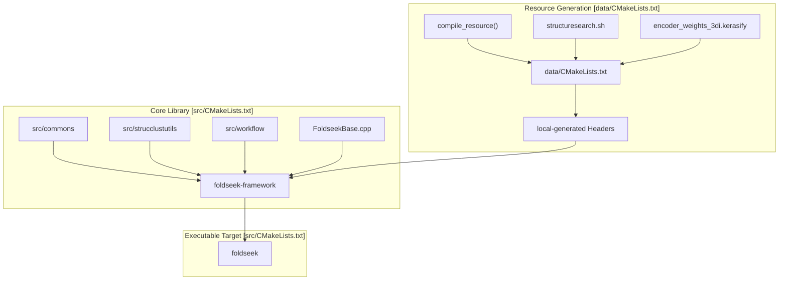
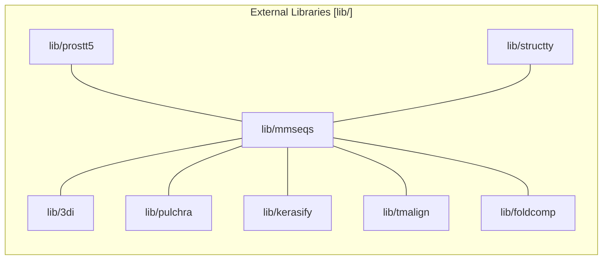

# Build System

Relevant source files

The following files were used as context for generating this wiki page:

- [.gitmodules](.gitmodules)
- [CMakeLists.txt](CMakeLists.txt)
- [data/CMakeLists.txt](data/CMakeLists.txt)
- [src/CMakeLists.txt](src/CMakeLists.txt)
- [src/commons/CMakeLists.txt](src/commons/CMakeLists.txt)
- [src/strucclustutils/CMakeLists.txt](src/strucclustutils/CMakeLists.txt)
- [src/workflow/CMakeLists.txt](src/workflow/CMakeLists.txt)
- [util/update_mmseqs.sh](util/update_mmseqs.sh)

## Purpose and Overview

This document describes the build system used by FoldSeek, a tool for fast and sensitive structural searches of protein structures. The build system is based on CMake and manages a complex dependency tree including submodules, resource compilation for neural network weights and shell scripts, and specialized SIMD/GPU/StrucTTY build flags.

Sources: [CMakeLists.txt:1-118]()

## Build System Architecture

FoldSeek's build process is centered around a hierarchical CMake structure that integrates the core MMseqs2 framework (`lib/mmseqs`) with FoldSeek-specific structural alignment and scoring modules (`src/commons`, `src/strucclustutils`, `src/workflow`).

### Build Orchestration and Code Entity Mapping

Sources: [CMakeLists.txt:33-46](), [src/CMakeLists.txt:8-50](), [data/CMakeLists.txt:1-39]()

### Build Targets and Entity Mapping

The following table maps logical system components to their specific code implementations and CMake targets.

| Component | CMake Target | Source Directory | Primary Role |
| :--- | :--- | :--- | :--- |
| **Command Registry** | `foldseek-framework` | `src/FoldseekBase.cpp` | Registers all `foldseekCommands` [src/FoldseekBase.cpp:1-120]() |
| **PDB/mmCIF Parser** | `gemmiwrapper` | `src/strucclustutils/GemmiWrapper.cpp` | Wraps Gemmi and Foldcomp for structure IO [src/strucclustutils/CMakeLists.txt:31-50]() |
| **3Di Encoding** | `3di` | `lib/3di` | Implements the 3Di alphabet and state transitions [CMakeLists.txt:41]() |
| **NN Inference** | `kerasify` | `lib/kerasify` | CPU-based inference for 3Di and E-value networks [CMakeLists.txt:43]() |
| **Language Model** | `prostt5` | `src/strucclustutils/ProstT5.cpp` | Integration with `ggml` for 3Di prediction [src/strucclustutils/CMakeLists.txt:51-54]() |
| **Terminal Viewer** | `structty` | `lib/structty` | Terminal structure visualization workflow [CMakeLists.txt:47-62](), [src/workflow/CMakeLists.txt:19]() |

Sources: [src/CMakeLists.txt:8-50](), [src/strucclustutils/CMakeLists.txt:1-54](), [src/workflow/CMakeLists.txt:1-21]()

## Resource Compilation

FoldSeek embeds shell scripts, substitution matrices, and neural network weights directly into the binary to ensure portability. This is handled by `MMseqsResourceCompiler` included in `data/CMakeLists.txt`.

1. **Input**: Files such as `structuresearch.sh` [data/CMakeLists.txt:8](), `mat3di.out` [data/CMakeLists.txt:13](), and `encoder_weights_3di.kerasify` [data/CMakeLists.txt:14]().
2. **Process**: The `compile_resource` function transforms these files into C++ headers [data/CMakeLists.txt:33-37]().
3. **Dependency**: The `foldseek-framework` target depends on `local-generated` via `add_dependencies` to ensure headers are ready before compilation [src/CMakeLists.txt:33]().
4. **Usage**: Embedded scripts are included and dispatched via command registries like `FoldseekBase.cpp`.

Sources: [data/CMakeLists.txt:1-39](), [src/CMakeLists.txt:33](), [src/FoldseekBase.cpp:1-120]()

## SIMD, GPU, and Static Build Flags

### CPU Optimization (SIMD)
The build system detects and propagates SIMD flags. For example, if `HAVE_SSE2` is detected without `SSE4.1`, `ENABLE_PROSTT5` is automatically disabled because the underlying language model requires higher-level SIMD instructions [CMakeLists.txt:70-73]().

### GPU Support (CUDA)
When `ENABLE_CUDA` is set to `1` [CMakeLists.txt:12]():
- The `HAVE_CUDA` macro is defined globally on `foldseek-framework` [src/CMakeLists.txt:28-30]().
- For ProstT5, `GGML_CUDA`, `GGML_CUDA_F16`, and `GGML_CUDA_FORCE_CUBLAS` are enabled to offload tensor operations to the GPU [CMakeLists.txt:105-110]().

### StrucTTY and Optional Flags
The `ENABLE_STRUCTTY` flag (default `1`) controls whether the terminal structure viewer is compiled, linking `lib/structty` and checking for required stb headers [CMakeLists.txt:13](), [CMakeLists.txt:47-62]().

### Static Linking
To create portable binaries, `FORCE_STATIC_DEPS` can be enabled. This forces the use of `.a` suffixes for libraries and sets static linking flags like `-static -static-libgcc -static-libstdc++` [CMakeLists.txt:14-26]().

Sources: [CMakeLists.txt:11-116](), [src/CMakeLists.txt:17-30]()

## Dependency and Submodule Management

FoldSeek manages several sub-libraries via `add_subdirectory`. Notably, it relies on a fork of the MMseqs2 framework included under `lib/mmseqs` [CMakeLists.txt:9-35]().

### Dependency Relationship Graph

- **Submodules**: Regression tests and specific components like `ggml-kompute` are managed as Git submodules [.gitmodules:1-11]().
- **Framework Mode**: The `FOLDSEEK_FRAMEWORK_ONLY` flag allows building libraries without the final `foldseek` executable, useful for embedding FoldSeek in other applications [CMakeLists.txt:37-40]().

Sources: [CMakeLists.txt:33-62](), [.gitmodules:1-11](), [src/CMakeLists.txt:43-50]()

## Adding New Commands

To integrate a new command into the build system:
1. Add the source file to `src/strucclustutils/CMakeLists.txt` or `src/workflow/CMakeLists.txt` [src/strucclustutils/CMakeLists.txt:1-29](), [src/workflow/CMakeLists.txt:1-21]().
2. Define the command logic and parameter bindings.
3. Register the command in the `foldseekCommands` registry within `src/FoldseekBase.cpp`.
4. If the command uses a shell script workflow, add the `.sh` file to `data/CMakeLists.txt` under `COMPILED_RESOURCES` for resource compilation [data/CMakeLists.txt:3-31]().

Sources: [src/strucclustutils/CMakeLists.txt:1-29](), [src/workflow/CMakeLists.txt:1-21](), [data/CMakeLists.txt:3-31](), [src/FoldseekBase.cpp:1-120]()

---