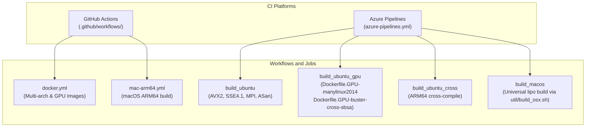
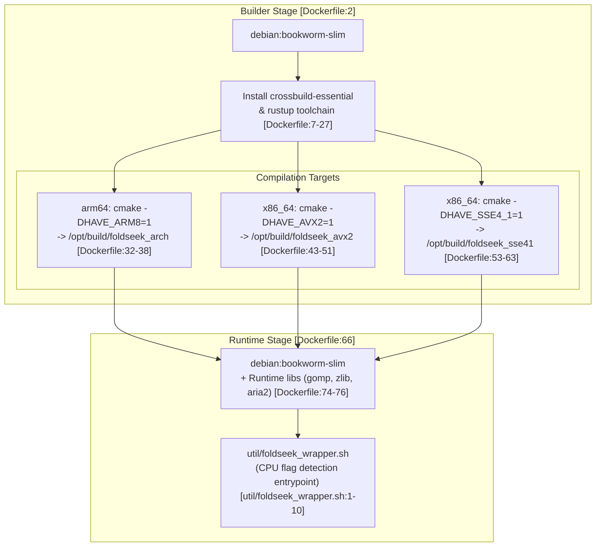
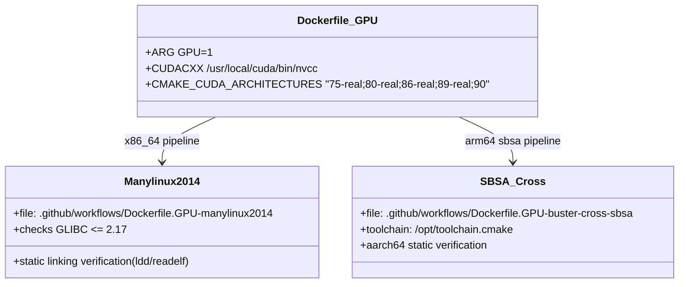
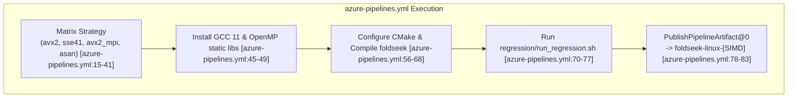
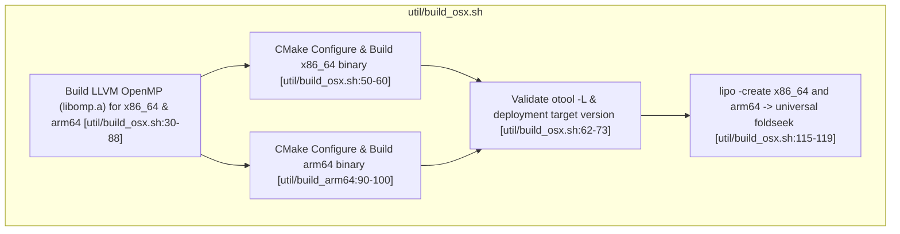

# CI and Docker Environment

Relevant source files

The following files were used as context for generating this wiki page:

- [.github/workflows/Dockerfile.GPU-buster-cross-sbsa](.github/workflows/Dockerfile.GPU-buster-cross-sbsa)
- [.github/workflows/Dockerfile.GPU-manylinux2014](.github/workflows/Dockerfile.GPU-manylinux2014)
- [.github/workflows/docker.yml](.github/workflows/docker.yml)
- [.github/workflows/mac-arm64.yml](.github/workflows/mac-arm64.yml)
- [Dockerfile](Dockerfile)
- [azure-pipelines.yml](azure-pipelines.yml)
- [lib/mmseqs/Dockerfile](lib/mmseqs/Dockerfile)
- [util/build_osx.sh](util/build_osx.sh)
- [util/foldseek_wrapper.sh](util/foldseek_wrapper.sh)

## Purpose and Scope

This page details the Continuous Integration (CI) and containerization configurations used to build, test, and distribute FoldSeek across platforms and hardware architectures. It covers the primary multi-stage `Dockerfile`, GPU-enabled container builds, the Azure Pipelines build matrix, macOS universal binary creation (`lipo`), GitHub Actions workflows, and artifact publishing mechanisms. For local compilation details, see [Build System](5.1).

---

## 1. Overview of CI and Docker Infrastructure

FoldSeek relies on a multi-pronged CI and distribution architecture combining GitHub Actions for container publishing and macOS checks with Azure Pipelines for deep matrix builds (including Linux static binaries, sanitizers, MPI, and GPU targets).

Sources: [.github/workflows/docker.yml:1-141](), [.github/workflows/mac-arm64.yml:1-40](), [azure-pipelines.yml:1-180]()

---

## 2. Main Dockerfile & Multi-Architecture Build

The root `Dockerfile` employs a multi-stage build strategy using `debian:bookworm-slim` to compile instruction-set optimized binaries (`foldseek_sse41`, `foldseek_avx2`, `foldseek_arch`) and package them into a lightweight runtime image [Dockerfile:1-83]().

### Runtime Binary Selection

At container startup, `util/foldseek_wrapper.sh` inspects `/proc/cpuinfo` flags to select the optimal x86_64 instruction set variant:
- **AVX2**: Executes `/usr/local/bin/foldseek_avx2` if `avx2` is present in `/proc/cpuinfo` [util/foldseek_wrapper.sh:2-6]().
- **SSE4.1**: Falls back to `/usr/local/bin/foldseek_sse41` on legacy hardware [util/foldseek_wrapper.sh:7-9]().
- **ARM64**: Symlinks directly to `foldseek_arch` [Dockerfile:77-78]().

Sources: [Dockerfile:1-83](), [util/foldseek_wrapper.sh:1-10]()

---

## 3. GPU-Enabled Docker Builds & Compatibility Containers

For GPU-accelerated workloads (such as ProstT5 sequence embedding inference), FoldSeek builds specialized CUDA images using NVIDIA CUDA 12 SDK tooling (`cuda-nvcc-12-6`, `libcublas-dev-12-6`) targeting CUDA compute capabilities `75-real;80-real;86-real;89-real;90` [Dockerfile:13-17](), [Dockerfile:46]().

To guarantee robust compatibility across older Linux distributions, CI uses container-based compilation targets:
- **`Dockerfile.GPU-manylinux2014`**: Compiles x86_64 static binaries against `manylinux2014` base environments, enforcing strict symbol checks against GLIBC versions and filtering out unauthorized shared library dependencies [.github/workflows/Dockerfile.GPU-manylinux2014:1-35]().
- **`Dockerfile.GPU-buster-cross-sbsa`**: Cross-compiles ARM64/SBSA (Server Base System Architecture) GPU binaries using custom toolchain definitions [.github/workflows/Dockerfile.GPU-buster-cross-sbsa:1-32]().

Sources: [Dockerfile:13-51](), [.github/workflows/Dockerfile.GPU-manylinux2014:1-35](), [.github/workflows/Dockerfile.GPU-buster-cross-sbsa:1-32]()

---

## 4. Azure Pipelines Build Matrix & Cross-Compilation

Azure Pipelines (`azure-pipelines.yml`) manages deep matrix configurations covering static/dynamic linking, SIMD instruction sets, MPI support, address sanitizers, and cross-compilation [azure-pipelines.yml:10-156]().

| Job Name | Strategy Matrix / Environment | Key CMake Flags / Toolchain |
| :--- | :--- | :--- |
| `build_ubuntu` | `avx2`, `sse41`, `avx2_mpi`, `asan` [azure-pipelines.yml:16-41] | `-DFORCE_STATIC_DEPS=1`, `-DHAVE_AVX2=1`, `-DHAVE_SANITIZER=1` [azure-pipelines.yml:60-65] |
| `build_ubuntu_gpu` | `x86_64` (manylinux2014), `aarch64` (sbsa) [azure-pipelines.yml:91-96] | Uses specialized Dockerfiles with CUDA enabled [azure-pipelines.yml:93-96] |
| `build_ubuntu_cross` | `arm64` (`CPREF: aarch64`) [azure-pipelines.yml:120-123] | `aarch64-linux-gnu-gcc`, `-DHAVE_ARM8=1`, Rust target `aarch64-unknown-linux-gnu` [azure-pipelines.yml:145-149] |

Sources: [azure-pipelines.yml:1-180]()

---

## 5. macOS Universal Binary Builds

macOS builds are handled both in Azure Pipelines (`build_macos`) and GitHub Actions (`mac-arm64.yml`), producing universal binaries supporting both Intel (`x86_64`) and Apple Silicon (`arm64`) architectures [.github/workflows/mac-arm64.yml:1-40](), [azure-pipelines.yml:157-180]().

The core orchestration for universal macOS packaging resides in `util/build_osx.sh`:
1. **OpenMP Runtime Compilation**: Downloads LLVM OpenMP source (`llvmorg-20.1.7`), building static `libomp.a` separately for `x86_64` and `arm64` [util/build_osx.sh:30-88]().
2. **Architecture-Specific CMake Passes**: Configures independent build dirs with `-DCMAKE_OSX_ARCHITECTURES` set to `x86_64` and `arm64` respectively, linking static OpenMP [util/build_osx.sh:51-99]().
3. **Dependency and Deployment Target Validation**: Uses `otool -L` and `vtool` to ensure no unauthorized dynamic libraries are linked and that `MACOSX_DEPLOYMENT_TARGET` adheres to bounds [util/build_osx.sh:62-73]().
4. **Universal Binary Stitching (`lipo`)**: Combines the compiled binaries into a universal executable [util/build_osx.sh:115-119]().

Sources: [util/build_osx.sh:1-120](), [.github/workflows/mac-arm64.yml:1-40]()

---

## 6. GitHub Actions Workflows & Artifact Uploads

GitHub Actions automates continuous delivery through dedicated workflow YAML files:
- **`.github/workflows/docker.yml`**: Uses Docker Buildx and QEMU to build and push multi-platform images (`linux/amd64`, `linux/arm64`) and CUDA-enabled container variants to the GitHub Container Registry (`ghcr.io/steineggerlab/foldseek`) [.github/workflows/docker.yml:1-141]().
- **`.github/workflows/mac-arm64.yml`**: Compiles and runs regression verification tests on macOS runners [.github/workflows/mac-arm64.yml:1-40]().

Artifact uploads across CI providers utilize pipeline-native tasks (e.g., Azure `PublishPipelineArtifact@0`) to archive compiled executables like `foldseek-linux-AVX2` or `foldseek-mac-universal` for release tagging [azure-pipelines.yml:78-83]().

Sources: [.github/workflows/docker.yml:1-141](), [.github/workflows/mac-arm64.yml:1-40](), [azure-pipelines.yml:78-83]()

---