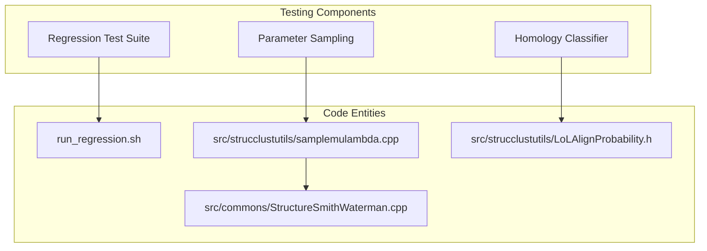
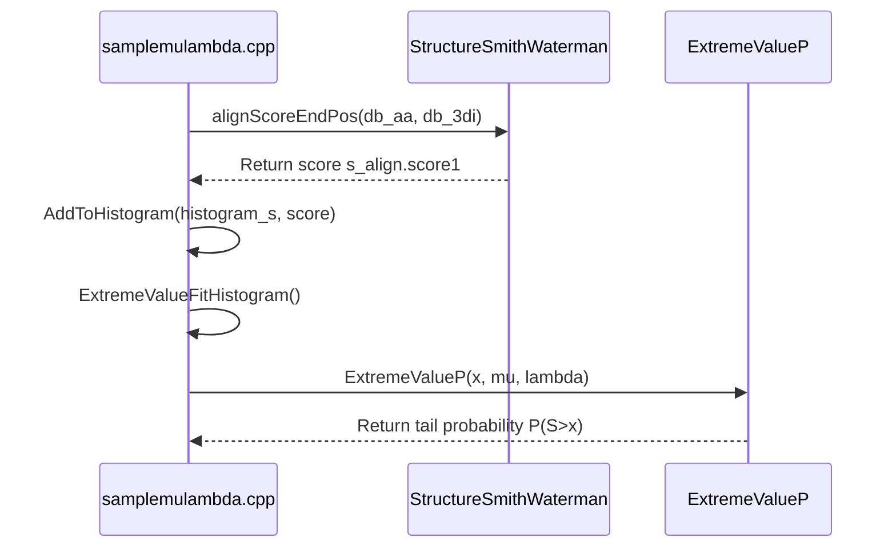
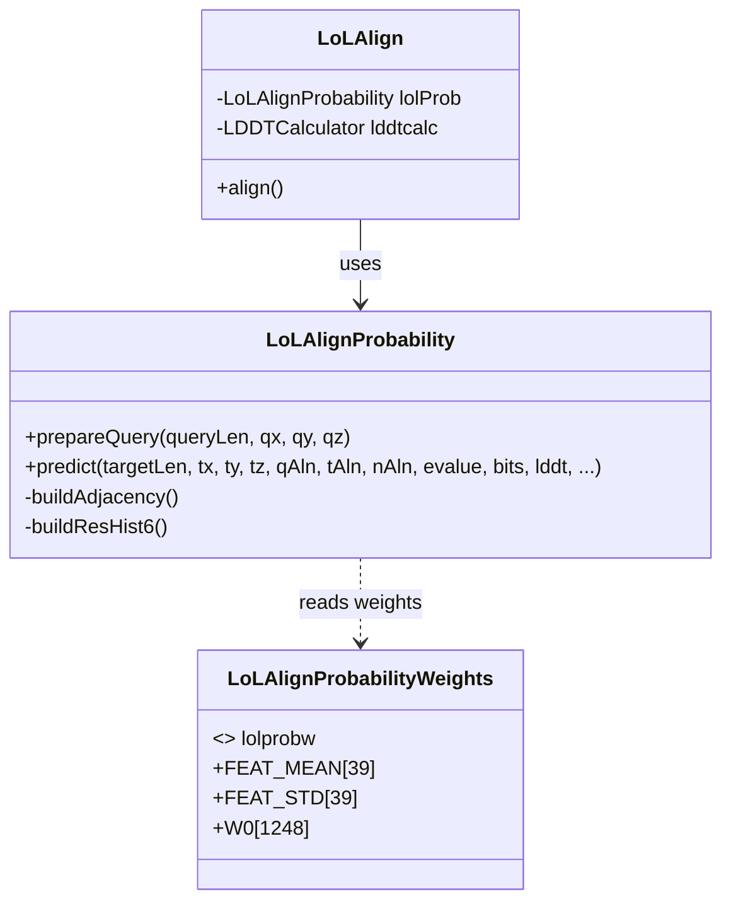

# Testing Framework

Relevant source files

The following files were used as context for generating this wiki page:

- [.github/results.png](.github/results.png)
- [README.md](README.md)
- [data/evalue_nn.kerasify](data/evalue_nn.kerasify)
- [example/1tim.pdb.gz](example/1tim.pdb.gz)
- [example/8tim.pdb.gz](example/8tim.pdb.gz)
- [src/commons/StructureSmithWaterman.cpp](src/commons/StructureSmithWaterman.cpp)
- [src/commons/StructureSmithWaterman.h](src/commons/StructureSmithWaterman.h)
- [src/strucclustutils/EvalueNeuralNet.cpp](src/strucclustutils/EvalueNeuralNet.cpp)
- [src/strucclustutils/EvalueNeuralNet.h](src/strucclustutils/EvalueNeuralNet.h)
- [src/strucclustutils/LoLAlign.cpp](src/strucclustutils/LoLAlign.cpp)
- [src/strucclustutils/LoLAlign.h](src/strucclustutils/LoLAlign.h)
- [src/strucclustutils/LoLAlignProbability.h](src/strucclustutils/LoLAlignProbability.h)
- [src/strucclustutils/LoLAlignProbabilityWeights.h](src/strucclustutils/LoLAlignProbabilityWeights.h)
- [src/strucclustutils/samplemulambda.cpp](src/strucclustutils/samplemulambda.cpp)

This page describes how testing, regression verification, and parameter validation are implemented in the Foldseek codebase. The scope covers the regression test suite (`run_regression.sh`), example input files, the statistical parameter sampling utility (`samplemulambda`), and continuous integration pipelines ensuring correctness across CPU, SIMD, and GPU architectures.

## 1. Testing Architecture and Components

Foldseek relies on a combination of automated regression scripts, static test inputs, statistical sampling utilities, and continuous integration runners.

Title: Testing Framework Components to Code Entities

Sources: [src/strucclustutils/samplemulambda.cpp:1-12](), [src/strucclustutils/LoLAlignProbability.h:1-12]()

## 2. Regression Testing Suite

The regression test suite validates end-to-end command execution and output stability against known gold-standard results. 

### 2.1 Regression Execution and Example Datasets
Regression testing is primarily orchestrated by shell scripts that invoke core binaries against benchmark files located in the `example/` directory. Standard protein structures such as `example/1tim.pdb.gz` and `example/8tim.pdb.gz` provide predictable folds for verifying alignment scores, Cα coordinate processing, and database indexing.

Sources: [README.md:97-99]()

## 3. Statistical Parameter Validation (`samplemulambda`)

To ensure accurate E-value estimation across arbitrary database sizes and sequence lengths, Foldseek uses the `samplemulambda` utility to fit Extreme Value Distribution (EVD) parameters ($\mu$ and $\lambda$) for alignment scores [src/strucclustutils/samplemulambda.cpp:77-96]().

### 3.1 Histogram Management and EVD Fitting
The utility relies on the internal `histogram_s` data structure to accumulate alignment scores and compute goodness-of-fit metrics [src/strucclustutils/samplemulambda.cpp:77-91](). The function `ExtremeValueP` evaluates the tail probability $P(S > x)$ for fitted parameters [src/strucclustutils/samplemulambda.cpp:119-132](), while `sre_random` implements L'Ecuyer's combined linear congruential generator for reproducible background score sampling [src/strucclustutils/samplemulambda.cpp:166-188]().

Title: Statistical Parameter Flow in samplemulambda

Sources: [src/strucclustutils/samplemulambda.cpp:77-132](), [src/commons/StructureSmithWaterman.h:112-119]()

## 4. Homology Probability Classifier Validation

Foldseek validates its structural homology predictions via the `LoLAlignProbability` class, which extracts a 39-feature vector from alignment metrics, topological adjacency, and LDDT scores [src/strucclustutils/LoLAlignProbability.h:37-82]().

### 4.1 Weight Integration and Feature Extraction
The classifier uses pre-trained neural network weights stored in `LoLAlignProbabilityWeights.h` (`lolprobw::W0`, `lolprobw::FEAT_MEAN`, etc.) [src/strucclustutils/LoLAlignProbabilityWeights.h:10-35]() to compute homology probabilities during local alignments.

Title: Homology Classifier Architecture to Code Mapping

Sources: [src/strucclustutils/LoLAlign.h:120-126](), [src/strucclustutils/LoLAlignProbability.h:19-82](), [src/strucclustutils/LoLAlignProbabilityWeights.h:10-35]()

## 5. Continuous Integration Environments

Automated testing is performed across multiple operating systems and hardware configurations using Azure Pipelines and containerized environments.

| Job Name | Target Architecture | Build Configuration | Purpose |
| :--- | :--- | :--- | :--- |
| `build_ubuntu` | x86_64 (AVX2 / SSE4.1) | Release | Standard binary verification |
| `build_ubuntu` | x86_64 (AVX2) | ASanOpt | Memory error and leak detection |
| `build_ubuntu_gpu` | x86_64 + CUDA | Release | GPU acceleration validation |
| `build_ubuntu_cross` | ARM64 (aarch64) | Release | Cross-compilation verification |
| `build_macos` | Universal (x86_64 / ARM64) | Release | macOS ecosystem verification |

Sources: [README.md:20](), [README.md:92-93]()

---