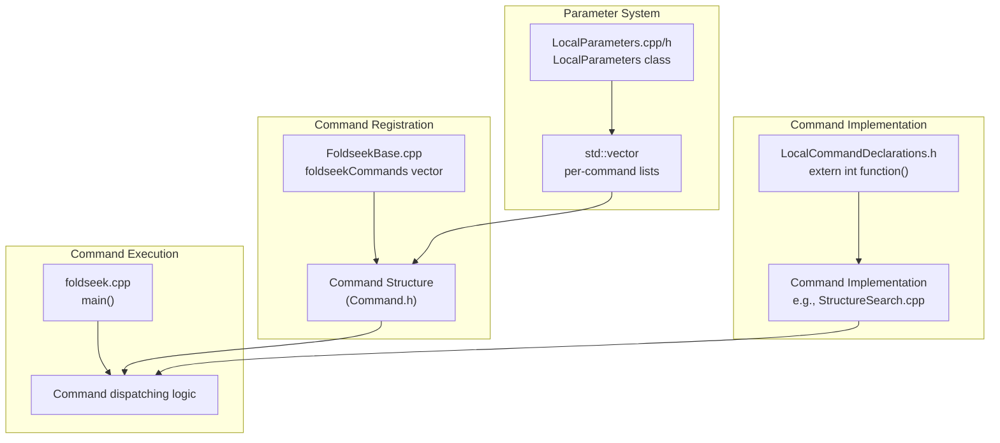
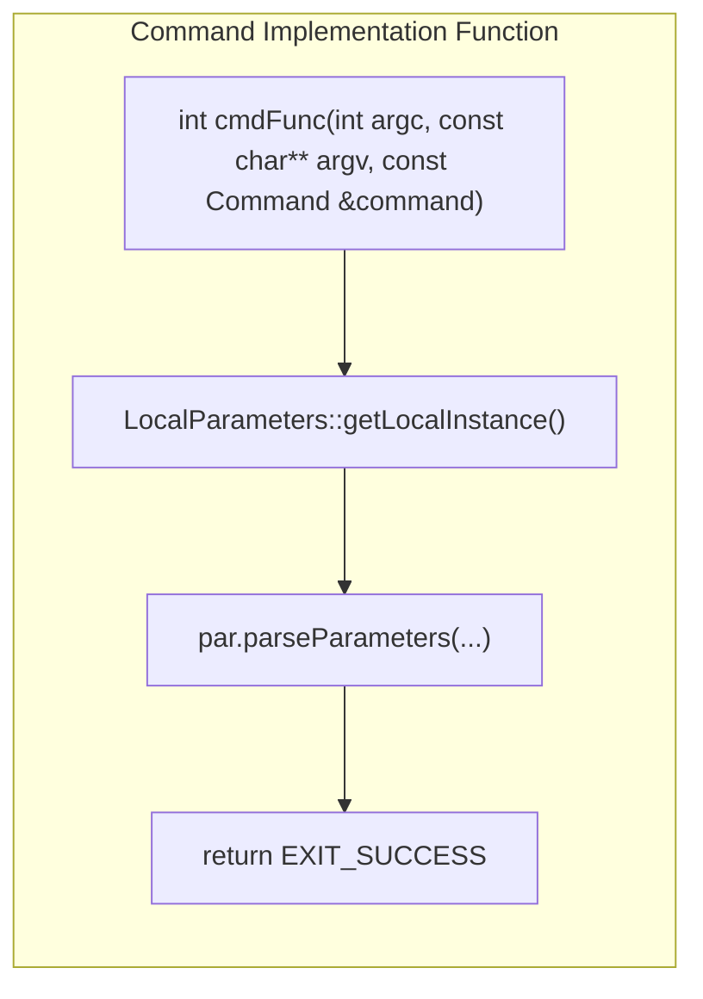
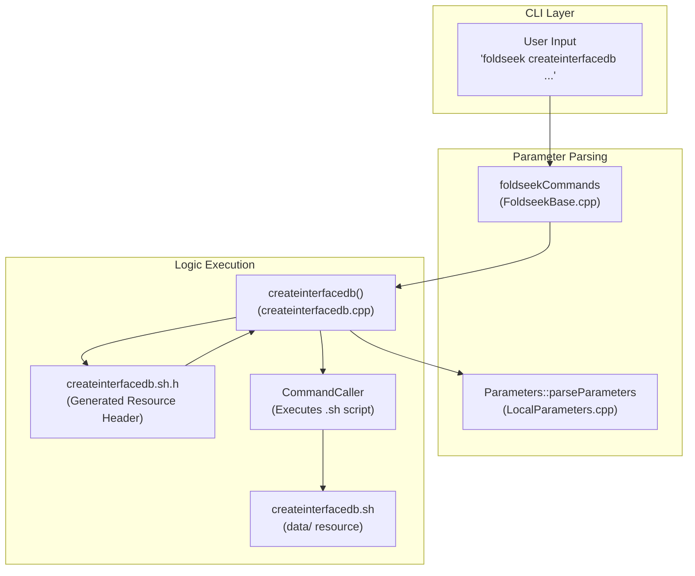

# Adding New Commands

<details>
<summary>Relevant source files</summary>

The following files were used as context for generating this wiki page:

- [data/CMakeLists.txt](data/CMakeLists.txt)
- [data/createinterfacedb.sh](data/createinterfacedb.sh)
- [src/FoldseekBase.cpp](src/FoldseekBase.cpp)
- [src/LocalCommandDeclarations.h](src/LocalCommandDeclarations.h)
- [src/commons/LocalParameters.cpp](src/commons/LocalParameters.cpp)
- [src/commons/LocalParameters.h](src/commons/LocalParameters.h)
- [src/strucclustutils/CMakeLists.txt](src/strucclustutils/CMakeLists.txt)
- [src/strucclustutils/createinterfacedb.cpp](src/strucclustutils/createinterfacedb.cpp)
- [src/strucclustutils/createstructinterfacedb.cpp](src/strucclustutils/createstructinterfacedb.cpp)
- [src/workflow/CMakeLists.txt](src/workflow/CMakeLists.txt)

</details>


This page provides a detailed guide for developers who want to extend FoldSeek by adding new commands to the system. It covers the command architecture, implementation steps, parameter management, workflow shell script creation, and integration into FoldSeek's build and CMake resource compilation systems. For information about the underlying command dispatch architecture, see [Command System](#2.1).

## Overview of the Command Architecture

FoldSeek's command system follows a modular architecture that separates command registration, implementation, and parameter handling. Understanding this architecture is essential before adding new commands.

### Natural Language to Code Entity Space: Architecture

The following diagram maps high-level system concepts to specific code entities in the FoldSeek repository.



Sources: [src/FoldseekBase.cpp:17-18](), [src/commons/LocalParameters.h:18-26](), [src/LocalCommandDeclarations.h:1-36]()

## Step-by-Step Process for Adding a New Command

### 1. Implement the Command Function

Create a command implementation in an appropriate source file (usually within the `workflow` directory for high-level logic, or `strucclustutils/` for standalone utilities):



Key considerations:
- The function must have the signature `int functionName(int argc, const char** argv, const Command &command)` [src/LocalCommandDeclarations.h:6-35]().
- Use `LocalParameters::getLocalInstance()` to access the singleton parameter object [src/commons/LocalParameters.h:21-26]().
- Call `par.parseParameters(argc, argv, command, ...)` to populate variables from the CLI [src/strucclustutils/createinterfacedb.cpp:9-11]().

Sources: [src/LocalCommandDeclarations.h:1-36](), [src/strucclustutils/createinterfacedb.cpp:9-11]()

### 2. Declare the Command Function

Add your command declaration to `LocalCommandDeclarations.h`. This allows `FoldseekBase.cpp` to reference the function pointer via `extern` linkage.

Example:
```cpp
extern int mynewcommand(int argc, const char** argv, const Command &command);
```

Sources: [src/LocalCommandDeclarations.h:6-35]()

### 3. Define Command Parameters

If your command requires specific parameters, add them to `LocalParameters.cpp` and `LocalParameters.h`:

1. **Declare Parameter ID**: Add a unique ID in `Parameters.h` (inherited) or define it locally.
2. **Declare Parameter Vector**: In `LocalParameters.h`, add a `std::vector<MMseqsParameter *>` for your command [src/commons/LocalParameters.h:131-165]().
3. **Initialize in Constructor**: In `LocalParameters.cpp`, initialize any new `MMseqsParameter` objects with flags, regex validation, and pointers to storage variables [src/commons/LocalParameters.cpp:11-40]().
4. **Populate Vector**: In the `LocalParameters` constructor, `push_back` the relevant parameters into your new command's parameter vector.

Sources: [src/commons/LocalParameters.h:131-165](), [src/commons/LocalParameters.cpp:9-40]()

### 4. Register the Command

Add your command to the `foldseekCommands` vector in `FoldseekBase.cpp`. This registration includes the CLI name, the function pointer, the parameter vector, and metadata for the help menu and validation rules.

```cpp
{"my-command", mynewcommand, &localPar.mynewcommand_params, COMMAND_MAIN,
 "Description of what it does",
 "foldseek my-command input output",
 "Author Name <email>",
 "<i:inputDB> <o:outputDB>",
 CITATION_FOLDSEEK, 
 {{"inputDB", DbType::ACCESS_MODE_INPUT, DbType::NEED_DATA, &DbValidator::allDb },
  {"outputDB", DbType::ACCESS_MODE_OUTPUT, DbType::NEED_DATA, &DbValidator::allDb }}}
```

Sources: [src/FoldseekBase.cpp:17-41]()

### 5. Writing Workflow Shell Scripts and Resource Compilation

Many FoldSeek workflows orchestrate underlying binaries via shell scripts (e.g., `createinterfacedb`) [src/strucclustutils/createinterfacedb.cpp:13-20](). To wire a workflow script into the codebase:
1. Write the shell script and place it in the `data/` directory (e.g., `data/createinterfacedb.sh`) [data/createinterfacedb.sh:1-45]().
2. Add the script filename to `COMPILED_RESOURCES` in `data/CMakeLists.txt` [data/CMakeLists.txt:3-31]().
3. During the build, the CMake system uses `MMseqsResourceCompiler` to compile resources into C++ headers (e.g., `createinterfacedb.sh.h`) [data/CMakeLists.txt:1, 33-37]().
4. Include the generated header in your utility or workflow implementation file, write the script to disk dynamically via `FileUtil::writeFile`, and execute it using `CommandCaller` [src/strucclustutils/createinterfacedb.cpp:7, 13-20]().

Sources: [data/CMakeLists.txt:1-37](), [src/strucclustutils/createinterfacedb.cpp:7-20](), [data/createinterfacedb.sh:1-45]()

### 6. Update the Build System

You must register your new source files in the appropriate CMake build lists:
- **Workflows**: Add source files to `workflow_source_files` in `src/workflow/CMakeLists.txt` [src/workflow/CMakeLists.txt:1-21]().
- **Utilities**: Add source files to `strucclustutils_source_files` in `src/strucclustutils/CMakeLists.txt` [src/strucclustutils/CMakeLists.txt:1-28]().

Sources: [src/workflow/CMakeLists.txt:1-21](), [src/strucclustutils/CMakeLists.txt:1-28]()

## Natural Language to Code Entity Space: Data Flow

This diagram illustrates how data flows from the Command Line Interface (CLI) through the parameter system into command execution and shell script orchestration.



Sources: [src/FoldseekBase.cpp:61-68](), [src/strucclustutils/createinterfacedb.cpp:9-20](), [data/createinterfacedb.sh:1-41](), [data/CMakeLists.txt:1-37]()

## Command Categories and Types

FoldSeek organizes commands into categories to control visibility in the help output and command-line usage.

| Category Constant | Description | File Reference |
|-------------------|-------------|----------------|
| `COMMAND_MAIN` | Primary user commands | [src/FoldseekBase.cpp:18]() |
| `COMMAND_EASY` | Simplified "easy-" wrappers | [src/FoldseekBase.cpp:92]() |
| `COMMAND_SET` | Database manipulation | [src/FoldseekBase.cpp:49]() |
| `COMMAND_HIDDEN` | Internal/Developer tools | [src/FoldseekBase.cpp:42]() |

Sources: [src/FoldseekBase.cpp:17-96]()

## Common Validator Types for Database Arguments

When registering a command, you must specify validators to ensure input/output paths are valid.

| Validator | Purpose | File Reference |
|-----------|---------|----------------|
| `&DbValidator::flatfile` | Standard file on disk | [src/FoldseekBase.cpp:41]() |
| `&DbValidator::allDb` | Any MMseqs2/Foldseek DB | [src/FoldseekBase.cpp:60]() |
| `&DbValidator::directory` | Path must be a directory | [src/FoldseekBase.cpp:84]() |
| `&FoldSeekDbValidator::flatfileAndFolder` | Files or directories (Foldseek specific) | [src/commons/LocalParameters.h:10-16]() |

Sources: [src/FoldseekBase.cpp:34-84](), [src/commons/LocalParameters.h:10-16]()

Sources: [src/commons/LocalParameters.cpp:1-40](), [src/commons/LocalParameters.h:18-165](), [src/FoldseekBase.cpp:17-95](), [src/LocalCommandDeclarations.h:1-44](), [src/strucclustutils/CMakeLists.txt:1-29](), [data/CMakeLists.txt:1-31](), [src/workflow/CMakeLists.txt:1-21](), [src/strucclustutils/createinterfacedb.cpp:1-25](), [data/createinterfacedb.sh:1-45]()

---