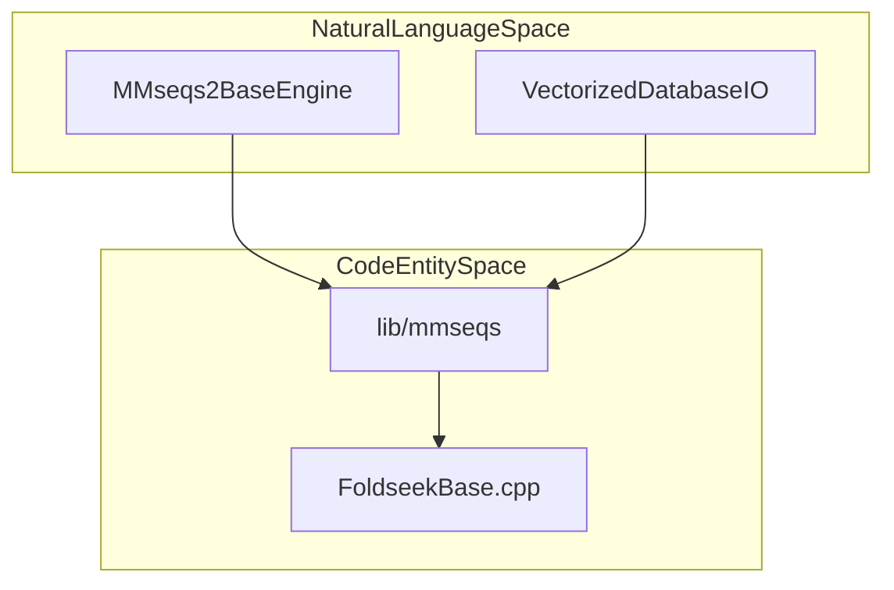
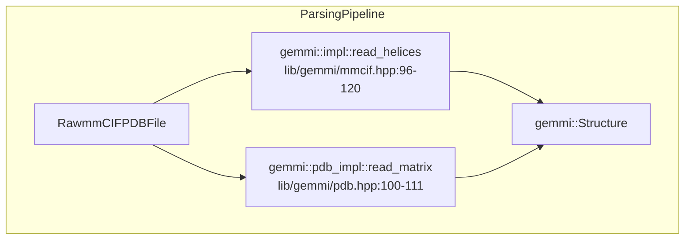

# Vendored Libraries

Relevant source files

The following files were used as context for generating this wiki page:

- [lib/gemmi/mmcif.hpp](lib/gemmi/mmcif.hpp)
- [lib/gemmi/pdb.hpp](lib/gemmi/pdb.hpp)
- [lib/kerasify/LICENSE](lib/kerasify/LICENSE)
- [lib/mmseqs/.gitmodules](lib/mmseqs/.gitmodules)
- [lib/tmalign/LICENSE](lib/tmalign/LICENSE)
- [util/update_foldcomp.sh](util/update_foldcomp.sh)

## Purpose and Scope
Foldseek bundles several third-party libraries and framework dependencies under the `lib/` directory. Vendoring these libraries ensures consistent builds across diverse operating systems, eliminates external package manager dependencies during compilation, and permits deep optimizations (such as custom SIMD vectorization and tightly integrated memory allocators) alongside the MMseqs2 ecosystem. This page surveys the primary vendored libraries, detailing their specific architectural roles, integration strategies, update mechanisms, and code pointers.

---

## 1. MMseqs2 Framework (`lib/mmseqs`)
The MMseqs2 framework forms the foundational backbone of Foldseek. It provides the multi-threaded execution engine, memory-mapped database input/output systems, vectorized sequence alignment routines, parameter parsing infrastructure, and core command dispatching framework.

Foldseek integrates MMseqs2 as a submodule or base framework, extending its command registry (`FoldseekBase.cpp`) and parameter classes (`LocalParameters`) to handle 3D structural data alongside standard sequence databases. Submodules like regression tests are managed under `lib/mmseqs/.gitmodules` [lib/mmseqs/.gitmodules:1-3]().

*Diagram 1: MMseqs2 Integration Mapping*

Sources: `lib/mmseqs/.gitmodules:1-4`

---

## 2. Gemmi (`lib/gemmi`)
Gemmi is a high-performance C++ library used for parsing macromolecular structural data formats, specifically mmCIF (`PDBx/mmCIF`) and legacy PDB files. 

### Implementation & Data Flow
Gemmi parses coordinate files into rich memory representations (`Structure`, `Model`, `Chain`, `Residue`, `Atom`). Within `lib/gemmi/mmcif.hpp`, tabular data such as secondary structure elements are extracted using helper functions like `gemmi::impl::read_helices` and `gemmi::impl::read_sheets` [lib/gemmi/mmcif.hpp:96-121](). Coordinate transformations, anisotropic temperature factors, and sequence identifiers are resolved through robust string-to-numeric converters.

Similarly, `lib/gemmi/pdb.hpp` implements fixed-column parsing rules conforming to wwPDB specifications, incorporating extensions for hybrid-36 serial numbers (`gemmi::pdb_impl::read_serial`) [lib/gemmi/pdb.hpp:137-140](), two-character chain IDs, and crystallographic symmetry matrices (`gemmi::pdb_impl::read_matrix`) [lib/gemmi/pdb.hpp:100-111]().

*Diagram 2: Gemmi Structure Parsing Data Flow*

Sources: `lib/gemmi/mmcif.hpp:96-121`, `lib/gemmi/pdb.hpp:100-140`

---

## 3. Foldcomp (`lib/foldcomp`)
Foldcomp provides ultra-fast compression and decompression for massive protein structure databases (such as AlphaFold DB predictions). 

### Integration and Updates
Foldcomp is integrated into Foldseek to enable direct reading and querying of compressed structure repositories without requiring explicit pre-decompression to individual PDB/mmCIF files. The library is updated via subtree synchronization scripts located in the repository, specifically `util/update_foldcomp.sh`, which pulls from the upstream repository using git subtree merge strategies [util/update_foldcomp.sh:1-2]().

Sources: `util/update_foldcomp.sh:1-3`

---

## 4. TM-align (`lib/tmalign`)
TM-align is the standard algorithm for protein structure alignment and TM-score calculation. 

### Integration
Bundled under `lib/tmalign`, the library operates independently of sequence identity to compute optimal rotations, translations, and residue-residue equivalence between two protein structures. Its licensing and attribution terms are preserved in `lib/tmalign/LICENSE` [lib/tmalign/LICENSE:1-12](). Foldseek invokes TM-align routines during detailed rescoring steps of structure searches and alignments.

Sources: `lib/tmalign/LICENSE:1-13`

---

## 5. Pulchra (`lib/pulchra`)
Pulchra is a C++ library integrated to rebuild full atomic coordinate models (backbone and side-chain approximations) starting from reduced $C_\alpha$ trace representations. In Foldseek workflows, when models are processed or compressed where only $C_\alpha$ traces are retained, Pulchra provides the geometric reconstruction necessary for full atom-based visualization or interface analysis.

Sources: `lib/pulchra/` (directory integration)

---

## 6. Kerasify (`lib/kerasify`)
Kerasify is a lightweight C++ library designed to load and evaluate pre-trained Keras neural network models directly in C++ without requiring heavy Python or TensorFlow runtimes.

### Integration
Kerasify evaluates the small neural network weights utilized by downstream modules (such as the 3Di structural alphabet prediction networks). Model definitions and weights are serialized and executed efficiently via `lib/kerasify/`, maintaining zero external machine learning library dependencies at runtime. Licensing information is tracked in `lib/kerasify/LICENSE` [lib/kerasify/LICENSE:1-59]().

Sources: `lib/kerasify/LICENSE:1-59`

---

## 7. 3Di (`lib/3di`)
The `lib/3di` component encompasses the encoder architecture and scoring matrices (such as `mat3di`) that translate 3D backbone local geometries into the 1D discrete structural alphabet (3Di states). It works alongside `structureto3didescriptor` utilities to convert coordinate databases into searchable discrete sequence representations that can be processed with standard sequence-alignment speeds.

Sources: `lib/3di/` (directory integration)

---

## 8. ProstT5 / ggml (`lib/prostt5`)
ProstT5 is a bilingual protein language model mapping between protein sequences and 3Di structural sequences. 

### Integration
Foldseek incorporates a ggml-based implementation under `lib/prostt5` to execute ProstT5 inference locally on both CPU and GPU architectures. By leveraging ggml tensors and quantization routines, the model runs efficiently within C++ memory limits, predicting 3Di states directly from amino acid inputs without relying on external Python execution environments.

Sources: `lib/prostt5/` (directory integration)

---

## 9. StrucTTY (`lib/structty`)
StrucTTY provides terminal-based ASCII visualization of 3D protein structures.

### Integration
Integrated via `lib/structty`, this library powers the `structty` command-line utility. It parses residue coordinates and renders interactive or static color-coded ASCII/ANSI graphical representations of protein chains and interfaces directly in standard terminal emulators.

Sources: `lib/structty/` (directory integration)

---