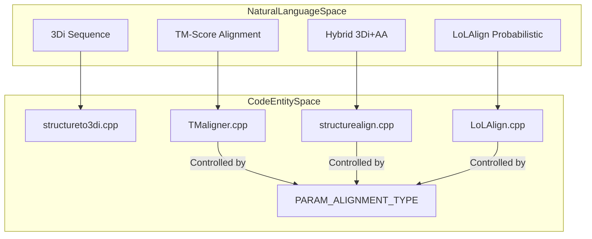
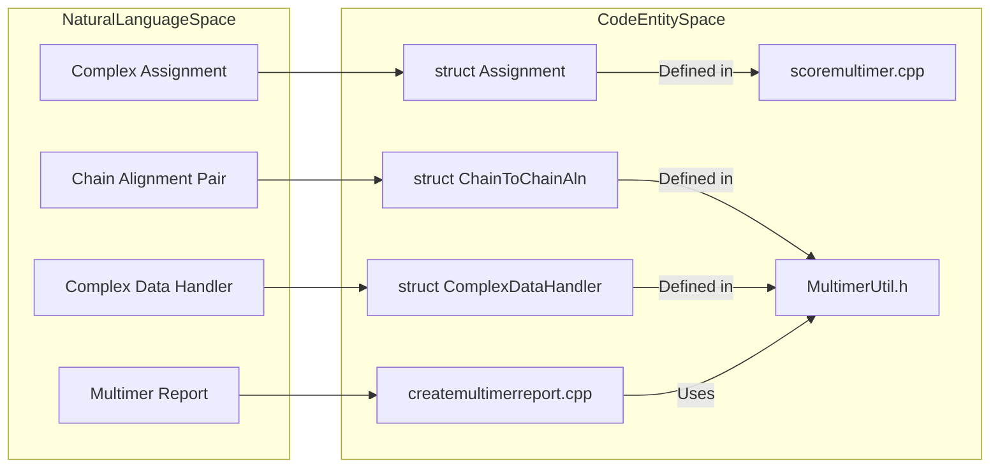

# Glossary

Relevant source files

The following files were used as context for generating this wiki page:

- [.github/results.png](.github/results.png)
- [README.md](README.md)
- [src/FoldseekBase.cpp](src/FoldseekBase.cpp)
- [src/commons/LocalParameters.cpp](src/commons/LocalParameters.cpp)
- [src/commons/LocalParameters.h](src/commons/LocalParameters.h)
- [src/strucclustutils/LoLAlign.cpp](src/strucclustutils/LoLAlign.cpp)
- [src/strucclustutils/LoLAlign.h](src/strucclustutils/LoLAlign.h)
- [src/strucclustutils/LoLAlignProbability.h](src/strucclustutils/LoLAlignProbability.h)
- [src/strucclustutils/LoLAlignProbabilityWeights.h](src/strucclustutils/LoLAlignProbabilityWeights.h)
- [src/strucclustutils/MultimerUtil.h](src/strucclustutils/MultimerUtil.h)
- [src/strucclustutils/convert2pdb.cpp](src/strucclustutils/convert2pdb.cpp)
- [src/strucclustutils/createmultimerreport.cpp](src/strucclustutils/createmultimerreport.cpp)
- [src/strucclustutils/expandmultimer.cpp](src/strucclustutils/expandmultimer.cpp)
- [src/strucclustutils/scoremultimer.cpp](src/strucclustutils/scoremultimer.cpp)

## Purpose and Scope
This page defines codebase-specific terms, jargon, abbreviations, and domain concepts used across the Foldseek repository. It serves as a reference for onboarding engineers to understand structural biology metrics, internal data abstractions, and core algorithmic components with direct pointers to the source code.

## 1. Structural Representation & Metrics

### 3Di (3D-Interactions)
A structural alphabet that discretizes the tertiary interactions of a residue with its nearest neighbors in 3D space. 3Di sequences allow Foldseek to treat structure alignment as a sequence alignment problem, leveraging optimized SIMD-accelerated Smith-Waterman implementations from MMseqs2.
*   **Implementation:** Handled via the 3Di modules and translation scripts [lib/3di/structureto3di.h:1-12](), [lib/3di/structureto3di.cpp:1-50]().
*   **Data Type:** Stored internally and processed with specialized substitution matrices like `mat3di.out` [src/commons/LocalParameters.cpp:4-4](), [data/mat3di.out:1-20]().

### TM-score (Template Modeling Score)
A metric assessing topological similarity between two protein structures, ranging from (0, 1], where >0.5 implies the same fold.
*   **Implementation:** Calculated via the `TMaligner` class [src/commons/TMaligner.h:1-20](), [src/commons/TMaligner.cpp:1-100]().
*   **Thresholds:** Controlled by `--tmscore-threshold` and `--tmscore-threshold-mode` [src/commons/LocalParameters.cpp:11-12](), [src/commons/LocalParameters.h:50-54]().

### LDDT (Local Distance Difference Test)
A superposition-independent metric comparing local residue environments, essential for predicted structure validation.
*   **Implementation:** `LDDTCalculator` uses grid-based neighbor searches within a cutoff [src/commons/LDDT.h:13-20](), [src/commons/LDDT.cpp:1-50]().
*   **Internal Data:** `LDDTScoreResult` stores per-residue and average scores [src/commons/LDDT.h:97-150]().

### Structure Bits
A heuristic scoring metric used for ranking hits, calculated as `bits * sqrt(alnlddt * alntmscore)`.
*   **Parameter:** Enabled via `--sort-by-structure-bits` [src/commons/LocalParameters.cpp:15-15]().

Sources: [src/commons/LocalParameters.cpp:4-15](), [src/commons/LocalParameters.h:50-54](), [src/commons/TMaligner.h:1-20](), [src/commons/LDDT.h:13-150](), [lib/3di/structureto3di.h:1-12]()

---

## 2. Internal Data Structures

### Coordinate16
A memory-efficient representation of protein coordinates supporting float or compressed `uint16_t` difference modes.
*   **Implementation:** [src/commons/Coordinate16.h:1-30](), [src/commons/LocalParameters.cpp:25-25]().

### ChainToChainAln
Stores the alignment between two specific chains from different complexes, including the rotation matrix (`u`) and translation vector (`t`).
*   **Implementation:** [src/strucclustutils/MultimerUtil.h:41-117]().
*   **Superposition Vector:** 12-element array holding 3x3 rotation and 3x1 translation [src/strucclustutils/MultimerUtil.h:18-18](), [src/strucclustutils/MultimerUtil.h:75-86]().

### Assignment & SearchResult
Used in `scoremultimer` to aggregate chain-to-chain alignments, evaluate complex TM-scores, and manage complex-level states.
*   **Implementation:** [src/strucclustutils/scoremultimer.cpp:22-160]().

### ComplexDataHandler
Holds complex-level scores such as query/target complex TM-scores, coverage metrics, chain TM-scores, and interface LDDT scores.
*   **Implementation:** [src/strucclustutils/MultimerUtil.h:153-168]().

### KeyIterator
An abstract interface (`DbKeyIterator`, `MapIterator`) used by `convert2pdb` to iterate over database keys or complex groupings.
*   **Implementation:** [src/strucclustutils/convert2pdb.cpp:18-63]().

Sources: [src/commons/Coordinate16.h:1-30](), [src/strucclustutils/MultimerUtil.h:18-168](), [src/strucclustutils/scoremultimer.cpp:22-160](), [src/strucclustutils/convert2pdb.cpp:18-63]()

---

## 3. Algorithm Concepts

### 3Di+AA Alignment
A hybrid alignment mode combining structural 3Di alphabets with amino acid sequence evolutionary profiles (`alignmentType = 2`).
*   **Implementation:** [src/commons/LocalParameters.h:38-38](), [src/strucclustutils/structurealign.cpp:32-35]().

### LoLAlign (Local-over-Local Alignment)
A specialized probabilistic alignment algorithm designed to detect local structural domains within larger, divergent proteins (`ALIGNMENT_TYPE_LOLALIGN = 3`).
*   **Implementation & Weights:** `LoLAlign` class, `LoLAlignProbability`, and `LoLAlignProbabilityWeights` [src/strucclustutils/LoLAlign.h:20-126](), [src/strucclustutils/LoLAlign.cpp:1-214]().

### Neural Network E-value Estimation
Uses pre-trained neural networks via `kerasify` to estimate statistical E-values for structural alignments since structural scores deviate from standard sequence score distributions.
*   **Implementation:** [lib/kerasify/keras_model.h:1-20](), [data/encoder_weights_3di.kerasify:1-10]().

Sources: [src/commons/LocalParameters.h:38-38](), [src/strucclustutils/structurealign.cpp:32-35](), [src/strucclustutils/LoLAlign.h:20-126](), [src/strucclustutils/LoLAlign.cpp:1-214]()

---

## 4. Codebase Mapping Diagrams

### From Logic to Code: Structure Alignment
This diagram maps natural language concepts of structure alignment to their corresponding C++ classes, functions, and parameters.

Title: "Structure Alignment Logic Mapping"

Sources: [src/commons/LocalParameters.cpp:17-25](), [src/strucclustutils/structurealign.cpp:32-43](), [src/strucclustutils/LoLAlign.cpp:1-35](), [lib/3di/structureto3di.h:1-12]()

### From Logic to Code: Multimer Search & Processing
This diagram connects multimer processing concepts to the internal data structures and utility modules.

Title: "Multimer Processing Mapping"

Sources: [src/strucclustutils/scoremultimer.cpp:74-160](), [src/strucclustutils/MultimerUtil.h:41-168](), [src/strucclustutils/createmultimerreport.cpp:1-85]()

---

## 5. Parameter Constants & Extended Types

| Constant | Value | Description |
| :--- | :--- | :--- |
| `DBTYPE_CA_ALPHA` | 101 | Internal database type for C-alpha coordinates [src/commons/LocalParameters.cpp:6-6]() |
| `DBTYPE_TMSCORE` | 102 | Internal database type for precomputed TM-scores [src/commons/LocalParameters.cpp:7-7]() |
| `DBTYPE_EXTENDED_INTERFACE` | `1u << 14` | Extended database type flag for interfaces [src/commons/LocalParameters.h:33-33]() |
| `DBTYPE_EXTENDED_LOLALIGN` | `1u << 13` | Extended database type flag for LoLAlign results [src/commons/LocalParameters.h:34-34]() |
| `ALIGNMENT_TYPE_3DI` | 0 | Pure 3Di structural alphabet alignment [src/commons/LocalParameters.h:36-36]() |
| `ALIGNMENT_TYPE_TMALIGN` | 1 | Global structural alignment using TM-align [src/commons/LocalParameters.h:37-37]() |
| `ALIGNMENT_TYPE_3DI_AA` | 2 | Hybrid 3Di + amino acid alignment [src/commons/LocalParameters.h:38-38]() |
| `ALIGNMENT_TYPE_LOLALIGN` | 3 | LoLAlign probabilistic domain alignment [src/commons/LocalParameters.h:39-39]() |
| `OUTFMT_U` | 42 | Output format ID for Rotation Matrix [src/commons/LocalParameters.h:74-74]() |
| `OUTFMT_T` | 43 | Output format ID for Translation Vector [src/commons/LocalParameters.h:75-75]() |
| `OUTFMT_LDDT` | 45 | Output format ID for LDDT score [src/commons/LocalParameters.h:77-77]() |

Sources: [src/commons/LocalParameters.cpp:6-7](), [src/commons/LocalParameters.h:33-39](), [src/commons/LocalParameters.h:74-77]()