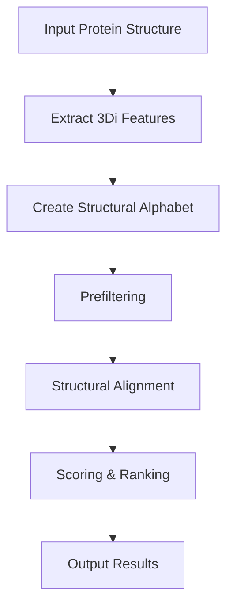

Foldseek is a revolutionary software tool that enables fast and sensitive comparisons of large protein structure sets. It represents a significant leap forward in structural bioinformatics, offering capabilities for both monomer and multimer searches, as well as clustering, all while running efficiently on CPU with optional GPU acceleration for even faster performance.

## What is Foldseek?

At its core, Foldseek addresses a fundamental challenge in structural biology: comparing protein structures at scale. Traditional structural alignment tools like TMalign or Dali are highly accurate but computationally expensive, making them impractical for large-scale analyses. Foldseek bridges this gap by achieving sensitivities similar to state-of-the-art structural aligners while being at least **20,000 times faster**.

This incredible speed is made possible through Foldseek's innovative approach to structural comparison. Instead of directly comparing 3D coordinates, Foldseek converts protein structures into a simplified representation using **3D interactions (3Di)** and amino acid sequences. This structural alphabet approach allows for rapid prefiltering and alignment, dramatically reducing computational requirements while maintaining remarkable sensitivity.

Sources: [src/foldseek.cpp#L7](src/foldseek.cpp#L7), [README.md#L3](README.md#L3)

## Key Features and Capabilities

Foldseek offers a comprehensive suite of tools for protein structure analysis:

### Fast Structure Search
The `easy-search` module allows you to query protein structures against a target database in seconds, not hours. It supports various input formats including PDB, mmCIF (both flat and gzipped), and even protein sequences in FASTA format through ProstT5 integration.

```bash
# Basic structure search
foldseek easy-search example/d1asha_ example/ aln tmpFolder
```

### Structure Clustering
With `easy-cluster`, Foldseek can group similar protein structures together, enabling the organization of large structural datasets and identification of structural families.

```bash
# Structure clustering with 90% coverage threshold
foldseek easy-cluster example/ res tmp -c 0.9
```

### Multimer Analysis
Foldseek extends its capabilities to protein complexes through `easy-multimersearch` and `easy-multimercluster`, allowing for comparison and clustering of multi-chain structures.

```bash
# Multimer search
foldseek easy-multimersearch example/1tim.pdb.gz example/8tim.pdb.gz result tmpFolder
```

### Sequence-to-Structure Search
Through integration with ProstT5, Foldseek can perform structure searches directly from protein sequences, eliminating the need for structure prediction and offering a **400-4000x speedup** compared to traditional structure prediction followed by alignment.

```bash
# Search sequences against structure databases
foldseek easy-search QUERY.fasta pdb res.m8 tmp --prostt5-model weights
```

### GPU Acceleration
For users with NVIDIA GPUs, Foldseek offers GPU acceleration that can make searches up to **4 times faster** than on a 64-core CPU.

```bash
# GPU-accelerated search
foldseek easy-search example/d1asha_ example/ aln tmp --gpu 1
```

Sources: [README.md#L111-L298](README.md#L111-L298), [LocalCommandDeclarations.h#L10-L30](src/LocalCommandDeclarations.h#L10-L30)

## How Foldseek Works

Foldseek's performance stems from its innovative approach to structural comparison:



The process begins by converting protein structures into a simplified representation using 3D interactions (3Di). This structural alphabet captures the essential geometric features of the protein fold while discarding less critical details. Foldseek then performs rapid prefiltering to identify potentially similar structures, followed by more detailed structural alignment of promising candidates.

This hierarchical approach allows Foldseek to achieve remarkable speed without sacrificing sensitivity. The software builds upon the MMseqs2 framework, a powerful sequence search toolkit, adapting its efficient algorithms for structural data.

Sources: [lib/3di/](lib/3di/), [lib/mmseqs/](lib/mmseqs/), [data/easystructuresearch.sh](data/easystructuresearch.sh)

## Technical Foundation

Foldseek is built on a robust technical foundation that combines several powerful libraries and algorithms:

- **MMseqs2**: Provides the core search and clustering algorithms adapted for structural data
- **3Di Library**: Converts 3D structures into structural alphabets for efficient comparison
- **TMalign**: Enables high-quality structural alignments and scoring
- **ProstT5**: Allows for sequence-to-structure translation using protein language models
- **Block-aligner**: Accelerates alignment computations
- **Foldcomp**: Compresses structural data for efficient storage and processing

This modular architecture allows Foldseek to leverage the strengths of each component while maintaining high performance and flexibility.

Sources: [lib/](lib/)

## Getting Started with Foldseek

Foldseek is designed to be accessible to users with varying levels of computational expertise. The software provides precompiled binaries for Linux (AVX2, ARM64, and GPU-enabled) and macOS, as well as conda packages for easy installation.

```bash
# Linux AVX2 installation
wget https://mmseqs.com/foldseek/foldseek-linux-avx2.tar.gz
tar xvzf foldseek-linux-avx2.tar.gz
export PATH=$(pwd)/foldseek/bin/:$PATH
```

Once installed, you can immediately start using Foldseek's "easy" commands for common tasks like searching and clustering, with more advanced options available for specialized analyses.

For those who prefer a web interface, Foldseek also provides a webserver at [search.foldseek.com](https://search.foldseek.com) that allows you to search against the AlphaFoldDB and PDB databases directly in your browser.

Sources: [README.md#L69-L85](README.md#L69-L85), [README.md#L66-L67](README.md#L66-L67)

## Why Foldseek Matters

Foldseek addresses critical needs in the era of structural genomics:

1. **Scale**: With the exponential growth of protein structure databases (exemplified by AlphaFold's predictions of over 200 million protein structures), traditional structural alignment tools have become impractical for large-scale analyses.

2. **Accessibility**: By dramatically reducing computational requirements, Foldseek makes structural bioinformatics accessible to researchers without access to high-performance computing resources.

3. **Integration**: The ability to work directly with protein sequences through ProstT5 bridges the gap between sequence and structure analysis, enabling new workflows and discoveries.

4. **Multimer Analysis**: As our understanding of protein function increasingly focuses on complexes and interactions, Foldseek's multimer capabilities provide essential tools for studying these higher-order structures.

> [!TIP]
> Whether you're a structural biologist exploring protein families, a bioinformatician analyzing large datasets, or a researcher interested in protein function and evolution, Foldseek provides the tools you need to efficiently navigate the expanding universe of protein structures.

## What's Next?

This overview has introduced you to Foldseek's core concepts and capabilities. To get hands-on experience with the tool, check out our [Quick Start](2-quick-start) guide, which will walk you through your first structure search in just a few minutes.

For more specific use cases, our tutorials cover [Structure Search Basics](4-structure-search-basics) and [Working with Structure Databases](5-working-with-structure-databases). If you're interested in the technical details, our [Architecture and Implementation](10-architecture-and-implementation) article provides a deeper dive into how Foldseek works under the hood.
