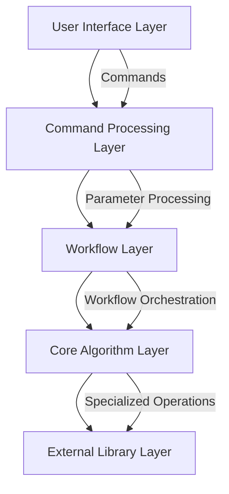
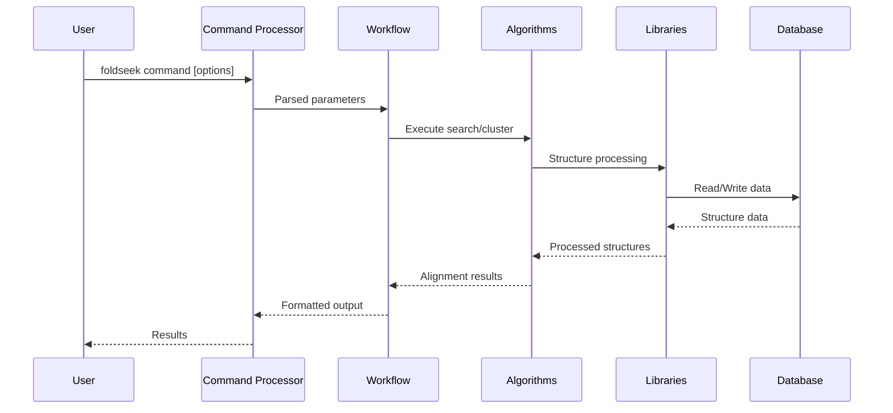

Foldseek represents a sophisticated approach to protein structure comparison, combining multiple computational techniques to achieve remarkable speed and sensitivity. Understanding its architecture reveals how the tool manages to perform structural alignments up to 20,000 times faster than traditional methods while maintaining comparable accuracy.

## Core Architecture Overview

At its foundation, Foldseek follows a modular design built on top of the MMseqs2 framework, extending its sequence-based search capabilities to handle 3D structural data. The architecture can be visualized as a layered system where each component has a specific responsibility in the structure comparison pipeline.



The entry point in `foldseek.cpp` serves as the application's face, defining basic metadata and registering available commands. This minimal main function delegates the real work to the command processing system, demonstrating a clean separation of concerns. `Sources: [foldseek.cpp#L1-L22](src/foldseek.cpp#L1-L22)`

## Command Processing System

Foldseek's command system is the heart of its user-facing functionality. The `FoldseekBase.cpp` file defines an extensive array of commands, each with specific parameters, examples, and validation rules. This approach creates a consistent interface for all operations, from simple database creation to complex multimer searches.

Each command in the system follows a structured format:
- **Command name**: The CLI identifier (e.g., "easy-search", "cluster")
- **Implementation function**: The C++ function that executes the command
- **Parameter set**: Configuration options specific to that command
- **Documentation**: Usage examples and descriptions
- **Validation rules**: Input/output type checking

For example, the "easy-search" command demonstrates this structure:
```cpp
{"easy-search",          easystructuresearch,           &localPar.easystructuresearchworkflow,   COMMAND_EASY,
        "Structual search",
        "# Search a single/multiple PDB file against a set of PDB files\n"
        "foldseek easy-search examples/d1asha_ examples/ result.m8 tmp\n",
        "Martin Steinegger <martin.steinegger@snu.ac.kr>",
        "<i:PDB|mmCIF[.gz]> ... <i:PDB|mmCIF[.gz]>|<i:stdin> <i:targetFastaFile[.gz]>|<i:targetDB> <o:alignmentFile> <tmpDir>",
        CITATION_FOLDSEEK, {{"PDB|mmCIF[.gz|.bz2]", DbType::ACCESS_MODE_INPUT, DbType::NEED_DATA|DbType::VARIADIC, &FoldSeekDbValidator::flatfileStdinAndFolder },
                                   {"targetDB", DbType::ACCESS_MODE_INPUT, DbType::NEED_DATA, &FoldSeekDbValidator::flatfileAndFolder },
                                   {"alignmentFile", DbType::ACCESS_MODE_OUTPUT, DbType::NEED_DATA, &DbValidator::flatfile },
                                   {"tmpDir", DbType::ACCESS_MODE_OUTPUT, DbType::NEED_DATA, &DbValidator::directory }}}
```
`Sources: [FoldseekBase.cpp#L61-L76](src/FoldseekBase.cpp#L61-L76)`

## Workflow Layer

The workflow layer orchestrates complex operations by combining simpler components. Each workflow implementation in the `workflow/` directory handles a specific use case, such as structure search, clustering, or multimer analysis.

Consider the structure search workflow:
```cpp
void setStructureSearchWorkflowDefaults(LocalParameters *p) {
    p->kmerSize = 0;
    p->sensitivity = 9.5;
    p->maxResListLen = 1000;
    p->alignmentMode = Parameters::ALIGNMENT_MODE_SCORE_COV_SEQID;
    p->removeTmpFiles = true;
}
```
`Sources: [StructureSearch.cpp#L14-L20](src/workflow/StructureSearch.cpp#L14-L20)`

Workflows follow a consistent pattern:
1. **Parameter initialization**: Set default values for workflow-specific parameters
2. **Parameter validation**: Ensure user inputs are valid and compatible
3. **Component orchestration**: Call the appropriate sequence of operations
4. **Resource management**: Handle temporary files and cleanup

## Core Algorithm Layer

The `commons/` directory contains Foldseek's computational engine, implementing the algorithms that make fast structure comparison possible. Key components include:

### 3Di Alphabet Implementation
The revolutionary 3Di (3-dimensional interaction) alphabet transforms complex 3D structural information into a 1D sequence representation. This transformation is the key to Foldseek's speed, allowing it to leverage fast sequence alignment algorithms for structural comparison.

### Structure Alignment Algorithms
Multiple alignment algorithms are implemented to handle different aspects of structure comparison:

| Algorithm | Purpose | Key Features |
|-----------|---------|--------------|
| TMaligner | Global structure alignment | TM-score calculation, rotation matrix optimization |
| StructureSmithWaterman | Local structure alignment | Handles structural motifs, flexible gap penalties |
| LDDT | Local Distance Difference Test | Residue-level accuracy assessment |

These algorithms work in concert to provide both speed and accuracy. The TMaligner, for instance, implements the well-established TM-score algorithm for global structural similarity assessment. `Sources: [TMaligner.h](src/commons/TMaligner.h), [StructureSmithWaterman.h](src/commons/StructureSmithWaterman.h)`

## External Library Integration

Foldseek leverages several specialized libraries through its `lib/` directory, each providing critical functionality:

### MMseqs2 Foundation
The MMseqs2 library provides the core search infrastructure, including:
- Efficient k-mer indexing and prefiltering
- Sequence database management
- Multi-threading support
- Memory-mapped file handling

This foundation allows Foldseek to handle massive datasets efficiently. `Sources: [lib/mmseqs/](lib/mmseqs/)`

### Structure Processing Libraries
Several libraries handle specialized structure-related tasks:

- **Gemmi**: Comprehensive PDB/mmCIF file parsing and structure manipulation
- **Foldcomp**: Structure compression for efficient storage
- **TMalign**: Reference implementation of TM-score algorithm
- **Pulchra**: Structure reconstruction and refinement

### Machine Learning Integration
The ProstT5 library enables cutting-edge protein language model capabilities:
- 3Di sequence prediction from amino acid sequences
- Structure embedding generation
- Enhanced sensitivity for distant homology detection

> [!TIP]
> The ProstT5 integration represents Foldseek's bridge between traditional structural biology and modern machine learning approaches, enabling structure prediction from sequence data alone.

## Build System and Configuration

Foldseek uses CMake for its build system, with careful attention to cross-platform compatibility and optional feature configuration:

```cmake
set(ENABLE_PROSTT5 1 CACHE BOOL "Enable ProstT5")
set(ENABLE_CUDA 0 CACHE BOOL "Enable CUDA")
set(IGNORE_RUST_VERSION 0 CACHE BOOL "Ignore Rust version check")
set(FORCE_STATIC_DEPS 0 CACHE BOOL "Force static linking of deps")
```
`Sources: [CMakeLists.txt#L9-L12](CMakeLists.txt#L9-L12)`

This configuration allows users to customize builds based on their needs, enabling or disabling features like GPU acceleration or machine learning components.

## Data Flow Architecture

Understanding how data flows through Foldseek is crucial for understanding its performance:



This flow demonstrates how the system efficiently handles the transformation from raw structure data to final comparison results, with each layer adding value and optimization.

## Performance Optimization Strategies

Foldseek's architecture incorporates several performance optimizations:

1. **Memory-mapped databases**: Efficient access to large structure databases without loading everything into memory
2. **Multi-threading**: Parallel processing of independent tasks
3. **Prefiltering**: Rapid elimination of non-matching structures using k-mer-based approaches
4. **Structure compression**: Reduced memory footprint through specialized encoding

The combination of these strategies enables Foldseek to process datasets that would be intractable with traditional structural alignment tools.

## Extensibility Design

The modular architecture makes Foldseek extensible in several ways:

- **New commands**: Adding functionality through the command registration system
- **New algorithms**: Implementing additional scoring or alignment methods in the commons layer
- **New workflows**: Combining existing components to create new analysis pipelines
- **New format support**: Extending the library layer to handle additional structure file formats

This design ensures that Foldseek can evolve with the field of structural bioinformatics, incorporating new algorithms and approaches as they emerge.