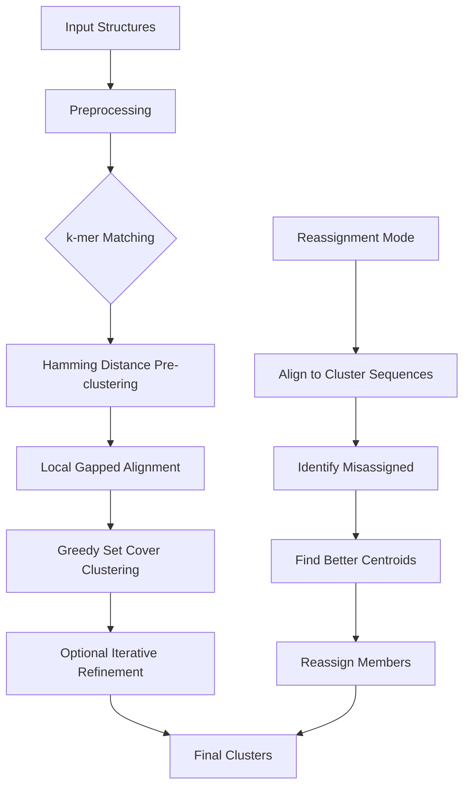
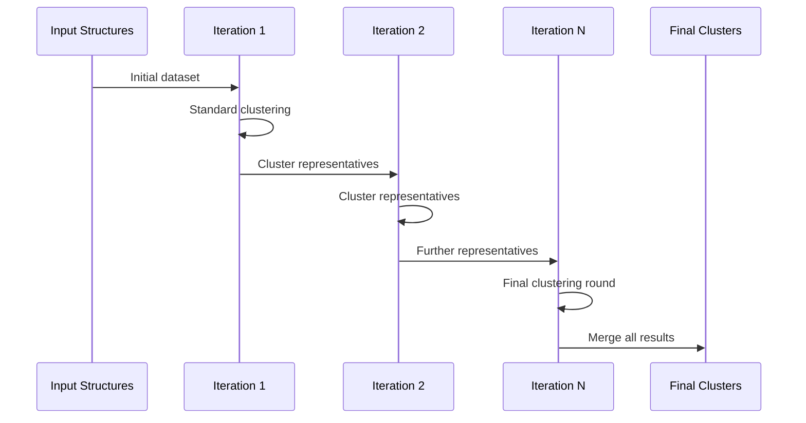

Structure clustering in Foldseek enables the systematic organization of protein structures into families based on structural similarity. This powerful capability allows researchers to analyze large protein structure datasets, identify evolutionary relationships, and discover novel protein families efficiently. Unlike traditional sequence-based clustering, structure clustering can detect distant evolutionary relationships that may not be apparent from sequence alone.

## Why Structure Clustering Matters

Protein structure is more conserved than sequence throughout evolution. Two proteins with low sequence similarity might share nearly identical structures and perform similar functions. Structure clustering leverages this principle to:

- **Identify distant evolutionary relationships** that sequence-based methods miss
- **Organize large structure datasets** into manageable families for analysis
- **Discover novel protein folds** and functional relationships
- **Reduce redundancy** in structure databases by grouping similar structures
- **Enable efficient comparative analysis** across entire protein structure universes

> [!TIP]
> Structure clustering is particularly valuable for analyzing large-scale structure prediction datasets like AlphaFold DB, where traditional sequence-based clustering would miss many important relationships.

## The Structure Clustering Workflow

Foldseek implements a sophisticated multi-stage clustering pipeline that balances sensitivity with computational efficiency. The process can be visualized as follows:



### Stage 1: Fast Pre-filtering with k-mer Matching

The clustering process begins by identifying potential structural similarities through **k-mer matching**. This step efficiently finds candidate pairs by comparing short structural fragments (3Di sequences) using:

- **3Di alphabet**: Foldseek's structural alphabet representing local backbone conformations
- **Exact k-mer matches**: Finding identical short structural patterns between proteins
- **Computational efficiency**: This step dramatically reduces the search space for more expensive alignment steps

```bash
# Finding exact k-mer matches (simplified from structurecluster.sh)
$MMSEQS kmermatcher "${INPUT}_ss" "${TMP_PATH}/pref" ${KMERMATCHER_PAR}
```

Sources: [structurecluster.sh#L58-L63](data/structurecluster.sh#L58-L63)

### Stage 2: Hamming Distance Pre-clustering

Candidate pairs from k-mer matching are further refined using **Hamming distance pre-clustering**. This step:

- Computes structural similarity scores for candidate pairs
- Filters out weak matches using efficient distance calculations
- Creates preliminary clusters based on structural similarity thresholds

```bash
# Hamming distance pre-clustering
$MMSEQS structurerescorediagonal "${INPUT}" "${INPUT}" "${TMP_PATH}/pref" "${TMP_PATH}/pref_rescore1"
```

Sources: [structurecluster.sh#L66-L70](data/structurecluster.sh#L66-L70)

### Stage 3: Local Gapped Alignment

The most computationally intensive step performs **local gapped alignment** using Foldseek's structural alignment algorithms:

- **3Di+AA alignment**: Combines structural (3Di) and sequence (amino acid) information
- **Local alignment**: Finds the best matching regions between structures
- **Sensitive detection**: Capable of identifying distant structural relationships

```bash
# Local gapped sequence alignment
$MMSEQS $ALIGNMENT_ALGO "${INPUT}${ALN_EXTENSION}" "${INPUT}${ALN_EXTENSION}" "${TMP_PATH}/pref_filter2" "${TMP_PATH}/aln.linclust"
```

Sources: [structurecluster.sh#L93-L98](data/structurecluster.sh#L93-L98)

### Stage 4: Greedy Set Cover Clustering

The final clustering step uses a **greedy set cover algorithm** to assign structures to clusters:

- **Representative selection**: Chooses centroid structures for each cluster
- **Member assignment**: Assigns remaining structures to the most similar representative
- **Optimal coverage**: Ensures comprehensive coverage while minimizing redundancy

```bash
# Clustering using greedy set cover
"$MMSEQS" clust "${TMP_PATH}/pre_clustered_seqs}" "${TMP_PATH}/aln.linclust}" "${TMP_PATH}/clust.linclust}"
```

Sources: [structurecluster.sh#L107-L111](data/structurecluster.sh#L107-L111)

## Advanced Features

### Iterative Clustering Mode

For maximum sensitivity, Foldseek offers an **iterative clustering mode** that performs multiple rounds of clustering:

1. **Initial clustering**: Creates preliminary clusters using the standard pipeline
2. **Representative selection**: Chooses cluster representatives for the next iteration
3. **Iterative refinement**: Performs additional clustering rounds on representatives
4. **Final merging**: Combines results from all iterations into comprehensive clusters

This approach is particularly useful for:
- **Large datasets** where computational efficiency is crucial
- **Distant relationship detection** where sensitivity is paramount
- **Hierarchical organization** of protein structure space



Sources: [structurecluster.sh#L126-L187](data/structurecluster.sh#L126-L187)

### Reassignment Mode

The **reassignment mode** provides an additional optimization step that:

1. **Validates assignments**: Checks if cluster members truly belong to their assigned cluster
2. **Identifies misassignments**: Finds structures that might be better placed elsewhere
3. **Reassigns optimally**: Moves structures to clusters where they fit better
4. **Improves quality**: Results in more biologically meaningful clusters

This feature is especially valuable when:
- **High precision** is required for downstream analysis
- **Overlapping clusters** need to be resolved
- **Boundary cases** between protein families need careful handling

Sources: [structurecluster.sh#L190-L343](data/structurecluster.sh#L190-L343)

## Practical Usage

### Basic Structure Clustering

The simplest way to perform structure clustering is using the `easy-cluster` command:

```bash
foldseek easy-cluster example/ res tmp -c 0.9
```

This command:
- **Input**: Takes structures from the `example/` directory
- **Output**: Creates results with prefix `res`
- **Temporary**: Uses `tmp` for intermediate files
- **Coverage**: Requires 90% coverage (`-c 0.9`) for cluster membership

Sources: [README.md#L230](README.md#L230)

### Understanding Cluster Output

Structure clustering produces three main output files:

#### 1. Tab-separated Cluster Format (`_cluster.tsv`)
```
Q0KJ32	Q0KJ32
Q0KJ32	C0W539
Q0KJ32	D6KVP9
E3HQM9	E3HQM9
E3HQM9	F0YHT8
```

Each line shows a **representative-member relationship**, where:
- First column: Cluster representative
- Second column: Cluster member (same as representative for centroids)

#### 2. Representative Sequences (`_repseq.fasta`)
```
>Q0KJ32
MAGA....R
>E3HQM9
MCAT...Q
```

Contains **one sequence per cluster** representing the cluster centroid.

#### 3. All Member Sequences (`_allseq.fasta`)
```
>Q0KJ32	
>Q0KJ32
MAGA....R
>C0W539
MVGA....R
>D6KVP9
MVGA....R
>E3HQM9	
>E3HQM9
MCAT...Q
>Q223C0
MCAR...Q
```

Shows **all sequences organized by cluster**, with cluster boundaries marked by duplicate headers.

Sources: [README.md#L232-L268](README.md#L232-L268)

### Key Clustering Parameters

| Parameter | Category | Description |
|-----------|----------|-------------|
| `-e` | Sensitivity | Maximum E-value for cluster membership (default: 0.001) |
| `--alignment-type` | Alignment | 0: 3Di only, 1: TMalign (global), 2: 3Di+AA (default) |
| `-c` | Alignment | Minimum coverage for cluster membership (default: 0.0) |
| `--cov-mode` | Alignment | Coverage calculation: 0:both, 1:target, 2:query |
| `--min-seq-id` | Alignment | Minimum sequence identity threshold |
| `--tmscore-threshold` | Alignment | Minimum TM-score for acceptance |
| `--lddt-threshold` | Alignment | Minimum LDDT score for acceptance |

Sources: [README.md#L270-L282](README.md#L270-L282)

## Performance Considerations

### Memory Requirements

Structure clustering memory usage depends on several factors:

- **Database size**: Larger datasets require more memory
- **Structural detail**: Including Cα coordinates increases memory usage
- **Clustering parameters**: More sensitive settings require additional resources

For optimal performance:
- **With Cα info**: Use formula `(6 bytes Cα + 1 3Di byte + 1 AA byte) × (database residues)`
- **Without Cα info**: Reduce memory by ~75% using `--sort-by-structure-bits 0`
- **Large datasets**: Consider iterative clustering mode for better memory efficiency

Sources: [README.md#L91-L101](README.md#L91-L101)

### Computational Optimization

To maximize clustering performance:

1. **Use appropriate sensitivity**: Start with default settings, adjust based on needs
2. **Leverage iterative mode**: For large datasets, use iterative clustering
3. **Consider coverage thresholds**: Higher coverage reduces computational cost
4. **Utilize multiple cores**: Foldseek automatically parallelizes across available CPUs

> [!TIP]
> For clustering very large datasets like AlphaFold DB, consider using the iterative clustering mode with appropriate coverage thresholds to balance sensitivity and computational efficiency.

## Applications and Use Cases

### Protein Family Analysis

Structure clustering enables comprehensive protein family analysis by:

- **Identifying structural families** beyond sequence-based classifications
- **Discovering novel folds** that don't match existing families
- **Mapping structural diversity** within protein superfamilies
- **Understanding evolutionary relationships** across protein structure space

### Database Organization

Large structure databases benefit from clustering through:

- **Redundancy reduction**: Removing duplicate or highly similar structures
- **Efficient storage**: Organizing structures by structural similarity
- **Improved search**: Enabling faster searches through representative structures
- **Hierarchical organization**: Creating multi-level classification systems

### Functional Annotation

Structure clustering supports functional annotation by:

- **Inferring function** from structural similarity to annotated proteins
- **Identifying functional sites** through conserved structural features
- **Predicting protein interactions** based on structural compatibility
- **Guiding experimental validation** of computationally predicted relationships

## Conclusion

Structure clustering in Foldseek represents a powerful approach to organizing and analyzing protein structure data. By combining efficient algorithms with sensitive structural comparison methods, it enables researchers to uncover relationships that would be missed by sequence-based approaches alone. Whether you're analyzing small protein families or entire structure databases, Foldseek's clustering capabilities provide the tools needed for comprehensive structural bioinformatics analysis.

The combination of speed, sensitivity, and flexibility makes Foldseek's structure clustering an essential tool for modern structural biology research, enabling discoveries that bridge the gap between protein sequence, structure, and function.