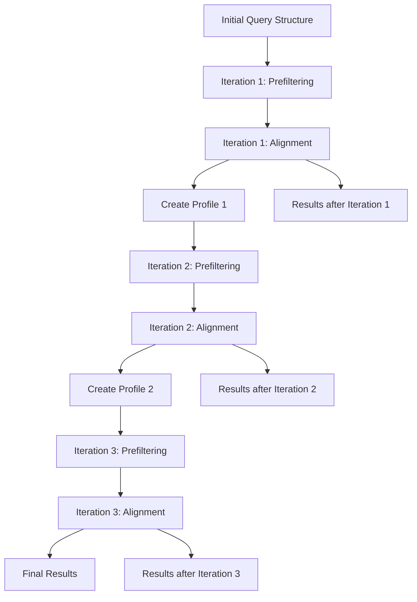

Iterative search workflows in Foldseek represent a powerful approach to enhance the sensitivity and accuracy of protein structure searches by progressively refining search results through multiple iterations. This technique is particularly valuable when searching for distant structural homologs or when dealing with complex protein structures where initial searches might miss important relationships.

## Understanding Iterative Search

At its core, iterative search in Foldseek follows a **multi-step refinement process** that builds upon previous search results to discover increasingly distant structural relationships. Think of it as peeling an onion layer by layer - each iteration reveals deeper structural similarities that might have been obscured in previous searches.

The iterative approach works by:
1. Performing an initial search with your query structure
2. Building a profile from the results of that search
3. Using this profile as a new query for the next search iteration
4. Repeating this process for a specified number of iterations

This method allows Foldseek to capture **progressively more remote structural homologies** by leveraging the information gained in each iteration to inform the next search.

## How Iterative Search Works in Foldseek

The iterative search workflow in Foldseek is implemented through a sophisticated shell script that orchestrates multiple search steps. Let's break down the key components:

### The Iterative Loop

The workflow operates in a loop that typically runs for 3 iterations by default (though this is configurable). Each iteration consists of several key steps:

```bash
# Default number of iterations
if [ -z "$NUM_IT" ]; then
    NUM_IT=3
fi

while [ "$STEP" -lt "$NUM_IT" ]; do
    # Perform prefiltering
    # Execute alignment
    # Create profile for next iteration
    STEP=$((STEP+1))
done
```

Sources: [structureiterativesearch.sh#L14-L19](data/structureiterativesearch.sh#L14-L19)

### Prefiltering Step

In each iteration, the workflow first performs a prefiltering step to quickly identify potential matches:

```bash
# Call prefilter module
if notExists "$TMP_PATH/pref_tmp_${STEP}.done"; then
    # Configure prefilter parameters
    # Execute prefilter
    $RUNNER "$MMSEQS" $TOOL "${QUERYDB}_ss" "${TARGET_PREFILTER}${INDEXEXT}" "$TMP_PATH/pref_${STEP}" ${TMP}
fi
```

Sources: [structureiterativesearch.sh#L21-L33](data/structureiterativesearch.sh#L21-L33)

For subsequent iterations (STEP ≥ 1), the workflow subtracts results from previous iterations to avoid redundancy:

```bash
# Subtract previous results to avoid redundancy
"$MMSEQS" subtractdbs "$TMP_PATH/pref_tmp_${STEP}" "$TMP_PATH/aln_${STEPONE}" "$TMP_PATH/pref_${STEP}" $SUBSTRACT_PAR
```

Sources: [structureiterativesearch.sh#L44-L47](data/structureiterativesearch.sh#L44-L47)

### Alignment Step

After prefiltering, the workflow performs detailed structural alignment:

```bash
# Call alignment module
if notExists "$TMP_PATH/aln_tmp_${STEP}.done"; then
    # Configure alignment parameters
    # Execute alignment
    $RUNNER "$MMSEQS" "${ALIGNMENT_ALGO}" "${QUERYDB}" "${TARGET_ALIGNMENT}${INDEXEXT}" "$TMP_PATH/pref_${STEP}" "$TMP_PATH/aln_${STEP}" ${TMP}
fi
```

Sources: [structureiterativesearch.sh#L55-62](data/structureiterativesearch.sh#L55-62)

### Profile Creation

The key to iterative search is the creation of profiles from alignment results. These profiles capture the structural and sequence characteristics of the found homologs, which then serve as the query for the next iteration:

```bash
# Create profiles for next iteration
if [ $STEP -ne $((NUM_IT - 1)) ]; then
    if notExists "$TMP_PATH/profile_${STEP}.dbtype"; then
        "$MMSEQS" result2profile "${QUERYDB}" "${TARGET_ALIGNMENT}${INDEXEXT}" "$TMP_PATH/aln_${STEP}" "$TMP_PATH/profile_${STEP}" ${VERBOSITY_THREADS_PAR} ${PROFILE_EVAL}
    fi
fi
QUERYDB="$TMP_PATH/profile_${STEP}"
```

Sources: [structureiterativesearch.sh#L111-118](data/structureiterativesearch.sh#L111-118)

> [!TIP]
> The profile creation step is what makes iterative search so powerful. By converting alignment results into a profile, Foldseek can capture the conserved structural features across multiple homologs, making it easier to detect more distant relationships in subsequent iterations.

## Workflow Visualization

The iterative search process can be visualized as follows:



## Benefits of Iterative Search

Iterative search workflows offer several key advantages over single-pass searches:

1. **Increased Sensitivity**: Each iteration builds upon the previous one, allowing the detection of increasingly distant structural relationships.

2. **Reduced False Positives**: The subtractdbs operation in subsequent iterations helps eliminate redundant matches, improving result quality.

3. **Better Coverage of Remote Homologs**: By creating profiles from intermediate results, the search can capture structural features that might be missed in a single pass.

4. **Adaptive Search Strategy**: The workflow automatically adjusts its search strategy based on results from previous iterations.

## Practical Applications

Iterative search workflows are particularly valuable in several scenarios:

### Finding Distant Structural Homologs

When searching for proteins that have diverged significantly over evolutionary time, iterative search can uncover relationships that would be missed by standard search methods.

### Exploring Protein Structure Space

For comprehensive structural analyses, iterative search provides a more complete picture of the structural neighborhood around a query protein.

### Annotating Proteins of Unknown Function

When dealing with proteins of unknown function, iterative search can reveal subtle structural similarities to proteins with known functions, providing clues about potential roles.

## Implementation Details

The iterative search workflow in Foldseek is built on top of the MMseqs2 framework, leveraging its efficient prefiltering and alignment algorithms. The workflow is implemented as a shell script that orchestrates calls to various MMseqs2 modules:

- **prefilter**: Quickly identifies potential matches
- **alignment**: Performs detailed structural alignment
- **subtractdbs**: Removes redundant matches
- **result2profile**: Creates profiles from alignment results
- **mergedbs**: Combines results from multiple iterations

Sources: [structureiterativesearch.sh](data/structureiterativesearch.sh)

## Configuring Iterative Search

The iterative search workflow can be customized through several parameters:

- **NUM_IT**: Number of iterations to perform (default: 3)
- **PREFILTER_PAR_0**, **PREFILTER_PAR_1**, etc.: Prefilter parameters for each iteration
- **ALIGNMENT_PAR_0**, **ALIGNMENT_PAR_1**, etc.: Alignment parameters for each iteration
- **PROFILE_EVAL**: E-value threshold for profile creation

These parameters allow fine-tuning of the search process for specific use cases, balancing sensitivity and computational efficiency.

> [!TIP]
> Increasing the number of iterations will generally improve sensitivity but at the cost of increased computation time. For most applications, 3 iterations provide a good balance between sensitivity and performance.

## Conclusion

Iterative search workflows represent one of the most powerful features of Foldseek, enabling researchers to uncover distant structural relationships that would be difficult or impossible to detect with single-pass searches. By progressively building profiles from search results and using them to inform subsequent searches, Foldseek can explore the protein structure space with remarkable sensitivity and efficiency.

Whether you're annotating novel protein structures, exploring evolutionary relationships, or investigating protein function, the iterative search workflow provides a valuable tool for comprehensive structural analysis.