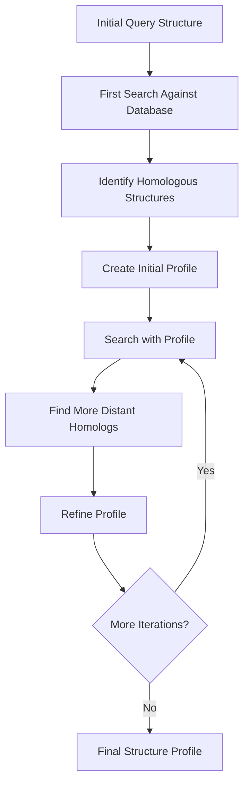

Structure profiles are a powerful feature in Foldseek that enable more sensitive and accurate protein structure comparisons by incorporating evolutionary information and structural characteristics into a unified representation. They build upon the concept of sequence profiles used in traditional sequence homology searches but extend it to include structural information specific to Foldseek's 3Di (3-dimensional interaction) alphabet.

## What Are Structure Profiles?

Structure profiles in Foldseek are position-specific scoring matrices that combine evolutionary information from multiple sequence alignments with structural information derived from protein 3D structures. They serve as an enriched representation of a protein that captures both its sequence conservation patterns and its structural features.

The key components of a structure profile include:

1. **Base Profile**: Contains position-specific scores for amino acids and structural states (3Di characters)
2. **Secondary Structure (_ss)**: Includes secondary structure information
3. **Structural Coordinates (_ca)**: Contains alpha-carbon coordinates for structural alignment
4. **Hidden Markov Model (_h)**: Probabilistic representation of the sequence and structure

> [!TIP]
> Structure profiles are particularly valuable for detecting distant evolutionary relationships where sequence similarity has diverged beyond recognition, but structural similarity is preserved.

## How Structure Profiles Work

Structure profiles are created through an iterative process that refines the representation of a query protein by incorporating information from homologous structures found in initial searches.



This iterative approach allows Foldseek to gradually expand its sensitivity, detecting increasingly distant structural relationships with each iteration.

## Creating Structure Profiles

Structure profiles can be created using the `result2structprofile` command, which takes alignment results and converts them into a profile representation.

```bash
foldseek result2structprofile queryDB targetDB alignmentResults profileDB
```

The `structureprofile.sh` script provides an automated workflow for creating structure profiles through multiple iterations:

```bash
# Basic structure profile creation
foldseek structureprofile.sh queryDB targetDB alignmentResults profileDB tmpFolder
```

Under the hood, this script performs several key steps:

1. **Prefiltering**: Rapidly identifies potentially similar structures in the database
2. **Alignment**: Performs detailed structural alignments between the query and candidates
3. **Profile Creation**: Converts alignment results into a position-specific scoring matrix
4. **Iteration**: Uses the newly created profile as the query for subsequent searches

Sources: [structureprofile.sh#L62-L70](data/structureprofile.sh#L62-L70), [result2structprofile.sh#L7-L11](data/result2structprofile.sh#L7-L11)

## Components of Structure Profiles

Structure profiles in Foldseek consist of multiple components that capture different aspects of protein structure and evolution:

### Base Profile
The core component contains position-specific scores for:
- **Amino Acids**: 20 standard amino acids plus gap characters
- **3Di States**: Foldseek's structural alphabet representing local structural environments

### Secondary Structure Information
The `_ss` component includes:
- Secondary structure assignments (helix, sheet, coil)
- Solvent accessibility predictions
- Other structural features

### Structural Coordinates
The `_ca` component maintains:
- Alpha-carbon coordinates for structural superposition
- Distance matrices for structural comparison
- Essential 3D information for accurate alignments

### Hidden Markov Model
The `_h` component provides:
- Probabilistic representation of sequence-structure relationships
- Transition probabilities between structural states
- Emission probabilities for amino acids and structural features

Sources: [result2structprofile.sh#L13-29](data/result2structprofile.sh#L13-29), [result2structprofile.cpp](src/strucclustutils/result2structprofile.cpp)

## Practical Applications

Structure profiles enhance various protein structure analysis tasks:

### Sensitive Homology Detection
Structure profiles significantly improve the detection of distant evolutionary relationships that might be missed by simple structure-to-structure comparisons.

```bash
# Iterative search with structure profiles
foldseek easy-search query.fasta targetDB results tmpFolder --num-iterations 3
```

### Structure Clustering
When clustering protein structures, profiles provide a more nuanced similarity measure that can distinguish between functionally relevant similarities and superficial resemblances.

```bash
# Clustering with profile-based similarities
foldseek easy-cluster structures/ clusterResults tmpFolder -c 0.5 --num-iterations 2
```

### Protein Function Prediction
By capturing both evolutionary and structural information, structure profiles can provide insights into protein function, especially for proteins with unknown function but known structure.

> [!TIP]
> For the best results when using structure profiles, ensure your database is comprehensive and includes diverse protein structures. The quality of the profile depends on the diversity of homologs found during the search process.

## Performance Considerations

Creating and using structure profiles involves additional computational overhead compared to direct structure comparisons:

1. **Memory Usage**: Structure profiles require more memory than simple structure databases
2. **Compute Time**: The iterative process and profile creation add to the overall runtime
3. **Storage**: Profile databases are larger than structure-only databases

However, the increased sensitivity and accuracy often justify these costs, especially for research questions involving distant evolutionary relationships or functionally important structural similarities.

## Advanced Usage

For more control over structure profile creation, you can adjust various parameters:

```bash
# Custom profile creation with specific parameters
foldseek result2structprofile queryDB targetDB alignmentResults profileDB \
    --profile-eval 0.001 \
    --profile-score-bits 50 \
    --profile-filter-threshold 0.8
```

Key parameters include:
- `--profile-eval`: E-value threshold for including sequences in the profile
- `--profile-score-bits`: Minimum bit score for profile inclusion
- `--profile-filter-threshold`: Minimum coverage threshold for profile construction

Sources: [LocalCommandDeclarations.h#L32](src/LocalCommandDeclarations.h#L32), [result2structprofile.cpp](src/strucclustutils/result2structprofile.cpp)

## Conclusion

Structure profiles represent a powerful approach to protein structure analysis that combines the strengths of evolutionary information from sequence profiles with the detailed structural information captured by Foldseek's 3Di alphabet. By leveraging both dimensions of protein information, structure profiles enable more sensitive detection of distant homologies and provide deeper insights into protein structure-function relationships.

Whether you're exploring the evolutionary history of a protein family, annotating structures of unknown function, or investigating structural relationships across diverse organisms, structure profiles offer a valuable tool for enhancing the depth and accuracy of your analyses.