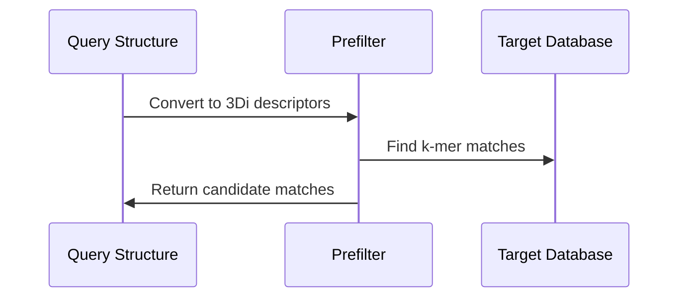

Protein structure search is a fundamental task in structural biology, enabling researchers to find proteins with similar 3D structures, which often indicates functional or evolutionary relationships. Foldseek makes this process remarkably fast and efficient, allowing you to search through massive structural databases in seconds rather than hours or days.

## What is Structure Search?

Structure search involves comparing a query protein structure against a database of target structures to identify similarities. Unlike sequence-based searches, structure searches can detect distant evolutionary relationships that might not be apparent from sequence alone. This is because protein structures are more conserved than sequences throughout evolution.

Foldseek achieves this by converting 3D protein structures into efficient representations (3Di descriptors) that can be rapidly compared, making it up to 20,000 times faster than traditional structural alignment methods while maintaining similar sensitivity.

> [!TIP]
> Foldseek's speed comes from its innovative approach of converting 3D structures into 1D sequences of structural alphabets (3Di), allowing it to leverage fast sequence alignment algorithms for structural comparisons.

## The Structure Search Workflow

A typical structure search in Foldseek follows these key steps:

1. **Database Creation**: Convert target structures into a searchable database format
2. **Indexing (Optional)**: Pre-compute an index for faster searches
3. **Searching**: Compare query structures against the database
4. **Result Conversion**: Convert internal results to human-readable formats

Let's visualize this workflow:

```mermaid
flowchart TD
    A[Query Structure<br/>(PDB/mmCIF/FASTA)] --> B[Database Creation]
    C[Target Structures<br/>(PDB/mmCIF/FASTA)] --> B
    B --> D[Optional Indexing]
    D --> E[Structure Search]
    E --> F[Result Conversion]
    F --> G[Output Formats<br/>(Tab-separated/HTML/PDB)]
```

Sources: [structuresearch.sh#L15-L53](data/structuresearch.sh#L15-L53), [easystructuresearch.sh#L15-L50](data/easystructuresearch.sh#L15-L50)

## Basic Structure Search Commands

Foldseek provides two main approaches for structure searches: a simplified `easy-search` command for beginners and more advanced commands for fine-tuned control.

### Easy Search: The Quick Start Approach

The `easy-search` command is perfect for beginners as it handles all the intermediate steps automatically:

```bash
foldseek easy-search example/d1asha_ example/ aln tmpFolder
```

This single command:
1. Creates a database from the `example/` directory
2. Searches the query structure `d1asha_` against this database
3. Outputs results in tab-separated format to `aln`
4. Uses `tmpFolder` for temporary files

The default output format includes: `query,target,fident,alnlen,mismatch,gapopen,qstart,qend,tstart,tend,evalue,bits`

Sources: [README.md#L114-L115](README.md#L114-L115), [easystructuresearch.sh#L15-L65](data/easystructuresearch.sh#L15-L65)

### Advanced Search: Step-by-Step Control

For more control over the search process, you can perform each step manually:

```bash
# 1. Create database from target structures
foldseek createdb example/ targetDB

# 2. Create index (optional, but speeds up repeated searches)
foldseek createindex targetDB tmp

# 3. Perform the search
foldseek structuresearch example/d1asha_ targetDB result tmp

# 4. Convert results to readable format
foldseek convertalis example/d1asha_ targetDB result aln.m8
```

This approach gives you more flexibility and is better suited for production environments where you might search against the same database multiple times.

Sources: [structuresearch.sh#L41-L53](data/structuresearch.sh#L41-L53), [LocalCommandDeclarations.h#L7-L9](src/LocalCommandDeclarations.h#L7-L9)

## Understanding the Search Process

Let's dive deeper into what happens during a structure search:

### 1. Prefiltering: Finding Initial Matches

Foldseek first performs a fast prefiltering step to find potential matches:



This step uses efficient k-mer matching to quickly eliminate most non-similar structures, dramatically reducing the search space.

Sources: [structuresearch.sh#L41-L53](data/structuresearch.sh#L41-L53)

### 2. Alignment: Detailed Structural Comparison

After prefiltering, Foldseek performs detailed structural alignment using one of several algorithms:

```mermaid
flowchart TD
    A[Prefilter Results] --> B{Alignment Algorithm}
    B -->|Default| C[3Di+AA Gotoh-Smith-Waterman<br/>(Local alignment)]
    B -->|Global| D[TMalign<br/>(Global alignment)]
    B -->|Alternative| E[LolAlign<br/>(Alternative local alignment)]
```

The default 3Di+AA alignment provides a good balance of speed and accuracy for most use cases.

Sources: [structuresearch.sh#L56-L143](data/structuresearch.sh#L56-L143)

## Key Search Parameters

Understanding these parameters will help you optimize your searches:

| Parameter | Description | Default | Effect |
|-----------|-------------|---------|--------|
| `-s` | Sensitivity setting | 9.5 | Lower = faster, higher = more sensitive |
| `-e` | Maximum E-value threshold | 0.001 | Higher = more results |
| `--alignment-type` | Alignment algorithm | 2 | 0: 3Di only, 1: TMalign, 2: 3Di+AA |
| `-c` | Minimum coverage threshold | 0.0 | Higher = more global alignments |
| `--max-seqs` | Maximum sequences for alignment | 1000 | Higher = more comprehensive |

For example, to perform a more sensitive search:

```bash
foldseek easy-search example/d1asha_ example/ aln tmp -s 10.0 -e 0.01
```

Sources: [README.md#L153-L164](README.md#L153-L164)

## Output Formats

Foldseek offers several output formats to suit different needs:

### Tab-Separated Format (Default)

The standard tab-separated output is perfect for computational analysis:

```bash
foldseek easy-search example/d1asha_ example/ result.m8 tmp
```

You can customize the output fields using `--format-output`:

```bash
foldseek easy-search example/d1asha_ example/ result.m8 tmp --format-output "query,target,alntmscore,prob"
```

### Interactive HTML Format

For visual inspection, generate an interactive HTML report:

```bash
foldseek easy-search example/d1asha_ example/ result.html tmp --format-mode 3
```

This creates a web-based visualization similar to the Foldseek webserver, allowing you to interactively explore alignments.

### Superpositioned PDB Files

For structural analysis, generate PDB files with target structures superimposed on the query:

```bash
foldseek easy-search example/d1asha_ example/ result_pdb tmp --format-mode 5
```

> [!TIP]
> Be careful with `--format-mode 5` as it generates a separate PDB file for each alignment, which can consume significant disk space for large searches.

Sources: [README.md#L116-L147](README.md#L116-L147)

## Working with Pre-built Databases

Foldseek provides easy access to major structural databases:

```bash
# Download PDB database
foldseek databases PDB pdb tmp

# Download AlphaFold DB
foldseek databases Alphafold/Proteome afdb tmp

# Search against the downloaded database
foldseek easy-search example/d1asha_ afdb result tmp
```

This eliminates the need to manually download and process large structural databases.

Sources: [README.md#L174-L181](README.md#L174-L181)

## Practical Example: Finding Structural Homologs

Let's put it all together with a practical example. Suppose you have a protein structure and want to find its structural homologs in the PDB:

```bash
# 1. Download and prepare the PDB database
foldseek databases PDB pdb tmp

# 2. Perform a sensitive search
foldseek easy-search my_protein.pdb pdb result.m8 tmp \
  -s 9.5 \
  -e 0.001 \
  --format-output "query,target,alntmscore,prob,lddt"

# 3. Generate visualizations for top hits
foldseek easy-search my_protein.pdb pdb result.html tmp \
  --format-mode 3 \
  --max-seqs 10
```

This workflow will:
1. Download the latest PDB database
2. Search your protein against it with balanced sensitivity
3. Generate a detailed tabular output with structural similarity metrics
4. Create an interactive HTML visualization of the top 10 hits

## Next Steps

Now that you understand the basics of structure search with Foldseek, you're ready to explore more advanced topics:

- **Working with Structure Databases**: Learn how to create and manage custom structural databases
- **Structure Clustering**: Group similar structures together
- **Iterative Search Workflows**: Perform multi-round searches for distant homologs
- **Performance Optimization**: Fine-tune Foldseek for your specific use case

The structure search capabilities of Foldseek provide a powerful foundation for structural biology research, enabling rapid exploration of protein structure space at unprecedented scale and speed.