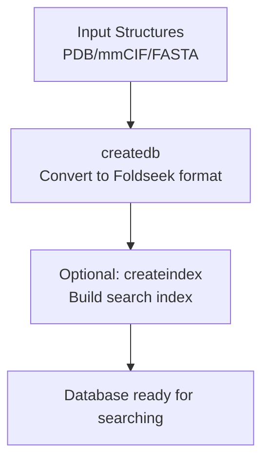
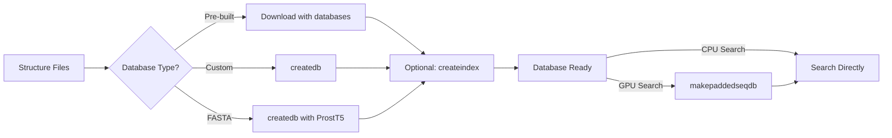

Working with structure databases is a fundamental aspect of using Foldseek effectively. Whether you're searching for protein structures, clustering them, or creating custom databases, understanding how to manage and utilize these databases will significantly enhance your productivity. This guide will walk you through the essential concepts and practical workflows for working with structure databases in Foldseek.

## Understanding Structure Databases in Foldseek

Foldseek uses specialized database formats to store protein structure information efficiently. These databases contain more than just amino acid sequences - they include structural information represented as **3Di (3-dimensional interaction) states** and optionally **Cα coordinates**. This rich structural representation allows Foldseek to perform rapid structural comparisons and searches.

A typical Foldseek structure database consists of multiple files:
- Main database file (`.dbtype`)
- Headers (_h.dbtype)
- Secondary structure (_ss.dbtype) 
- Cα coordinates (_ca.dbtype)
- Index files for fast searching

This multi-file structure enables efficient access to different types of information during searches and comparisons.

Sources: [README.md#L94-95](README.md#L94-L95), [structureindex.sh#L14-16](data/structureindex.sh#L14-L16)

## Types of Structure Databases

Foldseek supports several types of structure databases, each suited for different use cases:

### Pre-built Databases
Foldseek provides pre-formatted databases for major structure collections, which can be downloaded using the `databases` command:

| Database Name | Content | Use Case |
|---------------|---------|----------|
| Alphafold/UniProt | AlphaFold predictions for UniProt | Comprehensive monomer searches |
| Alphafold/UniProt50 | 50% sequence identity-reduced AlphaFold | Faster searches with broader coverage |
| PDB | Protein Data Bank structures | Experimentally determined structures |
| ESMAtlas30 | ESMFold predictions | High-quality predicted structures |

To download a pre-built database:
```bash
foldseek databases PDB pdb tmp
```

> [!TIP]
> Pre-built databases can be quite large. For example, the full AlphaFold/UniProt database requires approximately 151GB of RAM when loaded with Cα information.

Sources: [structdatabases.sh#L89-152](data/structdatabases.sh#L89-L152), [README.md#L175-192](README.md#L175-L192)

### Custom Structure Databases
For working with your own collection of protein structures, you'll need to create custom databases. This is useful for:
- Searching against a specific set of structures repeatedly
- Creating domain-specific structure collections
- Working with proprietary or unpublished structures

Create a custom database from PDB/mmCIF files:
```bash
foldseek createdb /path/to/pdb_files targetDB
```

### Sequence-Based Structure Databases
Foldseek can create structure databases directly from FASTA sequences using the ProstT5 protein language model. This is remarkably fast—**400-4000x faster** than predicting structures with ColabFold—though it only generates predicted 3Di sequences without full structural details.

```bash
# First download the ProstT5 model
foldseek databases ProstT5 weights tmp

# Create database from FASTA
foldseek createdb proteins.fasta db --prostt5-model weights
```

> [!TIP]
> Sequence-based databases support monomer searches and clustering but don't enable features requiring Cα information, such as TM-align or LDDT output.

Sources: [README.md#L200-217](README.md#L200-L217), [structdatabases.sh#L171-179](data/structdatabases.sh#L171-L179)

## Database Creation Workflow

The process of creating a structure database in Foldseek follows a logical sequence:



Let's examine each step in detail:

### Step 1: Database Creation
The `createdb` command converts protein structures into Foldseek's internal format. It processes each input file and extracts:
- Amino acid sequences
- 3Di structural states
- Cα coordinates (if available)
- Metadata and headers

```bash
# Create database from a directory of PDB files
foldseek createdb ./my_structures/ myDB

# Create database from a single structure
foldseek createdb query.pdb queryDB
```

### Step 2: Index Creation (Optional but Recommended)
Indexing dramatically speeds up searches by creating optimized data structures for k-mer matching. While Foldseek can search unindexed databases, indexing is highly recommended for repeated searches.

```bash
foldseek createindex myDB tmpFolder
```

The indexing process creates several specialized index files that allow Foldseek to quickly find potential structural matches without performing exhaustive comparisons.

Sources: [structureindex.sh#L14-16](data/structureindex.sh#L14-L16), [README.md#L196-198](README.md#L196-L198)

## Memory Considerations for Structure Databases

Structure databases can be memory-intensive, and Foldseek provides several options to balance memory usage and functionality:

| Mode | Memory Usage | Features Retained | Best For |
|------|--------------|-------------------|----------|
| Default (with Cα) | Highest | Full functionality | Detailed structural analysis, TM-align |
| Without Cα info | Reduced (~23% of default) | Basic search functionality | Large-scale screening |
| Single query searches | Not memory-limited | All features | Processing individual queries |

To reduce memory usage by disabling Cα information:
```bash
foldseek search queryDB targetDB results tmp --sort-by-structure-bits 0
```

> [!TIP]
> For large databases like AlphaFoldDB50, disabling Cα information can reduce memory requirements from 151GB to 35GB, making it feasible to run on more modest hardware.

Sources: [README.md#L91-101](README.md#L91-L101)

## Database Subsetting and Manipulation

Often you'll need to work with subsets of larger databases. Foldseek provides tools for extracting specific entries based on lists or criteria:

### Creating Sub-databases
The `createstructsubdb.sh` script creates a new database containing only specified entries from a larger database. This is useful for:
- Extracting specific protein families
- Creating test datasets
- Isolating structures of interest

```bash
foldseek createsubdb accession_list.txt fullDB subsetDB
```

The script handles all database components (sequences, structures, headers) to ensure consistency.

Sources: [createstructsubdb.sh#L3-28](data/createstructsubdb.sh#L3-L28)

## GPU Database Preparation

To leverage GPU acceleration for searches, databases need to be reformatted with padding. This process adds uniform-length padding to each sequence, enabling efficient parallel processing on GPUs:

```bash
# Prepare database for GPU search
foldseek makepaddedseqdb originalDB paddedDB

# Perform GPU-accelerated search
foldseek search queryDB paddedDB results tmp --gpu 1
```

The padded database format works for both CPU and GPU searches, so you can maintain a single database format that supports both processing methods.

> [!TIP]
> GPU acceleration requires an NVIDIA GPU of the Ampere generation or newer for full speed, though Turing-generation GPUs also work at reduced performance.

Sources: [easystructuresearch.sh#L34-42](data/easystructuresearch.sh#L34-L42), [README.md#L218-225](README.md#L218-L225)

## Working with Structure Databases: Practical Examples

Let's walk through some common scenarios for working with structure databases:

### Example 1: Basic Search with a Custom Database
```bash
# Create database from your structures
foldseek createdb ./my_proteins/ myProteinDB

# Create index for faster searching
foldseek createindex myProteinDB tmp

# Search a query against your database
foldseek easy-search query.pdb myProteinDB results.m8 tmp
```

### Example 2: Large-Scale Search with Reduced Memory
```bash
# Download and prepare Alphafold/UniProt50
foldseek databases Alphafold/UniProt50 afdb50 tmp

# Search with reduced memory usage
foldseek easy-search my_queries/ afdb50 results.m8 tmp --sort-by-structure-bits 0
```

### Example 3: GPU-Accelerated Search Setup
```bash
# Create database
foldseek createdb ./large_structure_set/ largeDB

# Prepare for GPU
foldseek makepaddedseqdb largeDB largeDB_gpu

# Perform search with GPU acceleration
foldseek easy-search queries/ largeDB_gpu results.m8 tmp --gpu 1
```

Sources: [easystructuresearch.sh#L15-51](data/easystructuresearch.sh#L15-L51), [structuresearch.sh#L40-53](data/structuresearch.sh#L40-L53)

## Database Maintenance and Best Practices

To ensure optimal performance when working with structure databases:

1. **Organize your databases**: Keep related structures in separate databases to maintain focus and reduce search times
2. **Index frequently used databases**: The initial indexing time pays off in faster searches
3. **Use appropriate memory settings**: Adjust memory usage based on your available resources and analysis needs
4. **Consider database size for your use case**: Alphafold/UniProt50 provides a good balance of coverage and performance for most users
5. **Backup important databases**: Store both the input files and the created database files



Sources: [structdatabases.sh#L80-84](data/structdatabases.sh#L80-L84), [easystructuresearch.sh#L44-65](data/easystructuresearch.sh#L44-L65)

## Conclusion

Working with structure databases is at the core of Foldseek's functionality. By understanding the different types of databases available, how to create and manage them, and the various options for optimization, you can leverage Foldseek's full potential for protein structure analysis. Whether you're working with pre-built databases like AlphaFoldDB or creating custom collections of your own structures, these techniques will help you perform fast, sensitive structural comparisons efficiently.

Remember that database preparation is often a one-time cost that pays dividends in faster subsequent searches. Take the time to properly set up and index your databases, and you'll find Foldseek to be an incredibly powerful tool for structural bioinformatics workflows.
