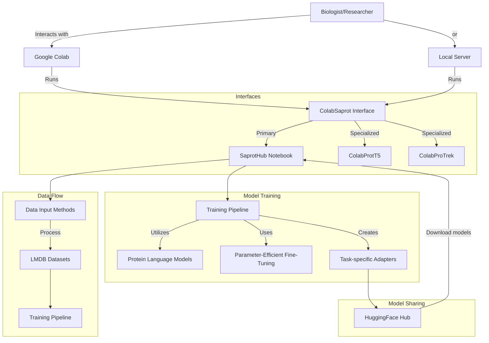
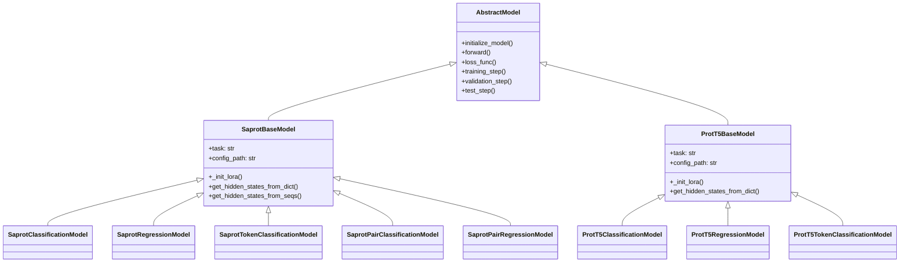
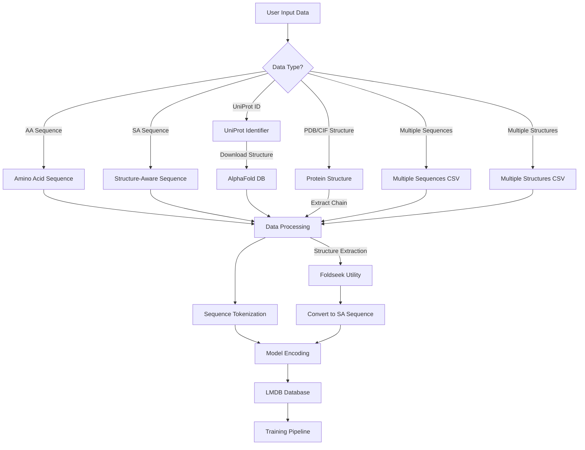
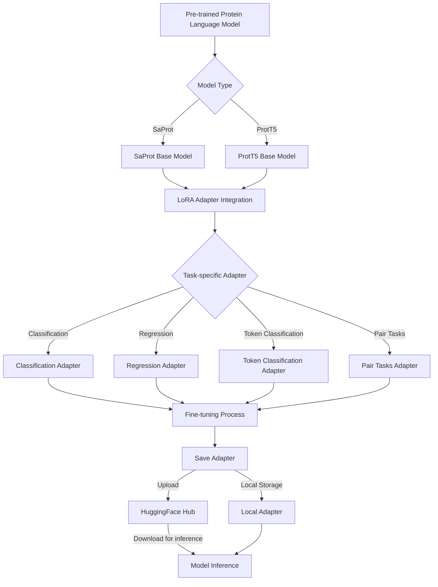
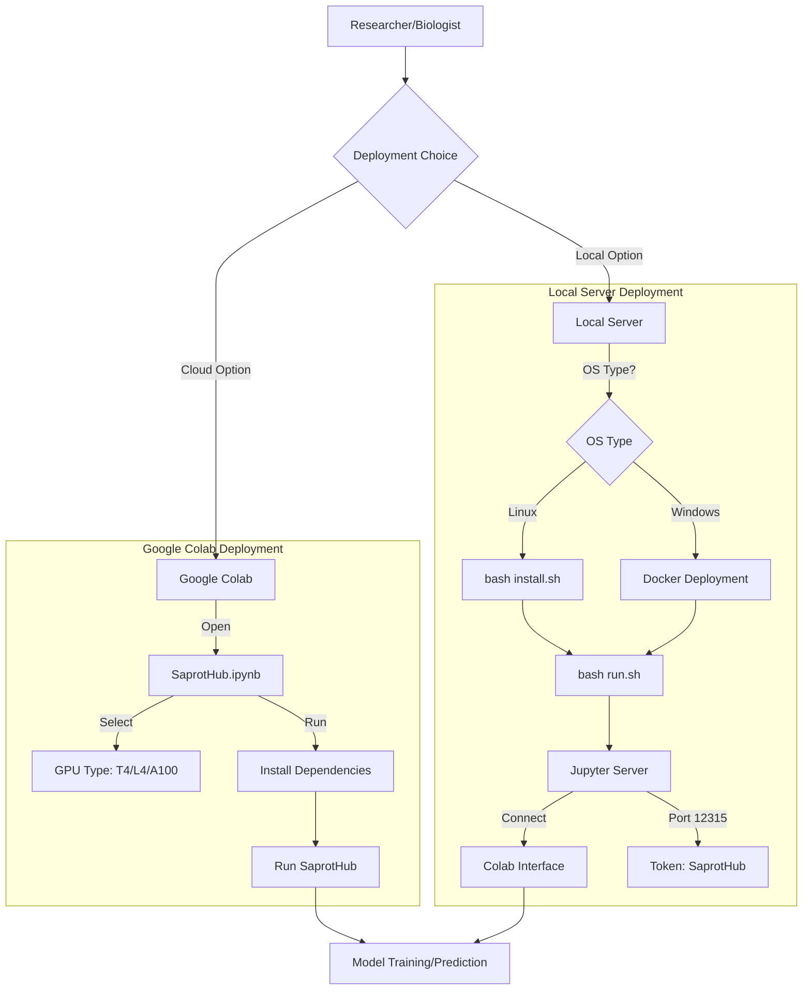

# Overview

Relevant source files

The following files were used as context for generating this wiki page:

- [Figure/wechat_group.jpg](Figure/wechat_group.jpg)
- [README.md](README.md)
- [colab/SaprotHub.ipynb](colab/SaprotHub.ipynb)
- [colab/not_use_only_for_dev.ipynb](colab/not_use_only_for_dev.ipynb)
- [local_server/jupyter_notebook_config.py](local_server/jupyter_notebook_config.py)
- [saprot/utils/foldseek_util.py](saprot/utils/foldseek_util.py)

SaprotHub is a framework designed to democratize protein language model (PLM) training and usage for biologists without requiring extensive machine learning expertise. It provides user-friendly interfaces and tools that enable researchers to train, fine-tune, share, and collaborate on protein language models for various biological prediction tasks.

For more detailed information about specific concepts introduced here, see [Key Concepts and Terminology](#1.1).

## System Architecture

SaprotHub integrates several components that work together to provide a seamless experience for biologists working with protein language models.

### High-Level Architecture

Sources:
- [README.md:1-10]()
- [colab/SaprotHub.ipynb:1-37]()

## Core Components

### ColabSaprot Interface

The ColabSaprot interface is the primary way researchers interact with SaprotHub. It provides a user-friendly environment in Google Colab or local servers for protein language model tasks.

#### Supported Input Types

| Input Type | Description |
|------------|-------------|
| Single AA Sequence | Amino acid sequence input |
| Single SA Sequence | Structure-aware sequence input |
| Single UniProt ID | UniProt database identifier |
| Single PDB/CIF Structure | 3D protein structure file |
| Multiple AA/SA Sequences | Batch processing of sequences |
| Pair Sequences | For protein-protein interaction tasks |
| SaprotHub Dataset | Pre-processed datasets from the hub |

Sources:
- [colab/SaprotHub.ipynb:45-60]()
- [colab/SaprotHub.ipynb:250-329]()

### Model Architecture

SaprotHub implements a hierarchical model structure organized by task type:

The task types in SaprotHub's model hierarchy include:

| Task Type | Model Suffix | Description |
|-----------|--------------|-------------|
| `classification` | `SaprotClassificationModel` | Protein-level classification tasks (e.g., function prediction) |
| `regression` | `SaprotRegressionModel` | Protein-level regression tasks (e.g., stability prediction) |
| `token_classification` | `SaprotTokenClassificationModel` | Residue-level classification tasks (e.g., secondary structure) |
| `pair_classification` | `SaprotPairClassificationModel` | Protein-protein interaction classification |
| `pair_regression` | `SaprotPairRegressionModel` | Protein-protein interaction regression |

Sources:
- [colab/SaprotHub.ipynb:290-311]()

### Data Processing Pipeline

The data processing pipeline is responsible for converting various input formats into structured datasets for model training.

Key steps in the data processing pipeline:

1. **Input Processing**: Handles various data formats including AA sequences, SA sequences, UniProt IDs, and PDB/CIF files
2. **Structure Extraction**: Uses Foldseek to extract structural information from 3D protein structures
3. **Data Conversion**: Transforms inputs into formats suitable for model training
4. **LMDB Storage**: Stores processed data in LMDB format for efficient access during training

Sources:
- [colab/SaprotHub.ipynb:574-627]()
- [saprot/utils/foldseek_util.py:12-87]()

### Training Pipeline with LoRA

SaprotHub uses Low-Rank Adaptation (LoRA) for efficient fine-tuning of protein language models.

The LoRA approach offers several advantages:

1. **Parameter-Efficient Fine-Tuning**: Only trains a small number of parameters rather than the entire model
2. **Reduced Memory Requirements**: Enables training on hardware with limited resources
3. **Easy Sharing**: Small adapter files (typically <10MB) instead of full models
4. **Flexible Deployment**: Adapters can be swapped without reloading the base model

Sources:
- [colab/SaprotHub.ipynb:347-456]()

## Deployment Options

SaprotHub can be deployed in two main environments:

### Google Colab Deployment

The Google Colab deployment is the simplest option for most users:

1. Open the SaprotHub notebook in Google Colab
2. Select an appropriate GPU type based on your needs:
   - T4 GPU (Free): For basic tasks and smaller models
   - L4 GPU (Colab Pro): For larger models with more memory
   - A100 GPU (Colab Pro): For training large models with highest performance
3. Run the installation cell
4. Use the interactive interface

### Local Server Deployment

For those who prefer local deployment or need more control:

1. Clone the SaprotHub repository
2. Install dependencies using the provided scripts:
   - Linux: Use `install.sh` and `run.sh`
   - Windows: Deploy through Docker
3. Access the Jupyter server on port 12315 with token "SaprotHub"
4. Connect to the ColabSaprot interface

Sources:
- [README.md:26-27]()
- [local_server/jupyter_notebook_config.py:930-939]()
- [colab/not_use_only_for_dev.ipynb:41-49]()

## Community Model Sharing

SaprotHub facilitates community collaboration through the Open Protein Modeling Consortium (OPMC), a collaborative initiative aimed at democratizing protein language models.

Key features of the community sharing approach:

1. **HuggingFace Integration**: Models trained in SaprotHub can be directly uploaded to HuggingFace
2. **Adapter-Based Sharing**: Small, task-specific adapters instead of full models
3. **Cross-Institution Collaboration**: Researchers from different institutions can build on each other's models
4. **Specialized Interfaces**: Support for multiple protein language models through specialized interfaces

The OPMC currently includes several tools:
- ColabSaprot (AA+3Di sequences)
- ColabProTrek (sequence-structure alignment)
- ColabProtT5 (amino acid sequences)
- ColabMETL (mutational effect transfer learning)
- Other specialized protein modeling tools (Evolla, Pinal, ProTrek)

Sources:
- [README.md:30-43]()
- [README.md:175-178]()

## Summary

SaprotHub provides a comprehensive framework for democratizing protein language models through:

1. **User-Friendly Interfaces**: Making sophisticated models accessible to biologists
2. **Efficient Fine-Tuning**: Using LoRA to enable training on limited resources
3. **Flexible Data Processing**: Supporting various protein data formats
4. **Collaborative Ecosystem**: Facilitating model sharing and collaboration
5. **Multiple Deployment Options**: Supporting both cloud and local deployment

For more details on specific components, see the related pages on the [ColabSaprot Interface](#2), [Model Architecture](#3), [Data Processing](#4), [Training Pipeline](#5), and [Deployment Options](#6).

---