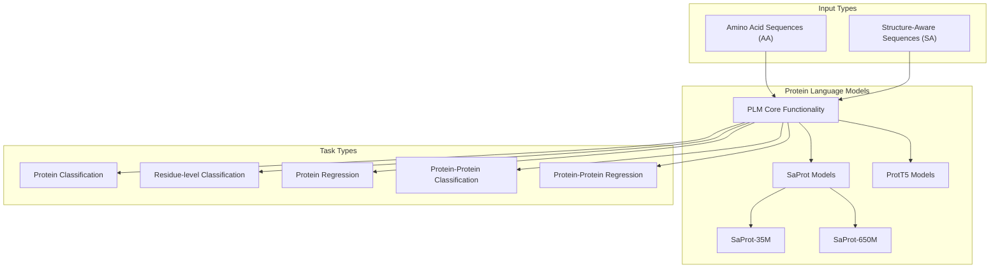
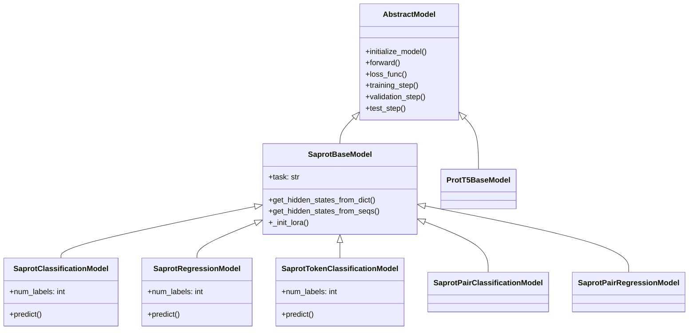
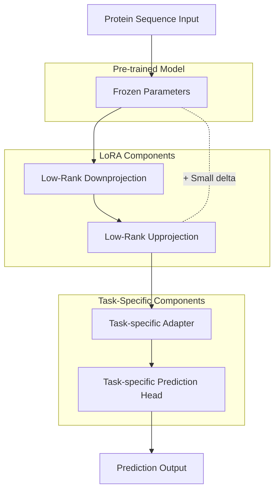
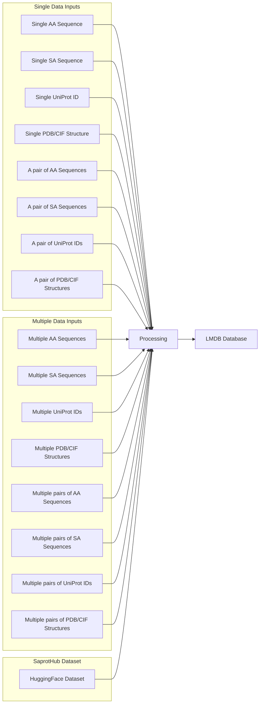
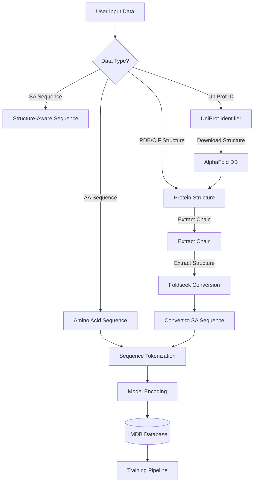
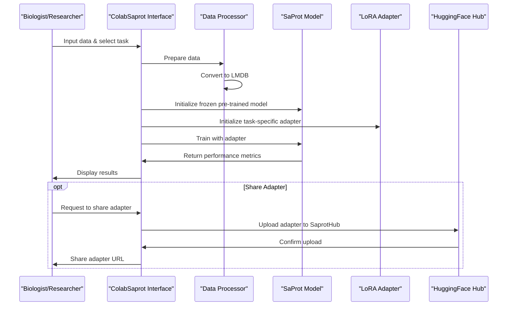
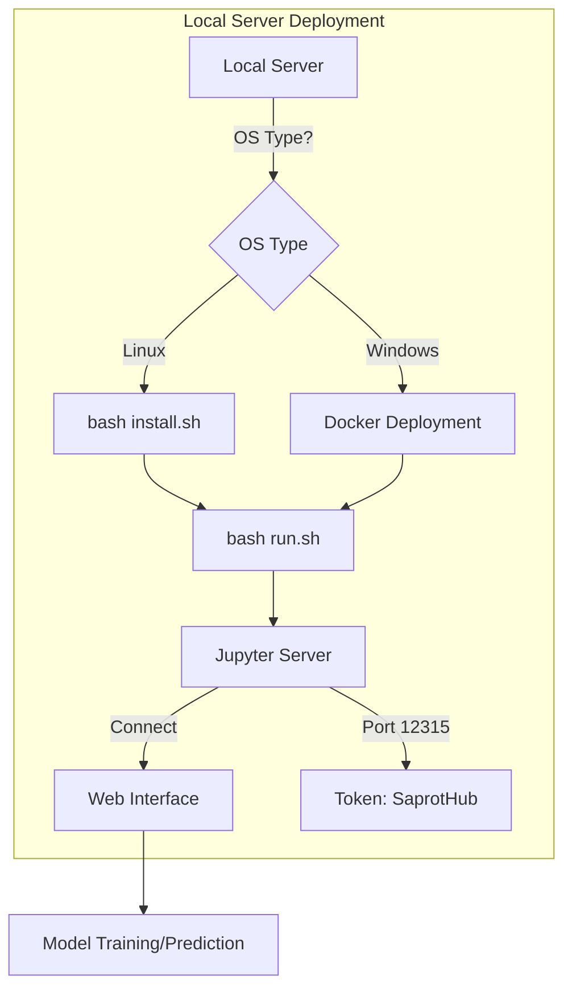

# Key Concepts and Terminology

Relevant source files

The following files were used as context for generating this wiki page:

- [Figure/training_curve_cls.png](Figure/training_curve_cls.png)
- [Figure/training_curve_reg.png](Figure/training_curve_reg.png)
- [Figure/wechat_group.jpg](Figure/wechat_group.jpg)
- [README.md](README.md)
- [colab/SaprotHub.ipynb](colab/SaprotHub.ipynb)
- [colab/SaprotHub_v2.ipynb](colab/SaprotHub_v2.ipynb)
- [colab/not_use_only_for_dev.ipynb](colab/not_use_only_for_dev.ipynb)
- [local_server/jupyter_notebook_config.py](local_server/jupyter_notebook_config.py)
- [saprot/utils/foldseek_util.py](saprot/utils/foldseek_util.py)

This page introduces the fundamental concepts and terminology used throughout the SaprotHub ecosystem. It covers protein language models, key data structures, model architecture, and common workflows that form the foundation of the SaprotHub platform. For specific details on interfaces and usage, see [ColabSaprot Interface](#2).

## 1. Protein Language Models

Protein Language Models (PLMs) are a class of machine learning models that learn the statistical patterns in protein sequences, similar to how language models learn patterns in text. In SaprotHub, PLMs serve as the foundation for various protein analysis tasks.

### 1.1 SaProt Framework

SaProt is the underlying protein language model framework in SaprotHub. It's designed to process both amino acid sequences and structural information about proteins.

Key characteristics of SaProt:
- Pre-trained on diverse protein datasets
- Available in different model sizes (35M, 650M parameters)
- Designed to support both sequence-based and structure-aware analysis

Sources: [README.md:20-27](README.md), [colab/SaprotHub.ipynb:19-25](colab/SaprotHub.ipynb)

### 1.2 Types of Protein Sequences

SaprotHub works with two primary types of protein sequence data:

1. **Amino Acid (AA) Sequences**: The traditional representation of proteins as chains of amino acids, using the standard 20-letter alphabet (A, C, D, E, F, G, H, I, K, L, M, N, P, Q, R, S, T, V, W, Y).

2. **Structure-Aware (SA) Sequences**: Enhanced protein representations that incorporate 3D structural information alongside the amino acid sequence. These are typically derived from PDB files or AlphaFold predictions using tools like Foldseek.

**Example:**
- AA sequence: `MKKLILVLLFVGAFNACQGTDNSKVCTASQDPYSAALQGCTIEWAK`
- SA sequence: Combines amino acid and structural tokens in alternating pattern

Sources: [saprot/utils/foldseek_util.py:11-87](saprot/utils/foldseek_util.py), [colab/SaprotHub.ipynb:251-251](colab/SaprotHub.ipynb)

## 2. Model Architecture

SaprotHub employs a hierarchical model architecture that enables different types of protein analysis tasks.

### 2.1 Model Hierarchy

Sources: [colab/SaprotHub.ipynb:295-303](colab/SaprotHub.ipynb)

### 2.2 Task-Specific Models

SaprotHub supports five main types of models for different protein analysis tasks:

| Model Type | Task Type | Description | Example Use Cases |
|------------|-----------|-------------|-------------------|
| Classification | `classification` | Predicts discrete protein-level labels | Protein function prediction, subcellular localization |
| Regression | `regression` | Predicts continuous protein-level values | Thermostability, solubility prediction |
| Token Classification | `token_classification` | Predicts properties for each amino acid residue | Secondary structure prediction, binding site identification |
| Pair Classification | `pair_classification` | Predicts binary relationships between protein pairs | Protein-protein interaction prediction |
| Pair Regression | `pair_regression` | Predicts continuous values for protein pairs | Binding affinity prediction |

Sources: [colab/SaprotHub.ipynb:290-326](colab/SaprotHub.ipynb)

## 3. Parameter-Efficient Fine-Tuning

SaprotHub uses Parameter-Efficient Fine-Tuning (PEFT) techniques to make it feasible to adapt large protein language models to specific tasks without requiring excessive computational resources.

### 3.1 LoRA Adapters

Low-Rank Adaptation (LoRA) is the primary PEFT method used in SaprotHub. Instead of fine-tuning all parameters of a large model, LoRA adds small trainable "adapter" modules to selected layers of the frozen pre-trained model.

Key benefits of LoRA in SaprotHub:
- Reduces the number of trainable parameters (typically <1% of the full model)
- Decreases memory requirements and allows training on standard GPUs
- Enables sharing of lightweight adapters (~1MB) instead of full models (~2GB)
- Facilitates community collaboration through adapter sharing

Sources: [colab/SaprotHub.ipynb:362-431](colab/SaprotHub.ipynb), [README.md:30-33](README.md)

## 4. Data Types and Processing

### 4.1 Input Data Types

SaprotHub supports multiple input formats to accommodate different user requirements:

Sources: [colab/SaprotHub.ipynb:252-267](colab/SaprotHub.ipynb), [colab/SaprotHub.ipynb:317-329](colab/SaprotHub.ipynb)

### 4.2 Data Processing Pipeline

Sources: [saprot/utils/foldseek_util.py:11-87](saprot/utils/foldseek_util.py), [colab/SaprotHub.ipynb:522-567](colab/SaprotHub.ipynb)

## 5. Training and Prediction Workflows

SaprotHub supports several key workflows for training models and making predictions:

### 5.1 Training Workflow

The training process in SaprotHub typically involves:

1. **Data preparation**: Converting input data to LMDB format
2. **Model selection**: Choosing the appropriate base model and task
3. **Adapter configuration**: Setting up LoRA parameters
4. **Training**: Fine-tuning the adapter for the specific task
5. **Evaluation**: Assessing model performance on validation data
6. **Adapter sharing**: Optionally sharing the adapter on SaprotHub

Sources: [colab/SaprotHub.ipynb:400-456](colab/SaprotHub.ipynb)

### 5.2 Prediction Workflows

SaprotHub supports several prediction workflows:

1. **Standard Prediction**: Use a trained model to predict properties of new proteins
2. **Mutational Effect Prediction**: Assess the impact of mutations on protein properties
3. **Inverse Folding Prediction**: Design sequences based on target structures

Sources: [colab/SaprotHub.ipynb:46-54](colab/SaprotHub.ipynb)

## 6. Deployment Options

### 6.1 Google Colab (ColabSaprot)

The primary interface for SaprotHub is ColabSaprot, which runs in Google Colab notebooks. This allows users to access SaprotHub without local installation requirements.

Key features:
- Free access with T4 GPUs (basic tasks)
- Higher-tier GPUs available with Colab Pro (L4, A100)
- Interactive interface for data input, model training, and prediction
- Easy sharing of models through HuggingFace Hub

Sources: [colab/SaprotHub_v2.ipynb:41-53](colab/SaprotHub_v2.ipynb)

### 6.2 Local Server Deployment

For users who need more computational resources or persistent environments, SaprotHub can be deployed on local servers.

Key features:
- Support for Linux and Windows (via Docker)
- Custom installation scripts for dependencies
- Access through Jupyter Server interface
- Persistent storage of models and data

Sources: [README.md:26-27](README.md), [local_server/jupyter_notebook_config.py:1-30](local_server/jupyter_notebook_config.py)

## 7. SaprotHub Community and Ecosystem

SaprotHub is part of the Open Protein Modeling Consortium (OPMC), which aims to democratize protein language models for the biology community.

Key components of the ecosystem:
- **SaprotHub**: Central repository for model sharing
- **ColabSaprot**: User interface for SaProt models
- **ColabProtT5**: Interface for ProtT5 models
- **ColabProTrek**: Interface for ProTrek models
- **Additional OPMC tools**: Including METL, Evolla, Pinal, and others

Sources: [README.md:29-43](README.md)

## 8. Terminology Reference

| Term | Definition |
|------|------------|
| PLM | Protein Language Model - Machine learning model trained to understand protein sequences |
| AA Sequence | Amino Acid Sequence - Standard one-letter code representation of proteins |
| SA Sequence | Structure-Aware Sequence - Enhanced representation that includes structural information |
| LoRA | Low-Rank Adaptation - Parameter-efficient fine-tuning method |
| PEFT | Parameter-Efficient Fine-Tuning - Techniques to adapt models with minimal parameters |
| Adapter | Small, trainable module that modifies a pre-trained model's behavior |
| LMDB | Lightning Memory-Mapped Database - High-performance database used for storing protein data |
| OPMC | Open Protein Modeling Consortium - Collaborative initiative for protein modeling |
| ColabSaprot | Google Colab interface for SaProt models |
| SaprotHub | Repository and community platform for sharing protein models |

Sources: [README.md:8-43](README.md), [colab/SaprotHub.ipynb:19-37](colab/SaprotHub.ipynb)

---