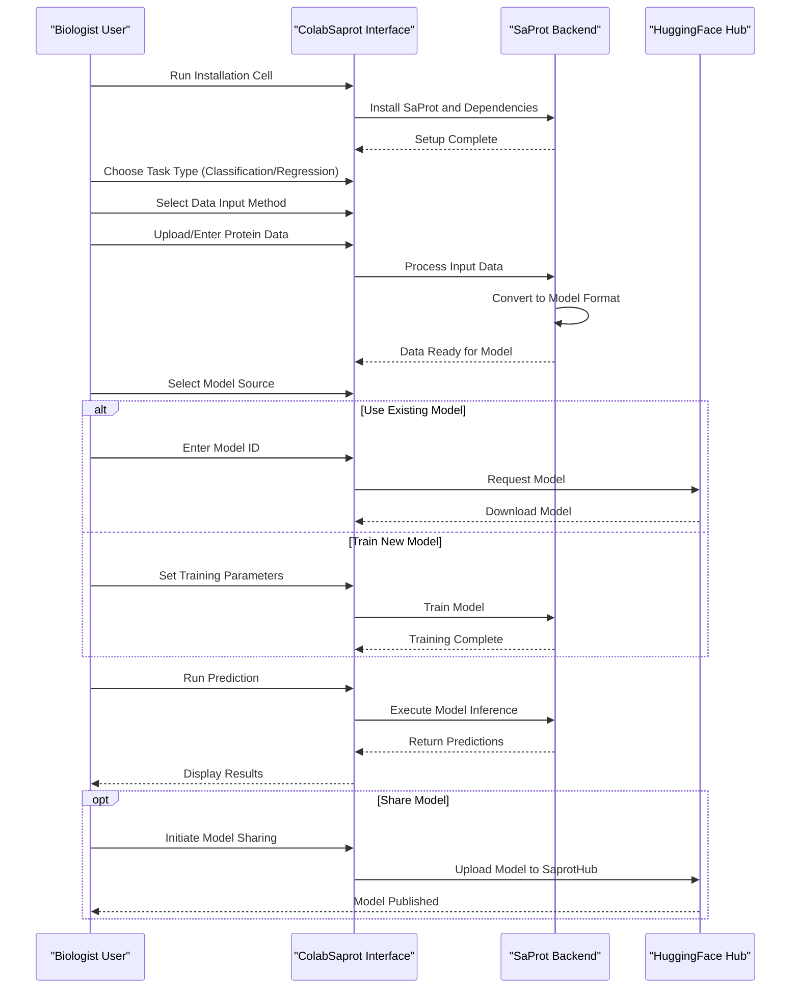
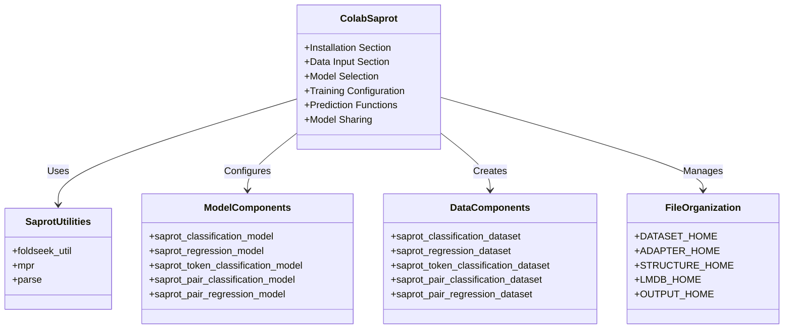
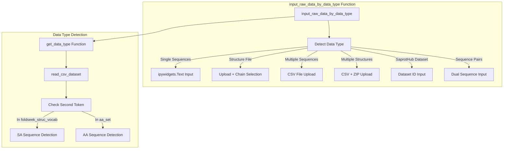

# ColabSaprot Interface

<details>
<summary>Relevant source files</summary>

The following files were used as context for generating this wiki page:

- [Figure/training_curve_cls.png](Figure/training_curve_cls.png)
- [Figure/training_curve_reg.png](Figure/training_curve_reg.png)
- [colab/SaprotHub.ipynb](colab/SaprotHub.ipynb)
- [colab/SaprotHub_v2.ipynb](colab/SaprotHub_v2.ipynb)
- [saprot/utils/foldseek_util.py](saprot/utils/foldseek_util.py)

</details>


## Overview

The ColabSaprot Interface is the primary user-facing component of SaprotHub, designed to democratize access to protein language models (PLMs) for biologists with limited machine learning expertise. This interface runs in Google Colab, providing a notebook-based environment where users can easily input protein data, train models, make predictions, and share trained models with the scientific community.

ColabSaprot specifically focuses on making the [SaProt](https://github.com/westlake-repl/SaProt) protein language model accessible through a user-friendly interface, eliminating the need for coding expertise or specialized hardware while maintaining robust functionality for protein modeling tasks.

For information about model architecture specifics, see [Model Architecture](#3). For details on data processing, see [Data Processing](#4).

Sources:
- [colab/SaprotHub.ipynb:9-37]()
- [colab/SaprotHub_v2.ipynb:6-27]()

## Architecture and Components

ColabSaprot is structured as a Jupyter notebook interface that connects users to the SaProt model ecosystem. It serves as an abstraction layer that simplifies the complexity of protein language models by providing intuitive workflows for various protein prediction tasks.

```mermaid
flowchart TD
    subgraph "ColabSaprot Interface"
        Inst[Installation Section] --> Input[Data Input Methods]
        Input --> ModelSel[Model Selection]
        ModelSel --> Training[Model Training]
        Training --> Prediction[Prediction Functions]
        Prediction --> ModelSharing[Model Sharing]
    end

    subgraph "Backend Systems"
        SaprotLib["SaProt Library"] <--> Models["Protein Language Models"]
        SaprotLib <--> HFHub["HuggingFace Hub"]
        SaprotLib <--> Foldseek["Foldseek Utility"]
        SaprotLib <--> LMDB["LMDB Storage"]
    end

    Input <--> SaprotLib
    ModelSel <--> SaprotLib
    Training <--> SaprotLib
    Prediction <--> SaprotLib
    ModelSharing <--> HFHub

    subgraph "User Interaction"
        User["Biologist User"] --> |"Runs"| ColabSaprot["ColabSaprot Notebook"]
        ColabSaprot --> |"Interfaces with"| Inst
    end
    
    classDef interface fill:#f9f9f9,stroke:#333,stroke-width:1px
    classDef backend fill:#f9f9f9,stroke:#333,stroke-width:1px
    class "ColabSaprot Interface" interface
    class "Backend Systems" backend
```

**Key Interface Components:**

| Component | Purpose | Functions |
|-----------|---------|-----------|
| Installation Section | Set up the environment | Install dependencies, check GPU status |
| Data Input Methods | Provide various ways to input protein data | Accept sequences, structures, IDs |
| Model Selection | Choose from available models | Browse local and shared models |
| Model Training | Configure and train models | Set hyperparameters, execute training |
| Prediction Functions | Apply models to make predictions | Classification, regression, mutational effects |
| Model Sharing | Share trained models with the community | Upload to HuggingFace Hub |

Sources:
- [colab/SaprotHub.ipynb:46-59]()
- [colab/SaprotHub_v2.ipynb:37-59]()
- [colab/SaprotHub.ipynb:81-99]()

## Data Flow in ColabSaprot

ColabSaprot has a structured data flow that processes various protein data inputs and transforms them for model training and inference:

```mermaid
flowchart TD
    subgraph "Input Methods"
        AASeq["Single AA Sequence"]
        SASeq["Single SA Sequence"]
        UniProt["UniProt ID"]
        PDBStruct["PDB/CIF Structure"]
        MultiSeq["Multiple Sequences CSV"]
        MultiStruct["Multiple Structures CSV+ZIP"]
        PairSeq["Sequence Pairs"]
    end

    subgraph "Data Processing"
        Parser["Data Type Parser"]
        AASeq --> Parser
        SASeq --> Parser
        UniProt --> Parser
        PDBStruct --> Parser
        MultiSeq --> Parser
        MultiStruct --> Parser
        PairSeq --> Parser
        
        Parser --> DataTypeDetection["data_type_list Detection"]
        DataTypeDetection --> DataFormatter["Format for Model Input"]
    end

    subgraph "Structure Processing"
        PDBParser["PDB/CIF Parsing"]
        FoldseekConversion["get_struc_seq Function"]
        PLDDTFiltering["plddt_mask Filtering"]
        
        PDBStruct --> PDBParser
        MultiStruct --> PDBParser
        PDBParser --> FoldseekConversion
        FoldseekConversion --> PLDDTFiltering
        PLDDTFiltering --> |"Returns SA Sequences"| DataFormatter
    end

    subgraph "Model Interface"
        DataFormatter --> LMDBCreation["LMDB Dataset Creation"]
        LMDBCreation --> ModelInput["Model Training/Inference"]
    end

    classDef processing fill:#f9f9f9,stroke:#333,stroke-width:1px
    class "Data Processing" processing
    class "Structure Processing" processing
```

**Data Type Support:**
ColabSaprot supports various input data types for flexibility:

1. **Sequences**:
   - Single AA (amino acid) sequences
   - Single SA (structure-aware) sequences
   - Multiple sequences via CSV files

2. **Structures**:
   - PDB/CIF structure files
   - Multiple structure files via ZIP archives

3. **Identifiers**:
   - UniProt IDs (automatically retrieves structures)
   - SaprotHub Dataset IDs

4. **Paired Data**:
   - Sequence pairs for interaction tasks
   - Structure pairs for structural comparison

Sources:
- [colab/SaprotHub.ipynb:252-268]()
- [colab/SaprotHub.ipynb:576-714]()
- [saprot/utils/foldseek_util.py:12-87]()

## User Interface Flow

The ColabSaprot interface guides users through a sequential process for working with protein data:



This diagram illustrates the typical user journey from installation to prediction and optional model sharing.

Sources:
- [colab/SaprotHub.ipynb:111-352]()
- [colab/SaprotHub.ipynb:347-409]()

## Integration with Code Components

The ColabSaprot interface connects with several key code components to deliver its functionality:



This diagram shows how the ColabSaprot interface connects with the underlying code components. The interface doesn't directly modify these components but rather configures and uses them to perform the desired tasks.

Sources:
- [colab/SaprotHub.ipynb:242-250]()
- [colab/SaprotHub.ipynb:290-309]()
- [colab/SaprotHub.ipynb:319-331]()

## Key Interface Features

### Installation and Setup

The installation section handles the initial setup required to use ColabSaprot:

1. **GPU Runtime Check**: Ensures the notebook is running with GPU acceleration
2. **SaProt Installation**: Installs the SaProt library and its dependencies
3. **Directory Structure Setup**: Creates the necessary directories for datasets, models, and outputs
4. **Binary Tools Setup**: Sets up the Foldseek binary for structure processing

The interface displays clear warnings about runtime limits and idle timeout policies to help users plan their usage.

Sources:
- [colab/SaprotHub.ipynb:81-99]()
- [colab/SaprotHub.ipynb:111-193]()

### Data Input Methods

ColabSaprot provides multiple ways to input protein data, implementing a flexible approach to accommodate various user needs:



These input methods allow users to easily provide their protein data regardless of its format or source.

Sources:
- [colab/SaprotHub.ipynb:586-714]()
- [colab/SaprotHub.ipynb:551-577]()

### Model Selection and Training

The model selection and training section allows users to:

1. **Select Model Source**:
   - Use existing models from SaprotHub
   - Train new models from scratch
   - Load models from local storage

2. **Configure Training Parameters**:
   - Model size selection (35M, 650M)
   - Batch size adjustment
   - Learning rate configuration
   - Number of training epochs

3. **Task Type Selection**:
   - Protein-level classification/regression
   - Residue-level (token) classification
   - Protein-protein classification/regression

Sources:
- [colab/SaprotHub.ipynb:347-409]()
- [colab/SaprotHub.ipynb:290-309]()

### Model Sharing

ColabSaprot facilitates community collaboration by enabling users to share their trained models:

1. **Local Model Export**: Saves trained models as downloadable ZIP files
2. **HuggingFace Hub Upload**: Directly uploads models to the SaprotHub collection on HuggingFace
3. **Model Metadata**: Captures essential information about the model's purpose and performance

This feature helps build a growing ecosystem of protein language models for various tasks.

Sources:
- [colab/SaprotHub.ipynb:433-470]()

## User Experience Considerations

The ColabSaprot interface incorporates several design elements to enhance user experience:

1. **Progressive Disclosure**: Shows only relevant options based on the user's current task
2. **Visual Feedback**: Provides progress indicators for long-running operations
3. **Error Handling**: Includes comprehensive error checks and user-friendly error messages
4. **Resource Management**: Monitors and optimizes GPU memory usage

These considerations help make the interface accessible to biologists with varying levels of computational expertise.

Sources:
- [colab/SaprotHub.ipynb:64-73]()
- [colab/SaprotHub_v2.ipynb:37-53]()

## Specialized Interfaces

While ColabSaprot is the primary interface, SaprotHub also includes specialized interfaces for specific use cases:

1. **ColabProtT5**: Focused on the ProtT5 protein language model
2. **ColabProTrek**: Specialized for protein trajectory analysis

These interfaces follow similar design principles but are optimized for their specific model architectures and use cases. Users who have specific needs in these areas may prefer these specialized interfaces.

For more information about these specialized interfaces, see [Alternative Interfaces: ColabProtT5 and ColabProTrek](#2.4).

Sources:
- [colab/SaprotHub.ipynb:46-59]()

## Version Considerations

The SaprotHub repository contains two versions of the ColabSaprot interface:

1. **SaprotHub.ipynb**: The original version
2. **SaprotHub_v2.ipynb**: A newer version with improved user interface and functionality

Users are encouraged to use the newer version for the best experience, as it includes various improvements and fixes.

Sources:
- [colab/SaprotHub.ipynb:9-10]()
- [colab/SaprotHub_v2.ipynb:6-27]()

## Conclusion

The ColabSaprot Interface serves as the primary entry point for biologists to access and leverage protein language models through SaprotHub. Its user-friendly design, flexible input methods, and comprehensive functionality make it an essential tool for democratizing protein modeling capabilities. By removing technical barriers, it enables researchers to focus on their biological questions rather than the complexities of machine learning implementation.

---