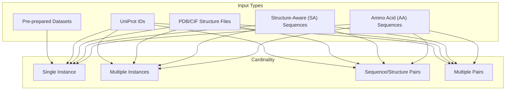
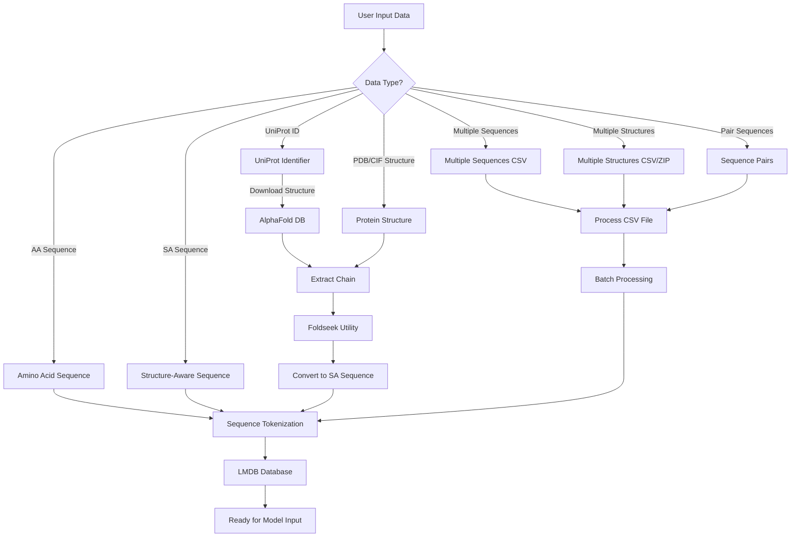
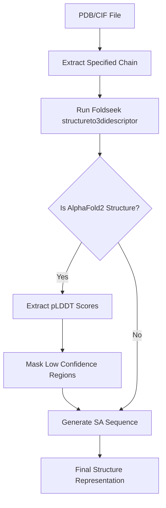
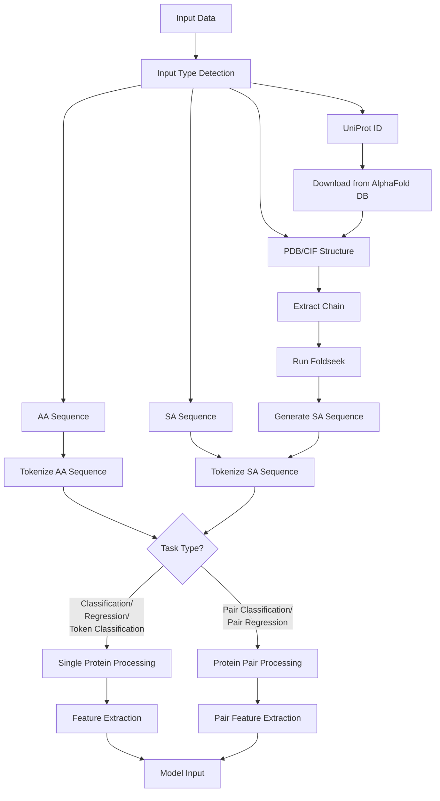

# Data Input Methods

<details>
<summary>Relevant source files</summary>

The following files were used as context for generating this wiki page:

- [Figure/training_curve_cls.png](Figure/training_curve_cls.png)
- [Figure/training_curve_reg.png](Figure/training_curve_reg.png)
- [colab/SaprotHub.ipynb](colab/SaprotHub.ipynb)
- [colab/SaprotHub_v2.ipynb](colab/SaprotHub_v2.ipynb)
- [saprot/utils/foldseek_util.py](saprot/utils/foldseek_util.py)

</details>


This page details the various methods for inputting protein data into the SaprotHub framework. Whether you're training a new model or making predictions with existing models, understanding these data input options is essential. For information about model selection and training processes, see [Model Selection and Training](#2.2).

## Overview of Data Input Methods

SaprotHub provides a flexible system for inputting protein data in various formats, accommodating different research needs and data availability scenarios. The system supports multiple input types ranging from raw sequences to 3D structure files.



Sources: [colab/SaprotHub.ipynb:252-268](), [colab/SaprotHub_v2.ipynb:268-284]()

## Supported Data Types

The following table shows all data types supported by SaprotHub and their compatibility with different task types:

| Data Type | Classification | Regression | Token Classification | Pair Classification | Pair Regression |
|-----------|:-------------:|:----------:|:--------------------:|:-------------------:|:---------------:|
| Single AA Sequence | ✓ | ✓ | ✓ | - | - |
| Single SA Sequence | ✓ | ✓ | ✓ | - | - |
| Single UniProt ID | ✓ | ✓ | ✓ | - | - |
| Single PDB/CIF Structure | ✓ | ✓ | ✓ | - | - |
| Multiple AA Sequences | ✓ | ✓ | ✓ | - | - |
| Multiple SA Sequences | ✓ | ✓ | ✓ | - | - |
| Multiple UniProt IDs | ✓ | ✓ | ✓ | - | - |
| Multiple PDB/CIF Structures | ✓ | ✓ | ✓ | - | - |
| A pair of AA Sequences | - | - | - | ✓ | ✓ |
| A pair of SA Sequences | - | - | - | ✓ | ✓ |
| A pair of UniProt IDs | - | - | - | ✓ | ✓ |
| A pair of PDB/CIF Structures | - | - | - | ✓ | ✓ |
| Multiple pairs of AA Sequences | - | - | - | ✓ | ✓ |
| Multiple pairs of SA Sequences | - | - | - | ✓ | ✓ |
| Multiple pairs of UniProt IDs | - | - | - | ✓ | ✓ |
| Multiple pairs of PDB/CIF Structures | - | - | - | ✓ | ✓ |
| SaprotHub Dataset | ✓ | ✓ | ✓ | ✓ | ✓ |

Sources: [colab/SaprotHub.ipynb:290-312](), [colab/SaprotHub_v2.ipynb:306-328]()

## Data Processing Pipeline

The data processing pipeline converts raw inputs into formats suitable for model training or prediction:



Sources: [colab/SaprotHub.ipynb:574-714](), [colab/SaprotHub_v2.ipynb:586-714](), [saprot/utils/foldseek_util.py:12-87]()

## Sequence-Based Inputs

### Single AA Sequence

Users can enter a single amino acid sequence directly into the text field. The sequence should only contain standard amino acid characters (A, C, D, E, F, G, H, I, K, L, M, N, P, Q, R, S, T, V, W, Y).

Example:
```
MSKGEELFTGVVPILVELDGDVNGHKFSVSGEGEGDATYGKLTLKFICTTGKLPVPWPTLVTTFSYGVQCFSRYPDHMKQHDFFKSAMPEGYVQERTIFFKDDGNYKTRAEVKFEGDTLVNRIELKGIDFKEDGNILGHKLEYNYNSHNVYIMADKQKNGIKVNFKIRHNIEDGSVQLADHYQQNTPIGDGPVLLPDNHYLSTQSALSKDPNEKRDHMVLLEFVTAAGITLGMDELYK
```

Sources: [colab/SaprotHub.ipynb:578-587](), [colab/SaprotHub_v2.ipynb:589-597]()

### Multiple AA Sequences via CSV

For batch processing, sequences can be uploaded in a CSV file with the following structure:

| protein | label | stage |
|---------|-------|-------|
| MSKGEE... | 1 | train |
| MADKQK... | 0 | valid |
| ... | ... | ... |

The `protein` column contains amino acid sequences, `label` contains target values, and `stage` indicates whether each sample belongs to the training, validation, or testing set.

Sources: [colab/SaprotHub.ipynb:613-633](), [colab/SaprotHub_v2.ipynb:614-635]()

## Structure-Based Inputs

### Structure-Aware (SA) Sequences

Structure-aware sequences incorporate structural information using a specialized vocabulary derived from Foldseek. They combine amino acid information with structural features into a unified sequence representation.

Example:
```
Mpqnwepadhngvskyltlsficttgklpvpwptlvttfsygvqcfsrypdhmkqhdffksampegyvqertiffkddgnyktraevkfegdtlvnrielkgidfkedgnilghkleynynshnvyimadkqkngikvnfkirhniedgsvqladhyqqntpigdgpvllpdnhylstqsalskdpnekrdhmvllefvtaagitlgmdelyk
```

Sources: [colab/SaprotHub.ipynb:587-596](), [colab/SaprotHub_v2.ipynb:589-597]()

### Single PDB/CIF Structure

Users can upload Protein Data Bank (PDB) or Crystallographic Information File (CIF) files. The system will:

1. Extract the specified chain (default is "A")
2. Run Foldseek to analyze the structure
3. Generate an SA sequence representation
4. For AlphaFold2 structures, low-confidence regions can be masked based on pLDDT scores

The internal process uses the `get_struc_seq` function from the Foldseek utility:



Sources: [colab/SaprotHub.ipynb:598-610](), [colab/SaprotHub_v2.ipynb:600-612](), [saprot/utils/foldseek_util.py:12-87]()

### Multiple PDB/CIF Structures

For batch processing of structures:

1. Upload a CSV file with references to structure files (similar format to multiple sequences)
2. Upload a ZIP file containing all the referenced structure files
3. The system will process each structure using the same pipeline as for single structures

Sources: [colab/SaprotHub.ipynb:621-633](), [colab/SaprotHub_v2.ipynb:621-635]()

## Identifier-Based Inputs

### UniProt IDs

Instead of providing sequences or structures directly, users can enter UniProt IDs. The system will:

1. Automatically retrieve the corresponding structure from AlphaFold Database
2. Process the structure to extract the specified chain
3. Convert it to an SA sequence using Foldseek

Example: `P42212` (Green Fluorescent Protein)

Sources: [colab/SaprotHub.ipynb:578-587](), [colab/SaprotHub_v2.ipynb:589-597]()

### Multiple UniProt IDs via CSV

For batch processing of UniProt IDs, users can upload a CSV file with the following structure:

| uniprot_id | label | stage |
|------------|-------|-------|
| P42212 | 1 | train |
| P0DMV8 | 0 | valid |
| ... | ... | ... |

The system will retrieve structures for each ID and process them as described above.

Sources: [colab/SaprotHub.ipynb:613-633](), [colab/SaprotHub_v2.ipynb:614-635]()

## Protein-Protein Interaction Inputs

### Pair Inputs

For protein-protein interaction tasks, SaprotHub supports paired inputs:

1. **Single pairs**: Enter two sequences, structures, or UniProt IDs separately
2. **Multiple pairs via CSV**: Upload a CSV file with the following structure:

| protein_1 | protein_2 | label | stage |
|-----------|-----------|-------|-------|
| MSKGEE... | MADKQK... | 1 | train |
| P42212 | P0DMV8 | 0 | valid |
| ... | ... | ... | ... |

Sources: [colab/SaprotHub.ipynb:646-668](), [colab/SaprotHub_v2.ipynb:648-670]()

### Structure Pairs

For structure-based protein-protein interaction tasks:

1. Upload two separate PDB/CIF files
2. Specify the chain to extract from each structure
3. The system will process both structures and prepare them for the interaction model

Sources: [colab/SaprotHub.ipynb:672-714](), [colab/SaprotHub_v2.ipynb:673-714]()

## Pre-prepared Datasets

### SaprotHub Datasets

SaprotHub provides pre-prepared datasets for various protein prediction tasks:

1. Enter a dataset ID from the SaprotHub repository (e.g., `SaProtHub/thermostability`)
2. The system will download and prepare the dataset automatically

Pre-prepared datasets are particularly useful for benchmarking or reproducing published results.

Sources: [colab/SaprotHub.ipynb:636-644](), [colab/SaprotHub_v2.ipynb:638-646]()

## Data Type Compatibility and Conversion

SaprotHub implements automatic conversions between different data types when necessary:



Sources: [colab/SaprotHub.ipynb:312-329](), [colab/SaprotHub_v2.ipynb:327-345](), [saprot/utils/foldseek_util.py:12-87]()

## Best Practices for Data Input

1. **Sequence quality**: Ensure sequences don't contain non-standard amino acids or invalid characters
2. **Structure selection**: For structures, select biologically relevant chains
3. **CSV formatting**: Verify CSV files have the correct column names and proper formatting
4. **Batch size management**: For large datasets, consider splitting into manageable batches
5. **pLDDT thresholds**: When using AlphaFold2 structures, consider adjusting the pLDDT threshold (default is 70) based on your confidence requirements

The `input_raw_data_by_data_type` function is the central implementation that handles all these input methods in the SaprotHub system.

Sources: [colab/SaprotHub.ipynb:574-714](), [colab/SaprotHub_v2.ipynb:586-714]()

---