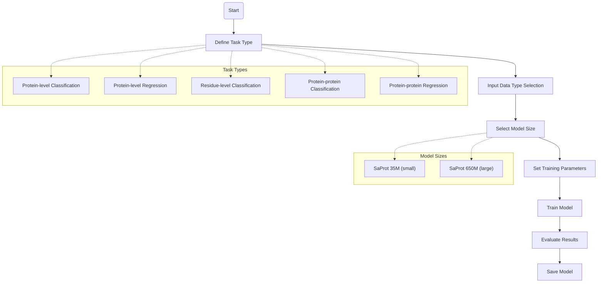
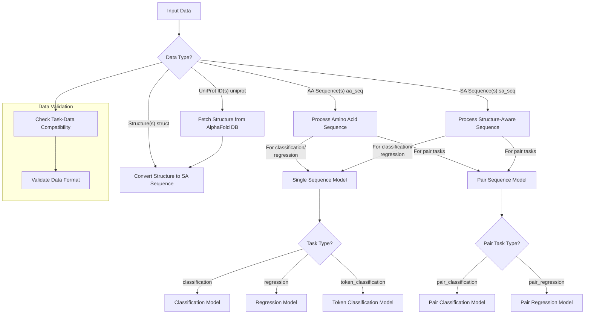
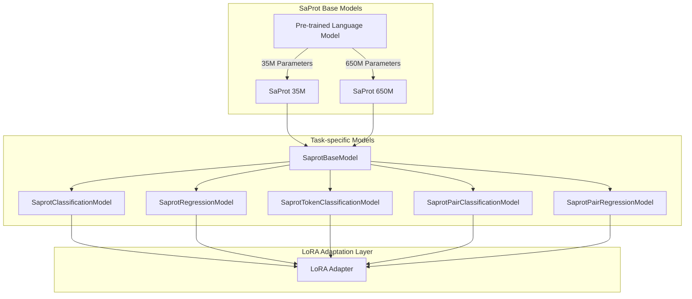
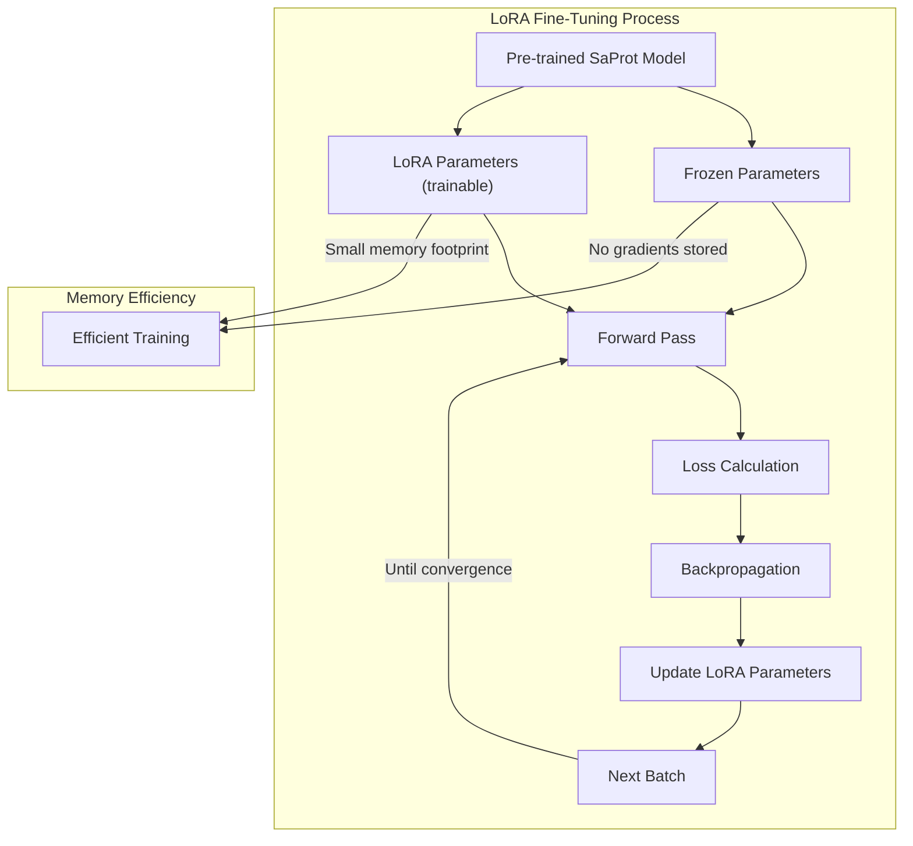
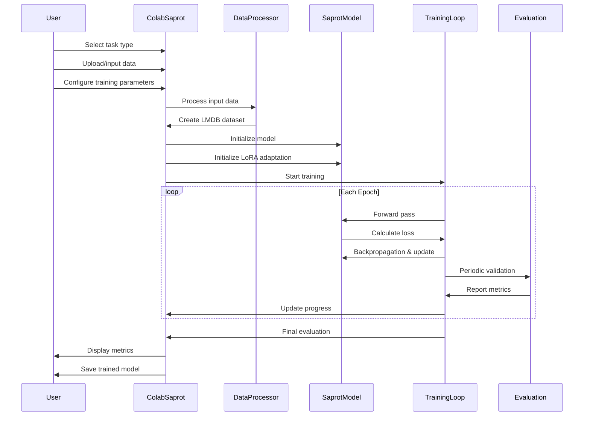

# Model Selection and Training

Relevant source files

The following files were used as context for generating this wiki page:

- [Figure/training_curve_cls.png](Figure/training_curve_cls.png)
- [Figure/training_curve_reg.png](Figure/training_curve_reg.png)
- [colab/SaprotHub.ipynb](colab/SaprotHub.ipynb)
- [colab/SaprotHub_v2.ipynb](colab/SaprotHub_v2.ipynb)
- [saprot/utils/foldseek_util.py](saprot/utils/foldseek_util.py)

## Purpose and Scope

This guide explains how to select and train protein language models using the ColabSaprot interface. It covers model selection based on tasks, configuring training parameters, and monitoring the training process. For uploading and sharing your trained models, see [Model Uploading and Sharing](#2.3), and for specialized interfaces for specific protein models, see [Alternative Interfaces](#2.4).

## Model Selection Process

The ColabSaprot interface allows users to select appropriate models based on their biological task requirements. The selection process follows a structured workflow that guides users from task definition to model configuration.

### Available Task Types

SaprotHub provides models for five distinct protein prediction tasks:

| Task Type | Internal Name | Description |
|-----------|---------------|-------------|
| Protein-level Classification | `classification` | Predicts categorical properties of entire proteins |
| Residue-level Classification | `token_classification` | Predicts properties for individual amino acid residues |
| Protein-level Regression | `regression` | Predicts continuous values for entire proteins |
| Protein-protein Classification | `pair_classification` | Predicts categorical properties for protein pairs |
| Protein-protein Regression | `pair_regression` | Predicts continuous values for protein pairs |

Sources: [colab/SaprotHub.ipynb:290-296]()

### Model Selection Workflow

Sources: [colab/SaprotHub.ipynb:290-296](), [colab/SaprotHub.ipynb:307-319]()

## Training Data Preparation

Before training, users need to prepare their data in the appropriate format. ColabSaprot supports various data input methods, which are handled differently based on the task type.

### Supported Data Types

The system supports 17 data types, broadly categorized into:

- Single-sequence inputs (AA, SA, UniProt ID, PDB/CIF Structure)
- Pair-sequence inputs (pairs of AA, SA, UniProt ID, PDB/CIF Structure)  
- Multiple-sequence inputs (multiple instances of the above)
- SaprotHub datasets (pre-prepared datasets from the community)

Sources: [colab/SaprotHub.ipynb:252-268](), [colab/SaprotHub_v2.ipynb:268-284]()

### Data Type and Task Compatibility

Sources: [colab/SaprotHub.ipynb:570-572](), [colab/SaprotHub_v2.ipynb:581-583]()

### Data Processing Flow

When you input data into ColabSaprot, it goes through a processing pipeline before being used for training:

1. Data validation to ensure compatibility with the selected task
2. Conversion to appropriate sequence format (AA or SA)
3. Storage in LMDB format for efficient training
4. Dataset splitting into train, validation, and test sets

Sources: [colab/SaprotHub.ipynb:534-536](), [colab/SaprotHub.ipynb:553-566](), [colab/SaprotHub_v2.ipynb:547-550]()

## Model Architecture Selection

SaprotHub provides pre-trained protein language models (PLMs) in different sizes, which serve as the foundation for training task-specific models.

### Available Model Sizes

| Model | Parameters | Suitable For | GPU Requirement |
|-------|------------|--------------|-----------------|
| SaProt 35M | 35 million | Simple tasks, faster training | T4 (Free tier) |
| SaProt 650M | 650 million | Complex tasks, better performance | L4/A100 (Colab Pro) |

### Model Architecture Diagram

Sources: [colab/SaprotHub.ipynb:298-310](), [colab/SaprotHub_v2.ipynb:309-321]()

## Training Configuration

Training a model in ColabSaprot requires setting several parameters that influence model performance and training efficiency.

### Essential Training Parameters

| Parameter | Description | Typical Values |
|-----------|-------------|----------------|
| Base Model | Size of the pre-trained model | 35M, 650M |
| Learning Rate | Step size for optimization | 1e-4 to 1e-3 |
| Batch Size | Number of samples processed together | 16-128 |
| Epochs | Number of training iterations | 10-100 |
| LoRA Rank | Rank of Low-Rank Adaptation matrices | 8, 16, 32 |
| LoRA Alpha | Scaling factor for LoRA | 16, 32 |
| Scheduler Type | Learning rate scheduling strategy | Linear, Cosine |

### Parameter-Efficient Fine-Tuning (PEFT)

SaprotHub uses Low-Rank Adaptation (LoRA) for parameter-efficient fine-tuning, which significantly reduces memory requirements and speeds up training. This is particularly important for training on GPU resources with limited memory, such as those available in Google Colab.

Sources: [saprot/utils/foldseek_util.py:1-133]()

## Training Process

Once the model and parameters are selected, the training process can begin. This section describes the training workflow and monitoring.

### Training Workflow

### Training Monitoring

During training, ColabSaprot provides real-time visualization of training metrics:

1. **Loss curves**: Training and validation loss over epochs
2. **Performance metrics**: 
   - For classification: accuracy, precision, recall, F1-score
   - For regression: mean squared error, Pearson correlation
   - For token classification: per-token accuracy, F1-score
   - For pair tasks: pair-wise metrics

### Handling Training Issues

Common training issues and their solutions:

1. **Out of memory errors**: Reduce batch size or use a smaller model (35M instead of 650M)
2. **Overfitting**: Apply early stopping or reduce model capacity
3. **Poor convergence**: Adjust learning rate or increase training epochs
4. **Colab disconnection**: Use Colab Pro+ for extended runtime or save checkpoints frequently

## Model Evaluation

After training, it's important to evaluate the model's performance on test data to ensure it generalizes well to unseen examples.

### Evaluation Metrics

The evaluation metrics depend on the task type:

| Task Type | Primary Metrics | Secondary Metrics |
|-----------|----------------|-------------------|
| Classification | Accuracy, F1-score | Precision, Recall, AUC |
| Regression | Mean Squared Error, R² | Pearson Correlation, RMSE |
| Token Classification | Token-wise F1-score | Per-class metrics |
| Pair Classification | Accuracy, F1-score | Precision, Recall |
| Pair Regression | Mean Squared Error, R² | Pearson Correlation |

### Results Interpretation

ColabSaprot provides visualization tools to help interpret model results:

1. **Confusion matrices** for classification tasks
2. **Scatter plots** for regression tasks
3. **Residue-level highlighting** for token classification tasks
4. **Protein structure visualization** for structure-based predictions

## Saving and Exporting Models

Once training is complete, you can save your model for future use or sharing with the community.

### Saving Options

1. **Local saving**: Save the adapter to your local machine for future use
2. **Upload to SaprotHub**: Share your model with the community (requires a HuggingFace account)

### Model Packaging

The saved model will include:

1. **LoRA adapter weights**: The fine-tuned parameters specific to your task
2. **Configuration file**: Model architecture and training parameters
3. **Metadata**: Task description, performance metrics, and data information

For detailed instructions on how to upload and share your models, see [Model Uploading and Sharing](#2.3).

## Conclusion

This guide covered the process of selecting and training protein language models in ColabSaprot. By following these steps, you can develop custom models for various protein prediction tasks without deep machine learning expertise. The parameter-efficient fine-tuning approach enables effective training even on limited computational resources, making advanced protein modeling accessible to all biologists.

For specific tasks and applications of the trained models, refer to other pages in this wiki.

---