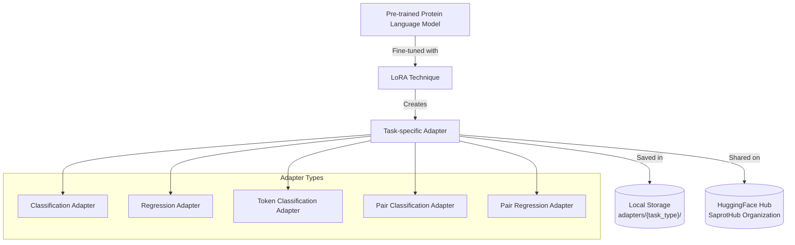
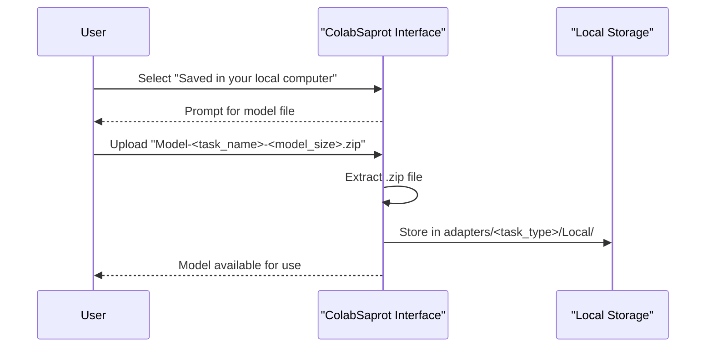
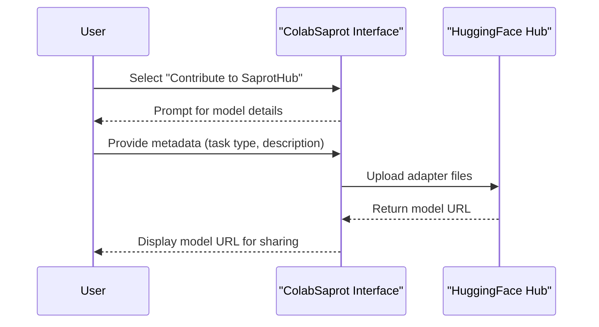
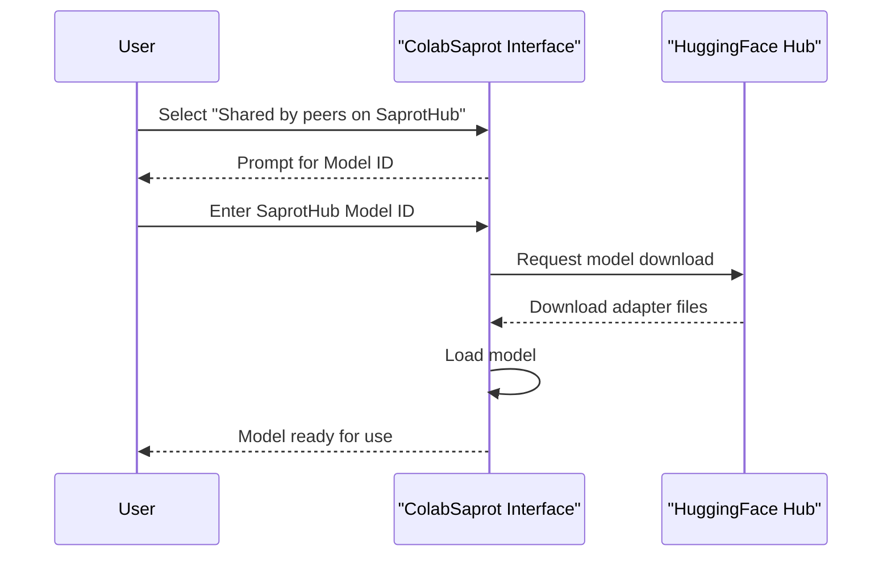
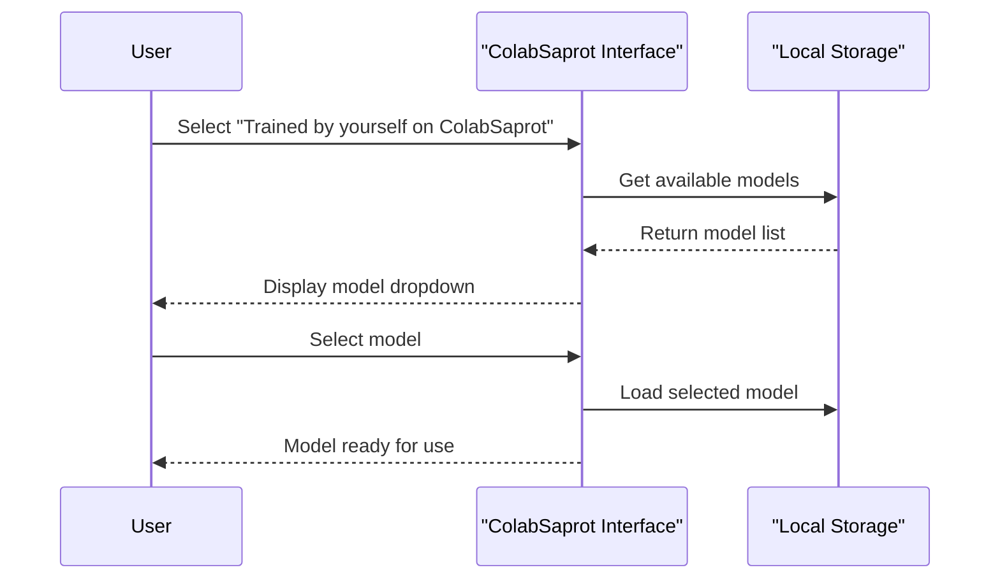

# Model Uploading and Sharing

<details>
<summary>Relevant source files</summary>

The following files were used as context for generating this wiki page:

- [Figure/training_curve_cls.png](Figure/training_curve_cls.png)
- [Figure/training_curve_reg.png](Figure/training_curve_reg.png)
- [colab/SaprotHub.ipynb](colab/SaprotHub.ipynb)
- [colab/SaprotHub_v2.ipynb](colab/SaprotHub_v2.ipynb)
- [saprot/utils/foldseek_util.py](saprot/utils/foldseek_util.py)

</details>


## Purpose and Scope

This document details how to save, upload, and share trained protein language models with the scientific community through SaprotHub. It covers the process of saving models locally, uploading models from your computer, sharing models via HuggingFace Hub, and using models shared by peers. 

For information about training models, please refer to [Model Selection and Training](#2.2). For details on specialized interfaces, see [Alternative Interfaces: ColabProtT5 and ColabProTrek](#2.4).

## Model Structure Overview

SaprotHub uses Parameter-Efficient Fine-Tuning (PEFT) with Low-Rank Adaptation (LoRA) to create small, task-specific adapters that can be easily shared without distributing the entire pre-trained protein language model.

### Model Adapter Architecture



Sources: [colab/SaprotHub.ipynb:149-167]()

## Local Model Storage

After training, models are automatically saved in task-specific directories within the SaprotHub environment:

```
adapters/<task_type>/Local/<model_name>/
```

Where `<task_type>` is one of:
- `classification`: For protein-level classification tasks
- `regression`: For protein-level regression tasks
- `token_classification`: For residue-level (per-amino-acid) classification tasks
- `pair_classification`: For protein-protein interaction classification tasks
- `pair_regression`: For protein-protein interaction regression tasks

Each adapter directory contains essential files:
- `adapter_model.bin`: The trained adapter weights
- `adapter_config.json`: Configuration including task type, model size, and training parameters

Sources: [colab/SaprotHub.ipynb:149-167](), [colab/SaprotHub.ipynb:307-326]()

## Managing Models

### Downloading Models to Your Computer

After training a model in ColabSaprot, you can download it to your local computer for backup or to use in a different session:

1. Navigate to the model directory in the file explorer (typically in `/content/SaprotHub/adapters/<task_type>/Local/<model_name>/`)
2. Right-click on the directory and select "Download"
3. The model will be downloaded as a zip file to your computer

### Uploading Models from Your Computer

To use a model saved on your local computer:



1. Prepare your model as a `.zip` file with the format `Model-<task_name>-<model_size>.zip`
2. When selecting a model, choose "Saved in your local computer" option
3. Upload the `.zip` file when prompted
4. The model will be extracted and stored in the appropriate directory for use

Sources: [colab/SaprotHub.ipynb:447-456]()

## Sharing Models on HuggingFace Hub

To share your model with the scientific community:



1. After training a model in ColabSaprot, use the "Contribute to SaprotHub" option
2. Provide metadata about your model:
   - Model name
   - Task type
   - Description
   - Training data source
   - Performance metrics
3. The model will be uploaded to the SaprotHub organization on HuggingFace Hub
4. You'll receive a URL that you can share with collaborators and the community

Sources: [colab/SaprotHub.ipynb:54]()

## Using Shared Models

### Using Models from HuggingFace Hub

To use models shared by others in the scientific community:



1. Find the model ID on the [SaprotHub organization page](https://huggingface.co/SaProtHub)
2. When selecting a model, choose "Shared by peers on SaprotHub" option
3. Enter the model ID in the text field
4. The model will be automatically downloaded and loaded for use

Sources: [colab/SaprotHub.ipynb:444-446]()

### Using Models from Local Storage

To use a previously trained or uploaded model:



1. When selecting a model, choose "Trained by yourself on ColabSaprot" option
2. Select the model from the dropdown list
3. The model will be loaded for use

Sources: [colab/SaprotHub.ipynb:441-443](), [colab/SaprotHub.ipynb:363-375]()

## Technical Details and Best Practices

### Model Format Requirements

When sharing models, ensure your adapter follows these requirements:

1. The adapter must include `adapter_model.bin` and `adapter_config.json`
2. The adapter configuration must specify the task type, model size, and other parameters
3. For maximum compatibility, use the recommended LoRA configuration from SaprotHub

### Best Practices for Model Sharing

1. **Clear Documentation**: Provide detailed descriptions of your model's purpose, training data, and intended use cases
2. **Performance Metrics**: Include metrics (accuracy, F1 score, etc.) to help users evaluate model suitability
3. **Attribution**: Cite original data sources used for training
4. **Versioning**: Clearly indicate model versions if you update your shared models
5. **License Information**: Specify any license restrictions on your model

## Using Multiple Models

SaprotHub also supports using multiple models for ensemble predictions:

1. When selecting models, choose "Multi-models on ColabSaprot" for local models or "Multi-models on SaprotHub" for shared models
2. For local models, select multiple models using Ctrl/Shift + click
3. For HuggingFace models, enter multiple model IDs separated by commas
4. The interface will load all selected models and enable ensemble prediction functionality

Sources: [colab/SaprotHub.ipynb:459-481]()

---

This documentation provides a comprehensive guide to model uploading and sharing in SaprotHub. By following these steps, you can effectively save, share, and use protein language models to advance collaborative research in the biological community.

---