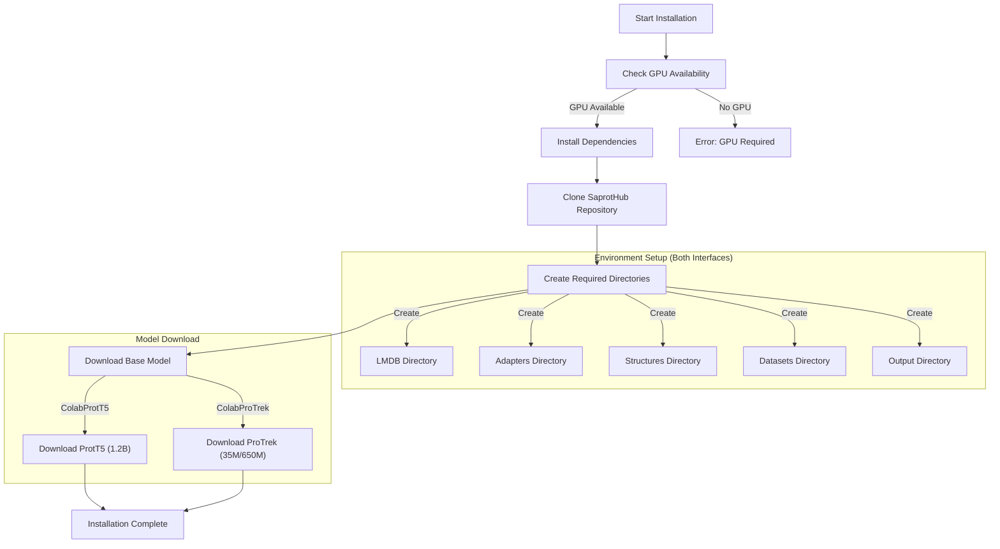
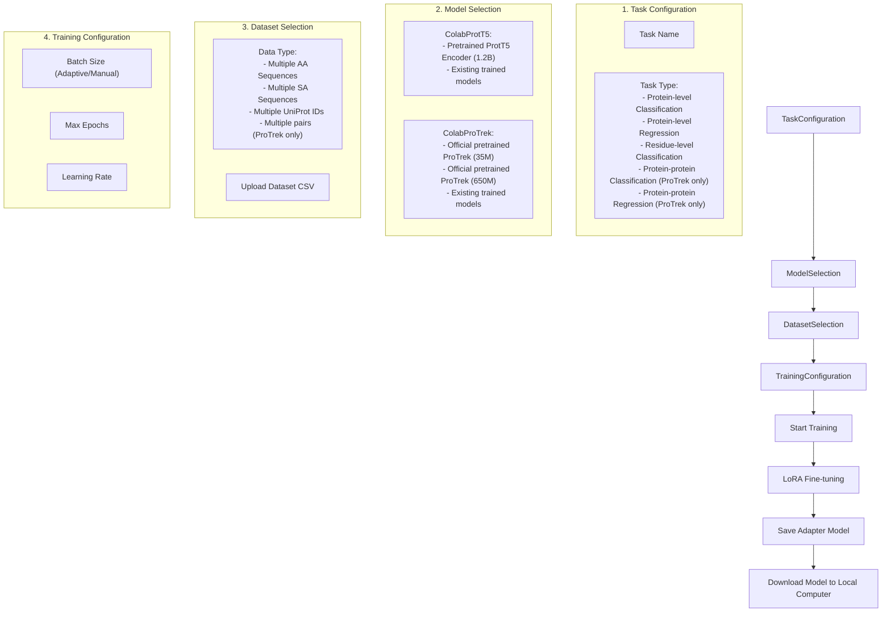
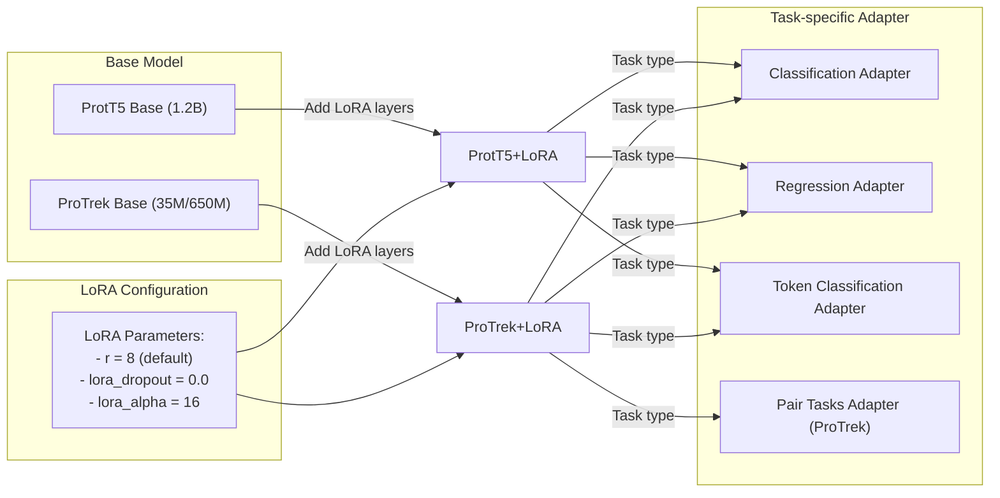
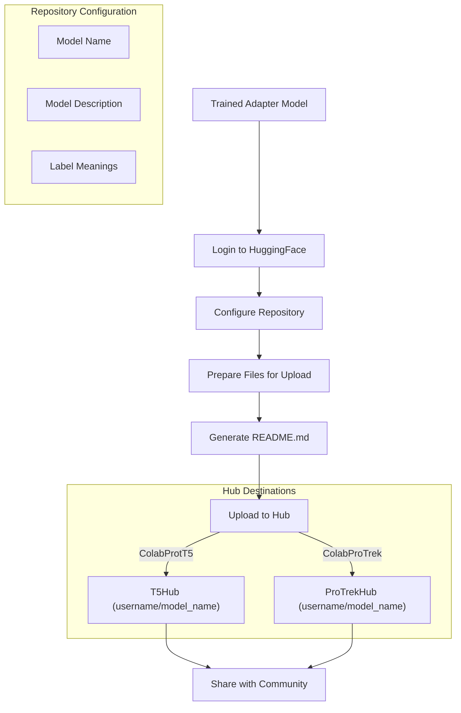
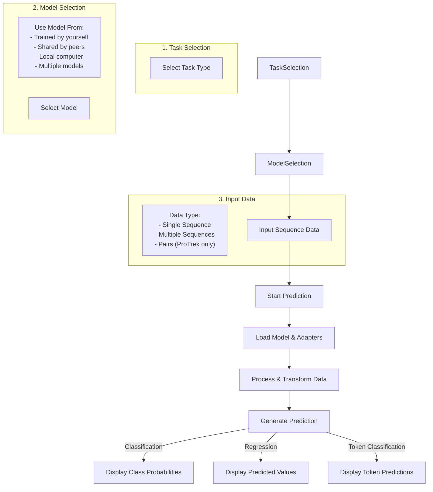
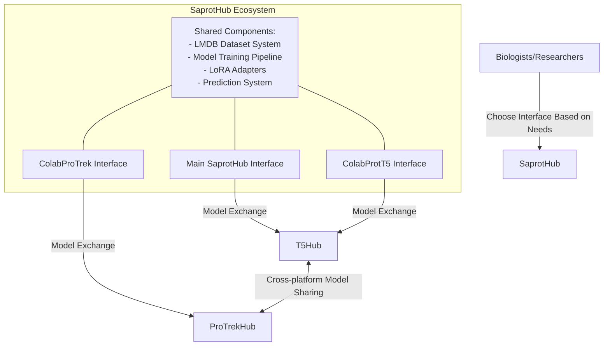

# Alternative Interfaces: ColabProtT5 and ColabProTrek

<details>
<summary>Relevant source files</summary>

The following files were used as context for generating this wiki page:

- [colab/ColabProTrek.ipynb](colab/ColabProTrek.ipynb)
- [colab/ColabProtT5.ipynb](colab/ColabProtT5.ipynb)

</details>


This page introduces two specialized Colab-based interfaces within the SaprotHub ecosystem: ColabProtT5 and ColabProTrek. These interfaces provide user-friendly access to specific protein language models (PLMs) and are designed to make advanced protein modeling accessible to biologists. For information about the primary SaprotHub interface, see [ColabSaprot Interface](#2).

## 1. Interface Overview

ColabProtT5 and ColabProTrek are specialized notebook interfaces that provide streamlined access to specific protein language models. They share the same underlying architecture as the main SaprotHub interface but are tailored for particular protein language models.

```mermaid
flowchart TB
    User[Researcher/Biologist] --> Interfaces

    subgraph "Interfaces"
        Interfaces[SaprotHub Interfaces]
        Interfaces --> ColabSaprot[Main SaprotHub Interface]
        Interfaces --> ColabProtT5[ColabProtT5]
        Interfaces --> ColabProTrek[ColabProTrek]
    end

    ColabProtT5 --> ProtT5[ProtT5 Model]
    ColabProTrek --> ProTrek[ProTrek Model]

    subgraph "Functionality"
        Train[Model Training]
        Predict[Prediction]
        Share[Model Sharing]
    end

    ColabProtT5 --> Functionality
    ColabProTrek --> Functionality

    subgraph "Models"
        ProtT5 --> |1.2B parameters|T5Encoder["Rostlab/prot_t5_xl_half_uniref50-enc"]
        ProTrek --> |35M parameters|Trek35M["ProTrekHub/Protein_Encoder_35M"]
        ProTrek --> |650M parameters|Trek650M["ProTrekHub/Protein_Encoder_650M"]
    end
```

Sources: [colab/ColabProtT5.ipynb:9-29](), [colab/ColabProTrek.ipynb:9-29]()

### 1.1 Key Differences

| Feature | ColabProtT5 | ColabProTrek |
|---------|-------------|-------------|
| Underlying Model | ProtT5 (1.2B parameters) | ProTrek (35M or 650M parameters) |
| Model Hub | T5Hub | ProTrekHub |
| GPU Requirements | Requires A100 GPU | Works with standard GPUs |
| Specialized For | Powerful encodings via T5 architecture | Sequence-structure-function pairwise searches |
| Model Path | `Rostlab/prot_t5_xl_half_uniref50-enc` | `ProTrekHub/Protein_Encoder_35M` or `ProTrekHub/Protein_Encoder_650M` |

Sources: [colab/ColabProtT5.ipynb:52-75](), [colab/ColabProTrek.ipynb:52-75]()

## 2. Installation and Setup

Both interfaces follow a similar installation process, but with model-specific dependencies.



Sources: [colab/ColabProtT5.ipynb:79-244](), [colab/ColabProTrek.ipynb:79-244]()

### 2.1 GPU Requirements

ColabProtT5 has stricter GPU requirements due to the size of the ProtT5 model:

```
Due to ProtT5's encoder containing 1.2B parameters, please ensure you run it on Colab Pro with an L4 or A100 GPU, otherwise, it will result in out of memory errors.
```

Sources: [colab/ColabProtT5.ipynb:60-62]()

ProTrek models are smaller and can run on standard GPUs available in Colab.

## 3. Training Workflow

Both interfaces support the same training workflow with minor differences in the model selection options.



Sources: [colab/ColabProtT5.ipynb:1253-1304](), [colab/ColabProtT5.ipynb:1306-1749](), [colab/ColabProTrek.ipynb:1255-1307](), [colab/ColabProTrek.ipynb:1310-1751]()

### 3.1 Specialized LoRA Adapter Integration

Both interfaces use Parameter-Efficient Fine-Tuning (PEFT) through LoRA adapters for model training:



Sources: [colab/ColabProtT5.ipynb:1318-1326](), [colab/ColabProTrek.ipynb:1322-1330]()

## 4. Model Sharing and Deployment

Both interfaces provide similar workflows for sharing trained models through their respective hubs:



Sources: [colab/ColabProtT5.ipynb:1752-1863](), [colab/ColabProTrek.ipynb:1754-1865]()

## 5. Prediction Capabilities

Both interfaces provide similar prediction workflows with model-specific optimizations:



Sources: [colab/ColabProtT5.ipynb:1873-2042](), [colab/ColabProTrek.ipynb:1873-2042]()

## 6. Key Implementation Differences

While both interfaces share the same overall architecture, there are important implementation differences:

### 6.1 Model-specific Configurations

#### ColabProtT5
- Uses ProtT5 encoder (`Rostlab/prot_t5_xl_half_uniref50-enc`)
- Model configuration path: `protT5/protT5_classification_model`
- Dataset configuration path: `protT5/protT5_classification_dataset`

Sources: [colab/ColabProtT5.ipynb:274-286]()

#### ColabProTrek
- Uses ProTrek models (`ProTrekHub/Protein_Encoder_35M` or `ProTrekHub/Protein_Encoder_650M`)
- Model configuration path: `saprot/saprot_classification_model`
- Dataset configuration path: `saprot/saprot_classification_dataset`

Sources: [colab/ColabProTrek.ipynb:276-288]()

### 6.2 Protein Pair Task Support

While both interfaces provide similar functionalities, ColabProTrek has more explicit support for protein pair tasks, including:
- Protein-protein classification
- Protein-protein regression
- Processing of protein pair sequences

This makes ColabProTrek particularly suited for tasks involving protein interactions.

Sources: [colab/ColabProTrek.ipynb:1391-1394]()

## 7. When to Choose Each Interface

| Use Case | Recommended Interface |
|----------|----------------------|
| When maximum model capacity is needed | ColabProtT5 (1.2B parameters) |
| When working with limited computing resources | ColabProTrek (35M model) |
| For protein-protein interaction tasks | ColabProTrek |
| For sequence annotation tasks | Either (task-dependent) |
| When A100 GPU is not available | ColabProTrek |
| When fine-tuning on very complex tasks | ColabProtT5 |

## 8. Integration with the SaprotHub Ecosystem

Both interfaces are designed to integrate with the larger SaprotHub system:



Sources: [colab/ColabProtT5.ipynb:18-20](), [colab/ColabProTrek.ipynb:22-24]()

Both interfaces leverage the same underlying infrastructure, enabling users to choose the most appropriate interface for their specific needs while maintaining compatibility with the broader SaprotHub ecosystem.

---