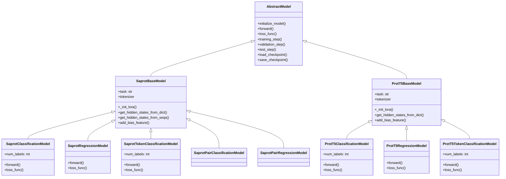
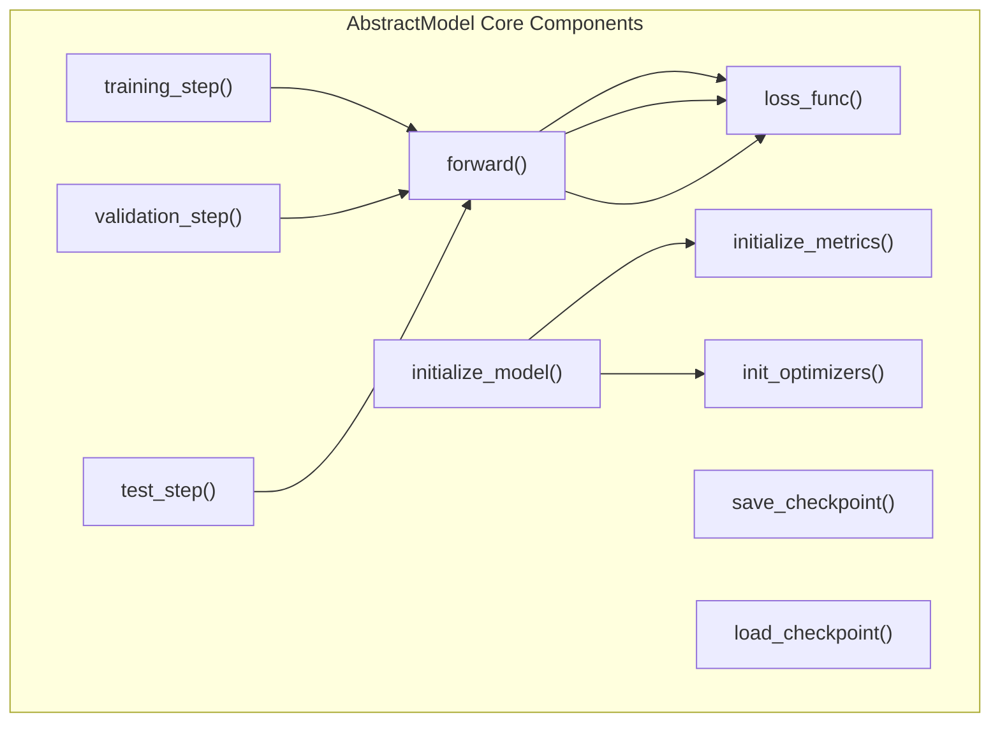
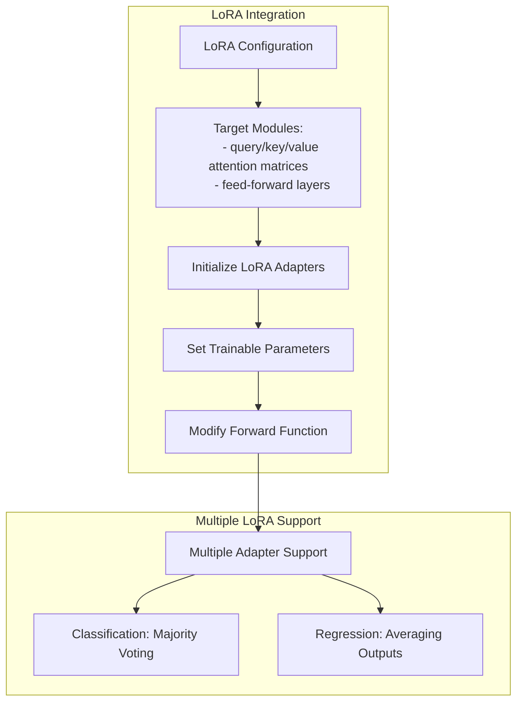
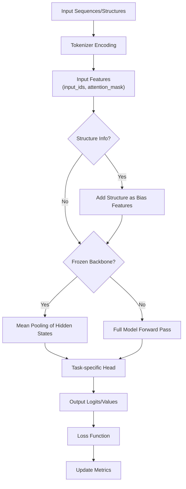
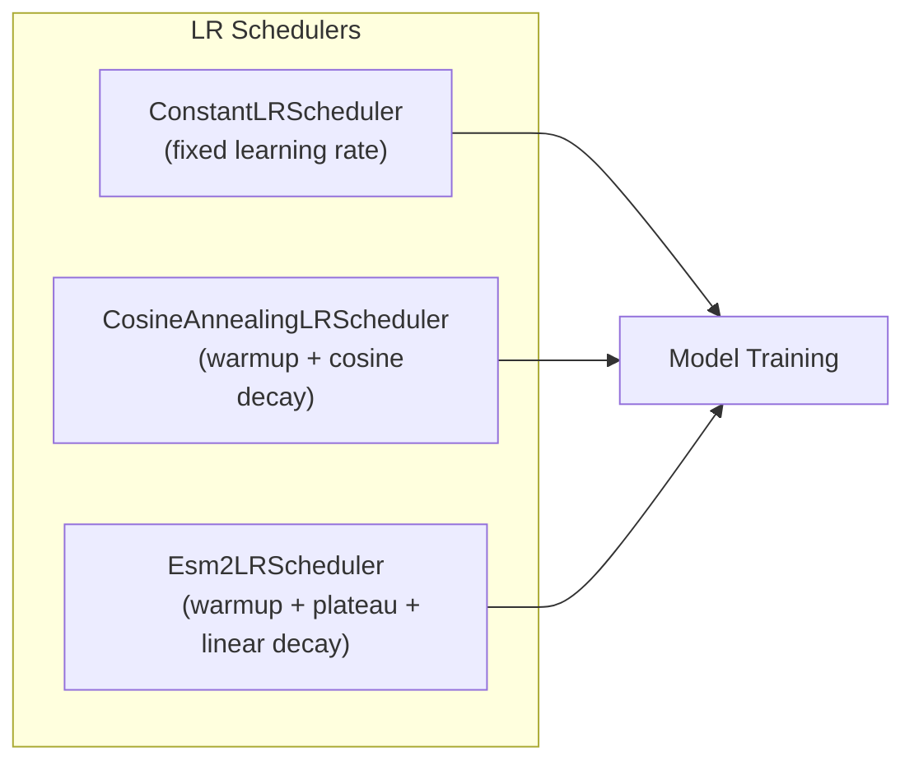
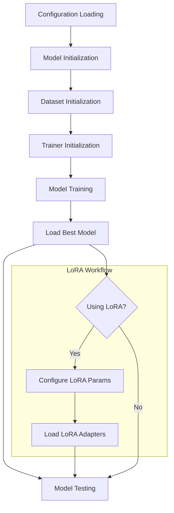

# Model Architecture

<details>
<summary>Relevant source files</summary>

The following files were used as context for generating this wiki page:

- [saprot/model/abstract_model.py](saprot/model/abstract_model.py)
- [saprot/model/protT5/base.py](saprot/model/protT5/base.py)
- [saprot/model/protT5/protT5_classification_model.py](saprot/model/protT5/protT5_classification_model.py)
- [saprot/model/protT5/protT5_regression_model.py](saprot/model/protT5/protT5_regression_model.py)
- [saprot/model/protT5/protT5_token_classification_model.py](saprot/model/protT5/protT5_token_classification_model.py)
- [saprot/model/saprot/base.py](saprot/model/saprot/base.py)
- [saprot/scripts/training.py](saprot/scripts/training.py)
- [saprot/utils/lr_scheduler.py](saprot/utils/lr_scheduler.py)

</details>


This page documents the technical architecture of the protein language models (PLMs) in SaprotHub. It covers the model hierarchy, base model implementations, task-specific variants, and how Parameter-Efficient Fine-Tuning (PEFT) is integrated via Low-Rank Adaptation (LoRA). For information about training these models, see [Training Pipeline](#5) and for data processing details, see [Data Processing](#4).

## Model Hierarchy Overview

SaprotHub implements a modular model architecture that follows a clear inheritance hierarchy. At the core is an abstract base class that defines the model interface, with specialized implementations for different protein language model types and prediction tasks.



Sources: [saprot/model/abstract_model.py](), [saprot/model/saprot/base.py](), [saprot/model/protT5/base.py](), [saprot/model/protT5/protT5_classification_model.py](), [saprot/model/protT5/protT5_regression_model.py](), [saprot/model/protT5/protT5_token_classification_model.py]()

## Base Models

### AbstractModel

The `AbstractModel` class is the foundation of all models in SaprotHub. It inherits from PyTorch Lightning's `LightningModule` and defines the essential methods that all specialized models must implement.

Key responsibilities:
- Model initialization and loading from checkpoints
- Training, validation, and testing workflows
- Optimizer and learning rate scheduler configuration
- Checkpoint saving and loading
- Metric tracking and reporting



Sources: [saprot/model/abstract_model.py:12-406]()

### SaprotBaseModel

`SaprotBaseModel` extends `AbstractModel` and serves as the foundation for ESM-based models. It initializes the ESM model from Hugging Face transformers and provides methods for obtaining hidden representations and working with structure information.

Key features:
- ESM model initialization with configurable parameters
- Support for different tasks (classification, regression, token classification)
- LoRA integration for parameter-efficient fine-tuning
- Extraction of hidden states from sequences
- Integration of structural information via bias features

```python
# SaprotBaseModel initializes different model types based on the specified task
def initialize_model(self):
    # Initialize tokenizer
    self.tokenizer = AutoTokenizer.from_pretrained(self.config_path)
    
    # Initialize different models according to task
    config = AutoConfig.from_pretrained(self.config_path)
    # ... then initialize the appropriate model type based on self.task
```

Sources: [saprot/model/saprot/base.py:21-453]()

### ProtT5BaseModel

`ProtT5BaseModel` is similar to `SaprotBaseModel` but built for T5-based protein language models. It initializes the T5 model from Hugging Face transformers and provides similar functionality adapted for the T5 architecture.

Key features:
- T5 model initialization with configurable parameters
- Support for different tasks (classification, regression, token classification)
- LoRA integration for parameter-efficient fine-tuning
- Extraction of hidden states from input dictionaries
- Integration of structural information via bias features

Sources: [saprot/model/protT5/base.py:27-393]()

## LoRA Integration

Both base models implement LoRA (Low-Rank Adaptation) for parameter-efficient fine-tuning. LoRA adds small, trainable "adapter" modules to the pre-trained model instead of fine-tuning all parameters, significantly reducing the computational and memory requirements.



Implementation details:
- For `SaprotBaseModel`, LoRA targets query, key, value, and dense layers
- For `ProtT5BaseModel`, LoRA targets self-attention and encoder-decoder attention components
- Both models support multiple LoRA adapters with ensemble prediction

Sources: [saprot/model/saprot/base.py:74-171](), [saprot/model/protT5/base.py:79-181]()

## Task-Specific Models

SaprotHub provides specialized models for different protein prediction tasks. Each task-specific model customizes the forward pass and loss calculation for its particular needs.

### Classification Models

`ProtT5ClassificationModel` extends `ProtT5BaseModel` for sequence classification tasks.

Key features:
- Initializes a classifier head with the architecture: Linear → ReLU → Linear
- Takes sequence inputs and returns class logits
- Uses cross-entropy loss for classification
- Tracks accuracy metrics during training and evaluation

```python
# ProtT5ClassificationModel classifier initialization
def initialize_model(self):
    super().initialize_model()
    
    hidden_size = self.model.config.hidden_size
    classifier = torch.nn.Sequential(
        torch.nn.Linear(hidden_size, hidden_size),
        torch.nn.ReLU(),
        torch.nn.Linear(hidden_size, self.num_labels)
    )
    
    setattr(self.model, "classifier", classifier)
```

Sources: [saprot/model/protT5/protT5_classification_model.py:11-106]()

### Regression Models

`ProtT5RegressionModel` extends `ProtT5BaseModel` for regression tasks.

Key features:
- Initializes a regression head with the architecture: Linear → ReLU → Linear(output=1)
- Takes sequence inputs and returns scalar values
- Uses mean squared error loss
- Tracks MSE, Spearman correlation, R² score, and Pearson correlation during training and evaluation

Sources: [saprot/model/protT5/protT5_regression_model.py:10-126]()

### Token Classification Models

`ProtT5TokenClassificationModel` extends `ProtT5BaseModel` for token-level classification tasks (e.g., residue-level property prediction).

Key features:
- Initializes a token classifier head with the architecture: Linear → ReLU → Linear
- Takes sequence inputs and returns logits for each token
- Uses cross-entropy loss with support for ignored indices
- Tracks accuracy and Matthews correlation coefficient (MCC) during training and evaluation

Sources: [saprot/model/protT5/protT5_token_classification_model.py:11-166]()

## Task and Model Type Mapping

The following table shows the supported task types and their corresponding model implementations:

| Task Type | SaProt Implementation | ProtT5 Implementation | Description |
|-----------|----------------------|------------------------|-------------|
| Classification | SaprotClassificationModel | ProtT5ClassificationModel | Sequence-level multi-class classification |
| Regression | SaprotRegressionModel | ProtT5RegressionModel | Sequence-level continuous value prediction |
| Token Classification | SaprotTokenClassificationModel | ProtT5TokenClassificationModel | Residue-level classification |
| Pair Classification | SaprotPairClassificationModel | - | Classification for sequence pairs |
| Pair Regression | SaprotPairRegressionModel | - | Regression for sequence pairs |

Sources: [saprot/model/saprot/base.py:53](), [saprot/model/protT5/base.py:58]()

## Model Forward Pass Flow

The following diagram illustrates the forward pass flow for a typical model in SaprotHub:



Sources: [saprot/model/saprot/base.py:257-325](), [saprot/model/protT5/protT5_classification_model.py:36-60](), [saprot/model/protT5/protT5_regression_model.py:39-63](), [saprot/model/protT5/protT5_token_classification_model.py:48-70]()

## Learning Rate Schedulers

SaprotHub implements several learning rate schedulers to optimize the training process:



The learning rate schedulers are essential components of the training process:

1. **ConstantLRScheduler**: Maintains a fixed learning rate throughout training
2. **CosineAnnealingLRScheduler**: Includes a warmup phase followed by cosine decay to final learning rate
3. **Esm2LRScheduler**: Implements ESM2's learning rate schedule with warmup, plateau, and linear decay phases

Sources: [saprot/utils/lr_scheduler.py:6-186](), [saprot/model/abstract_model.py:378-400]()

## Training Integration

The model architecture is integrated into the training pipeline through the following process:



Sources: [saprot/scripts/training.py:20-103]()

## Conclusion

SaprotHub's model architecture provides a flexible and extensible framework for working with protein language models. The modular design with an abstract base class and specialized implementations for different tasks allows for easy extension and customization. The integration of LoRA enables parameter-efficient fine-tuning, making it possible to adapt large protein language models to specific tasks with limited computational resources.

The architecture supports both ESM-based and T5-based protein language models, each with their own specialized implementations for different prediction tasks. This flexibility, combined with configurable learning rate schedules and training integration, makes SaprotHub a powerful tool for protein engineering and analysis.

For more details on specific model types and their applications, see [SaProt Base Model](#3.1) and [ProtT5 Models](#3.2).

---