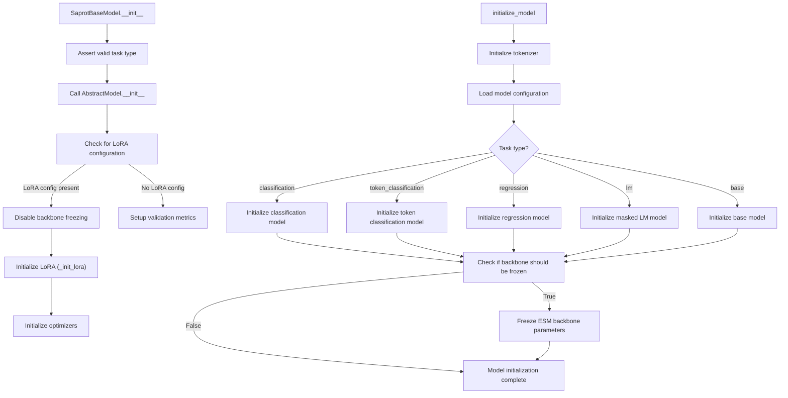
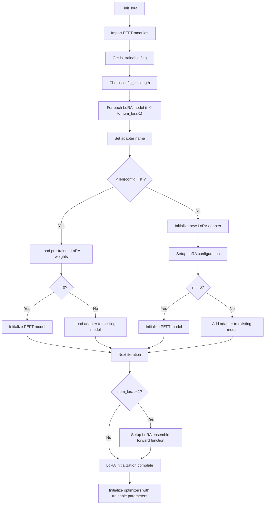
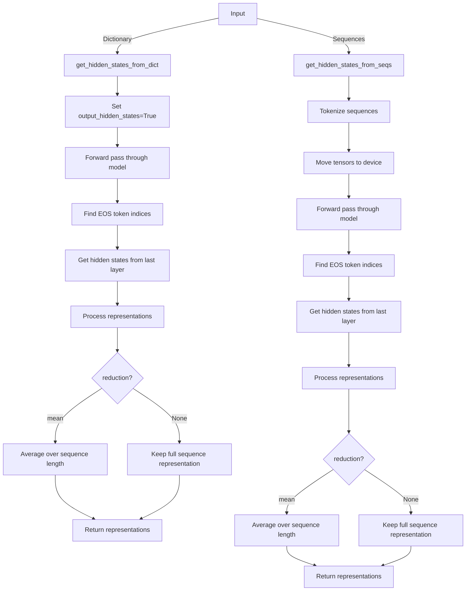
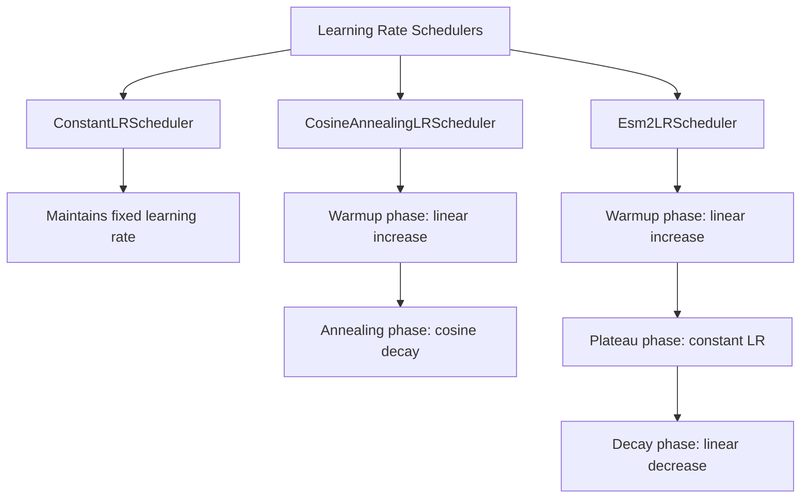
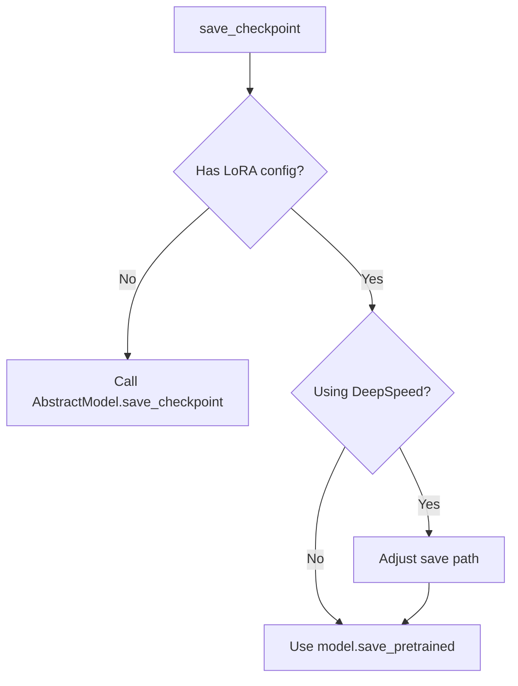

# SaProt Base Model

<details>
<summary>Relevant source files</summary>

The following files were used as context for generating this wiki page:

- [saprot/model/abstract_model.py](saprot/model/abstract_model.py)
- [saprot/model/saprot/base.py](saprot/model/saprot/base.py)
- [saprot/scripts/training.py](saprot/scripts/training.py)
- [saprot/utils/lr_scheduler.py](saprot/utils/lr_scheduler.py)

</details>


This document details the SaProt Base Model, which serves as the foundational architecture for protein language model implementations in the SaprotHub framework. The SaProt Base Model provides a standardized interface for initializing, configuring, and training protein language models, with specific focus on efficient fine-tuning capabilities through Low-Rank Adaptation (LoRA).

For information about task-specific model implementations that extend this base model, see [Model Types and Prediction Tasks](#3.3).

## 1. Architecture Overview

The SaProt Base Model inherits from the AbstractModel class, establishing a consistent interface for protein language model implementations in SaprotHub. It acts as an intermediary layer that handles model initialization, task-specific adaptations, and integration of efficient fine-tuning techniques.

```mermaid
classDiagram
    class AbstractModel {
        +initialize_model()
        +forward()
        +loss_func()
        +training_step()
        +validation_step()
        +test_step()
        +load_checkpoint()
        +save_checkpoint()
    }
    
    class SaprotBaseModel {
        +task: str
        +config_path: str
        +load_pretrained: bool
        +freeze_backbone: bool
        +gradient_checkpointing: bool
        +lora_kwargs: dict
        +initialize_model()
        +_init_lora()
        +get_hidden_states_from_dict()
        +get_hidden_states_from_seqs()
        +add_bias_feature()
    }
    
    AbstractModel <|-- SaprotBaseModel
    SaprotBaseModel <|-- "SaprotClassificationModel"
    SaprotBaseModel <|-- "SaprotRegressionModel"
    SaprotBaseModel <|-- "SaprotTokenClassificationModel"
    SaprotBaseModel <|-- "SaprotPairClassificationModel"
    SaprotBaseModel <|-- "SaprotPairRegressionModel"
```

Sources: [saprot/model/saprot/base.py:21-63](), [saprot/model/abstract_model.py:12-40]()

## 2. Initialization and Configuration

The SaprotBaseModel is designed to be highly configurable, supporting various tasks and model architectures. Its initialization process handles:

1. Task specification ('classification', 'token_classification', 'regression', 'lm', or 'base')
2. Model configuration path for loading the HuggingFace ESM model 
3. Additional configuration options such as whether to freeze backbone or enable gradient checkpointing
4. Learning rate scheduler and optimizer parameters
5. LoRA (Low-Rank Adaptation) configuration for efficient fine-tuning



Sources: [saprot/model/saprot/base.py:26-71](), [saprot/model/saprot/base.py:175-252]()

### 2.1 Supported Task Types

The SaprotBaseModel supports multiple task types, each corresponding to a specific model architecture:

| Task Type | Model Class | Description | Use Case |
|-----------|-------------|-------------|----------|
| `classification` | `AutoModelForSequenceClassification` | Predicts discrete labels for proteins | Protein function prediction, localization, etc. |
| `token_classification` | `AutoModelForTokenClassification` | Predicts labels for each amino acid | Secondary structure prediction, residue property prediction |
| `regression` | `AutoModelForSequenceClassification` (num_labels=1) | Predicts continuous values | Stability prediction, binding affinity, etc. |
| `lm` | `AutoModelForMaskedLM` | Masked language modeling task | Pretraining, mutation effect prediction |
| `base` | `AutoModelForMaskedLM` (modified) | Base representation without prediction heads | Feature extraction for custom downstream tasks |

Sources: [saprot/model/saprot/base.py:175-233]()

## 3. LoRA Integration

One of the key features of the SaprotBaseModel is its integration with Low-Rank Adaptation (LoRA), a parameter-efficient fine-tuning technique. LoRA allows for fine-tuning large protein language models with significantly fewer trainable parameters, reducing memory requirements and training time.



Sources: [saprot/model/saprot/base.py:74-173]()

### 3.1 LoRA Configuration Options

The LoRA integration supports the following key configuration parameters:

| Parameter | Description | Default |
|-----------|-------------|---------|
| `num_lora` | Number of LoRA adapters to use | Required |
| `config_list` | List of pre-trained LoRA configurations to load | `[]` |
| `is_trainable` | Whether the LoRA adapters should be trainable | `False` |
| `r` | Rank of the LoRA adaptation matrices | `8` |
| `lora_dropout` | Dropout probability for LoRA layers | `0.0` |
| `lora_alpha` | Scaling factor for LoRA | `16` |
| `target_modules` | Which modules to apply LoRA to | `["query", "key", "value", "intermediate.dense", "output.dense"]` |

Sources: [saprot/model/saprot/base.py:105-113]()

### 3.2 Multi-LoRA Ensemble

The SaprotBaseModel supports ensembling multiple LoRA adapters. When multiple LoRA adapters are used, the model operates in inference mode only, averaging predictions from all adapters:

- For classification tasks: Final predictions are determined by voting among all LoRA models
- For regression tasks: Final predictions are the average of predictions from all LoRA models

Sources: [saprot/model/saprot/base.py:124-167]()

## 4. Hidden State Extraction

The SaprotBaseModel provides methods to extract hidden representations from protein sequences, which are essential for many downstream tasks.



Sources: [saprot/model/saprot/base.py:257-325]()

## 5. Structure-Aware Features

The SaprotBaseModel can incorporate structural information through the `add_bias_feature` method. This method adds structure information as biases to attention maps, similar to how the Evoformer architecture works:

```python
def add_bias_feature(self, inputs, coords: List[Dict]) -> torch.Tensor:
    """
    Add structure information as biases to attention map. This function is used to add structure information
    to the model as Evoformer does.
    """
    inputs["pair_feature"] = batch_coords2feature(coords, self.model.device)
    return inputs
```

This enables structure-aware protein language modeling, where the model can leverage both sequence and structural information for improved predictions.

Sources: [saprot/model/saprot/base.py:327-340]()

## 6. Training and Optimization

The SaprotBaseModel leverages PyTorch Lightning for training, with support for various optimization strategies. The model uses different learning rate schedulers to control the learning process during training.

### 6.1 Learning Rate Schedulers

The SaprotBaseModel supports several learning rate schedulers:



Sources: [saprot/utils/lr_scheduler.py:6-187](), [saprot/model/abstract_model.py:378-400]()

### 6.2 Optimizer Configuration

The model uses the AdamW optimizer by default, with different weight decay settings for different parameter groups:

- No weight decay for layer normalization weights and biases
- Standard weight decay for all other parameters

This approach helps prevent overfitting while still allowing certain critical parameters to adapt properly.

Sources: [saprot/model/abstract_model.py:378-400]()

## 7. Model Saving and Loading

The SaprotBaseModel provides custom methods for saving and loading model checkpoints, with special handling for LoRA models.

### 7.1 Checkpoint Saving

For standard models, the checkpoint contains the model weights and optionally the optimizer and scheduler states. For LoRA models, the model is saved using the PEFT library's `save_pretrained` method, which preserves the LoRA adaptation parameters.



Sources: [saprot/model/saprot/base.py:342-358](), [saprot/model/abstract_model.py:267-296]()

### 7.2 Evaluation and Metrics

The SaprotBaseModel provides methods for evaluating model performance and displaying metrics during training and testing. It supports different metrics based on the task type:

| Task Type | Primary Metrics |
|-----------|----------------|
| Classification | Accuracy (Acc), Matthews Correlation Coefficient (MCC) |
| Regression | Root Mean Squared Error (RMSE), R², Spearman correlation, Pearson correlation |
| Token Classification | Accuracy, MCC (for binary), F1 score |

For interactive environments like Google Colab, the model can plot validation metric curves to help users monitor training progress and detect overfitting.

Sources: [saprot/model/saprot/base.py:359-452]()

## Summary

The SaprotBaseModel serves as the foundation for all protein language model implementations in SaprotHub. It provides a flexible and configurable architecture that supports various tasks and efficient fine-tuning through LoRA. Key features include:

1. Support for different task types (classification, regression, token classification)
2. Integration with Low-Rank Adaptation (LoRA) for parameter-efficient fine-tuning
3. Multi-adapter ensembling for improved model performance
4. Methods for extracting hidden representations from protein sequences
5. Structure-aware modeling capabilities through attention biases
6. Comprehensive training and evaluation utilities

This base model is extended by task-specific models to provide specialized functionality for different protein prediction tasks.

---