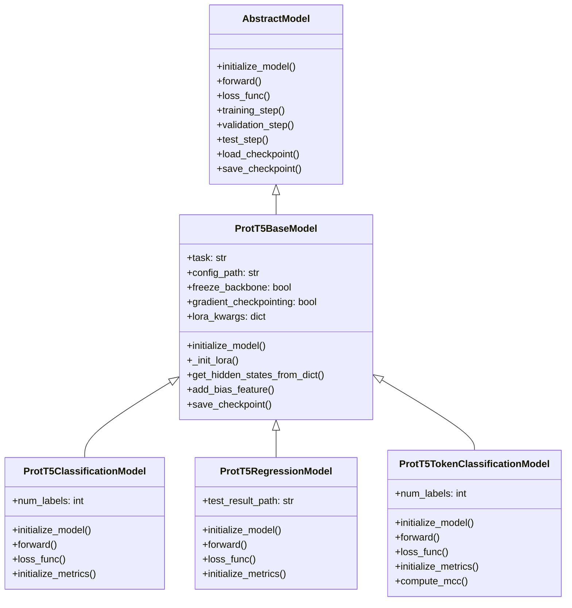
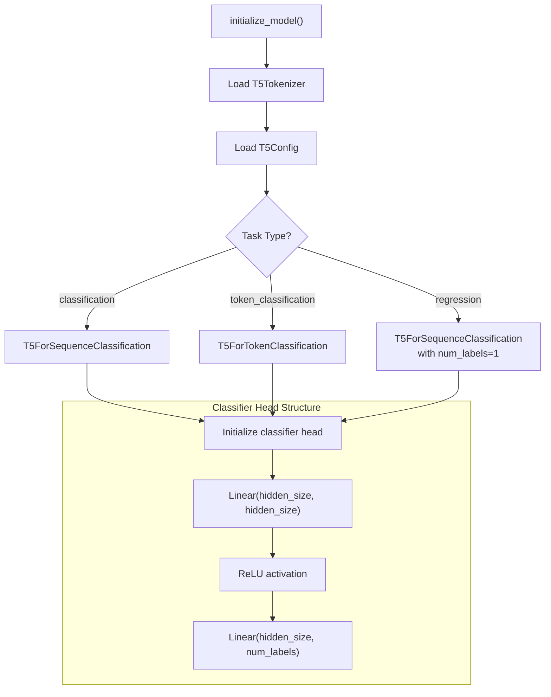
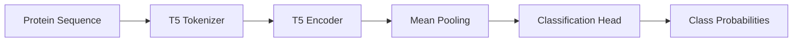
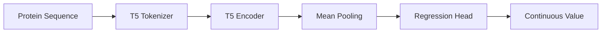
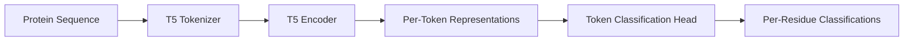
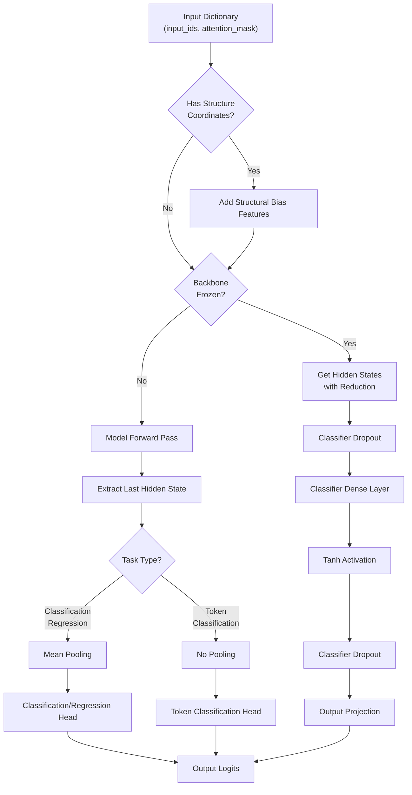

# ProtT5 Models

<details>
<summary>Relevant source files</summary>

The following files were used as context for generating this wiki page:

- [saprot/model/protT5/base.py](saprot/model/protT5/base.py)
- [saprot/model/protT5/protT5_classification_model.py](saprot/model/protT5/protT5_classification_model.py)
- [saprot/model/protT5/protT5_regression_model.py](saprot/model/protT5/protT5_regression_model.py)
- [saprot/model/protT5/protT5_token_classification_model.py](saprot/model/protT5/protT5_token_classification_model.py)

</details>


This page documents the ProtT5 models in SaprotHub, focusing on their architecture, implementation, and usage. ProtT5 models are based on the T5 encoder transformer architecture, specifically designed for protein sequence analysis tasks. For information about SaProt models, see [SaProt Base Model](#3.1).

## Overview

ProtT5 models use transformer-based neural networks to learn protein sequence representations. The models leverage the T5 encoder architecture and can be fine-tuned for various downstream tasks using parameter-efficient techniques like LoRA (Low-Rank Adaptation).



Sources: [saprot/model/protT5/base.py:27-393](), [saprot/model/protT5/protT5_classification_model.py:10-106](), [saprot/model/protT5/protT5_regression_model.py:9-126](), [saprot/model/protT5/protT5_token_classification_model.py:10-166]()

## ProtT5BaseModel

`ProtT5BaseModel` serves as the foundation for all ProtT5 models in SaprotHub. It cannot be used directly but provides essential functionality for downstream task-specific models.

### Initialization

The base model is initialized with several key parameters:

```python
def __init__(self,
             task: str,
             config_path: str,
             extra_config: dict = None,
             load_pretrained: bool = False,
             freeze_backbone: bool = False,
             gradient_checkpointing: bool = False,
             lora_kwargs: dict = None,
             **kwargs):
```

- `task`: Specifies the task type ('classification', 'token_classification', 'regression', 'lm', or 'base')
- `config_path`: Path to the HuggingFace configuration file for the T5 model
- `extra_config`: Additional configuration parameters
- `load_pretrained`: Whether to load pretrained weights
- `freeze_backbone`: Whether to freeze the encoder backbone
- `gradient_checkpointing`: Whether to enable gradient checkpointing (for memory efficiency)
- `lora_kwargs`: Configuration for LoRA parameter-efficient fine-tuning

Sources: [saprot/model/protT5/base.py:27-76]()

### Model Initialization

The model initialization process:

1. Sets up the T5 tokenizer based on the provided config path
2. Initializes the appropriate model based on the task type
3. Applies additional configuration as needed



Sources: [saprot/model/protT5/base.py:182-260]()

### LoRA Integration

The base model supports LoRA for parameter-efficient fine-tuning:

1. Configures LoRA adapters for specific modules (attention components)
2. Supports multiple LoRA adapters for ensemble prediction
3. Handles adapter saving and loading

Key LoRA parameters:

| Parameter | Default | Description |
|-----------|---------|-------------|
| r | 8 | LoRA rank (lower values = fewer parameters) |
| lora_dropout | 0.0 | Dropout rate for LoRA layers |
| lora_alpha | 16 | LoRA scaling factor |

Sources: [saprot/model/protT5/base.py:79-181]()

### Feature Extraction

The model provides methods to extract features from protein sequences:

```python
def get_hidden_states_from_dict(self, inputs: dict, reduction: str = None) -> list:
```

This method processes input token IDs and attention masks to extract hidden representations from the model. If `reduction="mean"`, it averages the representations across the sequence length.

Sources: [saprot/model/protT5/base.py:264-296]()

### Structural Information Integration

The model can incorporate structural information through:

```python
def add_bias_feature(self, inputs, coords: List[Dict]) -> torch.Tensor:
```

This method adds structure information as biases to attention maps, similar to how Evoformer works. It uses backbone atom coordinates (N, CA, C, O) to compute pair features.

Sources: [saprot/model/protT5/base.py:334-347]()

## Task-Specific Models

SaprotHub provides three specialized ProtT5 models for different tasks:

### 1. ProtT5ClassificationModel

For sequence-level classification tasks.



Key features:
- Takes `num_labels` to specify the number of classes
- Uses mean pooling to aggregate sequence representations
- Uses cross-entropy loss
- Tracks accuracy metrics

Implementation details:
- The classifier head consists of two linear layers with a ReLU activation
- Supports optional structure-aware features through the `coords` parameter

Sources: [saprot/model/protT5/protT5_classification_model.py:10-106]()

### 2. ProtT5RegressionModel

For sequence-level regression tasks.



Key features:
- Uses mean squared error loss
- Tracks multiple metrics: MSE, Spearman correlation, R², Pearson correlation
- Can save test results to a specified path

The model uses the same architecture as the classification model but with a single output unit and different loss function and metrics.

Sources: [saprot/model/protT5/protT5_regression_model.py:9-126]()

### 3. ProtT5TokenClassificationModel

For residue-level (token-level) classification tasks.



Key features:
- Predicts a class for each amino acid (token) in the sequence
- Uses cross-entropy loss (ignoring padding tokens)
- Computes Matthews Correlation Coefficient (MCC) in addition to accuracy
- Supports structure-aware features through the `coords` parameter

Unlike the sequence-level models, this model doesn't perform pooling, preserving token-level representations for prediction.

Sources: [saprot/model/protT5/protT5_token_classification_model.py:10-166]()

## Forward Pass Data Flow

The following diagram illustrates the data flow during a forward pass through a ProtT5 model:



Sources: [saprot/model/protT5/protT5_classification_model.py:36-60](), [saprot/model/protT5/protT5_regression_model.py:39-63](), [saprot/model/protT5/protT5_token_classification_model.py:48-70]()

## Integration with SaprotHub

ProtT5 models are registered through the model interface system and can be accessed through:

1. The main SaprotHub notebook interface
2. The specialized ColabProtT5 interface

The models use the `@register_model` decorator to make them available to the SaprotHub system.

## Usage Considerations

When using ProtT5 models, consider the following:

| Aspect | Notes |
|--------|-------|
| Memory Usage | ProtT5 models can be large; consider using gradient checkpointing or LoRA for efficiency |
| Tokenization | Uses T5 tokenizer which handles amino acid sequences differently than language models |
| Task Selection | Choose the appropriate model (Classification, Regression, TokenClassification) based on task |
| Structural Data | Consider adding structural information using the `add_bias_feature` method for potentially improved performance |
| Fine-tuning | LoRA adapters provide parameter-efficient fine-tuning with fewer resources |

## Metrics Visualization

ProtT5 models include built-in visualization of validation metrics using matplotlib through Google Colab widgets. This allows real-time monitoring of training progress.

The `plot_valid_metrics_curve` method creates visualizations for all tracked metrics over training steps.

Sources: [saprot/model/protT5/base.py:366-392]()

---