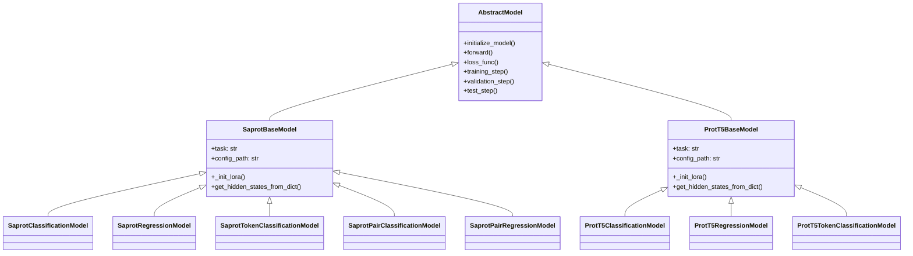
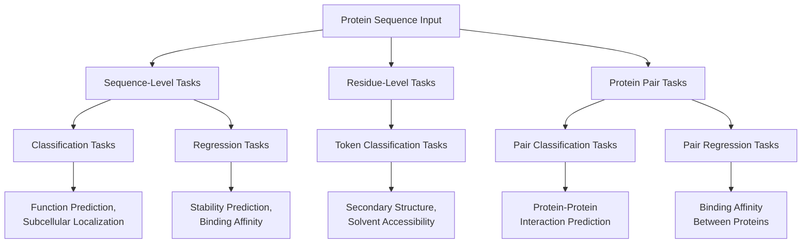

# Model Types and Prediction Tasks

Relevant source files

The following files were used as context for generating this wiki page:

- [saprot/model/protT5/base.py](saprot/model/protT5/base.py)
- [saprot/model/protT5/protT5_classification_model.py](saprot/model/protT5/protT5_classification_model.py)
- [saprot/model/protT5/protT5_regression_model.py](saprot/model/protT5/protT5_regression_model.py)
- [saprot/model/protT5/protT5_token_classification_model.py](saprot/model/protT5/protT5_token_classification_model.py)
- [saprot/model/saprot/saprot_classification_model.py](saprot/model/saprot/saprot_classification_model.py)
- [saprot/model/saprot/saprot_pair_classification_model.py](saprot/model/saprot/saprot_pair_classification_model.py)
- [saprot/model/saprot/saprot_pair_regression_model.py](saprot/model/saprot/saprot_pair_regression_model.py)
- [saprot/model/saprot/saprot_regression_model.py](saprot/model/saprot/saprot_regression_model.py)
- [saprot/model/saprot/saprot_token_classification_model.py](saprot/model/saprot/saprot_token_classification_model.py)

This page provides a technical overview of the various model types available in SaprotHub and the prediction tasks they support. It explains the architecture of each model type, their inheritance relationships, supported tasks, and how to choose the appropriate model for different protein-related predictions.

## Model Type Overview

The SaprotHub system implements two main families of protein language models:

1. **SaProt-based models**: Built on ESM protein language models
2. **ProtT5-based models**: Built on the T5 transformer architecture optimized for proteins

Both model families inherit from an abstract base class and are further specialized for different prediction tasks.

Sources: [saprot/model/protT5/base.py:27-393](), [saprot/model/saprot/saprot_classification_model.py:10-82](), [saprot/model/saprot/saprot_regression_model.py:9-109](), [saprot/model/saprot/saprot_token_classification_model.py:10-139](), [saprot/model/saprot/saprot_pair_classification_model.py:11-94](), [saprot/model/saprot/saprot_pair_regression_model.py:11-87](), [saprot/model/protT5/protT5_classification_model.py:10-106](), [saprot/model/protT5/protT5_regression_model.py:9-126](), [saprot/model/protT5/protT5_token_classification_model.py:10-166]()

## SaProt Models

SaProt models are based on Facebook's ESM protein language models. These models use a transformer-based architecture pre-trained on large protein sequence datasets. SaprotHub provides the following specialized SaProt model types:

### SaprotClassificationModel

- **Purpose**: Predicts discrete class labels for entire protein sequences
- **Architecture**: ESM backbone with a classification head
- **Key components**:
  - Classification head: `torch.nn.Linear(hidden_size, num_labels)`
  - Loss function: Cross-entropy
  - Primary metric: Accuracy

Sources: [saprot/model/saprot/saprot_classification_model.py:10-82]()

### SaprotRegressionModel

- **Purpose**: Predicts continuous values for entire protein sequences
- **Architecture**: ESM backbone with a regression head
- **Key components**:
  - Regression head: `torch.nn.Linear(hidden_size, 1)`
  - Loss function: Mean Squared Error (MSE)
  - Primary metrics: MSE, Spearman correlation, R²-score, Pearson correlation

Sources: [saprot/model/saprot/saprot_regression_model.py:9-109]()

### SaprotTokenClassificationModel

- **Purpose**: Predicts labels for each amino acid (token) in a sequence
- **Architecture**: ESM backbone with a token classification head
- **Key components**:
  - Token classification head that outputs logits for each token
  - Loss function: Cross-entropy with support for ignoring certain indices
  - Primary metrics: Accuracy, Matthews Correlation Coefficient (MCC)

Sources: [saprot/model/saprot/saprot_token_classification_model.py:10-139]()

### SaprotPairClassificationModel

- **Purpose**: Predicts discrete class labels for protein pairs
- **Architecture**: ESM backbone that processes two sequences independently, then concatenates embeddings
- **Key components**:
  - Pair classifier: `torch.nn.Sequential(Linear(hidden_size*2, hidden_size*2), ReLU(), Linear(hidden_size*2, num_labels))`
  - Loss function: Cross-entropy
  - Primary metric: Accuracy

Sources: [saprot/model/saprot/saprot_pair_classification_model.py:11-94]()

### SaprotPairRegressionModel

- **Purpose**: Predicts continuous values for protein pairs
- **Architecture**: Similar to pair classification but with a regression output
- **Key components**:
  - Pair regression head: `torch.nn.Sequential(Linear(hidden_size*2, hidden_size*2), ReLU(), Linear(hidden_size*2, 1))`
  - Loss function: MSE
  - Primary metrics: MSE, Spearman correlation, R²-score, Pearson correlation

Sources: [saprot/model/saprot/saprot_pair_regression_model.py:11-87]()

## ProtT5 Models

ProtT5 models are based on the T5 (Text-to-Text Transfer Transformer) architecture adapted for protein sequences. SaprotHub provides the following specialized ProtT5 model types:

### ProtT5ClassificationModel

- **Purpose**: Predicts discrete class labels for entire protein sequences
- **Architecture**: T5 encoder with a classification head
- **Key components**:
  - Classification head: `torch.nn.Sequential(Linear(hidden_size, hidden_size), ReLU(), Linear(hidden_size, num_labels))`
  - Loss function: Cross-entropy
  - Primary metric: Accuracy

Sources: [saprot/model/protT5/protT5_classification_model.py:10-106]()

### ProtT5RegressionModel

- **Purpose**: Predicts continuous values for entire protein sequences
- **Architecture**: T5 encoder with a regression head
- **Key components**:
  - Regression head: `torch.nn.Sequential(Linear(hidden_size, hidden_size), ReLU(), Linear(hidden_size, 1))`
  - Loss function: MSE
  - Primary metrics: MSE, Spearman correlation, R²-score, Pearson correlation

Sources: [saprot/model/protT5/protT5_regression_model.py:9-126]()

### ProtT5TokenClassificationModel

- **Purpose**: Predicts labels for each amino acid in a sequence
- **Architecture**: T5 encoder with a token classification head
- **Key components**:
  - Token classification head: `torch.nn.Sequential(Linear(hidden_size, hidden_size), ReLU(), Linear(hidden_size, num_labels))`
  - Loss function: Cross-entropy with support for ignoring padding tokens
  - Primary metrics: Accuracy, Matthews Correlation Coefficient (MCC)

Sources: [saprot/model/protT5/protT5_token_classification_model.py:10-166]()

## Prediction Tasks

SaprotHub models are designed to support various protein-related prediction tasks. These tasks can be categorized based on their input-output characteristics.

Sources: [saprot/model/protT5/protT5_classification_model.py:10-106](), [saprot/model/protT5/protT5_regression_model.py:9-126](), [saprot/model/protT5/protT5_token_classification_model.py:10-166](), [saprot/model/saprot/saprot_pair_classification_model.py:11-94](), [saprot/model/saprot/saprot_pair_regression_model.py:11-87]()

### Sequence-Level Tasks

#### Classification Tasks

Sequence classification tasks involve predicting discrete labels for an entire protein sequence. Examples include:

- Protein function prediction
- Subcellular localization
- Thermostability classification
- Enzyme/non-enzyme classification

The model outputs logits (one per possible class), which are converted to class probabilities via softmax.

Models supporting this task:
- `SaprotClassificationModel`
- `ProtT5ClassificationModel`

#### Regression Tasks

Sequence regression tasks involve predicting continuous values for an entire protein sequence. Examples include:

- Protein stability (ΔG)
- Binding affinity (Kd)
- Solubility
- Fitness scores

The model outputs a single continuous value for each protein.

Models supporting this task:
- `SaprotRegressionModel`
- `ProtT5RegressionModel`

### Residue-Level Tasks

Token classification tasks predict properties for each amino acid in a protein sequence. Examples include:

- Secondary structure prediction (helix, sheet, coil)
- Solvent accessibility
- Disorder prediction
- B-factor prediction
- Contact prediction

The model outputs logits for each amino acid in the sequence.

Models supporting this task:
- `SaprotTokenClassificationModel`
- `ProtT5TokenClassificationModel`

### Protein Pair Tasks

#### Pair Classification Tasks

Pair classification tasks predict discrete labels for pairs of proteins. Examples include:

- Protein-protein interaction prediction (binary)
- Antigen-antibody binding prediction
- Complex formation prediction

The model outputs logits for the protein pair.

Models supporting this task:
- `SaprotPairClassificationModel`

#### Pair Regression Tasks

Pair regression tasks predict continuous values for protein pairs. Examples include:

- Binding affinity between proteins
- Interaction energy scores
- Interface stability

The model outputs a single continuous value for the protein pair.

Models supporting this task:
- `SaprotPairRegressionModel`

## Model-Task Compatibility Matrix

The following table shows which model types support which prediction tasks:

| Task Type | SaProt Models | ProtT5 Models |
|-----------|---------------|---------------|
| Classification | SaprotClassificationModel | ProtT5ClassificationModel |
| Regression | SaprotRegressionModel | ProtT5RegressionModel |
| Token Classification | SaprotTokenClassificationModel | ProtT5TokenClassificationModel |
| Pair Classification | SaprotPairClassificationModel | - |
| Pair Regression | SaprotPairRegressionModel | - |

Sources: All model files listed above

## Model Selection Guide

When choosing a model for your protein prediction task, consider the following factors:

### 1. Task Type

First, identify the type of prediction task:
- For whole-protein classification → Use Classification models
- For whole-protein continuous values → Use Regression models
- For per-residue predictions → Use Token Classification models
- For protein pair predictions → Use Pair models (SaProt only)

### 2. Model Family Choice

Choose between SaProt-based and ProtT5-based models:

- **SaProt models (ESM-based)**:
  - Better for evolutionary aspects of proteins
  - Supports all task types including pair tasks
  - Larger model sizes available
  - Strong performance on diverse protein tasks

- **ProtT5 models**:
  - Better handling of longer sequences
  - Efficient encoder-only architecture
  - Good performance on sequence-level and token-level tasks
  - Does not natively support pair tasks

### 3. Performance vs. Computational Resources

- Larger models generally achieve better performance but require more computational resources
- Consider using LoRA (Low-Rank Adaptation) for efficient fine-tuning with limited resources
- Both model families support freezing the backbone and training only classification/regression heads

### 4. Structure Awareness

Both model families can incorporate structural information when available:
- Via the `add_bias_feature` method to enhance predictions with structural context
- Structure-aware sequences can be processed using the normal sequence pathways

## Implementation Details

When implementing models, note that all model types register themselves through the `register_model` decorator, allowing them to be dynamically loaded based on configuration.

Each model implements standard methods:
- `initialize_model()`: Sets up the model architecture
- `forward()`: Defines the forward pass computation
- `loss_func()`: Specifies the loss function and metrics updates
- `initialize_metrics()`: Sets up performance metrics for the model

All models support LoRA for efficient fine-tuning through the `_init_lora()` method defined in the base classes.

Sources: [saprot/model/protT5/base.py:27-393](), [saprot/model/protT5/protT5_classification_model.py:10-106]()

---