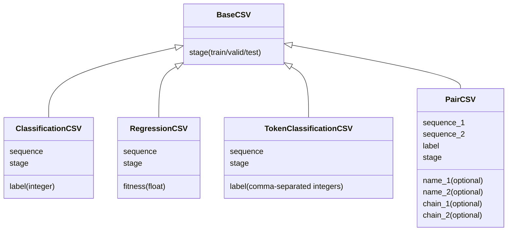
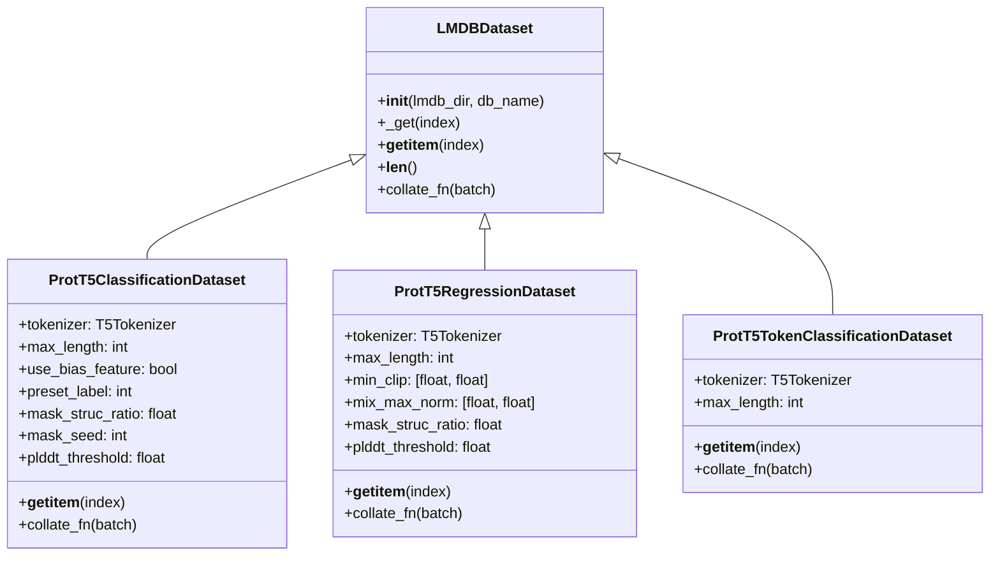
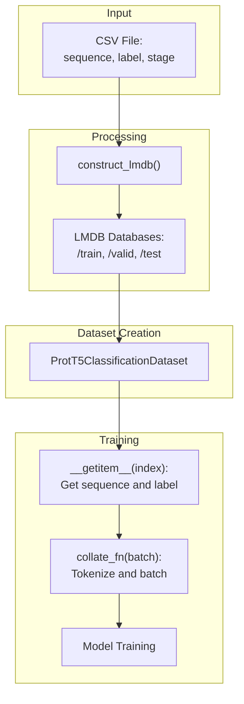

# Data Processing

<details>
<summary>Relevant source files</summary>

The following files were used as context for generating this wiki page:

- [Figure/Huggingface_ID.png](Figure/Huggingface_ID.png)
- [Figure/Runtime.png](Figure/Runtime.png)
- [Figure/Switch_Runtime.png](Figure/Switch_Runtime.png)
- [saprot/dataset/protT5/protT5_classification_dataset.py](saprot/dataset/protT5/protT5_classification_dataset.py)
- [saprot/dataset/protT5/protT5_regression_dataset.py](saprot/dataset/protT5/protT5_regression_dataset.py)
- [saprot/dataset/protT5/protT5_token_classification_dataset.py](saprot/dataset/protT5/protT5_token_classification_dataset.py)
- [saprot/utils/construct_lmdb.py](saprot/utils/construct_lmdb.py)

</details>


This document explains how protein data is processed, transformed, and stored for model training in SaprotHub. It covers the end-to-end data processing pipeline, from input formats to the creation of model-ready batches.

For information on datasets and data formats, see [Datasets and Data Formats](#4.1). For details on training the models with this processed data, see [Training Pipeline](#5).

## Data Processing Overview

SaprotHub processes various types of protein data (amino acid sequences, structure-aware sequences, etc.) into formats suitable for protein language models. The data processing pipeline involves several key steps:

1. **Input Data Reading**: Reading data from CSV files containing sequences, labels, and metadata
2. **Data Transformation**: Processing data based on task type (classification, regression, token classification)
3. **LMDB Construction**: Storing processed data in LMDB (Lightning Memory-Mapped Database) format
4. **Dataset Creation**: Instantiating task-specific dataset classes that extend the base `LMDBDataset`
5. **Batch Preparation**: Tokenizing sequences and preparing batches for model training

### Data Processing Pipeline

```mermaid
flowchart TB
    subgraph "Input"
        input["CSV Files"] --> |"read_csv"| df["DataFrame"]
    end
    
    subgraph "Processing"
        df --> |"task_type"| process["Process by Task"]
        process --> |"classification"| class["Process Single Sequence\n+ Class Label"]
        process --> |"regression"| reg["Process Single Sequence\n+ Fitness Value"]
        process --> |"token_classification"| token["Process Sequence\n+ Token-Level Labels"]
        process --> |"pair_classification\npair_regression"| pair["Process Sequence Pairs\n+ Labels"]
    end
    
    subgraph "Storage"
        class --> convert["Convert to JSON"]
        reg --> convert
        token --> convert
        pair --> convert
        convert --> lmdb["LMDB Dataset Construction\n(dump_lmdb)"]
    end
    
    subgraph "Dataset Classes"
        lmdb --> datasets["LMDBDataset"]
        datasets --> protT5class["ProtT5ClassificationDataset"]
        datasets --> protT5reg["ProtT5RegressionDataset"] 
        datasets --> protT5token["ProtT5TokenClassificationDataset"]
    end
    
    subgraph "Model Training"
        protT5class --> collate["collate_fn()"]
        protT5reg --> collate
        protT5token --> collate
        collate --> tokenize["Tokenization + Padding"]
        tokenize --> batch["Model-Ready Batches"]
    end
```

Sources: [saprot/utils/construct_lmdb.py](), [saprot/dataset/protT5/protT5_classification_dataset.py](), [saprot/dataset/protT5/protT5_regression_dataset.py](), [saprot/dataset/protT5/protT5_token_classification_dataset.py]()

## Input Data Formats

SaprotHub accepts protein data organized in CSV files with specific structure depending on the task type.

### CSV File Structure by Task Type



CSV file examples:

#### Classification Task CSV

| sequence | label | stage |
|----------|-------|-------|
| MKTVRQERLKSIVRILERSKEPVSGAQ... | 0 | train |
| GSSGSSGILQSAFHYLKHVVPIPPAV... | 1 | train |
| ... | ... | ... |
| MGLSDGEWQLVLNVWGKVEADIPGHG... | 0 | valid |
| ... | ... | ... |
| GSHMQEIVLTQSPATLSLSPGERATLSCRA... | 1 | test |

#### Token Classification Task CSV

| sequence | label | stage |
|----------|-------|-------|
| MKTVQERLK... | 0,1,0,0,1,0,1,0,0,... | train |
| ... | ... | ... |

Sources: [saprot/utils/construct_lmdb.py:21-44]()

## LMDB Dataset Construction

The `construct_lmdb` function transforms the input CSV data into LMDB format for efficient storage and retrieval during training.

### Transformation Process

1. **CSV Loading**: The function reads the CSV file and normalizes column names to lowercase
2. **Task-Specific Processing**: 
   - For token classification, converts comma-separated labels to integer lists
   - For single sequence tasks, extracts sequence, label, and stage
   - For pair tasks, extracts both sequences, labels, and metadata
3. **JSON Conversion**: Creates JSON objects containing processed data
4. **LMDB Creation**: Stores data in LMDB format organized by train/valid/test stages

```python
# LMDB construction process (simplified)
for stage in ["train", "valid", "test"]:
    tmp_dict = data_dicts[stage]
    tmp_dict["length"] = len(tmp_dict)
    lmdb_dir = f"{root_dir}/{dataset_name}/{stage}"
    dump_lmdb(tmp_dict, lmdb_dir)
```

The resulting LMDB databases are organized by stages (train, valid, test), with each stage stored in a separate directory. Within each directory, data is stored as key-value pairs where keys are indices and values are JSON-encoded data samples.

Sources: [saprot/utils/construct_lmdb.py:78-119]()

## Specialized Dataset Classes

SaprotHub provides specialized dataset classes for different tasks, all extending the base `LMDBDataset` class. These classes handle the retrieval, processing, and batching of data from LMDB storage.

### Dataset Class Hierarchy



Each dataset class is registered using the `@register_dataset` decorator, which allows the system to dynamically load the appropriate dataset class based on the task type.

Sources: [saprot/dataset/protT5/protT5_classification_dataset.py:15-67](), [saprot/dataset/protT5/protT5_regression_dataset.py:13-80](), [saprot/dataset/protT5/protT5_token_classification_dataset.py:12-56]()

### Classification Dataset

The `ProtT5ClassificationDataset` handles classification tasks and supports the following key features:

- **Sequence Retrieval**: Extracts amino acid sequences from LMDB storage
- **Label Processing**: Handles class labels (integers)
- **Optional Features**:
  - `use_bias_feature`: Option to incorporate structural information
  - `preset_label`: Override stored labels with a fixed value
  - `mask_struc_ratio`: Mask a portion of structural tokens for robustness
  - `plddt_threshold`: Mask tokens with pLDDT scores below threshold

```python
# Item retrieval for classification dataset
def __getitem__(self, index):
    entry = json.loads(self._get(index))
    seq = entry['seq'][::2]  # Extract every other character
    seq = " ".join(seq)      # Add space between amino acids
    
    # Use preset label if provided, otherwise use stored label
    label = entry["label"] if self.preset_label is None else self.preset_label

    return seq, label
```

Sources: [saprot/dataset/protT5/protT5_classification_dataset.py:47-54]()

### Regression Dataset

The `ProtT5RegressionDataset` extends the base dataset for regression tasks with these key features:

- **Fitness Value Processing**: Handles continuous values for regression tasks
- **Value Normalization**: Optional min-max normalization of fitness values
- **Value Clipping**: Option to clip values below a threshold to a specific value

```python
# Value processing in regression dataset
if self.min_clip is not None:
    given_min, clip_value = self.min_clip
    if entry['fitness'] < given_min:
        entry['fitness'] = clip_value

if self.mix_max_norm is not None:
    min_norm, max_norm = self.mix_max_norm
    entry['fitness'] = (entry['fitness'] - min_norm) / (max_norm - min_norm)
```

Sources: [saprot/dataset/protT5/protT5_regression_dataset.py:56-64]()

### Token Classification Dataset

The `ProtT5TokenClassificationDataset` handles tasks where each amino acid token has a corresponding label:

- **Token-Level Labels**: Processes per-token labels for tasks like secondary structure prediction
- **Label Truncation/Padding**: Ensures labels match the max sequence length
- **Special Token Handling**: Adds padding token (0) at the end for the CLS token

```python
# Label processing for token classification
if len(entry["label"]) >= self.max_length:
    label = entry["label"][:self.max_length - 1] + [0]
else:
    label = entry["label"][:self.max_length] + [0]  
label = torch.tensor(label, dtype=torch.long)
```

Sources: [saprot/dataset/protT5/protT5_token_classification_dataset.py:30-37]()

## Batch Preparation and Tokenization

The final step in data processing is converting samples into model-ready batches, handled by each dataset's `collate_fn` method.

### Tokenization Process

1. **Sequence Preparation**: For ProtT5 models, spaces are added between amino acids
2. **Tokenization**: Sequences are tokenized using the T5Tokenizer
3. **Padding/Truncation**: Sequences are padded to the same length within a batch and truncated to `max_length`
4. **Tensor Conversion**: Converts tokenized sequences to PyTorch tensors

```python
# Tokenization in ProtT5ClassificationDataset
def collate_fn(self, batch):
    seqs, labels = tuple(zip(*batch))
    labels = torch.tensor(labels)
    labels = {"labels": labels}
    
    encoder_info = self.tokenizer.batch_encode_plus(
        seqs, return_tensors='pt', padding=True, 
        max_length=self.max_length, truncation=True
    )
    inputs = {"inputs": encoder_info}
    
    return inputs, labels
```

For token classification, additional steps are taken to ensure label sequences match the tokenized input:

```python
# Token classification specific processing
seqs = tuple(" ".join(seq) for seq in seqs)
label_ids = pad_sequences(label_ids, constant_value=0)
labels = {"labels": label_ids}
```

Sources: [saprot/dataset/protT5/protT5_classification_dataset.py:59-67](), [saprot/dataset/protT5/protT5_token_classification_dataset.py:44-56]()

## Data Processing Flow Example

To illustrate the complete data processing flow, let's follow an example of a classification task:



1. **CSV Input**: A CSV file with protein sequences, labels, and stages is provided
2. **LMDB Construction**: `construct_lmdb` processes the CSV and creates LMDB databases
3. **Dataset Instantiation**: A `ProtT5ClassificationDataset` is created with the LMDB path
4. **Data Retrieval**: During training, `__getitem__` retrieves sequences and labels
5. **Batch Preparation**: `collate_fn` tokenizes sequences and prepares batches
6. **Model Training**: Prepared batches are fed to the model for training

Sources: [saprot/utils/construct_lmdb.py](), [saprot/dataset/protT5/protT5_classification_dataset.py]()

## Summary

The data processing pipeline in SaprotHub provides a flexible and efficient system for preparing protein data for model training. Key strengths include:

1. **Task Flexibility**: Handles various tasks including classification, regression, and token-level prediction
2. **Efficient Storage**: LMDB provides fast random access to large datasets
3. **Specialized Processing**: Task-specific dataset classes tailor data preparation to each need
4. **Integration with Tokenizers**: Seamless integration with transformer tokenizers
5. **Batch Optimization**: Handles variable-length sequences with proper padding and truncation

For more information on how these processed datasets are used in training, see [Training Pipeline](#5). For details on specific dataset formats, see [Datasets and Data Formats](#4.1).

---