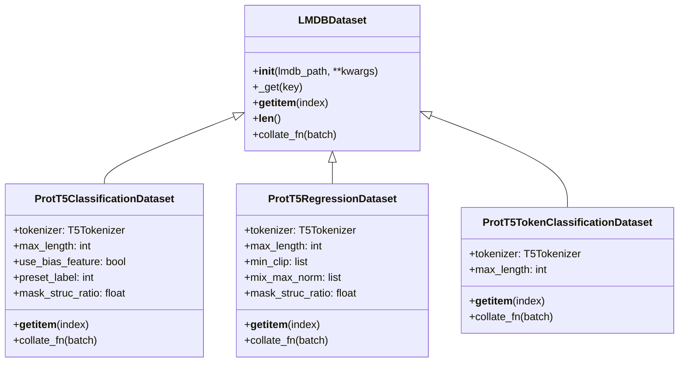
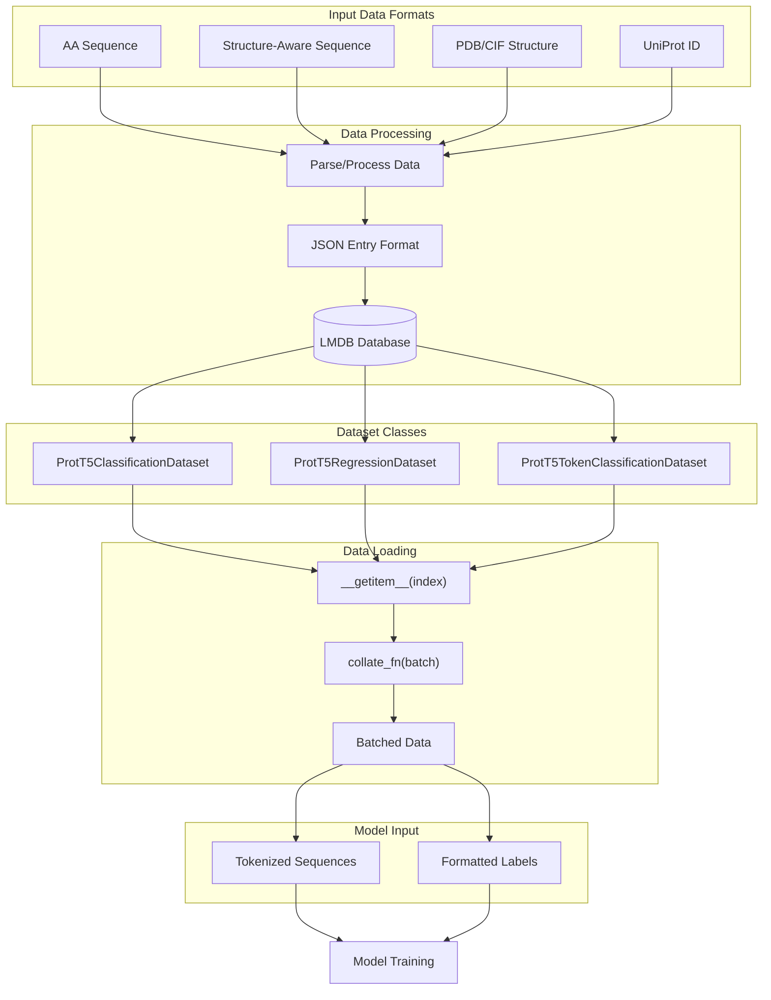

# Datasets and Data Formats

<details>
<summary>Relevant source files</summary>

The following files were used as context for generating this wiki page:

- [saprot/dataset/protT5/protT5_classification_dataset.py](saprot/dataset/protT5/protT5_classification_dataset.py)
- [saprot/dataset/protT5/protT5_regression_dataset.py](saprot/dataset/protT5/protT5_regression_dataset.py)
- [saprot/dataset/protT5/protT5_token_classification_dataset.py](saprot/dataset/protT5/protT5_token_classification_dataset.py)

</details>


This document details the dataset structures and formats used in SaprotHub for training and evaluating protein language models. Understanding these formats is essential for creating custom datasets, interpreting model inputs/outputs, and extending SaprotHub for new protein analysis tasks.

For information about how LMDB datasets are constructed for efficient storage, see [LMDB Dataset Construction](#4.2). For details on how protein structures are processed into sequence formats, see [Protein Structure Handling](#4.3).

## Dataset System Architecture

SaprotHub implements a hierarchical dataset system built on the Lightning Memory-Mapped Database (LMDB) for efficient storage and retrieval of protein data. All dataset implementations inherit from a base `LMDBDataset` class.



Sources: [saprot/dataset/protT5/protT5_classification_dataset.py:15-46](). [saprot/dataset/protT5/protT5_regression_dataset.py:13-49](). [saprot/dataset/protT5/protT5_token_classification_dataset.py:12-27]().

## Data Flow in SaprotHub

The following diagram illustrates how data flows through the dataset system in SaprotHub, from input formats to model training:



Sources: [saprot/dataset/protT5/protT5_classification_dataset.py](). [saprot/dataset/protT5/protT5_regression_dataset.py](). [saprot/dataset/protT5/protT5_token_classification_dataset.py]().

## Core Dataset Types

SaprotHub provides specialized dataset implementations for different protein analysis tasks:

### Classification Datasets

Used for predicting categorical properties such as protein function, localization, or family.

```python
@register_dataset
class ProtT5ClassificationDataset(LMDBDataset):
    def __init__(self,
                 tokenizer: str,
                 use_bias_feature: bool = False,
                 max_length: int = 1024,
                 preset_label: int = None,
                 mask_struc_ratio: float = None,
                 mask_seed: int = 20000812,
                 plddt_threshold: float = None,
                 **kwargs):
```

Key configuration options:
- `tokenizer`: Path to the T5Tokenizer
- `use_bias_feature`: Flag to include structural information
- `max_length`: Maximum sequence length
- `preset_label`: Optional fixed label value for inference or semi-supervised learning
- `mask_struc_ratio`: Ratio of structure tokens to mask (replace with "#")
- `plddt_threshold`: Threshold for masking low-confidence structure predictions

Sources: [saprot/dataset/protT5/protT5_classification_dataset.py:15-46]().

### Regression Datasets

Used for predicting continuous properties like binding affinity, stability, or enzymatic activity.

```python
@register_dataset
class ProtT5RegressionDataset(LMDBDataset):
    def __init__(self,
                 tokenizer: str,
                 max_length: int = 1024,
                 min_clip: [float, float] = None,
                 mix_max_norm: [float, float] = None,
                 mask_struc_ratio: float = None,
                 plddt_threshold: float = None,
                 **kwargs):
```

Key configuration options:
- `tokenizer`: Path to the T5Tokenizer
- `max_length`: Maximum sequence length
- `min_clip`: Optional [threshold, replacement] values to clip outliers
- `mix_max_norm`: Optional [min, max] values for min-max normalization of labels
- `mask_struc_ratio`: Ratio of structure tokens to mask
- `plddt_threshold`: Threshold for masking low-confidence structure predictions

Sources: [saprot/dataset/protT5/protT5_regression_dataset.py:13-49]().

### Token Classification Datasets

Used for amino acid-level predictions such as secondary structure, disorder regions, or binding sites.

```python
@register_dataset
class ProtT5TokenClassificationDataset(LMDBDataset):
    def __init__(self,
                 tokenizer: str,
                 max_length: int = 1024,
                 **kwargs):
```

Key configuration options:
- `tokenizer`: Path to the T5Tokenizer
- `max_length`: Maximum sequence length

Sources: [saprot/dataset/protT5/protT5_token_classification_dataset.py:12-27]().

## Data Formats

### Entry Format in LMDB

Data entries in SaprotHub's LMDB datasets are stored as JSON strings with task-specific fields:

| Task Type | Key Fields | Description |
|-----------|------------|-------------|
| Classification | `seq`, `label` | Sequence and class label (integer) |
| Regression | `seq`, `fitness` | Sequence and target value (float) |
| Token Classification | `seq`, `label` | Sequence and per-residue labels (list of integers) |

Example of a classification entry:
```json
{
  "seq": "METKELVTKA...",
  "label": 1
}
```

Example of a regression entry:
```json
{
  "seq": "METKELVTKA...",
  "fitness": 0.78
}
```

Example of a token classification entry:
```json
{
  "seq": "METKELVTKA...",
  "label": [0, 1, 2, 0, 1, 0, 1, 2, 0, 1]
}
```

Sources: [saprot/dataset/protT5/protT5_classification_dataset.py:47-53](). [saprot/dataset/protT5/protT5_regression_dataset.py:51-66](). [saprot/dataset/protT5/protT5_token_classification_dataset.py:28-39]().

### Sequence Format

SaprotHub handles protein sequences in two primary formats:

1. **Amino Acid (AA) Sequences**: Standard protein sequences using the 20 amino acid one-letter codes.
2. **Structure-Aware (SA) Sequences**: Sequences enriched with structural information, where every other character represents structural context.

In the dataset implementation, the structure-aware tokens are extracted by taking every other character from the sequence:

```python
seq = entry['seq'][::2]  # Extract AA sequence from structure-aware format
```

Sources: [saprot/dataset/protT5/protT5_classification_dataset.py:49](). [saprot/dataset/protT5/protT5_regression_dataset.py:53](). [saprot/dataset/protT5/protT5_token_classification_dataset.py:30]().

## Data Processing for Model Input

### Tokenization Process

The T5Tokenizer requires spaces between amino acids for proper tokenization. This process is handled in the dataset classes:


For classification and regression datasets, the spacing is added directly:
```python
seq = " ".join(seq)
```

For token classification, spacing is added during batch collation:
```python
seqs = tuple(" ".join(seq) for seq in seqs)
```

Sources: [saprot/dataset/protT5/protT5_classification_dataset.py:50](). [saprot/dataset/protT5/protT5_token_classification_dataset.py:47]().

### Collation Function

The `collate_fn` method in each dataset class transforms individual data items into properly formatted batches for model training:

For classification:
```python
def collate_fn(self, batch):
    seqs, labels = tuple(zip(*batch))
    labels = torch.tensor(labels)
    labels = {"labels": labels}
    
    encoder_info = self.tokenizer.batch_encode_plus(seqs, return_tensors='pt', padding=True, max_length=self.max_length, truncation=True)
    inputs = {"inputs": encoder_info}
    
    return inputs, labels
```

For token classification (with special handling for padded labels):
```python
def collate_fn(self, batch):
    seqs, label_ids = tuple(zip(*batch))
    # Add a space between each amino acid
    seqs = tuple(" ".join(seq) for seq in seqs)
    # Pad the label_ids with 0
    label_ids = pad_sequences(label_ids, constant_value=0)
    labels = {"labels": label_ids}
    
    # Encode the sequences
    encoder_info = self.tokenizer.batch_encode_plus(seqs, padding=True, truncation=True, return_tensors='pt', max_length=self.max_length)
    inputs = {"inputs": encoder_info}

    return inputs, labels
```

Sources: [saprot/dataset/protT5/protT5_classification_dataset.py:59-67](). [saprot/dataset/protT5/protT5_token_classification_dataset.py:44-55]().

## Special Handling for Different Tasks

### Label Processing in Regression Tasks

For regression tasks, SaprotHub provides options to preprocess the target values:

1. **Min Clipping**: Replace values below a threshold with a specified value:
   ```python
   if self.min_clip is not None:
       given_min, clip_value = self.min_clip
       if entry['fitness'] < given_min:
           entry['fitness'] = clip_value
   ```

2. **Min-Max Normalization**: Scale values to a specific range (typically [0,1]):
   ```python
   if self.mix_max_norm is not None:
       min_norm, max_norm = self.mix_max_norm
       entry['fitness'] = (entry['fitness'] - min_norm) / (max_norm - min_norm)
   ```

Sources: [saprot/dataset/protT5/protT5_regression_dataset.py:56-63]().

### Label Processing in Token Classification Tasks

For token classification, labels must be aligned with the amino acid sequence and properly handled for maximum length:

```python
# Add 0 to the end of the label to ignore the cls token
if len(entry["label"]) >= self.max_length:
    label = entry["label"][:self.max_length - 1] + [0]
else:
    label = entry["label"][:self.max_length] + [0]  
label = torch.tensor(label, dtype=torch.long)
```

Sources: [saprot/dataset/protT5/protT5_token_classification_dataset.py:33-37]().

## Conclusion

SaprotHub's dataset system is designed for flexibility and efficiency in handling various protein analysis tasks. The LMDB-based storage combined with task-specific dataset implementations enables researchers to work with large protein datasets while maintaining good performance.

The standardized data formats and processing pipelines facilitate the integration of new data types and tasks, making SaprotHub adaptable to diverse research needs in computational protein science.

Sources: [saprot/dataset/protT5/protT5_classification_dataset.py](). [saprot/dataset/protT5/protT5_regression_dataset.py](). [saprot/dataset/protT5/protT5_token_classification_dataset.py]().

---