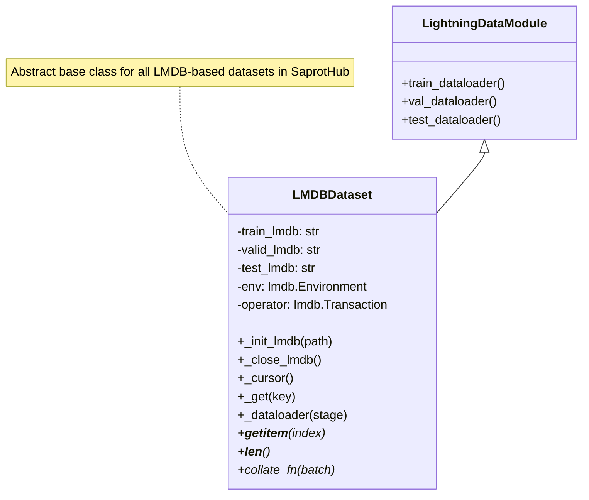
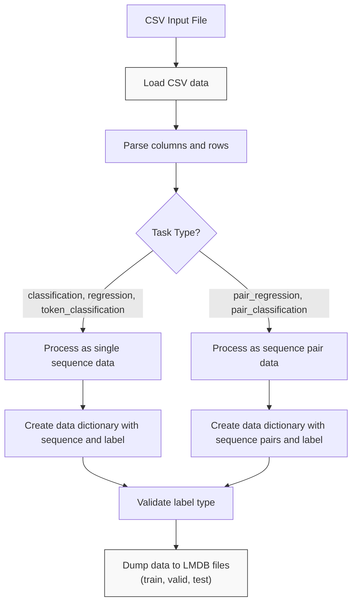
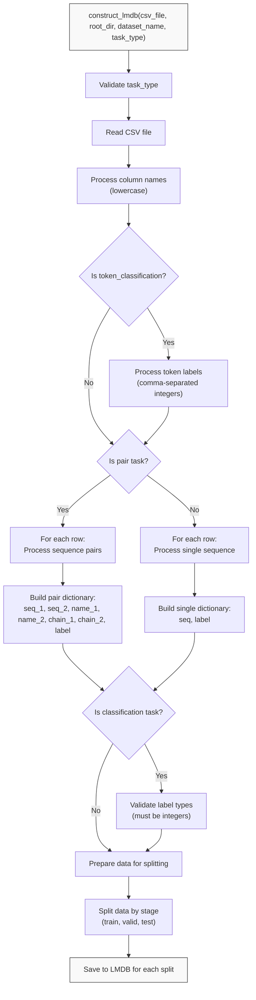
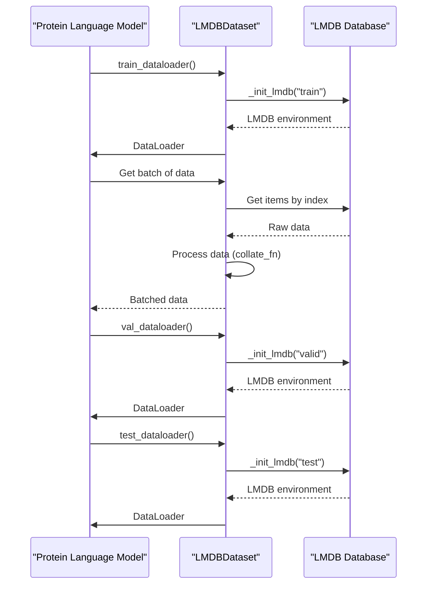
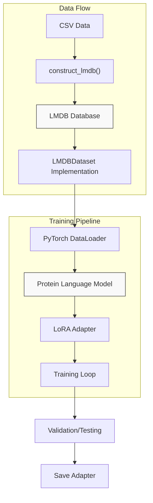

# LMDB Dataset Construction

<details>
<summary>Relevant source files</summary>

The following files were used as context for generating this wiki page:

- [Figure/Huggingface_ID.png](Figure/Huggingface_ID.png)
- [Figure/Runtime.png](Figure/Runtime.png)
- [Figure/Switch_Runtime.png](Figure/Switch_Runtime.png)
- [saprot/dataset/lmdb_dataset.py](saprot/dataset/lmdb_dataset.py)
- [saprot/model/protT5/self_peft/__init__.py](saprot/model/protT5/self_peft/__init__.py)
- [saprot/model/protT5/self_peft/mapping.py](saprot/model/protT5/self_peft/mapping.py)
- [saprot/model/protT5/self_peft/peft_model.py](saprot/model/protT5/self_peft/peft_model.py)
- [saprot/model/protT5/self_peft/save_and_load.py](saprot/model/protT5/self_peft/save_and_load.py)
- [saprot/utils/construct_lmdb.py](saprot/utils/construct_lmdb.py)

</details>


## Purpose and Scope

This document explains how LMDB (Lightning Memory-Mapped Database) datasets are constructed and used within the SaprotHub framework. It covers the process of converting CSV inputs into efficient LMDB format used for model training, validation, and testing. For information about supported dataset formats and structure, see [Datasets and Data Formats](#4.1).

## What is LMDB?

LMDB (Lightning Memory-Mapped Database) is a high-performance, memory-mapped key-value storage system. In SaprotHub, LMDB is used to efficiently store and retrieve training, validation, and testing data for protein language models. LMDB provides several advantages:

- Fast, random access to data
- Memory-efficient operation through memory mapping
- Transaction support
- Low overhead when loading large datasets

Sources: [saprot/dataset/lmdb_dataset.py:1-106]()

## LMDB Dataset Architecture

The LMDB dataset implementation in SaprotHub is centered around the abstract `LMDBDataset` class which inherits from PyTorch Lightning's `LightningDataModule`. This class provides methods for initializing, accessing, and closing LMDB databases, as well as creating appropriate data loaders.



The `LMDBDataset` class is abstract and requires concrete implementations to define:
- `__getitem__(index)`: How to retrieve and process a single data item
- `__len__()`: The size of the dataset
- `collate_fn(batch)`: How to combine multiple samples into a batch

Sources: [saprot/dataset/lmdb_dataset.py:14-106]()

## Dataset Construction Process

The process of constructing an LMDB dataset from CSV input files follows these steps:



The construction process handles several task types:
- `classification`: For protein sequence classification tasks
- `regression`: For protein sequence regression tasks
- `token_classification`: For per-residue classification tasks
- `pair_regression`: For protein-protein interaction regression
- `pair_classification`: For protein-protein interaction classification

Sources: [saprot/utils/construct_lmdb.py:8-118]()

## LMDB Dataset Construction Details

### The `construct_lmdb` Function

The main function responsible for LMDB dataset construction is `construct_lmdb` in the `saprot/utils/construct_lmdb.py` file. This function:

1. Takes a CSV file as input
2. Processes the data based on the specified task type
3. Creates appropriate LMDB directories for train/valid/test splits
4. Dumps the processed data into LMDB format



The LMDB directories are structured as follows:
```
{root_dir}/{dataset_name}/
    ├── train/
    ├── valid/
    └── test/
```

Sources: [saprot/utils/construct_lmdb.py:8-118]()

### Data Processing by Task Type

The LMDB construction process handles different task types with specific logic:

1. **Single Sequence Tasks** (classification, regression, token_classification):
   - Each entry contains a sequence and label
   - For token_classification, labels are lists of integers
   - Sequence length may be truncated for training data (to 2048 residues)

2. **Pair Sequence Tasks** (pair_regression, pair_classification):
   - Each entry contains two sequences, their names, chain identifiers, and a label
   - Sequence lengths may be truncated for training data (to 2044 residues each)

3. **Classification Tasks** (classification, pair_classification, token_classification):
   - Labels must be integers
   - For token_classification, labels are lists of integers (one per token)

4. **Regression Tasks** (regression, pair_regression):
   - Labels can be floating point values

The table below summarizes the key differences in data handling by task type:

| Task Type | Input Format | Label Key | Label Type | Max Seq Length (Train) |
|-----------|-------------|-----------|-----------|------------------------|
| classification | Single sequence | "label" | Integer | 2048 |
| regression | Single sequence | "fitness" | Float | 2048 |
| token_classification | Single sequence | "label" | List[Integer] | 2048 (1022 for token labels) |
| pair_classification | Sequence pair | "label" | Integer | 2044 per sequence |
| pair_regression | Sequence pair | "label" | Float | 2044 per sequence |

Sources: [saprot/utils/construct_lmdb.py:21-118]()

## LMDB Dataset Usage

Once an LMDB dataset is constructed, it can be used through the `LMDBDataset` interface. The dataset provides access to the three splits (train, validation, test) through PyTorch Lightning's data loader interface.



### Performance Considerations

LMDB datasets offer significant performance advantages over standard file-based datasets:

1. **Memory Efficiency**: LMDB memory-maps data files, allowing the OS to efficiently manage memory
2. **Random Access**: Fast access to any sample in the dataset without sequential reading
3. **Caching**: The OS can cache frequently accessed data in memory
4. **Data Consistency**: LMDB provides transaction support, ensuring data integrity

The SaprotHub framework sets a maximum LMDB size of 10TB, allowing for very large datasets:

```python
_10TB = 10995116277760  # Maximum map size for LMDB
```

Sources: [saprot/dataset/lmdb_dataset.py:11-50]()

## Integration with Training Pipeline

The LMDB datasets are fully integrated with the SaprotHub training pipeline. The datasets provide the necessary interfaces for PyTorch Lightning's training, validation, and testing loops.



During training, the model accesses data through the DataLoader interface, which internally retrieves and processes data from the LMDB database. This design enables efficient batch processing and memory usage, making it possible to train large protein language models on standard hardware.

Sources: [saprot/dataset/lmdb_dataset.py:69-87]()

## Summary

LMDB Dataset Construction in SaprotHub provides an efficient mechanism for storing and retrieving protein sequence data for training language models. The system supports multiple task types, handles different data formats, and offers excellent performance characteristics. By converting data into LMDB format, SaprotHub enables training on large datasets while maintaining memory efficiency and fast data access.

---