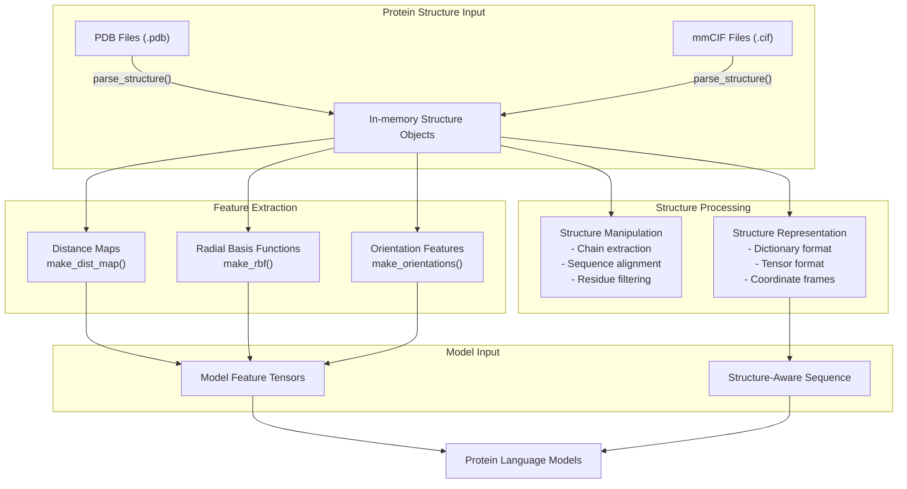
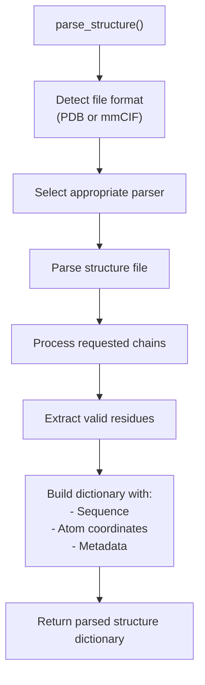
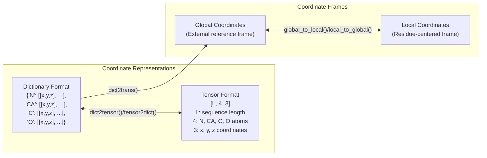
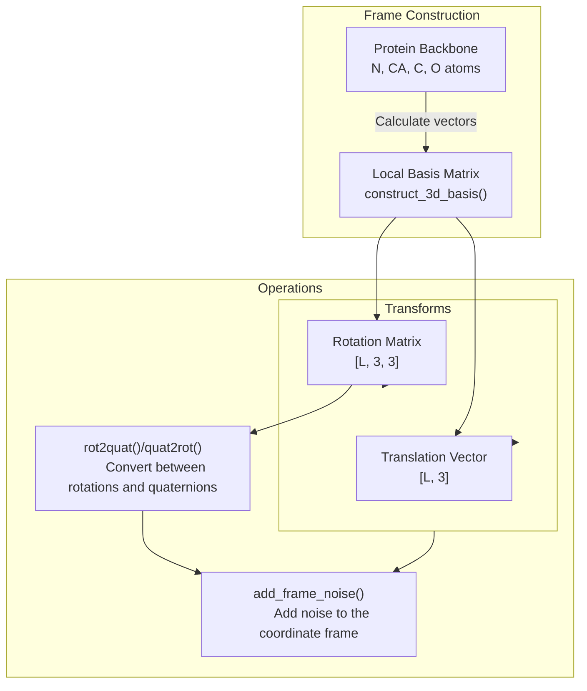
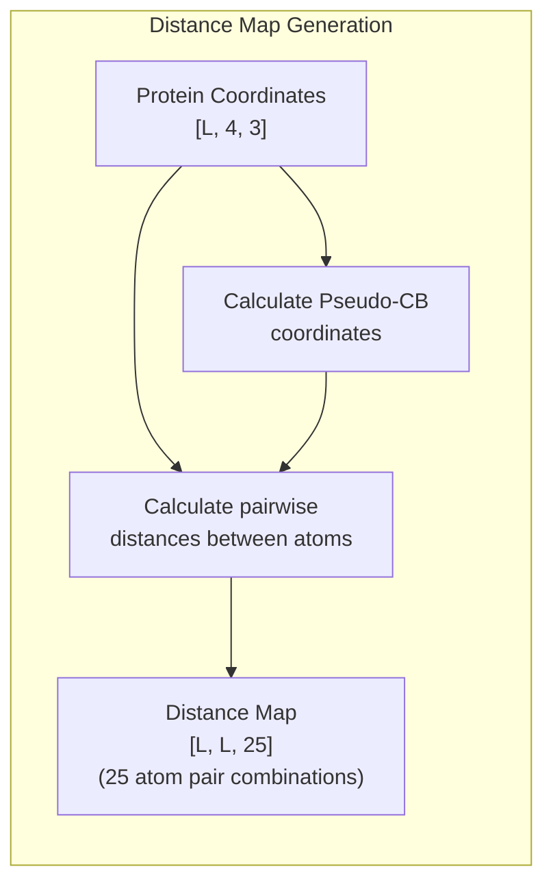
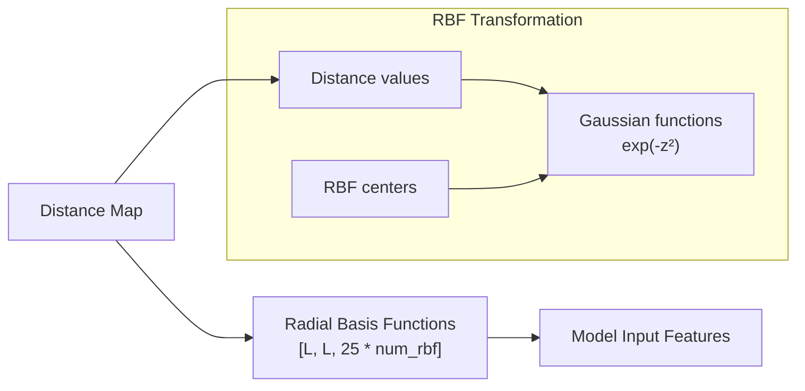
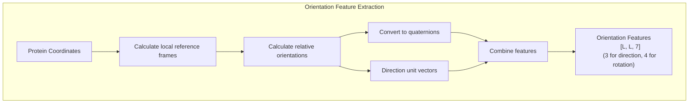
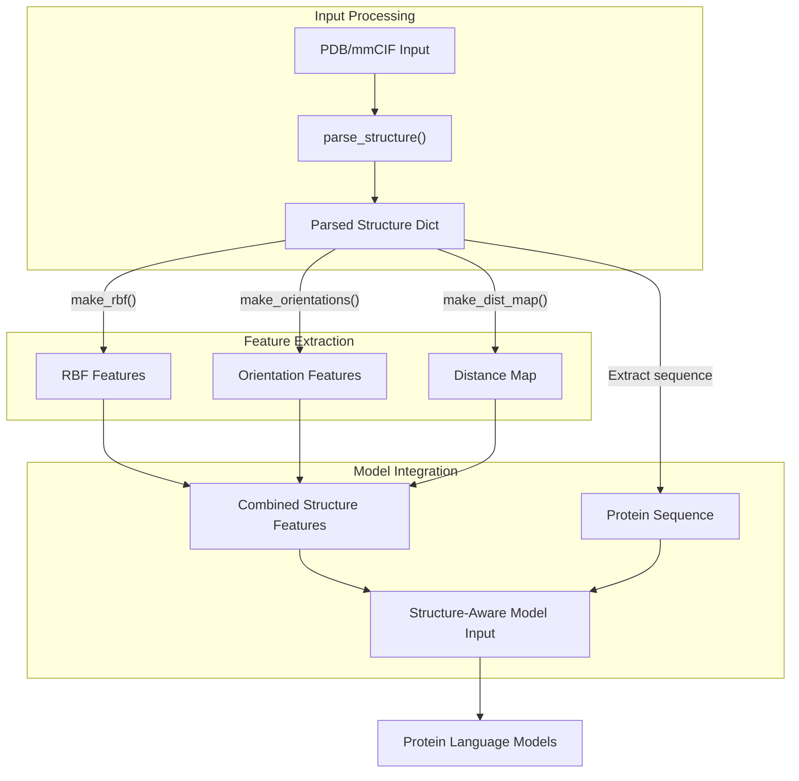

# Protein Structure Handling

<details>
<summary>Relevant source files</summary>

The following files were used as context for generating this wiki page:

- [Figure/content.png](Figure/content.png)
- [saprot/data/data_transform.py](saprot/data/data_transform.py)
- [saprot/data/parse.py](saprot/data/parse.py)

</details>


This page documents how SaprotHub processes and handles protein structures for model input, feature extraction, and analysis tasks. The protein structure handling components provide essential functionality for converting between different structural representations and extracting structural features needed for protein language models.

## 1. Overview

The protein structure handling system in SaprotHub supports loading protein structures from standard file formats (PDB and mmCIF), extracting and manipulating structural data, and converting structures into specialized features for input to structure-aware protein language models.



Sources: [saprot/data/parse.py:1-439](), [saprot/data/data_transform.py:1-99]()

## 2. Structure Parsing and File Handling

SaprotHub uses BioPython's PDB module to parse protein structure files (PDB and mmCIF formats) and extract structural information.

### 2.1. Parsers and File I/O

The system instantiates specialized parsers for both PDB and mmCIF formats:

```python
mmcif_parser = FastMMCIFParser(QUIET=True)
mmcif_io = MMCIFIO()
pdb_parser = PDBParser(QUIET=True)
pdb_io = PDBIO()
```

Sources: [saprot/data/parse.py:15-18]()

### 2.2. Structure Parsing

The core parsing function `parse_structure` reads protein structure files and extracts essential information:



The returned dictionary contains:
- `seq`: Amino acid sequence as a string
- `coords`: Dictionary of atom coordinates with keys `N`, `CA`, `C`, `O`
- `name`: Name of the PDB
- `chain`: Chain ID

Sources: [saprot/data/parse.py:421-448]()

### 2.3. Structure Manipulation Functions

The system provides several functions for manipulating protein structures:

| Function | Purpose |
|----------|---------|
| `split_chain` | Extract a single chain from a structure file |
| `extract_pdb_section` | Extract a segment of residues from a structure |
| `remove_pdb_section` | Remove specific residues from a structure |
| `align_structure_output` | Align two structures and save the aligned result |
| `get_chain_ids` | Get all chain IDs in a structure file |
| `is_residue_valid` | Check if a residue has all required atoms |
| `create_pdb_from_backbone` | Generate a PDB file from backbone coordinates |

Sources: [saprot/data/parse.py:294-318](), [saprot/data/parse.py:320-340](), [saprot/data/parse.py:342-382](), [saprot/data/parse.py:383-419](), [saprot/data/parse.py:177-248](), [saprot/data/parse.py:26-75]()

## 3. Structure Representation and Transformations

SaprotHub uses several representations for protein structures and provides functions to convert between them.

### 3.1. Coordinate Systems and Transformations



Sources: [saprot/data/data_transform.py:370-427](), [saprot/data/data_transform.py:261-326]()

### 3.2. Frame Construction and Manipulation

The system defines a local coordinate frame for each residue based on its backbone atoms:

1. The origin is at the CA atom position
2. The x-axis points from CA to C
3. The y-axis is perpendicular to both the x-axis and the CA-N vector
4. The z-axis completes the right-handed coordinate system

This frame allows for residue-centric operations and feature calculations.



Sources: [saprot/data/data_transform.py:261-326](), [saprot/data/data_transform.py:155-244](), [saprot/data/data_transform.py:330-367]()

## 4. Feature Extraction from Structures

SaprotHub extracts various structural features that can be used as input for protein language models.

### 4.1. Distance Maps

Distance maps compute the pairwise distances between atoms in the protein:



The `make_dist_map` function calculates a distance map that includes all pairwise distances between N, CA, C, O, and pseudo-CB atoms.

Sources: [saprot/data/data_transform.py:58-92]()

### 4.2. Radial Basis Function Features



The `make_rbf` function converts distance maps into radial basis function features, which provide a smoother, fixed-dimension representation of the distance information.

Sources: [saprot/data/data_transform.py:38-115]()

### 4.3. Orientation Features

Orientation features capture the relative orientation of residues in 3D space:



The `make_orientations` function calculates the relative orientations between all pairs of residues, encoded as direction vectors and quaternions.

Sources: [saprot/data/data_transform.py:118-152]()

## 5. Integration with Model Pipeline

Protein structure handling is a key component in SaprotHub's processing pipeline, transforming raw structural data into model-ready features.



The extracted structural features can be used in various downstream tasks:

1. **Structure-aware sequence modeling**: Enhancing protein language models with structural information
2. **Structure prediction validation**: Comparing predicted structures with experimental ones
3. **Mutation effect prediction**: Understanding how mutations affect protein structure and function
4. **Design of structure-based protein properties**: Engineering proteins with specific structural characteristics

For more information about how these features are used in model training, see [Training Pipeline](#5) and [Model Architecture](#3).

Sources: [saprot/data/parse.py:421-448](), [saprot/data/data_transform.py:95-152]()

## 6. Common Operations

This section documents common operations for working with protein structures in SaprotHub.

### 6.1. Structure Alignment

Structure alignment is an important operation for comparing protein structures:

```python
# Align two protein chains and save the result
align_structure_output(chain1, chain2, save_path1="aligned1.pdb", save_path2="aligned2.pdb")

# Align two structure dictionaries, removing residues that don't match
aligned_dicts = align_structure(dict1, dict2)
```

The alignment is based on the amino acid sequence and removes residues that don't align between the two structures.

Sources: [saprot/data/parse.py:177-248](), [saprot/data/parse.py:251-291]()

### 6.2. Chain and Residue Manipulation

```python
# Extract a chain from a structure
split_chain("input.pdb", "output.pdb", "A")

# Extract a section of a structure
extract_pdb_section("input.pdb", "output.pdb", "A", 10, 50)

# Remove specific residues from a structure
remove_pdb_section("input.pdb", "output.pdb", "A", [15, 16, 17])
```

These functions allow for precise manipulation of structure files.

Sources: [saprot/data/parse.py:294-318](), [saprot/data/parse.py:342-382](), [saprot/data/parse.py:383-419]()

### 6.3. Conversion Between Representations

```python
# Convert coordinate dictionary to tensor
coords_tensor = dict2tensor(coord_dict)

# Convert tensor back to dictionary
coords_dict = tensor2dict(coords_tensor)

# Get rotation matrix and translation vector from coordinates
coords, rots, trans = dict2trans(coord_dict)
```

These utilities allow for easy conversion between different representations of protein structure.

Sources: [saprot/data/data_transform.py:370-427]()

## 7. Considerations for Structure Pre-processing

When working with protein structures in SaprotHub, consider the following:

1. **Structure validity**: Use `is_residue_valid()` to ensure residues have all required atoms (N, CA, C, O)
2. **Chain selection**: Most functions operate on single chains; use `split_chain()` to extract chains if needed
3. **Residue numbering**: Be aware that residue numbering in PDB files may not be sequential; SaprotHub reindexes residues from 0
4. **Structure alignment**: When comparing structures, use alignment functions to ensure proper residue correspondence
5. **Performance**: For large-scale processing, consider batching operations to optimize memory usage

Sources: [saprot/data/parse.py:77-96]()

---