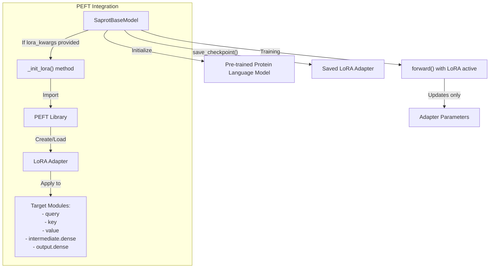
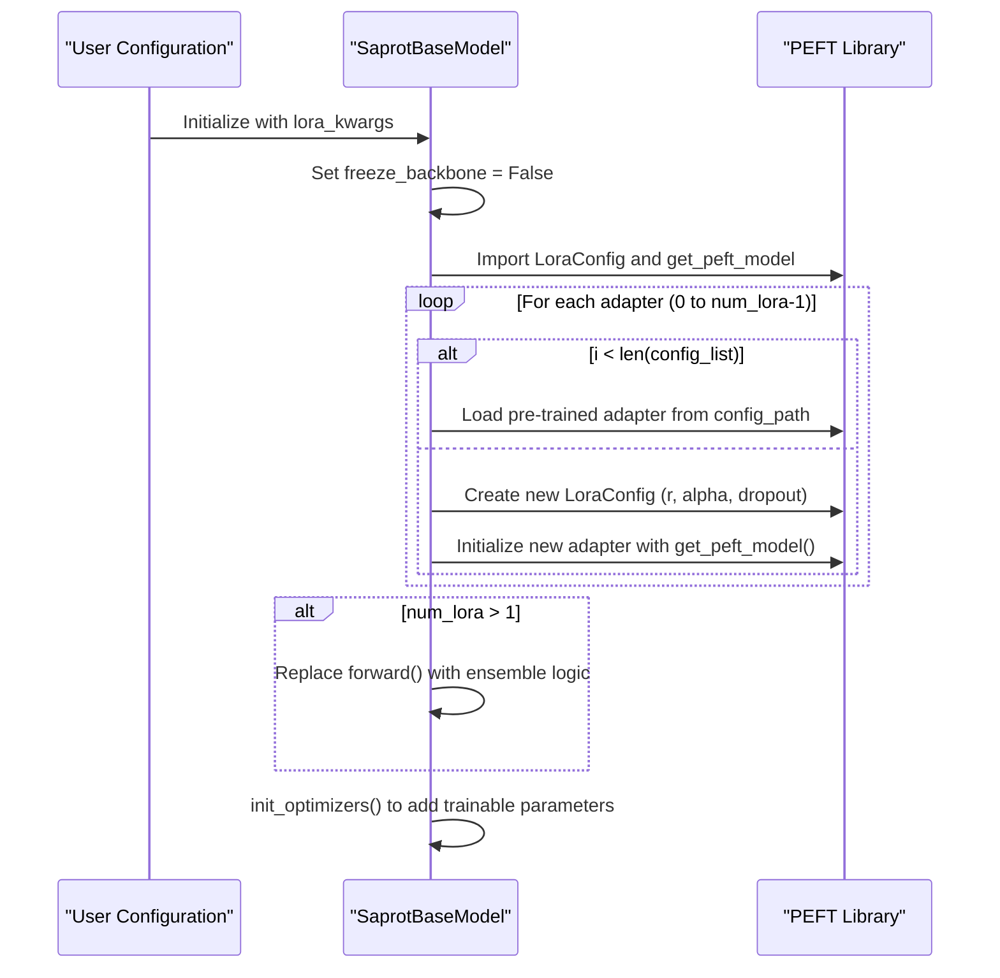
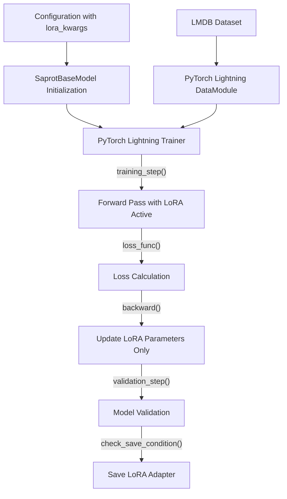
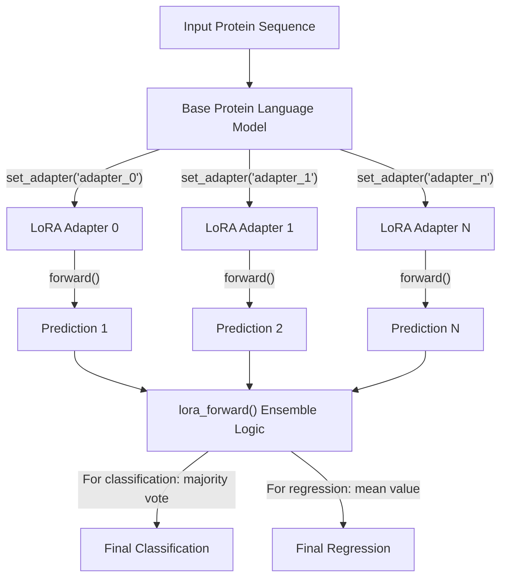
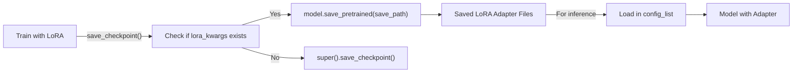
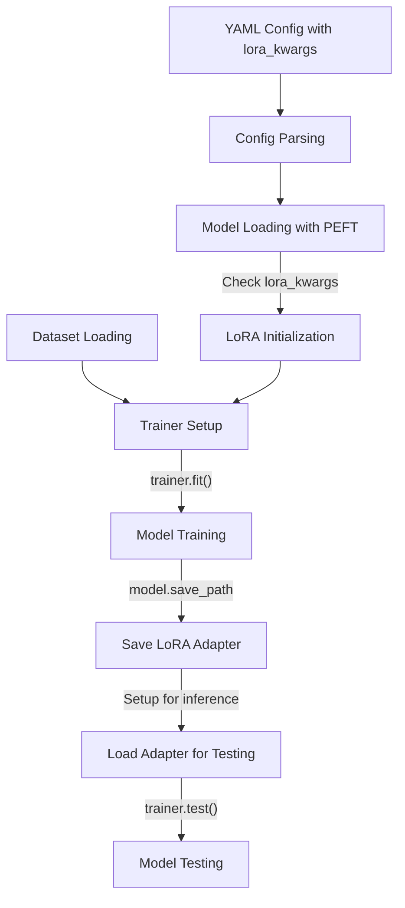

# Parameter-Efficient Fine-Tuning (PEFT)

<details>
<summary>Relevant source files</summary>

The following files were used as context for generating this wiki page:

- [saprot/model/abstract_model.py](saprot/model/abstract_model.py)
- [saprot/model/saprot/base.py](saprot/model/saprot/base.py)
- [saprot/scripts/training.py](saprot/scripts/training.py)
- [saprot/utils/lr_scheduler.py](saprot/utils/lr_scheduler.py)

</details>


## Purpose and Scope

This document explains the Parameter-Efficient Fine-Tuning (PEFT) implementation in SaprotHub, focusing specifically on the Low-Rank Adaptation (LoRA) technique. PEFT allows users to adapt large protein language models to specific tasks with minimal computational resources by training only a small number of parameters while keeping the base model frozen. For general information about the training pipeline, see [Training Pipeline](#5).

## PEFT Architecture in SaprotHub

SaprotHub implements PEFT primarily through LoRA, which adds trainable low-rank decomposition matrices to selected layers of the pre-trained model.



Sources: [saprot/model/saprot/base.py:26-71](), [saprot/model/saprot/base.py:74-173]()

## LoRA Initialization Process

The PEFT initialization process is handled by the `_init_lora()` method in the `SaprotBaseModel` class. This method is called during model initialization if `lora_kwargs` is provided:



Sources: [saprot/model/saprot/base.py:74-173]()

The key steps in this process:
1. Import PEFT library components
2. For each adapter (up to `num_lora`):
   - Either load a pre-trained adapter configuration
   - Or create a new LoRA configuration
3. If multiple adapters are used, set up ensemble prediction
4. Initialize optimizers with the trainable adapter parameters

## LoRA Configuration Parameters

The LoRA implementation in SaprotHub can be customized through the following parameters:

| Parameter | Description | Default Value | Code Location |
|-----------|-------------|---------------|--------------|
| `num_lora` | Number of LoRA adapters to use | Required | [base.py:87-88]() |
| `config_list` | List of pre-trained adapter paths | `[]` | [base.py:86-87]() |
| `r` | Rank of the decomposition matrices | `8` | [base.py:110]() |
| `lora_dropout` | Dropout probability for LoRA layers | `0.0` | [base.py:111]() |
| `lora_alpha` | Scaling factor for LoRA updates | `16` | [base.py:112]() |
| `is_trainable` | Whether loaded adapters can be trained | `False` | [base.py:84]() |
| `target_modules` | Layers to apply LoRA to | `["query", "key", "value", "intermediate.dense", "output.dense"]` | [base.py:107]() |

Sources: [saprot/model/saprot/base.py:104-116]()

These parameters control how LoRA is applied to the model and determine the trade-off between parameter efficiency and model expressivity.

## Training Process with LoRA

When using LoRA for fine-tuning, the training process differs from standard full fine-tuning in that only the adapter parameters are updated:



Sources: [saprot/scripts/training.py:20-100](), [saprot/model/abstract_model.py:180-212]()

The key advantage of this approach is that the large base model remains frozen, significantly reducing memory requirements and training time.

## Ensemble Prediction with Multiple LoRA Adapters

A unique feature of SaprotHub's PEFT implementation is support for ensemble prediction using multiple LoRA adapters:



Sources: [saprot/model/saprot/base.py:124-167]()

The ensemble logic is implemented in a custom `lora_forward()` function that:
1. Iterates through all adapters and collects predictions
2. For classification tasks: uses majority voting (mode of predictions)
3. For regression tasks: averages the outputs
4. Returns the combined prediction

This approach can improve prediction stability and performance, especially for difficult or ambiguous cases.

## Saving and Loading LoRA Adapters

One of the key benefits of LoRA is the small size of saved adapters, which are much more efficient to store and share than full models:



Sources: [saprot/model/saprot/base.py:342-358](), [saprot/scripts/training.py:87-98]()

The `save_checkpoint` method in `SaprotBaseModel` is overridden to handle LoRA adapters specifically:
1. If the model uses LoRA, it calls `model.save_pretrained(save_path)`
2. Otherwise, it falls back to the standard checkpoint saving
3. For loading, adapters are specified in the `config_list` parameter of `lora_kwargs`

## Learning Rate Schedulers for PEFT

SaprotHub provides specialized learning rate schedulers that work well with PEFT:

| Scheduler | Description | Key Parameters |
|-----------|-------------|----------------|
| `ConstantLRScheduler` | Fixed learning rate | `init_lr` |
| `CosineAnnealingLRScheduler` | Cosine decay with warmup | `init_lr`, `max_lr`, `final_lr`, `warmup_steps`, `cosine_steps` |
| `Esm2LRScheduler` | ESM2-style with plateau | `init_lr`, `max_lr`, `final_lr`, `warmup_steps`, `start_decay_after_n_steps`, `end_decay_after_n_steps` |

Sources: [saprot/utils/lr_scheduler.py:6-187]()

The appropriate scheduler depends on the specific task and dataset. For small datasets, `ConstantLRScheduler` often works well, while larger datasets may benefit from the warmup and decay provided by `CosineAnnealingLRScheduler` or `Esm2LRScheduler`.

## Using PEFT in SaprotHub

To use PEFT in SaprotHub, you need to specify the `lora_kwargs` parameter in your model configuration:

```yaml
model:
  class: saprot.model.saprot.classification.SaprotClassificationModel
  kwargs:
    task: classification
    config_path: facebook/esm2_t33_650M_UR50D
    num_labels: 2
    load_pretrained: True
    lora_kwargs:
      num_lora: 1
      r: 16
      lora_alpha: 32
      lora_dropout: 0.1
```

This configuration:
1. Loads the ESM2 protein language model with 650M parameters
2. Initializes a classification model with 2 classes
3. Applies LoRA with rank 16, alpha scaling of 32, and dropout of 0.1
4. Creates a single LoRA adapter (more could be added for ensemble prediction)

## PEFT in the Training Pipeline

The training pipeline in SaprotHub is designed to work seamlessly with PEFT:



Sources: [saprot/scripts/training.py:20-100]()

The key steps in this pipeline:
1. Parse configuration and load model with PEFT settings
2. Initialize LoRA adapters
3. Train the model, updating only adapter parameters
4. Save the adapter to disk
5. Load the adapter for inference/testing

## Conclusion

Parameter-Efficient Fine-Tuning through LoRA provides SaprotHub users with an efficient way to adapt large protein language models to specific tasks. The advantages include:

1. Significantly reduced memory requirements
2. Faster training times
3. Smaller storage footprint for trained models
4. Ability to use ensemble prediction for improved results
5. Compatibility with various learning rate schedulers

This approach makes advanced protein language models accessible even to users with limited computational resources, which aligns with SaprotHub's goal of democratizing access to protein language models for biological research.

---