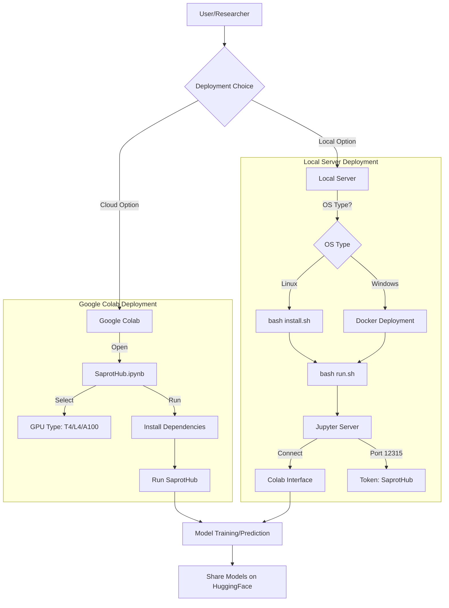
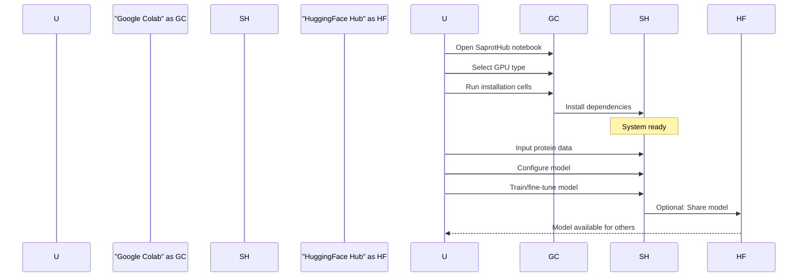
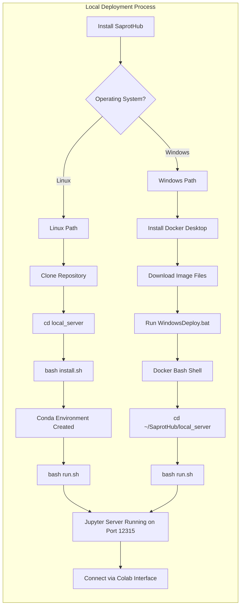
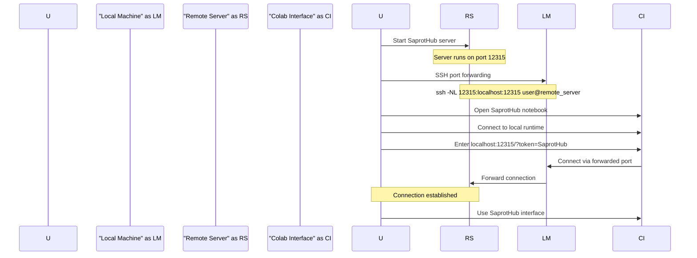
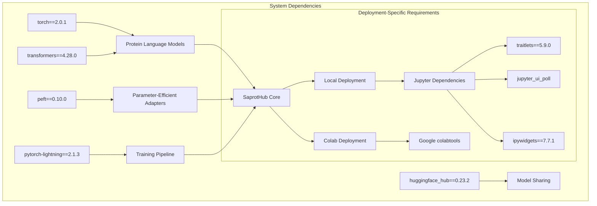

# Deployment Options

<details>
<summary>Relevant source files</summary>

The following files were used as context for generating this wiki page:

- [Figure/InstallPage1.png](Figure/InstallPage1.png)
- [Figure/InstallPage2.png](Figure/InstallPage2.png)
- [Figure/InstallPage3.png](Figure/InstallPage3.png)
- [local_server/README.md](local_server/README.md)
- [local_server/install.sh](local_server/install.sh)
- [local_server/requirements.txt](local_server/requirements.txt)
- [local_server/run.sh](local_server/run.sh)
- [requirements.txt](requirements.txt)

</details>


This page describes the different ways you can deploy and run SaprotHub. SaprotHub offers two primary deployment options: Google Colab for cloud-based execution and local server deployment for running on your own hardware. This documentation covers the setup, configuration, and considerations for each deployment method.

For information about using SaprotHub interfaces after deployment, see [ColabSaprot Interface](#2).

## Deployment Overview

SaprotHub is designed to be flexible in how it's deployed, accommodating different user needs and computational resources. Each deployment option offers specific advantages and limitations.



Sources:
- [local_server/README.md]()
- [local_server/run.sh]()
- [local_server/install.sh]()

## Google Colab Deployment

Google Colab deployment is the simplest way to get started with SaprotHub. It requires minimal setup and leverages Google's computing resources.

### Requirements

- Google account
- Internet connection
- Web browser

### Setup Process

1. Open the [SaprotHub.ipynb](https://colab.research.google.com/github/westlake-repl/SaprotHub/blob/main/colab/SaprotHub.ipynb) notebook in Google Colab
2. Select a GPU runtime type based on your needs (T4, L4, or A100)
3. Run the notebook cells to install dependencies
4. Continue with your protein modeling tasks

### Hardware Considerations

Different GPU types have varying performance characteristics:
- T4: Basic GPU for small models and datasets
- L4: Improved performance for medium-sized tasks
- A100: Best performance for large models and datasets



Sources:
- [requirements.txt]()

## Local Server Deployment

Local server deployment allows you to run SaprotHub on your own hardware, giving you more control over computational resources and data privacy.

### General Requirements

- Machine with sufficient CPU/GPU resources
- Python 3.10
- Conda environment manager

### Linux Deployment

The Linux deployment process uses bash scripts to simplify installation and execution.

#### Installation Steps

1. Clone the SaprotHub repository: `git clone https://github.com/westlake-repl/SaprotHub.git`
2. Navigate to the local server directory: `cd SaprotHub/local_server`
3. Run the installation script: `bash install.sh`

The installation script [local_server/install.sh]() performs the following operations:
- Creates a conda environment named "SaprotHub" with Python 3.10.15
- Creates cache directories
- Installs required tools including zip
- Clones and installs Google colabtools
- Installs Python dependencies from requirements.txt
- Overwrites specific files to enable the Colab interface

#### Running the Server

1. From the local_server directory, run: `bash run.sh`

The run script [local_server/run.sh]() performs these actions:
- Activates the SaprotHub conda environment
- Checks if the local cache version is up-to-date, updating if needed
- Starts a Jupyter notebook server on port 12315 with the token "SaprotHub"

### Windows Deployment

Windows deployment uses Docker to provide a consistent environment.

#### Installation Steps

1. Download **SaprotHubImage.tar** and **WindowsDeploy.bat** from [HuggingFace](https://huggingface.co/datasets/lxzcpro/SaprotHubWindowsDeploy/tree/main)
2. Install [Docker Desktop](https://desktop.docker.com/win/main/amd64/Docker%20Desktop%20Installer.exe) and start it
3. Run the WindowsDeploy.bat file to launch the Docker container

#### Running the Server

1. In the Docker container's bash shell, run:
```
cd ~/SaprotHub/local_server
bash run.sh
```



Sources:
- [local_server/README.md]()
- [local_server/install.sh]()
- [local_server/run.sh]()
- [local_server/requirements.txt]()

## Connecting to a Local Server

After setting up a local server, you need to connect to it to use SaprotHub.

### Connection Steps

1. Open the [SaprotHub.ipynb](https://colab.research.google.com/github/westlake-repl/SaprotHub/blob/main/colab/SaprotHub.ipynb) notebook in Google Colab
2. Click "Connect to a local runtime"
3. Enter the address: `http://localhost:12315/?token=SaprotHub`
4. The notebook will connect to your local server

### Remote Server Connection

If your server is running on a remote machine, you can use SSH port forwarding:

```
ssh -NL 12315:localhost:12315 user@remote_server
```

Then connect to `http://localhost:12315/?token=SaprotHub` as if the server were local.



Sources:
- [local_server/README.md]()

## Deployment Comparison

This table outlines the key differences between the deployment options to help you choose the best option for your needs:

| Feature | Google Colab | Local Server |
|---------|-------------|--------------|
| Setup Complexity | Low | Medium |
| Hardware Requirements | None (uses Google's GPUs) | Your own CPU/GPU |
| Data Privacy | Data resides on Google servers | Data stays on your hardware |
| Session Time Limits | Yes (colab timeouts) | No (run indefinitely) |
| Installation Process | Run notebook cells | Script-based installation |
| Cost | Free (with limitations) | Cost of your hardware |
| Scaling | Limited by Google's resources | Limited by your hardware |
| Internet Requirement | Constant connection needed | Only for initial setup and model sharing |

### When to Choose Each Option

- **Choose Google Colab when:**
  - You want a quick start with no setup
  - You don't have access to powerful GPUs
  - You're running short training sessions
  - You're new to SaprotHub
  
- **Choose Local Server when:**
  - You need longer training sessions
  - You have sensitive data
  - You have powerful hardware available
  - You need more control over the environment
  - You need to run many experiments

Sources:
- [local_server/README.md]()
- [requirements.txt]()
- [local_server/requirements.txt]()

## Environment and Dependencies

Both deployment options use similar core dependencies, but the local server has additional requirements to support the Jupyter interface.

### Core Dependencies

The core dependencies required for SaprotHub include:

```
numpy==1.26.4
torch==2.0.1
torchvision==0.15.2
torchaudio==2.0.2
transformers==4.28.0
huggingface_hub==0.23.2
peft==0.10.0
pytorch-lightning==2.1.3
```

### Local Server Additional Dependencies

The local server requires some additional dependencies to support the notebook interface:

```
traitlets==5.9.0
jupyter_ui_poll
ipywidgets==7.7.1
```



Sources:
- [requirements.txt]()
- [local_server/requirements.txt]()
- [local_server/install.sh]()

## Version Management

The local server deployment includes automatic version checking and updating to keep your installation current with the latest SaprotHub version.

### Update Mechanism

When you run `run.sh` in the local server, it:

1. Checks the current Git commit hash in the cache
2. Compares it with the remote repository
3. If different, pulls the latest changes and updates dependencies

This ensures you're always using the latest version of SaprotHub without manual intervention.

Sources:
- [local_server/run.sh:8-18]()

## Troubleshooting

### Google Colab Issues

- **Runtime disconnection**: Colab may disconnect after periods of inactivity. Save your work frequently.
- **GPU unavailability**: If GPUs are not available, try at a different time or choose a CPU runtime.

### Local Server Issues

- **Port already in use**: If port 12315 is already in use, modify the Jupyter configuration to use a different port.
- **Dependency conflicts**: Make sure you're using the conda environment created by the installation script.
- **Docker issues on Windows**: Ensure Docker Desktop is running before executing the deployment batch file.

### Connection Issues

- **Cannot connect to local server**: Verify the server is running and check for firewall restrictions.
- **SSH port forwarding issues**: Ensure your SSH connection is active and the correct ports are being forwarded.

Sources:
- [local_server/README.md]()
- [local_server/run.sh]()

## Summary

SaprotHub offers flexible deployment options to accommodate different user needs. The Google Colab deployment provides a quick start with minimal setup, while the local server deployment offers more control and can run for extended periods. Both methods access the same SaprotHub functionality, allowing you to train protein language models and share them with the community.

Choose the deployment option that best suits your hardware availability, data privacy requirements, and duration of training sessions.

---